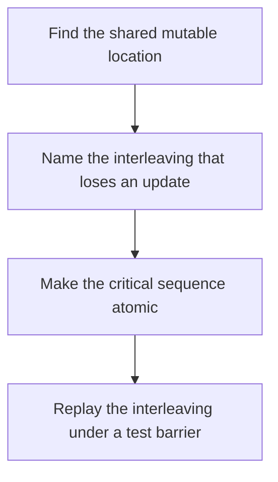

# D03-T008 — Race conditions

Topic ID: `D03-T008`
Domain: Operating Systems
Subdomain: Race conditions
Importance: core
Complexity: intermediate
Dependencies: `D03-T007`, `D03-T001`, `D01-T001`, `D01-T002`
Execution status of the code in section F: unexecuted

## A. Topic Overview

A race condition is a bug whose outcome depends on the timing of unsynchronized accesses, at least one of which writes. The read-modify-write of a counter is the classic case: two threads read the same value and both write value plus one, so one increment disappears. Data races are the language-level version. Logical races can exist even with atomic stores if the invariant spans two variables.

In production this shows up as follows: A balance update that reads a row, adds a deposit in the app, and writes the row back loses money when two deposits interleave. The fix is a single SQL update or a transaction, not a hope.

Interviewers use Race conditions to see whether you can state the failure mode, not only the definition. The failure to name is: lost updates or torn reads that disappear when you add logging and change the timing

Prerequisites: `D03-T007`, `D03-T001`, `D01-T001`, `D01-T002`. Later notes should link here instead of repeating the mechanism.

## B. First-Principles Explanation

A race condition is a bug whose outcome depends on the timing of unsynchronized accesses, at least one of which writes. The read-modify-write of a counter is the classic case: two threads read the same value and both write value plus one, so one increment disappears. Data races are the language-level version. Logical races can exist even with atomic stores if the invariant spans two variables.

The useful picture is: Two people editing the same line of a shared document without merging will overwrite each other.

What has to be true:

1. Find the shared mutable location
2. Name the interleaving that loses an update
3. Make the critical sequence atomic
4. Replay the interleaving under a test barrier

It works when those steps preserve one invariant. It fails when lost updates or torn reads that disappear when you add logging and change the timing. The alternative is: the state is immutable or confined to one thread, so there is nothing to race

## C. Internal Working and Architecture

Components involved: the caller, the state Race conditions mutates or reads, and the observer that reports a stress test that fails without the lock and passes with it, counted as lost increments.

Execution:

1. Find the shared mutable location
2. Name the interleaving that loses an update
3. Make the critical sequence atomic
4. Replay the interleaving under a test barrier

Data moves only along that path. A retry re-enters at step 1, so the operation must say what a duplicate does. Memory and locks stay inside this mechanism. Callers see the result or a typed error, not a half-updated invariant.

State to remember: choose this when two actors can touch the same mutable state. Do not choose it when the state is immutable or confined to one thread, so there is nothing to race.

## D. Diagrams and Visual Models



Read the diagram from top to bottom. Each box is one step of Race conditions. The failure mode (lost updates or torn reads that disappear when you add logging and change the timing) is what you look for when a later box never happens or happens twice.

## E. Examples and Analogies

Analogy: Two people editing the same line of a shared document without merging will overwrite each other.

Production example: A balance update that reads a row, adds a deposit in the app, and writes the row back loses money when two deposits interleave. The fix is a single SQL update or a transaction, not a hope.

A small counterexample is enough in an interview. Show the input, apply the steps, and show the broken outcome if someone uses the mechanism outside its rule: lost updates or torn reads that disappear when you add logging and change the timing.

## F. Code Examples

The snippet is labeled unexecuted. It illustrates the shape of the idea. It is not a benchmark and it embeds no secret.

```python
import threading
counter = 0
lock = threading.Lock()

def increment():
    global counter
    with lock:
        counter += 1
```

After the snippet, check a stress test that fails without the lock and passes with it, counted as lost increments. If that signal moves the wrong way, the snippet is the wrong tool for the workload.

## G. Practical Backend Application

Use Race conditions in a service when two actors can touch the same mutable state.

A typical place is the production case already stated: A balance update that reads a row, adds a deposit in the app, and writes the row back loses money when two deposits interleave. The fix is a single SQL update or a transaction, not a hope.

Operationally you alert on a stress test that fails without the lock and passes with it, counted as lost increments. You do not alert only on process uptime. The dashboard should show the failure mode, a success rate, and the saturation signal (queue depth, lock wait, or latency) that predicts it.

## H. Advantages, Limitations and Trade-offs

| Choice | Benefit | Cost | Choose when | Avoid when |
| --- | --- | --- | --- | --- |
| Apply Race conditions | two actors can touch the same mutable state | Extra moving parts and a new failure mode | The failure you are preventing is already real | the state is immutable or confined to one thread, so there is nothing to race |
| Simpler alternative | Less code and fewer dependencies | lost updates or torn reads that disappear when you add logging and change the timing | The workload does not hit the limit | The invariant must hold under concurrency or failure |

Race conditions is a trade. State the benefit and the cost in the same sentence when you propose it in a design review.

## I. Common Mistakes and Misconceptions

- Adding a lock around only the write.
- Calling a bug a race without naming the interleaving.
- Using a lock in the app and a separate read-modify-write in SQL.
- Treating a diagram of Race conditions as proof that the invariant holds in production.
- Copying a default configuration without naming a stress test that fails without the lock and passes with it, counted as lost increments.

## J. Debugging and Troubleshooting

Symptom: lost updates or torn reads that disappear when you add logging and change the timing

First check: a stress test that fails without the lock and passes with it, counted as lost increments.

Then compare one healthy instance against one unhealthy instance. Confirm whether retries are duplicating work. Confirm whether a timeout is shorter than the work. Fix the invariant, then watch the same metric for a full peak, not only for the next minute.

Useful questions: did the step order in section C actually happen, or did a caller skip a step? Did a deploy change the data shape that Race conditions assumes?

## K. Interview Preparation

### Beginner

#### Q1. What problem does Race conditions solve?

**Answer:** A race condition is a bug whose outcome depends on the timing of unsynchronized accesses, at least one of which writes. The read-modify-write of a counter is the classic case: two threads read the same value and both write value plus one, so one increment disappears. Data races are the language-level version. Logical races can exist even with atomic stores if the invariant spans two variables. Without it, the usual backend failure is: lost updates or torn reads that disappear when you add logging and change the timing.

#### Q2. Where does Race conditions sit on a request path?

**Answer:** Race conditions is not a library you sprinkle on every call. two actors can touch the same mutable state You notice it when a stress test that fails without the lock and passes with it, counted as lost increments. Name the constraint that makes this choice correct. Say what you would measure to confirm it.

#### Q3. Give a concrete example of Race conditions.

**Answer:** A balance update that reads a row, adds a deposit in the app, and writes the row back loses money when two deposits interleave. The fix is a single SQL update or a transaction, not a hope. Walk the input, the state change, and the observable output. Name the constraint that makes this choice correct.

#### Q4. What is a common mix-up around Race conditions?

**Answer:** lost updates or torn reads that disappear when you add logging and change the timing The corrective check is a stress test that fails without the lock and passes with it, counted as lost increments. Name the constraint that makes this choice correct. Say what you would measure to confirm it. Say which alternative you rejected and why.

#### Q5. When would you skip Race conditions?

**Answer:** the state is immutable or confined to one thread, so there is nothing to race Skipping is a decision with a measured cost, not a slogan. Name the constraint that makes this choice correct. Say what you would measure to confirm it. Say which alternative you rejected and why.

### Intermediate

#### Q1. What invariant makes Race conditions correct?

**Answer:** A race condition is a bug whose outcome depends on the timing of unsynchronized accesses, at least one of which writes. The read-modify-write of a counter is the classic case: two threads read the same value and both write value plus one, so one increment disappears. Data races are the language-level version. Logical races can exist even with atomic stores if the invariant spans two variables. State the invariant before you name the tool.

#### Q2. How do you test Race conditions?

**Answer:** Assert the failure mode directly: lost updates or torn reads that disappear when you add logging and change the timing. The assertion should watch a stress test that fails without the lock and passes with it, counted as lost increments. Include a concurrent or retry case if the bug only appears then. Name the constraint that makes this choice correct.

#### Q3. What signal tells you Race conditions is misbehaving in production?

**Answer:** Watch a stress test that fails without the lock and passes with it, counted as lost increments. The user-visible symptom is usually lost updates or torn reads that disappear when you add logging and change the timing. Name the constraint that makes this choice correct. Say what you would measure to confirm it.

#### Q4. How would you introduce Race conditions into a legacy service?

**Answer:** two actors can touch the same mutable state Ship it behind a metric so you can compare the old path. Roll back if lost updates or torn reads that disappear when you add logging and change the timing gets worse. Name the constraint that makes this choice correct. Say what you would measure to confirm it.

#### Q5. What do you trade away by choosing Race conditions?

**Answer:** two actors can touch the same mutable state the state is immutable or confined to one thread, so there is nothing to race Say the cost in latency, storage, or operational load. Name the constraint that makes this choice correct. Say what you would measure to confirm it. Say which alternative you rejected and why.

### Advanced

#### Q1. What breaks if a dependency of Race conditions is slow or down?

**Answer:** lost updates or torn reads that disappear when you add logging and change the timing Degrade using the rule: the state is immutable or confined to one thread, so there is nothing to race. Timeouts must be shorter than the caller's deadline. Name the constraint that makes this choice correct. Say what you would measure to confirm it.

#### Q2. How does Race conditions behave under retries?

**Answer:** Retries repeat work, so Race conditions must define what a duplicate does. lost updates or torn reads that disappear when you add logging and change the timing Idempotency keys or fences belong next to the write, not in a comment. Name the constraint that makes this choice correct. Say what you would measure to confirm it.

#### Q3. What is the capacity limit of Race conditions?

**Answer:** The limit shows up as a stress test that fails without the lock and passes with it, counted as lost increments. Add capacity only after you know whether the bottleneck is CPU, lock wait, or network. Name the constraint that makes this choice correct. Say what you would measure to confirm it.

#### Q4. How do you evolve Race conditions without a flag day?

**Answer:** two actors can touch the same mutable state Version the contract or the on-disk format. Readers should tolerate one old and one new shape during the rollout. Name the constraint that makes this choice correct. Say what you would measure to confirm it.

#### Q5. What security or correctness bug hides inside Race conditions?

**Answer:** lost updates or torn reads that disappear when you add logging and change the timing Check authorization and tenancy at the same boundary as the mechanism. A cache or queue must not widen who can read the data. Name the constraint that makes this choice correct. Say what you would measure to confirm it.

### Scenario

#### Q1. Incident: lost updates or torn reads that disappear when you add logging and change the timing. What do you check first?

**Answer:** Start with a stress test that fails without the lock and passes with it, counted as lost increments. Compare a good host and a bad host before you restart anything. A race condition is a bug whose outcome depends on the timing of unsynchronized accesses, at least one of which writes. The read-modify-write of a counter is the classic case: two threads read the same value and both write value plus one, so one increment disappears. Data races are the language-level version. Logical races can exist even with atomic stores if the invariant spans two variables.

#### Q2. A reviewer wants the clever version. What data settles it?

**Answer:** two actors can touch the same mutable state the state is immutable or confined to one thread, so there is nothing to race Bring a stress test that fails without the lock and passes with it, counted as lost increments from a load test or from production, not a slogan. Name the constraint that makes this choice correct. Say what you would measure to confirm it. Say which alternative you rejected and why.

#### Q3. You have one hour to explain Race conditions at a whiteboard.

**Answer:** Draw the happy path in four boxes. Then draw the failure: lost updates or torn reads that disappear when you add logging and change the timing. End with the metric you would page on. Name the constraint that makes this choice correct.

#### Q4. The bug only appears under two concurrent callers.

**Answer:** lost updates or torn reads that disappear when you add logging and change the timing Reproduce with a barrier so both sides enter the critical window. Confirm the fix with a stress test that fails without the lock and passes with it, counted as lost increments. Name the constraint that makes this choice correct. Say what you would measure to confirm it.

#### Q5. Leadership wants this on every service next week.

**Answer:** the state is immutable or confined to one thread, so there is nothing to race two actors can touch the same mutable state Roll it out where the failure mode is already hurting users. Name the constraint that makes this choice correct. Say what you would measure to confirm it. Say which alternative you rejected and why.

### Follow-up

#### Q1. What did you assume about the data size or the clock?

**Answer:** A race condition is a bug whose outcome depends on the timing of unsynchronized accesses, at least one of which writes. The read-modify-write of a counter is the classic case: two threads read the same value and both write value plus one, so one increment disappears. Data races are the language-level version. Logical races can exist even with atomic stores if the invariant spans two variables. Clocks are not a total order across machines. State whether the algorithm needs bounded size or a single leader.

#### Q2. What would you measure after the change ships?

**Answer:** Page on a stress test that fails without the lock and passes with it, counted as lost increments. Keep a before/after dashboard for one week. Alert on the failure mode, not only on CPU. Name the constraint that makes this choice correct.

#### Q3. Which neighboring topic did you deliberately not re-teach?

**Answer:** This note owns Race conditions. Related identifiers are in section N. Shared ideas are linked, not copied. Name the constraint that makes this choice correct.

## L. Practical Exercises

Solutions are in `EXERCISES/solutions/D03-T008.md`, not in this section.

1. Whiteboard the four steps of Race conditions and mark where `lost updates or torn reads that disappear when you add logging and change the timing` enters.
2. Read the snippet in section F and write the assertion that would catch that failure. The assertion must mention `a stress test that fails without the lock and passes with it, counted as lost increments`.
3. Argue for or against using Race conditions on a service you know. Use the choose and avoid rows from section H. Do not appeal to popularity.

## M. Revision Notes

- Mechanism: A race condition is a bug whose outcome depends on the timing of unsynchronized accesses, at least one of which writes.
- Failure: lost updates or torn reads that disappear when you add logging and change the timing
- Metric: a stress test that fails without the lock and passes with it, counted as lost increments
- Choose when: two actors can touch the same mutable state
- Avoid when: the state is immutable or confined to one thread, so there is nothing to race

## N. Related Topics

Dependencies to review first: `D03-T007`, `D03-T001`, `D01-T001`, `D01-T002`.

Shared ideas stay in those notes. This note does not restate them.

## O. Completion Criteria

- You can explain Race conditions without reading this note, including the failure mode.
- You can draw the diagram in section D from memory.
- You can say when not to use it, using the avoid condition in section H.
- You can name the metric you would watch after shipping it.
