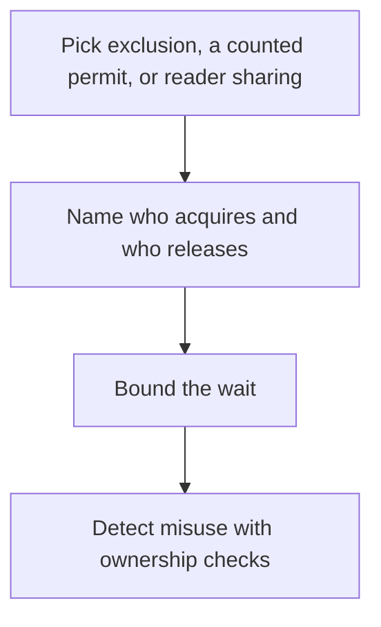

# D03-T010 — Mutexes, semaphores, read-write locks

Topic ID: `D03-T010`
Domain: Operating Systems
Subdomain: Mutexes, semaphores, read-write locks
Importance: core
Complexity: intermediate
Dependencies: `D03-T009`, `D03-T001`, `D01-T001`, `D01-T002`
Execution status of the code in section F: unexecuted

## A. Topic Overview

A mutex gives exclusive ownership of a critical section to one holder. A semaphore counts permits and can allow a fixed number of concurrent entrants. A read-write lock allows either many readers or one writer. None of them chooses lock order for you. A mutex is not a semaphore you happened to initialize to one if the API allows an extra release.

In production this shows up as follows: A pool of four outbound HTTP calls uses a semaphore of four. Using a mutex there serializes throughput. Using an unbounded thread per call exhausts file descriptors.

Interviewers use Mutexes, semaphores, read-write locks to see whether you can state the failure mode, not only the definition. The failure to name is: a semaphore released once too often, or a writer starved by a continuous stream of readers

Prerequisites: `D03-T009`, `D03-T001`, `D01-T001`, `D01-T002`. Later notes should link here instead of repeating the mechanism.

## B. First-Principles Explanation

A mutex gives exclusive ownership of a critical section to one holder. A semaphore counts permits and can allow a fixed number of concurrent entrants. A read-write lock allows either many readers or one writer. None of them chooses lock order for you. A mutex is not a semaphore you happened to initialize to one if the API allows an extra release.

The useful picture is: A mutex is one bathroom key. A semaphore is a stack of four keys. A read-write lock is a library room that is either full of readers or closed for one writer.

What has to be true:

1. Pick exclusion, a counted permit, or reader sharing
2. Name who acquires and who releases
3. Bound the wait
4. Detect misuse with ownership checks

It works when those steps preserve one invariant. It fails when a semaphore released once too often, or a writer starved by a continuous stream of readers. The alternative is: the resource is already serialized by the database or by a single-threaded event loop

## C. Internal Working and Architecture

Components involved: the caller, the state Mutexes, semaphores, read-write locks mutates or reads, and the observer that reports wait time per acquire, permit count, and writer starvation time.

Execution:

1. Pick exclusion, a counted permit, or reader sharing
2. Name who acquires and who releases
3. Bound the wait
4. Detect misuse with ownership checks

Data moves only along that path. A retry re-enters at step 1, so the operation must say what a duplicate does. Memory and locks stay inside this mechanism. Callers see the result or a typed error, not a half-updated invariant.

State to remember: choose this when you need exclusion, a concurrency cap, or shared readers with rare writers. Do not choose it when the resource is already serialized by the database or by a single-threaded event loop.

## D. Diagrams and Visual Models



Read the diagram from top to bottom. Each box is one step of Mutexes, semaphores, read-write locks. The failure mode (a semaphore released once too often, or a writer starved by a continuous stream of readers) is what you look for when a later box never happens or happens twice.

## E. Examples and Analogies

Analogy: A mutex is one bathroom key. A semaphore is a stack of four keys. A read-write lock is a library room that is either full of readers or closed for one writer.

Production example: A pool of four outbound HTTP calls uses a semaphore of four. Using a mutex there serializes throughput. Using an unbounded thread per call exhausts file descriptors.

A small counterexample is enough in an interview. Show the input, apply the steps, and show the broken outcome if someone uses the mechanism outside its rule: a semaphore released once too often, or a writer starved by a continuous stream of readers.

## F. Code Examples

The snippet is labeled unexecuted. It illustrates the shape of the idea. It is not a benchmark and it embeds no secret.

```python
import threading
mutex = threading.Lock()
semaphores = threading.Semaphore(4)
rw = threading.RLock()
```

After the snippet, check wait time per acquire, permit count, and writer starvation time. If that signal moves the wrong way, the snippet is the wrong tool for the workload.

## G. Practical Backend Application

Use Mutexes, semaphores, read-write locks in a service when you need exclusion, a concurrency cap, or shared readers with rare writers.

A typical place is the production case already stated: A pool of four outbound HTTP calls uses a semaphore of four. Using a mutex there serializes throughput. Using an unbounded thread per call exhausts file descriptors.

Operationally you alert on wait time per acquire, permit count, and writer starvation time. You do not alert only on process uptime. The dashboard should show the failure mode, a success rate, and the saturation signal (queue depth, lock wait, or latency) that predicts it.

## H. Advantages, Limitations and Trade-offs

| Choice | Benefit | Cost | Choose when | Avoid when |
| --- | --- | --- | --- | --- |
| Apply Mutexes, semaphores, read-write locks | you need exclusion, a concurrency cap, or shared readers with rare writers | Extra moving parts and a new failure mode | The failure you are preventing is already real | the resource is already serialized by the database or by a single-threaded event loop |
| Simpler alternative | Less code and fewer dependencies | a semaphore released once too often, or a writer starved by a continuous stream of readers | The workload does not hit the limit | The invariant must hold under concurrency or failure |

Mutexes, semaphores, read-write locks is a trade. State the benefit and the cost in the same sentence when you propose it in a design review.

## I. Common Mistakes and Misconceptions

- Unlocking a mutex from another thread where the runtime forbids it.
- Using a read-write lock for a write-heavy map.
- Treating semaphore release as idempotent.
- Treating a diagram of Mutexes, semaphores, read-write locks as proof that the invariant holds in production.
- Copying a default configuration without naming wait time per acquire, permit count, and writer starvation time.

## J. Debugging and Troubleshooting

Symptom: a semaphore released once too often, or a writer starved by a continuous stream of readers

First check: wait time per acquire, permit count, and writer starvation time.

Then compare one healthy instance against one unhealthy instance. Confirm whether retries are duplicating work. Confirm whether a timeout is shorter than the work. Fix the invariant, then watch the same metric for a full peak, not only for the next minute.

Useful questions: did the step order in section C actually happen, or did a caller skip a step? Did a deploy change the data shape that Mutexes, semaphores, read-write locks assumes?

## K. Interview Preparation

### Beginner

#### Q1. What problem does Mutexes, semaphores, read-write locks solve?

**Answer:** A mutex gives exclusive ownership of a critical section to one holder. A semaphore counts permits and can allow a fixed number of concurrent entrants. A read-write lock allows either many readers or one writer. None of them chooses lock order for you. A mutex is not a semaphore you happened to initialize to one if the API allows an extra release. Without it, the usual backend failure is: a semaphore released once too often, or a writer starved by a continuous stream of readers.

#### Q2. Where does Mutexes, semaphores, read-write locks sit on a request path?

**Answer:** Mutexes, semaphores, read-write locks is not a library you sprinkle on every call. you need exclusion, a concurrency cap, or shared readers with rare writers You notice it when wait time per acquire, permit count, and writer starvation time. Name the constraint that makes this choice correct. Say what you would measure to confirm it.

#### Q3. Give a concrete example of Mutexes, semaphores, read-write locks.

**Answer:** A pool of four outbound HTTP calls uses a semaphore of four. Using a mutex there serializes throughput. Using an unbounded thread per call exhausts file descriptors. Walk the input, the state change, and the observable output.

#### Q4. What is a common mix-up around Mutexes, semaphores, read-write locks?

**Answer:** a semaphore released once too often, or a writer starved by a continuous stream of readers The corrective check is wait time per acquire, permit count, and writer starvation time. Name the constraint that makes this choice correct. Say what you would measure to confirm it. Say which alternative you rejected and why.

#### Q5. When would you skip Mutexes, semaphores, read-write locks?

**Answer:** the resource is already serialized by the database or by a single-threaded event loop Skipping is a decision with a measured cost, not a slogan. Name the constraint that makes this choice correct. Say what you would measure to confirm it. Say which alternative you rejected and why.

### Intermediate

#### Q1. What invariant makes Mutexes, semaphores, read-write locks correct?

**Answer:** A mutex gives exclusive ownership of a critical section to one holder. A semaphore counts permits and can allow a fixed number of concurrent entrants. A read-write lock allows either many readers or one writer. None of them chooses lock order for you. A mutex is not a semaphore you happened to initialize to one if the API allows an extra release. State the invariant before you name the tool.

#### Q2. How do you test Mutexes, semaphores, read-write locks?

**Answer:** Assert the failure mode directly: a semaphore released once too often, or a writer starved by a continuous stream of readers. The assertion should watch wait time per acquire, permit count, and writer starvation time. Include a concurrent or retry case if the bug only appears then. Name the constraint that makes this choice correct.

#### Q3. What signal tells you Mutexes, semaphores, read-write locks is misbehaving in production?

**Answer:** Watch wait time per acquire, permit count, and writer starvation time. The user-visible symptom is usually a semaphore released once too often, or a writer starved by a continuous stream of readers. Name the constraint that makes this choice correct. Say what you would measure to confirm it.

#### Q4. How would you introduce Mutexes, semaphores, read-write locks into a legacy service?

**Answer:** you need exclusion, a concurrency cap, or shared readers with rare writers Ship it behind a metric so you can compare the old path. Roll back if a semaphore released once too often, or a writer starved by a continuous stream of readers gets worse. Name the constraint that makes this choice correct. Say what you would measure to confirm it.

#### Q5. What do you trade away by choosing Mutexes, semaphores, read-write locks?

**Answer:** you need exclusion, a concurrency cap, or shared readers with rare writers the resource is already serialized by the database or by a single-threaded event loop Say the cost in latency, storage, or operational load. Name the constraint that makes this choice correct. Say what you would measure to confirm it. Say which alternative you rejected and why.

### Advanced

#### Q1. What breaks if a dependency of Mutexes, semaphores, read-write locks is slow or down?

**Answer:** a semaphore released once too often, or a writer starved by a continuous stream of readers Degrade using the rule: the resource is already serialized by the database or by a single-threaded event loop. Timeouts must be shorter than the caller's deadline. Name the constraint that makes this choice correct. Say what you would measure to confirm it.

#### Q2. How does Mutexes, semaphores, read-write locks behave under retries?

**Answer:** Retries repeat work, so Mutexes, semaphores, read-write locks must define what a duplicate does. a semaphore released once too often, or a writer starved by a continuous stream of readers Idempotency keys or fences belong next to the write, not in a comment. Name the constraint that makes this choice correct. Say what you would measure to confirm it.

#### Q3. What is the capacity limit of Mutexes, semaphores, read-write locks?

**Answer:** The limit shows up as wait time per acquire, permit count, and writer starvation time. Add capacity only after you know whether the bottleneck is CPU, lock wait, or network. Name the constraint that makes this choice correct. Say what you would measure to confirm it.

#### Q4. How do you evolve Mutexes, semaphores, read-write locks without a flag day?

**Answer:** you need exclusion, a concurrency cap, or shared readers with rare writers Version the contract or the on-disk format. Readers should tolerate one old and one new shape during the rollout. Name the constraint that makes this choice correct. Say what you would measure to confirm it.

#### Q5. What security or correctness bug hides inside Mutexes, semaphores, read-write locks?

**Answer:** a semaphore released once too often, or a writer starved by a continuous stream of readers Check authorization and tenancy at the same boundary as the mechanism. A cache or queue must not widen who can read the data. Name the constraint that makes this choice correct. Say what you would measure to confirm it.

### Scenario

#### Q1. Incident: a semaphore released once too often, or a writer starved by a continuous stream of readers. What do you check first?

**Answer:** Start with wait time per acquire, permit count, and writer starvation time. Compare a good host and a bad host before you restart anything. A mutex gives exclusive ownership of a critical section to one holder. A semaphore counts permits and can allow a fixed number of concurrent entrants. A read-write lock allows either many readers or one writer. None of them chooses lock order for you. A mutex is not a semaphore you happened to initialize to one if the API allows an extra release.

#### Q2. A reviewer wants the clever version. What data settles it?

**Answer:** you need exclusion, a concurrency cap, or shared readers with rare writers the resource is already serialized by the database or by a single-threaded event loop Bring wait time per acquire, permit count, and writer starvation time from a load test or from production, not a slogan. Name the constraint that makes this choice correct. Say what you would measure to confirm it. Say which alternative you rejected and why.

#### Q3. You have one hour to explain Mutexes, semaphores, read-write locks at a whiteboard.

**Answer:** Draw the happy path in four boxes. Then draw the failure: a semaphore released once too often, or a writer starved by a continuous stream of readers. End with the metric you would page on. Name the constraint that makes this choice correct.

#### Q4. The bug only appears under two concurrent callers.

**Answer:** a semaphore released once too often, or a writer starved by a continuous stream of readers Reproduce with a barrier so both sides enter the critical window. Confirm the fix with wait time per acquire, permit count, and writer starvation time. Name the constraint that makes this choice correct. Say what you would measure to confirm it.

#### Q5. Leadership wants this on every service next week.

**Answer:** the resource is already serialized by the database or by a single-threaded event loop you need exclusion, a concurrency cap, or shared readers with rare writers Roll it out where the failure mode is already hurting users. Name the constraint that makes this choice correct. Say what you would measure to confirm it. Say which alternative you rejected and why.

### Follow-up

#### Q1. What did you assume about the data size or the clock?

**Answer:** A mutex gives exclusive ownership of a critical section to one holder. A semaphore counts permits and can allow a fixed number of concurrent entrants. A read-write lock allows either many readers or one writer. None of them chooses lock order for you. A mutex is not a semaphore you happened to initialize to one if the API allows an extra release. Clocks are not a total order across machines. State whether the algorithm needs bounded size or a single leader.

#### Q2. What would you measure after the change ships?

**Answer:** Page on wait time per acquire, permit count, and writer starvation time. Keep a before/after dashboard for one week. Alert on the failure mode, not only on CPU. Name the constraint that makes this choice correct.

#### Q3. Which neighboring topic did you deliberately not re-teach?

**Answer:** This note owns Mutexes, semaphores, read-write locks. Related identifiers are in section N. Shared ideas are linked, not copied. Name the constraint that makes this choice correct.

## L. Practical Exercises

Solutions are in `EXERCISES/solutions/D03-T010.md`, not in this section.

1. Whiteboard the four steps of Mutexes, semaphores, read-write locks and mark where `a semaphore released once too often, or a writer starved by a continuous stream of readers` enters.
2. Read the snippet in section F and write the assertion that would catch that failure. The assertion must mention `wait time per acquire, permit count, and writer starvation time`.
3. Argue for or against using Mutexes, semaphores, read-write locks on a service you know. Use the choose and avoid rows from section H. Do not appeal to popularity.

## M. Revision Notes

- Mechanism: A mutex gives exclusive ownership of a critical section to one holder.
- Failure: a semaphore released once too often, or a writer starved by a continuous stream of readers
- Metric: wait time per acquire, permit count, and writer starvation time
- Choose when: you need exclusion, a concurrency cap, or shared readers with rare writers
- Avoid when: the resource is already serialized by the database or by a single-threaded event loop

## N. Related Topics

Dependencies to review first: `D03-T009`, `D03-T001`, `D01-T001`, `D01-T002`.

Shared ideas stay in those notes. This note does not restate them.

## O. Completion Criteria

- You can explain Mutexes, semaphores, read-write locks without reading this note, including the failure mode.
- You can draw the diagram in section D from memory.
- You can say when not to use it, using the avoid condition in section H.
- You can name the metric you would watch after shipping it.
