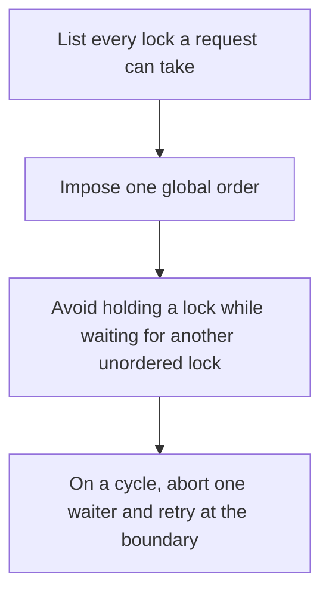

# D03-T011 — Deadlocks: prevention, detection, recovery

Topic ID: `D03-T011`
Domain: Operating Systems
Subdomain: Deadlocks: prevention, detection, recovery
Importance: core
Complexity: intermediate
Dependencies: `D03-T010`, `D03-T001`, `D01-T001`, `D01-T002`
Execution status of the code in section F: unexecuted

## A. Topic Overview

A deadlock is a cycle of actors each waiting for a resource another holds. Prevention breaks one Coffman condition, usually by acquiring locks in a global order or by using try-lock with backoff. Detection waits for a cycle in the wait-for graph and aborts one waiter. Recovery rolls back the victim's work. A lock timeout is a crude detector, not a proof you are deadlock-free.

In production this shows up as follows: Transferring money from account A to B and from B to A deadlocks if each transaction locks the source first. Locking by account id order removes the cycle.

Interviewers use Deadlocks: prevention, detection, recovery to see whether you can state the failure mode, not only the definition. The failure to name is: two transactions lock rows in opposite orders and wait forever, or a timeout retry storms the database

Prerequisites: `D03-T010`, `D03-T001`, `D01-T001`, `D01-T002`. Later notes should link here instead of repeating the mechanism.

## B. First-Principles Explanation

A deadlock is a cycle of actors each waiting for a resource another holds. Prevention breaks one Coffman condition, usually by acquiring locks in a global order or by using try-lock with backoff. Detection waits for a cycle in the wait-for graph and aborts one waiter. Recovery rolls back the victim's work. A lock timeout is a crude detector, not a proof you are deadlock-free.

The useful picture is: Two people in a hallway each step aside in a different direction and block each other. Agreeing on one direction prevents it.

What has to be true:

1. List every lock a request can take
2. Impose one global order
3. Avoid holding a lock while waiting for another unordered lock
4. On a cycle, abort one waiter and retry at the boundary

It works when those steps preserve one invariant. It fails when two transactions lock rows in opposite orders and wait forever, or a timeout retry storms the database. The alternative is: you can take all resources in one ordered batch, or use a single lock

## C. Internal Working and Architecture

Components involved: the caller, the state Deadlocks: prevention, detection, recovery mutates or reads, and the observer that reports lock-wait timeouts and deadlock rollback counters from the database.

Execution:

1. List every lock a request can take
2. Impose one global order
3. Avoid holding a lock while waiting for another unordered lock
4. On a cycle, abort one waiter and retry at the boundary

Data moves only along that path. A retry re-enters at step 1, so the operation must say what a duplicate does. Memory and locks stay inside this mechanism. Callers see the result or a typed error, not a half-updated invariant.

State to remember: choose this when a request can hold one lock and wait for another. Do not choose it when you can take all resources in one ordered batch, or use a single lock.

## D. Diagrams and Visual Models



Read the diagram from top to bottom. Each box is one step of Deadlocks: prevention, detection, recovery. The failure mode (two transactions lock rows in opposite orders and wait forever, or a timeout retry storms the database) is what you look for when a later box never happens or happens twice.

## E. Examples and Analogies

Analogy: Two people in a hallway each step aside in a different direction and block each other. Agreeing on one direction prevents it.

Production example: Transferring money from account A to B and from B to A deadlocks if each transaction locks the source first. Locking by account id order removes the cycle.

A small counterexample is enough in an interview. Show the input, apply the steps, and show the broken outcome if someone uses the mechanism outside its rule: two transactions lock rows in opposite orders and wait forever, or a timeout retry storms the database.

## F. Code Examples

The snippet is labeled unexecuted. It illustrates the shape of the idea. It is not a benchmark and it embeds no secret.

```python
def ordered(locks):
    return sorted(locks, key=id)
```

After the snippet, check lock-wait timeouts and deadlock rollback counters from the database. If that signal moves the wrong way, the snippet is the wrong tool for the workload.

## G. Practical Backend Application

Use Deadlocks: prevention, detection, recovery in a service when a request can hold one lock and wait for another.

A typical place is the production case already stated: Transferring money from account A to B and from B to A deadlocks if each transaction locks the source first. Locking by account id order removes the cycle.

Operationally you alert on lock-wait timeouts and deadlock rollback counters from the database. You do not alert only on process uptime. The dashboard should show the failure mode, a success rate, and the saturation signal (queue depth, lock wait, or latency) that predicts it.

## H. Advantages, Limitations and Trade-offs

| Choice | Benefit | Cost | Choose when | Avoid when |
| --- | --- | --- | --- | --- |
| Apply Deadlocks: prevention, detection, recovery | a request can hold one lock and wait for another | Extra moving parts and a new failure mode | The failure you are preventing is already real | you can take all resources in one ordered batch, or use a single lock |
| Simpler alternative | Less code and fewer dependencies | two transactions lock rows in opposite orders and wait forever, or a timeout retry storms the database | The workload does not hit the limit | The invariant must hold under concurrency or failure |

Deadlocks: prevention, detection, recovery is a trade. State the benefit and the cost in the same sentence when you propose it in a design review.

## I. Common Mistakes and Misconceptions

- Detecting deadlocks in production instead of ordering locks.
- Retrying a deadlock without a bound.
- Locking in UI or map iteration order.
- Treating a diagram of Deadlocks: prevention, detection, recovery as proof that the invariant holds in production.
- Copying a default configuration without naming lock-wait timeouts and deadlock rollback counters from the database.

## J. Debugging and Troubleshooting

Symptom: two transactions lock rows in opposite orders and wait forever, or a timeout retry storms the database

First check: lock-wait timeouts and deadlock rollback counters from the database.

Then compare one healthy instance against one unhealthy instance. Confirm whether retries are duplicating work. Confirm whether a timeout is shorter than the work. Fix the invariant, then watch the same metric for a full peak, not only for the next minute.

Useful questions: did the step order in section C actually happen, or did a caller skip a step? Did a deploy change the data shape that Deadlocks: prevention, detection, recovery assumes?

## K. Interview Preparation

### Beginner

#### Q1. What problem does Deadlocks: prevention, detection, recovery solve?

**Answer:** A deadlock is a cycle of actors each waiting for a resource another holds. Prevention breaks one Coffman condition, usually by acquiring locks in a global order or by using try-lock with backoff. Detection waits for a cycle in the wait-for graph and aborts one waiter. Recovery rolls back the victim's work. A lock timeout is a crude detector, not a proof you are deadlock-free. Without it, the usual backend failure is: two transactions lock rows in opposite orders and wait forever, or a timeout retry storms the database.

#### Q2. Where does Deadlocks: prevention, detection, recovery sit on a request path?

**Answer:** Deadlocks: prevention, detection, recovery is not a library you sprinkle on every call. a request can hold one lock and wait for another You notice it when lock-wait timeouts and deadlock rollback counters from the database. Name the constraint that makes this choice correct. Say what you would measure to confirm it.

#### Q3. Give a concrete example of Deadlocks: prevention, detection, recovery.

**Answer:** Transferring money from account A to B and from B to A deadlocks if each transaction locks the source first. Locking by account id order removes the cycle. Walk the input, the state change, and the observable output. Name the constraint that makes this choice correct.

#### Q4. What is a common mix-up around Deadlocks: prevention, detection, recovery?

**Answer:** two transactions lock rows in opposite orders and wait forever, or a timeout retry storms the database The corrective check is lock-wait timeouts and deadlock rollback counters from the database. Name the constraint that makes this choice correct. Say what you would measure to confirm it. Say which alternative you rejected and why.

#### Q5. When would you skip Deadlocks: prevention, detection, recovery?

**Answer:** you can take all resources in one ordered batch, or use a single lock Skipping is a decision with a measured cost, not a slogan. Name the constraint that makes this choice correct. Say what you would measure to confirm it. Say which alternative you rejected and why.

### Intermediate

#### Q1. What invariant makes Deadlocks: prevention, detection, recovery correct?

**Answer:** A deadlock is a cycle of actors each waiting for a resource another holds. Prevention breaks one Coffman condition, usually by acquiring locks in a global order or by using try-lock with backoff. Detection waits for a cycle in the wait-for graph and aborts one waiter. Recovery rolls back the victim's work. A lock timeout is a crude detector, not a proof you are deadlock-free. State the invariant before you name the tool.

#### Q2. How do you test Deadlocks: prevention, detection, recovery?

**Answer:** Assert the failure mode directly: two transactions lock rows in opposite orders and wait forever, or a timeout retry storms the database. The assertion should watch lock-wait timeouts and deadlock rollback counters from the database. Include a concurrent or retry case if the bug only appears then. Name the constraint that makes this choice correct.

#### Q3. What signal tells you Deadlocks: prevention, detection, recovery is misbehaving in production?

**Answer:** Watch lock-wait timeouts and deadlock rollback counters from the database. The user-visible symptom is usually two transactions lock rows in opposite orders and wait forever, or a timeout retry storms the database. Name the constraint that makes this choice correct. Say what you would measure to confirm it.

#### Q4. How would you introduce Deadlocks: prevention, detection, recovery into a legacy service?

**Answer:** a request can hold one lock and wait for another Ship it behind a metric so you can compare the old path. Roll back if two transactions lock rows in opposite orders and wait forever, or a timeout retry storms the database gets worse. Name the constraint that makes this choice correct. Say what you would measure to confirm it.

#### Q5. What do you trade away by choosing Deadlocks: prevention, detection, recovery?

**Answer:** a request can hold one lock and wait for another you can take all resources in one ordered batch, or use a single lock Say the cost in latency, storage, or operational load. Name the constraint that makes this choice correct. Say what you would measure to confirm it. Say which alternative you rejected and why.

### Advanced

#### Q1. What breaks if a dependency of Deadlocks: prevention, detection, recovery is slow or down?

**Answer:** two transactions lock rows in opposite orders and wait forever, or a timeout retry storms the database Degrade using the rule: you can take all resources in one ordered batch, or use a single lock. Timeouts must be shorter than the caller's deadline. Name the constraint that makes this choice correct. Say what you would measure to confirm it.

#### Q2. How does Deadlocks: prevention, detection, recovery behave under retries?

**Answer:** Retries repeat work, so Deadlocks: prevention, detection, recovery must define what a duplicate does. two transactions lock rows in opposite orders and wait forever, or a timeout retry storms the database Idempotency keys or fences belong next to the write, not in a comment. Name the constraint that makes this choice correct. Say what you would measure to confirm it.

#### Q3. What is the capacity limit of Deadlocks: prevention, detection, recovery?

**Answer:** The limit shows up as lock-wait timeouts and deadlock rollback counters from the database. Add capacity only after you know whether the bottleneck is CPU, lock wait, or network. Name the constraint that makes this choice correct. Say what you would measure to confirm it.

#### Q4. How do you evolve Deadlocks: prevention, detection, recovery without a flag day?

**Answer:** a request can hold one lock and wait for another Version the contract or the on-disk format. Readers should tolerate one old and one new shape during the rollout. Name the constraint that makes this choice correct. Say what you would measure to confirm it.

#### Q5. What security or correctness bug hides inside Deadlocks: prevention, detection, recovery?

**Answer:** two transactions lock rows in opposite orders and wait forever, or a timeout retry storms the database Check authorization and tenancy at the same boundary as the mechanism. A cache or queue must not widen who can read the data. Name the constraint that makes this choice correct. Say what you would measure to confirm it.

### Scenario

#### Q1. Incident: two transactions lock rows in opposite orders and wait forever, or a timeout retry storms the database. What do you check first?

**Answer:** Start with lock-wait timeouts and deadlock rollback counters from the database. Compare a good host and a bad host before you restart anything. A deadlock is a cycle of actors each waiting for a resource another holds. Prevention breaks one Coffman condition, usually by acquiring locks in a global order or by using try-lock with backoff. Detection waits for a cycle in the wait-for graph and aborts one waiter. Recovery rolls back the victim's work. A lock timeout is a crude detector, not a proof you are deadlock-free.

#### Q2. A reviewer wants the clever version. What data settles it?

**Answer:** a request can hold one lock and wait for another you can take all resources in one ordered batch, or use a single lock Bring lock-wait timeouts and deadlock rollback counters from the database from a load test or from production, not a slogan. Name the constraint that makes this choice correct. Say what you would measure to confirm it. Say which alternative you rejected and why.

#### Q3. You have one hour to explain Deadlocks: prevention, detection, recovery at a whiteboard.

**Answer:** Draw the happy path in four boxes. Then draw the failure: two transactions lock rows in opposite orders and wait forever, or a timeout retry storms the database. End with the metric you would page on. Name the constraint that makes this choice correct.

#### Q4. The bug only appears under two concurrent callers.

**Answer:** two transactions lock rows in opposite orders and wait forever, or a timeout retry storms the database Reproduce with a barrier so both sides enter the critical window. Confirm the fix with lock-wait timeouts and deadlock rollback counters from the database. Name the constraint that makes this choice correct. Say what you would measure to confirm it.

#### Q5. Leadership wants this on every service next week.

**Answer:** you can take all resources in one ordered batch, or use a single lock a request can hold one lock and wait for another Roll it out where the failure mode is already hurting users. Name the constraint that makes this choice correct. Say what you would measure to confirm it. Say which alternative you rejected and why.

### Follow-up

#### Q1. What did you assume about the data size or the clock?

**Answer:** A deadlock is a cycle of actors each waiting for a resource another holds. Prevention breaks one Coffman condition, usually by acquiring locks in a global order or by using try-lock with backoff. Detection waits for a cycle in the wait-for graph and aborts one waiter. Recovery rolls back the victim's work. A lock timeout is a crude detector, not a proof you are deadlock-free. Clocks are not a total order across machines. State whether the algorithm needs bounded size or a single leader.

#### Q2. What would you measure after the change ships?

**Answer:** Page on lock-wait timeouts and deadlock rollback counters from the database. Keep a before/after dashboard for one week. Alert on the failure mode, not only on CPU. Name the constraint that makes this choice correct.

#### Q3. Which neighboring topic did you deliberately not re-teach?

**Answer:** This note owns Deadlocks: prevention, detection, recovery. Related identifiers are in section N. Shared ideas are linked, not copied. Name the constraint that makes this choice correct.

## L. Practical Exercises

Solutions are in `EXERCISES/solutions/D03-T011.md`, not in this section.

1. Whiteboard the four steps of Deadlocks: prevention, detection, recovery and mark where `two transactions lock rows in opposite orders and wait forever, or a timeout retry storms the database` enters.
2. Read the snippet in section F and write the assertion that would catch that failure. The assertion must mention `lock-wait timeouts and deadlock rollback counters from the database`.
3. Argue for or against using Deadlocks: prevention, detection, recovery on a service you know. Use the choose and avoid rows from section H. Do not appeal to popularity.

## M. Revision Notes

- Mechanism: A deadlock is a cycle of actors each waiting for a resource another holds.
- Failure: two transactions lock rows in opposite orders and wait forever, or a timeout retry storms the database
- Metric: lock-wait timeouts and deadlock rollback counters from the database
- Choose when: a request can hold one lock and wait for another
- Avoid when: you can take all resources in one ordered batch, or use a single lock

## N. Related Topics

Dependencies to review first: `D03-T010`, `D03-T001`, `D01-T001`, `D01-T002`.

Shared ideas stay in those notes. This note does not restate them.

## O. Completion Criteria

- You can explain Deadlocks: prevention, detection, recovery without reading this note, including the failure mode.
- You can draw the diagram in section D from memory.
- You can say when not to use it, using the avoid condition in section H.
- You can name the metric you would watch after shipping it.
