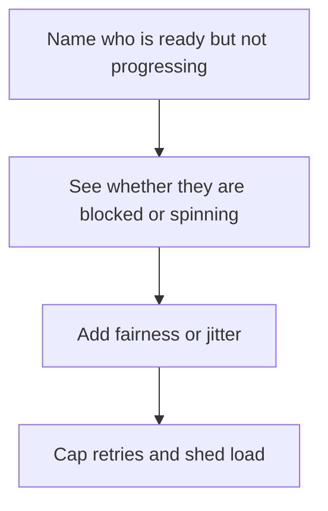

# D03-T012 — Starvation and livelocks

Topic ID: `D03-T012`
Domain: Operating Systems
Subdomain: Starvation and livelocks
Importance: core
Complexity: intermediate
Dependencies: `D03-T011`, `D03-T001`, `D01-T001`, `D01-T002`
Execution status of the code in section F: unexecuted

## A. Topic Overview

Starvation means a ready actor never runs because others always win the scheduler or the lock. A livelock means actors are busy responding to each other and still make no progress, often because both sides retry in the same pattern. Fairness, queues, and randomized backoff are the usual fixes. A timeout that always expires together can turn a retry into a livelock.

In production this shows up as follows: A writer thread starved by readers on an unfair read-write lock, or two consumers nacking and requeueing the same poison message as fast as they can.

Interviewers use Starvation and livelocks to see whether you can state the failure mode, not only the definition. The failure to name is: a low-priority queue that never drains, or two services retrying in lockstep and both failing

Prerequisites: `D03-T011`, `D03-T001`, `D01-T001`, `D01-T002`. Later notes should link here instead of repeating the mechanism.

## B. First-Principles Explanation

Starvation means a ready actor never runs because others always win the scheduler or the lock. A livelock means actors are busy responding to each other and still make no progress, often because both sides retry in the same pattern. Fairness, queues, and randomized backoff are the usual fixes. A timeout that always expires together can turn a retry into a livelock.

The useful picture is: Starvation is the person who never gets the microphone because others talk first. Livelock is two people sidestepping forever in a doorway.

What has to be true:

1. Name who is ready but not progressing
2. See whether they are blocked or spinning
3. Add fairness or jitter
4. Cap retries and shed load

It works when those steps preserve one invariant. It fails when a low-priority queue that never drains, or two services retrying in lockstep and both failing. The alternative is: the system is merely slow, which is latency, not starvation

## C. Internal Working and Architecture

Components involved: the caller, the state Starvation and livelocks mutates or reads, and the observer that reports age of the oldest queued item, and retry correlation across instances.

Execution:

1. Name who is ready but not progressing
2. See whether they are blocked or spinning
3. Add fairness or jitter
4. Cap retries and shed load

Data moves only along that path. A retry re-enters at step 1, so the operation must say what a duplicate does. Memory and locks stay inside this mechanism. Callers see the result or a typed error, not a half-updated invariant.

State to remember: choose this when scheduling or lock admission can prefer the same waiters forever. Do not choose it when the system is merely slow, which is latency, not starvation.

## D. Diagrams and Visual Models



Read the diagram from top to bottom. Each box is one step of Starvation and livelocks. The failure mode (a low-priority queue that never drains, or two services retrying in lockstep and both failing) is what you look for when a later box never happens or happens twice.

## E. Examples and Analogies

Analogy: Starvation is the person who never gets the microphone because others talk first. Livelock is two people sidestepping forever in a doorway.

Production example: A writer thread starved by readers on an unfair read-write lock, or two consumers nacking and requeueing the same poison message as fast as they can.

A small counterexample is enough in an interview. Show the input, apply the steps, and show the broken outcome if someone uses the mechanism outside its rule: a low-priority queue that never drains, or two services retrying in lockstep and both failing.

## F. Code Examples

The snippet is labeled unexecuted. It illustrates the shape of the idea. It is not a benchmark and it embeds no secret.

```python
import random, time

def backoff(attempt):
    base = min(2 ** attempt, 30)
    return base / 2 + random.random() * base / 2
```

After the snippet, check age of the oldest queued item, and retry correlation across instances. If that signal moves the wrong way, the snippet is the wrong tool for the workload.

## G. Practical Backend Application

Use Starvation and livelocks in a service when scheduling or lock admission can prefer the same waiters forever.

A typical place is the production case already stated: A writer thread starved by readers on an unfair read-write lock, or two consumers nacking and requeueing the same poison message as fast as they can.

Operationally you alert on age of the oldest queued item, and retry correlation across instances. You do not alert only on process uptime. The dashboard should show the failure mode, a success rate, and the saturation signal (queue depth, lock wait, or latency) that predicts it.

## H. Advantages, Limitations and Trade-offs

| Choice | Benefit | Cost | Choose when | Avoid when |
| --- | --- | --- | --- | --- |
| Apply Starvation and livelocks | scheduling or lock admission can prefer the same waiters forever | Extra moving parts and a new failure mode | The failure you are preventing is already real | the system is merely slow, which is latency, not starvation |
| Simpler alternative | Less code and fewer dependencies | a low-priority queue that never drains, or two services retrying in lockstep and both failing | The workload does not hit the limit | The invariant must hold under concurrency or failure |

Starvation and livelocks is a trade. State the benefit and the cost in the same sentence when you propose it in a design review.

## I. Common Mistakes and Misconceptions

- Adding priority without an aging rule.
- Retrying immediately on contention.
- Calling a saturated thread pool starvation when the queue is just unbounded and growing.
- Treating a diagram of Starvation and livelocks as proof that the invariant holds in production.
- Copying a default configuration without naming age of the oldest queued item, and retry correlation across instances.

## J. Debugging and Troubleshooting

Symptom: a low-priority queue that never drains, or two services retrying in lockstep and both failing

First check: age of the oldest queued item, and retry correlation across instances.

Then compare one healthy instance against one unhealthy instance. Confirm whether retries are duplicating work. Confirm whether a timeout is shorter than the work. Fix the invariant, then watch the same metric for a full peak, not only for the next minute.

Useful questions: did the step order in section C actually happen, or did a caller skip a step? Did a deploy change the data shape that Starvation and livelocks assumes?

## K. Interview Preparation

### Beginner

#### Q1. What problem does Starvation and livelocks solve?

**Answer:** Starvation means a ready actor never runs because others always win the scheduler or the lock. A livelock means actors are busy responding to each other and still make no progress, often because both sides retry in the same pattern. Fairness, queues, and randomized backoff are the usual fixes. A timeout that always expires together can turn a retry into a livelock. Without it, the usual backend failure is: a low-priority queue that never drains, or two services retrying in lockstep and both failing.

#### Q2. Where does Starvation and livelocks sit on a request path?

**Answer:** Starvation and livelocks is not a library you sprinkle on every call. scheduling or lock admission can prefer the same waiters forever You notice it when age of the oldest queued item, and retry correlation across instances. Name the constraint that makes this choice correct. Say what you would measure to confirm it.

#### Q3. Give a concrete example of Starvation and livelocks.

**Answer:** A writer thread starved by readers on an unfair read-write lock, or two consumers nacking and requeueing the same poison message as fast as they can. Walk the input, the state change, and the observable output. Name the constraint that makes this choice correct. Say what you would measure to confirm it.

#### Q4. What is a common mix-up around Starvation and livelocks?

**Answer:** a low-priority queue that never drains, or two services retrying in lockstep and both failing The corrective check is age of the oldest queued item, and retry correlation across instances. Name the constraint that makes this choice correct. Say what you would measure to confirm it. Say which alternative you rejected and why.

#### Q5. When would you skip Starvation and livelocks?

**Answer:** the system is merely slow, which is latency, not starvation Skipping is a decision with a measured cost, not a slogan. Name the constraint that makes this choice correct. Say what you would measure to confirm it. Say which alternative you rejected and why.

### Intermediate

#### Q1. What invariant makes Starvation and livelocks correct?

**Answer:** Starvation means a ready actor never runs because others always win the scheduler or the lock. A livelock means actors are busy responding to each other and still make no progress, often because both sides retry in the same pattern. Fairness, queues, and randomized backoff are the usual fixes. A timeout that always expires together can turn a retry into a livelock. State the invariant before you name the tool.

#### Q2. How do you test Starvation and livelocks?

**Answer:** Assert the failure mode directly: a low-priority queue that never drains, or two services retrying in lockstep and both failing. The assertion should watch age of the oldest queued item, and retry correlation across instances. Include a concurrent or retry case if the bug only appears then. Name the constraint that makes this choice correct.

#### Q3. What signal tells you Starvation and livelocks is misbehaving in production?

**Answer:** Watch age of the oldest queued item, and retry correlation across instances. The user-visible symptom is usually a low-priority queue that never drains, or two services retrying in lockstep and both failing. Name the constraint that makes this choice correct. Say what you would measure to confirm it.

#### Q4. How would you introduce Starvation and livelocks into a legacy service?

**Answer:** scheduling or lock admission can prefer the same waiters forever Ship it behind a metric so you can compare the old path. Roll back if a low-priority queue that never drains, or two services retrying in lockstep and both failing gets worse. Name the constraint that makes this choice correct. Say what you would measure to confirm it.

#### Q5. What do you trade away by choosing Starvation and livelocks?

**Answer:** scheduling or lock admission can prefer the same waiters forever the system is merely slow, which is latency, not starvation Say the cost in latency, storage, or operational load. Name the constraint that makes this choice correct. Say what you would measure to confirm it. Say which alternative you rejected and why.

### Advanced

#### Q1. What breaks if a dependency of Starvation and livelocks is slow or down?

**Answer:** a low-priority queue that never drains, or two services retrying in lockstep and both failing Degrade using the rule: the system is merely slow, which is latency, not starvation. Timeouts must be shorter than the caller's deadline. Name the constraint that makes this choice correct. Say what you would measure to confirm it.

#### Q2. How does Starvation and livelocks behave under retries?

**Answer:** Retries repeat work, so Starvation and livelocks must define what a duplicate does. a low-priority queue that never drains, or two services retrying in lockstep and both failing Idempotency keys or fences belong next to the write, not in a comment. Name the constraint that makes this choice correct. Say what you would measure to confirm it.

#### Q3. What is the capacity limit of Starvation and livelocks?

**Answer:** The limit shows up as age of the oldest queued item, and retry correlation across instances. Add capacity only after you know whether the bottleneck is CPU, lock wait, or network. Name the constraint that makes this choice correct. Say what you would measure to confirm it.

#### Q4. How do you evolve Starvation and livelocks without a flag day?

**Answer:** scheduling or lock admission can prefer the same waiters forever Version the contract or the on-disk format. Readers should tolerate one old and one new shape during the rollout. Name the constraint that makes this choice correct. Say what you would measure to confirm it.

#### Q5. What security or correctness bug hides inside Starvation and livelocks?

**Answer:** a low-priority queue that never drains, or two services retrying in lockstep and both failing Check authorization and tenancy at the same boundary as the mechanism. A cache or queue must not widen who can read the data. Name the constraint that makes this choice correct. Say what you would measure to confirm it.

### Scenario

#### Q1. Incident: a low-priority queue that never drains, or two services retrying in lockstep and both failing. What do you check first?

**Answer:** Start with age of the oldest queued item, and retry correlation across instances. Compare a good host and a bad host before you restart anything. Starvation means a ready actor never runs because others always win the scheduler or the lock. A livelock means actors are busy responding to each other and still make no progress, often because both sides retry in the same pattern. Fairness, queues, and randomized backoff are the usual fixes. A timeout that always expires together can turn a retry into a livelock.

#### Q2. A reviewer wants the clever version. What data settles it?

**Answer:** scheduling or lock admission can prefer the same waiters forever the system is merely slow, which is latency, not starvation Bring age of the oldest queued item, and retry correlation across instances from a load test or from production, not a slogan. Name the constraint that makes this choice correct. Say what you would measure to confirm it. Say which alternative you rejected and why.

#### Q3. You have one hour to explain Starvation and livelocks at a whiteboard.

**Answer:** Draw the happy path in four boxes. Then draw the failure: a low-priority queue that never drains, or two services retrying in lockstep and both failing. End with the metric you would page on. Name the constraint that makes this choice correct.

#### Q4. The bug only appears under two concurrent callers.

**Answer:** a low-priority queue that never drains, or two services retrying in lockstep and both failing Reproduce with a barrier so both sides enter the critical window. Confirm the fix with age of the oldest queued item, and retry correlation across instances. Name the constraint that makes this choice correct. Say what you would measure to confirm it.

#### Q5. Leadership wants this on every service next week.

**Answer:** the system is merely slow, which is latency, not starvation scheduling or lock admission can prefer the same waiters forever Roll it out where the failure mode is already hurting users. Name the constraint that makes this choice correct. Say what you would measure to confirm it. Say which alternative you rejected and why.

### Follow-up

#### Q1. What did you assume about the data size or the clock?

**Answer:** Starvation means a ready actor never runs because others always win the scheduler or the lock. A livelock means actors are busy responding to each other and still make no progress, often because both sides retry in the same pattern. Fairness, queues, and randomized backoff are the usual fixes. A timeout that always expires together can turn a retry into a livelock. Clocks are not a total order across machines. State whether the algorithm needs bounded size or a single leader.

#### Q2. What would you measure after the change ships?

**Answer:** Page on age of the oldest queued item, and retry correlation across instances. Keep a before/after dashboard for one week. Alert on the failure mode, not only on CPU. Name the constraint that makes this choice correct.

#### Q3. Which neighboring topic did you deliberately not re-teach?

**Answer:** This note owns Starvation and livelocks. Related identifiers are in section N. Shared ideas are linked, not copied. Name the constraint that makes this choice correct.

## L. Practical Exercises

Solutions are in `EXERCISES/solutions/D03-T012.md`, not in this section.

1. Whiteboard the four steps of Starvation and livelocks and mark where `a low-priority queue that never drains, or two services retrying in lockstep and both failing` enters.
2. Read the snippet in section F and write the assertion that would catch that failure. The assertion must mention `age of the oldest queued item, and retry correlation across instances`.
3. Argue for or against using Starvation and livelocks on a service you know. Use the choose and avoid rows from section H. Do not appeal to popularity.

## M. Revision Notes

- Mechanism: Starvation means a ready actor never runs because others always win the scheduler or the lock.
- Failure: a low-priority queue that never drains, or two services retrying in lockstep and both failing
- Metric: age of the oldest queued item, and retry correlation across instances
- Choose when: scheduling or lock admission can prefer the same waiters forever
- Avoid when: the system is merely slow, which is latency, not starvation

## N. Related Topics

Dependencies to review first: `D03-T011`, `D03-T001`, `D01-T001`, `D01-T002`.

Shared ideas stay in those notes. This note does not restate them.

## O. Completion Criteria

- You can explain Starvation and livelocks without reading this note, including the failure mode.
- You can draw the diagram in section D from memory.
- You can say when not to use it, using the avoid condition in section H.
- You can name the metric you would watch after shipping it.
