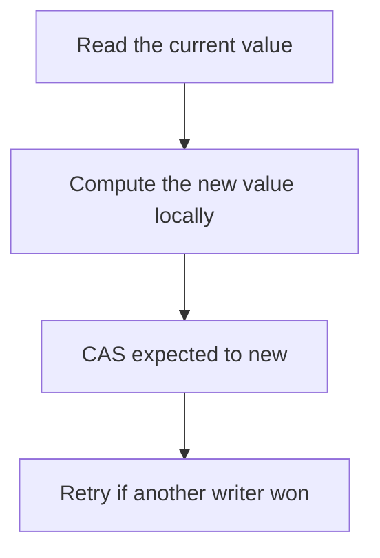

# D03-T013 — Atomic operations and compare-and-swap

Topic ID: `D03-T013`
Domain: Operating Systems
Subdomain: Atomic operations and compare-and-swap
Importance: core
Complexity: intermediate
Dependencies: `D03-T012`, `D03-T001`, `D01-T001`, `D01-T002`
Execution status of the code in section F: unexecuted

## A. Topic Overview

An atomic operation completes as a single step with respect to other threads. Compare-and-swap takes an address, an expected value, and a new value, and updates the address only if it still holds the expected value. It is the building block of lock-free stacks and counters. ABA is the bug where the value changes from A to B and back to A, so a CAS succeeds and misses the intervening mutation.

In production this shows up as follows: A lock-free request counter increments with an atomic add. A lock-free stack that reuses nodes without a version tag can pop the wrong generation.

Interviewers use Atomic operations and compare-and-swap to see whether you can state the failure mode, not only the definition. The failure to name is: ABA on a pointer, or a CAS loop that burns a core under contention

Prerequisites: `D03-T012`, `D03-T001`, `D01-T001`, `D01-T002`. Later notes should link here instead of repeating the mechanism.

## B. First-Principles Explanation

An atomic operation completes as a single step with respect to other threads. Compare-and-swap takes an address, an expected value, and a new value, and updates the address only if it still holds the expected value. It is the building block of lock-free stacks and counters. ABA is the bug where the value changes from A to B and back to A, so a CAS succeeds and misses the intervening mutation.

The useful picture is: CAS is checking that a luggage tag still shows your name before you replace it. If someone swapped the bag and put your tag back, you are fooled. That is ABA.

What has to be true:

1. Read the current value
2. Compute the new value locally
3. CAS expected to new
4. Retry if another writer won

It works when those steps preserve one invariant. It fails when ABA on a pointer, or a CAS loop that burns a core under contention. The alternative is: the invariant spans two words, unless you have a double-width CAS or a lock

## C. Internal Working and Architecture

Components involved: the caller, the state Atomic operations and compare-and-swap mutates or reads, and the observer that reports CAS failure rate and the number of retries per successful update.

Execution:

1. Read the current value
2. Compute the new value locally
3. CAS expected to new
4. Retry if another writer won

Data moves only along that path. A retry re-enters at step 1, so the operation must say what a duplicate does. Memory and locks stay inside this mechanism. Callers see the result or a typed error, not a half-updated invariant.

State to remember: choose this when the update is a single word and the critical section is tiny. Do not choose it when the invariant spans two words, unless you have a double-width CAS or a lock.

## D. Diagrams and Visual Models



Read the diagram from top to bottom. Each box is one step of Atomic operations and compare-and-swap. The failure mode (ABA on a pointer, or a CAS loop that burns a core under contention) is what you look for when a later box never happens or happens twice.

## E. Examples and Analogies

Analogy: CAS is checking that a luggage tag still shows your name before you replace it. If someone swapped the bag and put your tag back, you are fooled. That is ABA.

Production example: A lock-free request counter increments with an atomic add. A lock-free stack that reuses nodes without a version tag can pop the wrong generation.

A small counterexample is enough in an interview. Show the input, apply the steps, and show the broken outcome if someone uses the mechanism outside its rule: ABA on a pointer, or a CAS loop that burns a core under contention.

## F. Code Examples

The snippet is labeled unexecuted. It illustrates the shape of the idea. It is not a benchmark and it embeds no secret.

```python
def cas_loop(get, cas, delta):
    while True:
        cur = get()
        if cas(cur, cur + delta):
            return cur + delta
```

After the snippet, check CAS failure rate and the number of retries per successful update. If that signal moves the wrong way, the snippet is the wrong tool for the workload.

## G. Practical Backend Application

Use Atomic operations and compare-and-swap in a service when the update is a single word and the critical section is tiny.

A typical place is the production case already stated: A lock-free request counter increments with an atomic add. A lock-free stack that reuses nodes without a version tag can pop the wrong generation.

Operationally you alert on CAS failure rate and the number of retries per successful update. You do not alert only on process uptime. The dashboard should show the failure mode, a success rate, and the saturation signal (queue depth, lock wait, or latency) that predicts it.

## H. Advantages, Limitations and Trade-offs

| Choice | Benefit | Cost | Choose when | Avoid when |
| --- | --- | --- | --- | --- |
| Apply Atomic operations and compare-and-swap | the update is a single word and the critical section is tiny | Extra moving parts and a new failure mode | The failure you are preventing is already real | the invariant spans two words, unless you have a double-width CAS or a lock |
| Simpler alternative | Less code and fewer dependencies | ABA on a pointer, or a CAS loop that burns a core under contention | The workload does not hit the limit | The invariant must hold under concurrency or failure |

Atomic operations and compare-and-swap is a trade. State the benefit and the cost in the same sentence when you propose it in a design review.

## I. Common Mistakes and Misconceptions

- Assuming CAS of a pointer is safe without a generation.
- Spinning without backoff on a hot counter.
- Using atomicity for one field and forgetting the neighboring field.
- Treating a diagram of Atomic operations and compare-and-swap as proof that the invariant holds in production.
- Copying a default configuration without naming CAS failure rate and the number of retries per successful update.

## J. Debugging and Troubleshooting

Symptom: ABA on a pointer, or a CAS loop that burns a core under contention

First check: CAS failure rate and the number of retries per successful update.

Then compare one healthy instance against one unhealthy instance. Confirm whether retries are duplicating work. Confirm whether a timeout is shorter than the work. Fix the invariant, then watch the same metric for a full peak, not only for the next minute.

Useful questions: did the step order in section C actually happen, or did a caller skip a step? Did a deploy change the data shape that Atomic operations and compare-and-swap assumes?

## K. Interview Preparation

### Beginner

#### Q1. What problem does Atomic operations and compare-and-swap solve?

**Answer:** An atomic operation completes as a single step with respect to other threads. Compare-and-swap takes an address, an expected value, and a new value, and updates the address only if it still holds the expected value. It is the building block of lock-free stacks and counters. ABA is the bug where the value changes from A to B and back to A, so a CAS succeeds and misses the intervening mutation. Without it, the usual backend failure is: ABA on a pointer, or a CAS loop that burns a core under contention.

#### Q2. Where does Atomic operations and compare-and-swap sit on a request path?

**Answer:** Atomic operations and compare-and-swap is not a library you sprinkle on every call. the update is a single word and the critical section is tiny You notice it when CAS failure rate and the number of retries per successful update. Name the constraint that makes this choice correct. Say what you would measure to confirm it.

#### Q3. Give a concrete example of Atomic operations and compare-and-swap.

**Answer:** A lock-free request counter increments with an atomic add. A lock-free stack that reuses nodes without a version tag can pop the wrong generation. Walk the input, the state change, and the observable output. Name the constraint that makes this choice correct.

#### Q4. What is a common mix-up around Atomic operations and compare-and-swap?

**Answer:** ABA on a pointer, or a CAS loop that burns a core under contention The corrective check is CAS failure rate and the number of retries per successful update. Name the constraint that makes this choice correct. Say what you would measure to confirm it. Say which alternative you rejected and why.

#### Q5. When would you skip Atomic operations and compare-and-swap?

**Answer:** the invariant spans two words, unless you have a double-width CAS or a lock Skipping is a decision with a measured cost, not a slogan. Name the constraint that makes this choice correct. Say what you would measure to confirm it. Say which alternative you rejected and why.

### Intermediate

#### Q1. What invariant makes Atomic operations and compare-and-swap correct?

**Answer:** An atomic operation completes as a single step with respect to other threads. Compare-and-swap takes an address, an expected value, and a new value, and updates the address only if it still holds the expected value. It is the building block of lock-free stacks and counters. ABA is the bug where the value changes from A to B and back to A, so a CAS succeeds and misses the intervening mutation. State the invariant before you name the tool.

#### Q2. How do you test Atomic operations and compare-and-swap?

**Answer:** Assert the failure mode directly: ABA on a pointer, or a CAS loop that burns a core under contention. The assertion should watch CAS failure rate and the number of retries per successful update. Include a concurrent or retry case if the bug only appears then. Name the constraint that makes this choice correct.

#### Q3. What signal tells you Atomic operations and compare-and-swap is misbehaving in production?

**Answer:** Watch CAS failure rate and the number of retries per successful update. The user-visible symptom is usually ABA on a pointer, or a CAS loop that burns a core under contention. Name the constraint that makes this choice correct. Say what you would measure to confirm it.

#### Q4. How would you introduce Atomic operations and compare-and-swap into a legacy service?

**Answer:** the update is a single word and the critical section is tiny Ship it behind a metric so you can compare the old path. Roll back if ABA on a pointer, or a CAS loop that burns a core under contention gets worse. Name the constraint that makes this choice correct. Say what you would measure to confirm it.

#### Q5. What do you trade away by choosing Atomic operations and compare-and-swap?

**Answer:** the update is a single word and the critical section is tiny the invariant spans two words, unless you have a double-width CAS or a lock Say the cost in latency, storage, or operational load. Name the constraint that makes this choice correct. Say what you would measure to confirm it. Say which alternative you rejected and why.

### Advanced

#### Q1. What breaks if a dependency of Atomic operations and compare-and-swap is slow or down?

**Answer:** ABA on a pointer, or a CAS loop that burns a core under contention Degrade using the rule: the invariant spans two words, unless you have a double-width CAS or a lock. Timeouts must be shorter than the caller's deadline. Name the constraint that makes this choice correct. Say what you would measure to confirm it.

#### Q2. How does Atomic operations and compare-and-swap behave under retries?

**Answer:** Retries repeat work, so Atomic operations and compare-and-swap must define what a duplicate does. ABA on a pointer, or a CAS loop that burns a core under contention Idempotency keys or fences belong next to the write, not in a comment. Name the constraint that makes this choice correct. Say what you would measure to confirm it.

#### Q3. What is the capacity limit of Atomic operations and compare-and-swap?

**Answer:** The limit shows up as CAS failure rate and the number of retries per successful update. Add capacity only after you know whether the bottleneck is CPU, lock wait, or network. Name the constraint that makes this choice correct. Say what you would measure to confirm it.

#### Q4. How do you evolve Atomic operations and compare-and-swap without a flag day?

**Answer:** the update is a single word and the critical section is tiny Version the contract or the on-disk format. Readers should tolerate one old and one new shape during the rollout. Name the constraint that makes this choice correct. Say what you would measure to confirm it.

#### Q5. What security or correctness bug hides inside Atomic operations and compare-and-swap?

**Answer:** ABA on a pointer, or a CAS loop that burns a core under contention Check authorization and tenancy at the same boundary as the mechanism. A cache or queue must not widen who can read the data. Name the constraint that makes this choice correct. Say what you would measure to confirm it.

### Scenario

#### Q1. Incident: ABA on a pointer, or a CAS loop that burns a core under contention. What do you check first?

**Answer:** Start with CAS failure rate and the number of retries per successful update. Compare a good host and a bad host before you restart anything. An atomic operation completes as a single step with respect to other threads. Compare-and-swap takes an address, an expected value, and a new value, and updates the address only if it still holds the expected value. It is the building block of lock-free stacks and counters. ABA is the bug where the value changes from A to B and back to A, so a CAS succeeds and misses the intervening mutation.

#### Q2. A reviewer wants the clever version. What data settles it?

**Answer:** the update is a single word and the critical section is tiny the invariant spans two words, unless you have a double-width CAS or a lock Bring CAS failure rate and the number of retries per successful update from a load test or from production, not a slogan. Name the constraint that makes this choice correct. Say what you would measure to confirm it. Say which alternative you rejected and why.

#### Q3. You have one hour to explain Atomic operations and compare-and-swap at a whiteboard.

**Answer:** Draw the happy path in four boxes. Then draw the failure: ABA on a pointer, or a CAS loop that burns a core under contention. End with the metric you would page on. Name the constraint that makes this choice correct.

#### Q4. The bug only appears under two concurrent callers.

**Answer:** ABA on a pointer, or a CAS loop that burns a core under contention Reproduce with a barrier so both sides enter the critical window. Confirm the fix with CAS failure rate and the number of retries per successful update. Name the constraint that makes this choice correct. Say what you would measure to confirm it.

#### Q5. Leadership wants this on every service next week.

**Answer:** the invariant spans two words, unless you have a double-width CAS or a lock the update is a single word and the critical section is tiny Roll it out where the failure mode is already hurting users. Name the constraint that makes this choice correct. Say what you would measure to confirm it. Say which alternative you rejected and why.

### Follow-up

#### Q1. What did you assume about the data size or the clock?

**Answer:** An atomic operation completes as a single step with respect to other threads. Compare-and-swap takes an address, an expected value, and a new value, and updates the address only if it still holds the expected value. It is the building block of lock-free stacks and counters. ABA is the bug where the value changes from A to B and back to A, so a CAS succeeds and misses the intervening mutation. Clocks are not a total order across machines. State whether the algorithm needs bounded size or a single leader.

#### Q2. What would you measure after the change ships?

**Answer:** Page on CAS failure rate and the number of retries per successful update. Keep a before/after dashboard for one week. Alert on the failure mode, not only on CPU. Name the constraint that makes this choice correct.

#### Q3. Which neighboring topic did you deliberately not re-teach?

**Answer:** This note owns Atomic operations and compare-and-swap. Related identifiers are in section N. Shared ideas are linked, not copied. Name the constraint that makes this choice correct.

## L. Practical Exercises

Solutions are in `EXERCISES/solutions/D03-T013.md`, not in this section.

1. Whiteboard the four steps of Atomic operations and compare-and-swap and mark where `ABA on a pointer, or a CAS loop that burns a core under contention` enters.
2. Read the snippet in section F and write the assertion that would catch that failure. The assertion must mention `CAS failure rate and the number of retries per successful update`.
3. Argue for or against using Atomic operations and compare-and-swap on a service you know. Use the choose and avoid rows from section H. Do not appeal to popularity.

## M. Revision Notes

- Mechanism: An atomic operation completes as a single step with respect to other threads.
- Failure: ABA on a pointer, or a CAS loop that burns a core under contention
- Metric: CAS failure rate and the number of retries per successful update
- Choose when: the update is a single word and the critical section is tiny
- Avoid when: the invariant spans two words, unless you have a double-width CAS or a lock

## N. Related Topics

Dependencies to review first: `D03-T012`, `D03-T001`, `D01-T001`, `D01-T002`.

Shared ideas stay in those notes. This note does not restate them.

## O. Completion Criteria

- You can explain Atomic operations and compare-and-swap without reading this note, including the failure mode.
- You can draw the diagram in section D from memory.
- You can say when not to use it, using the avoid condition in section H.
- You can name the metric you would watch after shipping it.
