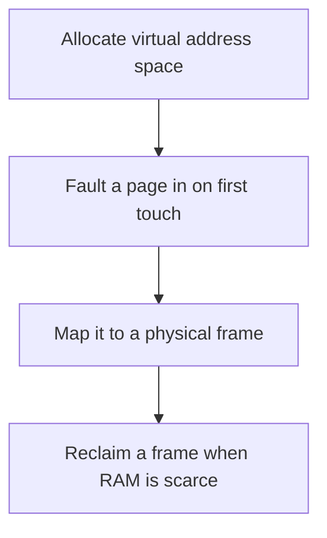

# D03-T014 — Memory management and virtual memory

Topic ID: `D03-T014`
Domain: Operating Systems
Subdomain: Memory management and virtual memory
Importance: core
Complexity: intermediate
Dependencies: `D03-T013`, `D03-T001`, `D01-T001`, `D01-T002`
Execution status of the code in section F: unexecuted

## A. Topic Overview

Virtual memory gives each process its own address space. The CPU translates virtual pages to physical frames through page tables. The process cannot name another process's memory except through an explicit shared mapping. Overcommit and swap let the OS promise more virtual memory than RAM, and then the promise fails under pressure.

In production this shows up as follows: A JVM or a Python process whose RSS crosses a container limit is killed even though virtual size looked fine for weeks. The metric that matters is resident set and the cgroup cap.

Interviewers use Memory management and virtual memory to see whether you can state the failure mode, not only the definition. The failure to name is: the OOM killer, or latency spikes when anonymous memory is swapped out

Prerequisites: `D03-T013`, `D03-T001`, `D01-T001`, `D01-T002`. Later notes should link here instead of repeating the mechanism.

## B. First-Principles Explanation

Virtual memory gives each process its own address space. The CPU translates virtual pages to physical frames through page tables. The process cannot name another process's memory except through an explicit shared mapping. Overcommit and swap let the OS promise more virtual memory than RAM, and then the promise fails under pressure.

The useful picture is: Virtual memory is a set of named mailboxes that the post office remaps onto a smaller wall of real boxes.

What has to be true:

1. Allocate virtual address space
2. Fault a page in on first touch
3. Map it to a physical frame
4. Reclaim a frame when RAM is scarce

It works when those steps preserve one invariant. It fails when the OOM killer, or latency spikes when anonymous memory is swapped out. The alternative is: you only needed an application-level cache bound, which virtual memory will not enforce for you

## C. Internal Working and Architecture

Components involved: the caller, the state Memory management and virtual memory mutates or reads, and the observer that reports major page faults, swap in/out, and RSS versus the cgroup limit.

Execution:

1. Allocate virtual address space
2. Fault a page in on first touch
3. Map it to a physical frame
4. Reclaim a frame when RAM is scarce

Data moves only along that path. A retry re-enters at step 1, so the operation must say what a duplicate does. Memory and locks stay inside this mechanism. Callers see the result or a typed error, not a half-updated invariant.

State to remember: choose this when you are explaining a crash, a leak, or a container limit. Do not choose it when you only needed an application-level cache bound, which virtual memory will not enforce for you.

## D. Diagrams and Visual Models



Read the diagram from top to bottom. Each box is one step of Memory management and virtual memory. The failure mode (the OOM killer, or latency spikes when anonymous memory is swapped out) is what you look for when a later box never happens or happens twice.

## E. Examples and Analogies

Analogy: Virtual memory is a set of named mailboxes that the post office remaps onto a smaller wall of real boxes.

Production example: A JVM or a Python process whose RSS crosses a container limit is killed even though virtual size looked fine for weeks. The metric that matters is resident set and the cgroup cap.

A small counterexample is enough in an interview. Show the input, apply the steps, and show the broken outcome if someone uses the mechanism outside its rule: the OOM killer, or latency spikes when anonymous memory is swapped out.

## F. Code Examples

The snippet is labeled unexecuted. It illustrates the shape of the idea. It is not a benchmark and it embeds no secret.

```text
# unexecuted: inspect a process map
# ps -o pid,rss,vsz -p <pid>
```

After the snippet, check major page faults, swap in/out, and RSS versus the cgroup limit. If that signal moves the wrong way, the snippet is the wrong tool for the workload.

## G. Practical Backend Application

Use Memory management and virtual memory in a service when you are explaining a crash, a leak, or a container limit.

A typical place is the production case already stated: A JVM or a Python process whose RSS crosses a container limit is killed even though virtual size looked fine for weeks. The metric that matters is resident set and the cgroup cap.

Operationally you alert on major page faults, swap in/out, and RSS versus the cgroup limit. You do not alert only on process uptime. The dashboard should show the failure mode, a success rate, and the saturation signal (queue depth, lock wait, or latency) that predicts it.

## H. Advantages, Limitations and Trade-offs

| Choice | Benefit | Cost | Choose when | Avoid when |
| --- | --- | --- | --- | --- |
| Apply Memory management and virtual memory | you are explaining a crash, a leak, or a container limit | Extra moving parts and a new failure mode | The failure you are preventing is already real | you only needed an application-level cache bound, which virtual memory will not enforce for you |
| Simpler alternative | Less code and fewer dependencies | the OOM killer, or latency spikes when anonymous memory is swapped out | The workload does not hit the limit | The invariant must hold under concurrency or failure |

Memory management and virtual memory is a trade. State the benefit and the cost in the same sentence when you propose it in a design review.

## I. Common Mistakes and Misconceptions

- Treating virtual size as RAM used.
- Disabling swap and assuming latency can never spike.
- Ignoring the container limit and looking only at the host.
- Treating a diagram of Memory management and virtual memory as proof that the invariant holds in production.
- Copying a default configuration without naming major page faults, swap in/out, and RSS versus the cgroup limit.

## J. Debugging and Troubleshooting

Symptom: the OOM killer, or latency spikes when anonymous memory is swapped out

First check: major page faults, swap in/out, and RSS versus the cgroup limit.

Then compare one healthy instance against one unhealthy instance. Confirm whether retries are duplicating work. Confirm whether a timeout is shorter than the work. Fix the invariant, then watch the same metric for a full peak, not only for the next minute.

Useful questions: did the step order in section C actually happen, or did a caller skip a step? Did a deploy change the data shape that Memory management and virtual memory assumes?

## K. Interview Preparation

### Beginner

#### Q1. What problem does Memory management and virtual memory solve?

**Answer:** Virtual memory gives each process its own address space. The CPU translates virtual pages to physical frames through page tables. The process cannot name another process's memory except through an explicit shared mapping. Overcommit and swap let the OS promise more virtual memory than RAM, and then the promise fails under pressure. Without it, the usual backend failure is: the OOM killer, or latency spikes when anonymous memory is swapped out.

#### Q2. Where does Memory management and virtual memory sit on a request path?

**Answer:** Memory management and virtual memory is not a library you sprinkle on every call. you are explaining a crash, a leak, or a container limit You notice it when major page faults, swap in/out, and RSS versus the cgroup limit. Name the constraint that makes this choice correct. Say what you would measure to confirm it.

#### Q3. Give a concrete example of Memory management and virtual memory.

**Answer:** A JVM or a Python process whose RSS crosses a container limit is killed even though virtual size looked fine for weeks. The metric that matters is resident set and the cgroup cap. Walk the input, the state change, and the observable output. Name the constraint that makes this choice correct.

#### Q4. What is a common mix-up around Memory management and virtual memory?

**Answer:** the OOM killer, or latency spikes when anonymous memory is swapped out The corrective check is major page faults, swap in/out, and RSS versus the cgroup limit. Name the constraint that makes this choice correct. Say what you would measure to confirm it. Say which alternative you rejected and why.

#### Q5. When would you skip Memory management and virtual memory?

**Answer:** you only needed an application-level cache bound, which virtual memory will not enforce for you Skipping is a decision with a measured cost, not a slogan. Name the constraint that makes this choice correct. Say what you would measure to confirm it. Say which alternative you rejected and why.

### Intermediate

#### Q1. What invariant makes Memory management and virtual memory correct?

**Answer:** Virtual memory gives each process its own address space. The CPU translates virtual pages to physical frames through page tables. The process cannot name another process's memory except through an explicit shared mapping. Overcommit and swap let the OS promise more virtual memory than RAM, and then the promise fails under pressure. State the invariant before you name the tool.

#### Q2. How do you test Memory management and virtual memory?

**Answer:** Assert the failure mode directly: the OOM killer, or latency spikes when anonymous memory is swapped out. The assertion should watch major page faults, swap in/out, and RSS versus the cgroup limit. Include a concurrent or retry case if the bug only appears then. Name the constraint that makes this choice correct.

#### Q3. What signal tells you Memory management and virtual memory is misbehaving in production?

**Answer:** Watch major page faults, swap in/out, and RSS versus the cgroup limit. The user-visible symptom is usually the OOM killer, or latency spikes when anonymous memory is swapped out. Name the constraint that makes this choice correct. Say what you would measure to confirm it.

#### Q4. How would you introduce Memory management and virtual memory into a legacy service?

**Answer:** you are explaining a crash, a leak, or a container limit Ship it behind a metric so you can compare the old path. Roll back if the OOM killer, or latency spikes when anonymous memory is swapped out gets worse. Name the constraint that makes this choice correct. Say what you would measure to confirm it.

#### Q5. What do you trade away by choosing Memory management and virtual memory?

**Answer:** you are explaining a crash, a leak, or a container limit you only needed an application-level cache bound, which virtual memory will not enforce for you Say the cost in latency, storage, or operational load. Name the constraint that makes this choice correct. Say what you would measure to confirm it. Say which alternative you rejected and why.

### Advanced

#### Q1. What breaks if a dependency of Memory management and virtual memory is slow or down?

**Answer:** the OOM killer, or latency spikes when anonymous memory is swapped out Degrade using the rule: you only needed an application-level cache bound, which virtual memory will not enforce for you. Timeouts must be shorter than the caller's deadline. Name the constraint that makes this choice correct. Say what you would measure to confirm it.

#### Q2. How does Memory management and virtual memory behave under retries?

**Answer:** Retries repeat work, so Memory management and virtual memory must define what a duplicate does. the OOM killer, or latency spikes when anonymous memory is swapped out Idempotency keys or fences belong next to the write, not in a comment. Name the constraint that makes this choice correct. Say what you would measure to confirm it.

#### Q3. What is the capacity limit of Memory management and virtual memory?

**Answer:** The limit shows up as major page faults, swap in/out, and RSS versus the cgroup limit. Add capacity only after you know whether the bottleneck is CPU, lock wait, or network. Name the constraint that makes this choice correct. Say what you would measure to confirm it.

#### Q4. How do you evolve Memory management and virtual memory without a flag day?

**Answer:** you are explaining a crash, a leak, or a container limit Version the contract or the on-disk format. Readers should tolerate one old and one new shape during the rollout. Name the constraint that makes this choice correct. Say what you would measure to confirm it.

#### Q5. What security or correctness bug hides inside Memory management and virtual memory?

**Answer:** the OOM killer, or latency spikes when anonymous memory is swapped out Check authorization and tenancy at the same boundary as the mechanism. A cache or queue must not widen who can read the data. Name the constraint that makes this choice correct. Say what you would measure to confirm it.

### Scenario

#### Q1. Incident: the OOM killer, or latency spikes when anonymous memory is swapped out. What do you check first?

**Answer:** Start with major page faults, swap in/out, and RSS versus the cgroup limit. Compare a good host and a bad host before you restart anything. Virtual memory gives each process its own address space. The CPU translates virtual pages to physical frames through page tables. The process cannot name another process's memory except through an explicit shared mapping. Overcommit and swap let the OS promise more virtual memory than RAM, and then the promise fails under pressure.

#### Q2. A reviewer wants the clever version. What data settles it?

**Answer:** you are explaining a crash, a leak, or a container limit you only needed an application-level cache bound, which virtual memory will not enforce for you Bring major page faults, swap in/out, and RSS versus the cgroup limit from a load test or from production, not a slogan. Name the constraint that makes this choice correct. Say what you would measure to confirm it. Say which alternative you rejected and why.

#### Q3. You have one hour to explain Memory management and virtual memory at a whiteboard.

**Answer:** Draw the happy path in four boxes. Then draw the failure: the OOM killer, or latency spikes when anonymous memory is swapped out. End with the metric you would page on. Name the constraint that makes this choice correct.

#### Q4. The bug only appears under two concurrent callers.

**Answer:** the OOM killer, or latency spikes when anonymous memory is swapped out Reproduce with a barrier so both sides enter the critical window. Confirm the fix with major page faults, swap in/out, and RSS versus the cgroup limit. Name the constraint that makes this choice correct. Say what you would measure to confirm it.

#### Q5. Leadership wants this on every service next week.

**Answer:** you only needed an application-level cache bound, which virtual memory will not enforce for you you are explaining a crash, a leak, or a container limit Roll it out where the failure mode is already hurting users. Name the constraint that makes this choice correct. Say what you would measure to confirm it. Say which alternative you rejected and why.

### Follow-up

#### Q1. What did you assume about the data size or the clock?

**Answer:** Virtual memory gives each process its own address space. The CPU translates virtual pages to physical frames through page tables. The process cannot name another process's memory except through an explicit shared mapping. Overcommit and swap let the OS promise more virtual memory than RAM, and then the promise fails under pressure. Clocks are not a total order across machines. State whether the algorithm needs bounded size or a single leader.

#### Q2. What would you measure after the change ships?

**Answer:** Page on major page faults, swap in/out, and RSS versus the cgroup limit. Keep a before/after dashboard for one week. Alert on the failure mode, not only on CPU. Name the constraint that makes this choice correct.

#### Q3. Which neighboring topic did you deliberately not re-teach?

**Answer:** This note owns Memory management and virtual memory. Related identifiers are in section N. Shared ideas are linked, not copied. Name the constraint that makes this choice correct.

## L. Practical Exercises

Solutions are in `EXERCISES/solutions/D03-T014.md`, not in this section.

1. Whiteboard the four steps of Memory management and virtual memory and mark where `the OOM killer, or latency spikes when anonymous memory is swapped out` enters.
2. Read the snippet in section F and write the assertion that would catch that failure. The assertion must mention `major page faults, swap in/out, and RSS versus the cgroup limit`.
3. Argue for or against using Memory management and virtual memory on a service you know. Use the choose and avoid rows from section H. Do not appeal to popularity.

## M. Revision Notes

- Mechanism: Virtual memory gives each process its own address space.
- Failure: the OOM killer, or latency spikes when anonymous memory is swapped out
- Metric: major page faults, swap in/out, and RSS versus the cgroup limit
- Choose when: you are explaining a crash, a leak, or a container limit
- Avoid when: you only needed an application-level cache bound, which virtual memory will not enforce for you

## N. Related Topics

Dependencies to review first: `D03-T013`, `D03-T001`, `D01-T001`, `D01-T002`.

Shared ideas stay in those notes. This note does not restate them.

## O. Completion Criteria

- You can explain Memory management and virtual memory without reading this note, including the failure mode.
- You can draw the diagram in section D from memory.
- You can say when not to use it, using the avoid condition in section H.
- You can name the metric you would watch after shipping it.
