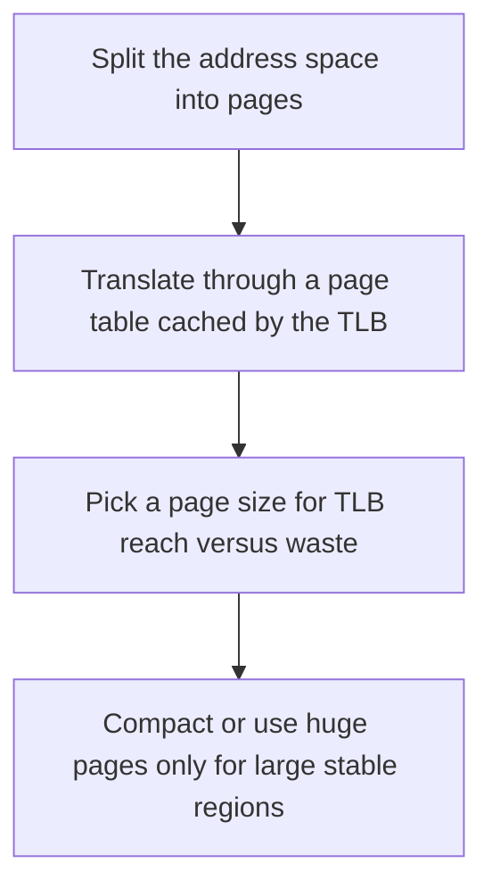

# D03-T015 — Paging and segmentation

Topic ID: `D03-T015`
Domain: Operating Systems
Subdomain: Paging and segmentation
Importance: core
Complexity: intermediate
Dependencies: `D03-T014`, `D03-T001`, `D01-T001`, `D01-T002`
Execution status of the code in section F: unexecuted

## A. Topic Overview

Paging splits address space into fixed-size pages, usually 4 KiB, and maps them independently. Segmentation uses variable-sized logical segments. Modern general-purpose systems are paged. Huge pages reduce TLB misses for large contiguous heaps. Internal fragmentation is the unused tail of a page. External fragmentation is the historical segment problem of holes that are too small.

In production this shows up as follows: A database buffer pool sized to a multiple of the huge-page size avoids fragmenting the TLB. A service that mmaps millions of tiny files should stay on base pages.

Interviewers use Paging and segmentation to see whether you can state the failure mode, not only the definition. The failure to name is: TLB shootdowns and extra page-table memory after turning on huge pages for a tiny, short-lived allocation

Prerequisites: `D03-T014`, `D03-T001`, `D01-T001`, `D01-T002`. Later notes should link here instead of repeating the mechanism.

## B. First-Principles Explanation

Paging splits address space into fixed-size pages, usually 4 KiB, and maps them independently. Segmentation uses variable-sized logical segments. Modern general-purpose systems are paged. Huge pages reduce TLB misses for large contiguous heaps. Internal fragmentation is the unused tail of a page. External fragmentation is the historical segment problem of holes that are too small.

The useful picture is: Paging is graph paper. Segmentation is custom-length shelves. Graph paper wastes the last cell of a short line and never needs to slide shelves together.

What has to be true:

1. Split the address space into pages
2. Translate through a page table cached by the TLB
3. Pick a page size for TLB reach versus waste
4. Compact or use huge pages only for large stable regions

It works when those steps preserve one invariant. It fails when TLB shootdowns and extra page-table memory after turning on huge pages for a tiny, short-lived allocation. The alternative is: you are picking a data structure, where page size is a constant you should not retune per request

## C. Internal Working and Architecture

Components involved: the caller, the state Paging and segmentation mutates or reads, and the observer that reports TLB miss rate and the fraction of anonymous memory backed by huge pages.

Execution:

1. Split the address space into pages
2. Translate through a page table cached by the TLB
3. Pick a page size for TLB reach versus waste
4. Compact or use huge pages only for large stable regions

Data moves only along that path. A retry re-enters at step 1, so the operation must say what a duplicate does. Memory and locks stay inside this mechanism. Callers see the result or a typed error, not a half-updated invariant.

State to remember: choose this when you are sizing memory or explaining TLB cost. Do not choose it when you are picking a data structure, where page size is a constant you should not retune per request.

## D. Diagrams and Visual Models



Read the diagram from top to bottom. Each box is one step of Paging and segmentation. The failure mode (TLB shootdowns and extra page-table memory after turning on huge pages for a tiny, short-lived allocation) is what you look for when a later box never happens or happens twice.

## E. Examples and Analogies

Analogy: Paging is graph paper. Segmentation is custom-length shelves. Graph paper wastes the last cell of a short line and never needs to slide shelves together.

Production example: A database buffer pool sized to a multiple of the huge-page size avoids fragmenting the TLB. A service that mmaps millions of tiny files should stay on base pages.

A small counterexample is enough in an interview. Show the input, apply the steps, and show the broken outcome if someone uses the mechanism outside its rule: TLB shootdowns and extra page-table memory after turning on huge pages for a tiny, short-lived allocation.

## F. Code Examples

The snippet is labeled unexecuted. It illustrates the shape of the idea. It is not a benchmark and it embeds no secret.

```python
# page size is a kernel fact, not an application toggle in this snippet
PAGE = 4096
def pages_for(nbytes):
    return (nbytes + PAGE - 1) // PAGE
```

After the snippet, check TLB miss rate and the fraction of anonymous memory backed by huge pages. If that signal moves the wrong way, the snippet is the wrong tool for the workload.

## G. Practical Backend Application

Use Paging and segmentation in a service when you are sizing memory or explaining TLB cost.

A typical place is the production case already stated: A database buffer pool sized to a multiple of the huge-page size avoids fragmenting the TLB. A service that mmaps millions of tiny files should stay on base pages.

Operationally you alert on TLB miss rate and the fraction of anonymous memory backed by huge pages. You do not alert only on process uptime. The dashboard should show the failure mode, a success rate, and the saturation signal (queue depth, lock wait, or latency) that predicts it.

## H. Advantages, Limitations and Trade-offs

| Choice | Benefit | Cost | Choose when | Avoid when |
| --- | --- | --- | --- | --- |
| Apply Paging and segmentation | you are sizing memory or explaining TLB cost | Extra moving parts and a new failure mode | The failure you are preventing is already real | you are picking a data structure, where page size is a constant you should not retune per request |
| Simpler alternative | Less code and fewer dependencies | TLB shootdowns and extra page-table memory after turning on huge pages for a tiny, short-lived allocation | The workload does not hit the limit | The invariant must hold under concurrency or failure |

Paging and segmentation is a trade. State the benefit and the cost in the same sentence when you propose it in a design review.

## I. Common Mistakes and Misconceptions

- Assuming the application page size is the disk block size.
- Enabling transparent huge pages on a latency-sensitive allocator without measuring stalls.
- Confusing fragmentation with a leak.
- Treating a diagram of Paging and segmentation as proof that the invariant holds in production.
- Copying a default configuration without naming TLB miss rate and the fraction of anonymous memory backed by huge pages.

## J. Debugging and Troubleshooting

Symptom: TLB shootdowns and extra page-table memory after turning on huge pages for a tiny, short-lived allocation

First check: TLB miss rate and the fraction of anonymous memory backed by huge pages.

Then compare one healthy instance against one unhealthy instance. Confirm whether retries are duplicating work. Confirm whether a timeout is shorter than the work. Fix the invariant, then watch the same metric for a full peak, not only for the next minute.

Useful questions: did the step order in section C actually happen, or did a caller skip a step? Did a deploy change the data shape that Paging and segmentation assumes?

## K. Interview Preparation

### Beginner

#### Q1. What problem does Paging and segmentation solve?

**Answer:** Paging splits address space into fixed-size pages, usually 4 KiB, and maps them independently. Segmentation uses variable-sized logical segments. Modern general-purpose systems are paged. Huge pages reduce TLB misses for large contiguous heaps. Internal fragmentation is the unused tail of a page. External fragmentation is the historical segment problem of holes that are too small. Without it, the usual backend failure is: TLB shootdowns and extra page-table memory after turning on huge pages for a tiny, short-lived allocation.

#### Q2. Where does Paging and segmentation sit on a request path?

**Answer:** Paging and segmentation is not a library you sprinkle on every call. you are sizing memory or explaining TLB cost You notice it when TLB miss rate and the fraction of anonymous memory backed by huge pages. Name the constraint that makes this choice correct. Say what you would measure to confirm it.

#### Q3. Give a concrete example of Paging and segmentation.

**Answer:** A database buffer pool sized to a multiple of the huge-page size avoids fragmenting the TLB. A service that mmaps millions of tiny files should stay on base pages. Walk the input, the state change, and the observable output. Name the constraint that makes this choice correct.

#### Q4. What is a common mix-up around Paging and segmentation?

**Answer:** TLB shootdowns and extra page-table memory after turning on huge pages for a tiny, short-lived allocation The corrective check is TLB miss rate and the fraction of anonymous memory backed by huge pages. Name the constraint that makes this choice correct. Say what you would measure to confirm it. Say which alternative you rejected and why.

#### Q5. When would you skip Paging and segmentation?

**Answer:** you are picking a data structure, where page size is a constant you should not retune per request Skipping is a decision with a measured cost, not a slogan. Name the constraint that makes this choice correct. Say what you would measure to confirm it. Say which alternative you rejected and why.

### Intermediate

#### Q1. What invariant makes Paging and segmentation correct?

**Answer:** Paging splits address space into fixed-size pages, usually 4 KiB, and maps them independently. Segmentation uses variable-sized logical segments. Modern general-purpose systems are paged. Huge pages reduce TLB misses for large contiguous heaps. Internal fragmentation is the unused tail of a page. External fragmentation is the historical segment problem of holes that are too small. State the invariant before you name the tool.

#### Q2. How do you test Paging and segmentation?

**Answer:** Assert the failure mode directly: TLB shootdowns and extra page-table memory after turning on huge pages for a tiny, short-lived allocation. The assertion should watch TLB miss rate and the fraction of anonymous memory backed by huge pages. Include a concurrent or retry case if the bug only appears then. Name the constraint that makes this choice correct.

#### Q3. What signal tells you Paging and segmentation is misbehaving in production?

**Answer:** Watch TLB miss rate and the fraction of anonymous memory backed by huge pages. The user-visible symptom is usually TLB shootdowns and extra page-table memory after turning on huge pages for a tiny, short-lived allocation. Name the constraint that makes this choice correct. Say what you would measure to confirm it.

#### Q4. How would you introduce Paging and segmentation into a legacy service?

**Answer:** you are sizing memory or explaining TLB cost Ship it behind a metric so you can compare the old path. Roll back if TLB shootdowns and extra page-table memory after turning on huge pages for a tiny, short-lived allocation gets worse. Name the constraint that makes this choice correct. Say what you would measure to confirm it.

#### Q5. What do you trade away by choosing Paging and segmentation?

**Answer:** you are sizing memory or explaining TLB cost you are picking a data structure, where page size is a constant you should not retune per request Say the cost in latency, storage, or operational load. Name the constraint that makes this choice correct. Say what you would measure to confirm it. Say which alternative you rejected and why.

### Advanced

#### Q1. What breaks if a dependency of Paging and segmentation is slow or down?

**Answer:** TLB shootdowns and extra page-table memory after turning on huge pages for a tiny, short-lived allocation Degrade using the rule: you are picking a data structure, where page size is a constant you should not retune per request. Timeouts must be shorter than the caller's deadline. Name the constraint that makes this choice correct. Say what you would measure to confirm it.

#### Q2. How does Paging and segmentation behave under retries?

**Answer:** Retries repeat work, so Paging and segmentation must define what a duplicate does. TLB shootdowns and extra page-table memory after turning on huge pages for a tiny, short-lived allocation Idempotency keys or fences belong next to the write, not in a comment. Name the constraint that makes this choice correct. Say what you would measure to confirm it.

#### Q3. What is the capacity limit of Paging and segmentation?

**Answer:** The limit shows up as TLB miss rate and the fraction of anonymous memory backed by huge pages. Add capacity only after you know whether the bottleneck is CPU, lock wait, or network. Name the constraint that makes this choice correct. Say what you would measure to confirm it.

#### Q4. How do you evolve Paging and segmentation without a flag day?

**Answer:** you are sizing memory or explaining TLB cost Version the contract or the on-disk format. Readers should tolerate one old and one new shape during the rollout. Name the constraint that makes this choice correct. Say what you would measure to confirm it.

#### Q5. What security or correctness bug hides inside Paging and segmentation?

**Answer:** TLB shootdowns and extra page-table memory after turning on huge pages for a tiny, short-lived allocation Check authorization and tenancy at the same boundary as the mechanism. A cache or queue must not widen who can read the data. Name the constraint that makes this choice correct. Say what you would measure to confirm it.

### Scenario

#### Q1. Incident: TLB shootdowns and extra page-table memory after turning on huge pages for a tiny, short-lived allocation. What do you check first?

**Answer:** Start with TLB miss rate and the fraction of anonymous memory backed by huge pages. Compare a good host and a bad host before you restart anything. Paging splits address space into fixed-size pages, usually 4 KiB, and maps them independently. Segmentation uses variable-sized logical segments. Modern general-purpose systems are paged. Huge pages reduce TLB misses for large contiguous heaps. Internal fragmentation is the unused tail of a page. External fragmentation is the historical segment problem of holes that are too small.

#### Q2. A reviewer wants the clever version. What data settles it?

**Answer:** you are sizing memory or explaining TLB cost you are picking a data structure, where page size is a constant you should not retune per request Bring TLB miss rate and the fraction of anonymous memory backed by huge pages from a load test or from production, not a slogan. Name the constraint that makes this choice correct. Say what you would measure to confirm it. Say which alternative you rejected and why.

#### Q3. You have one hour to explain Paging and segmentation at a whiteboard.

**Answer:** Draw the happy path in four boxes. Then draw the failure: TLB shootdowns and extra page-table memory after turning on huge pages for a tiny, short-lived allocation. End with the metric you would page on. Name the constraint that makes this choice correct.

#### Q4. The bug only appears under two concurrent callers.

**Answer:** TLB shootdowns and extra page-table memory after turning on huge pages for a tiny, short-lived allocation Reproduce with a barrier so both sides enter the critical window. Confirm the fix with TLB miss rate and the fraction of anonymous memory backed by huge pages. Name the constraint that makes this choice correct. Say what you would measure to confirm it.

#### Q5. Leadership wants this on every service next week.

**Answer:** you are picking a data structure, where page size is a constant you should not retune per request you are sizing memory or explaining TLB cost Roll it out where the failure mode is already hurting users. Name the constraint that makes this choice correct. Say what you would measure to confirm it. Say which alternative you rejected and why.

### Follow-up

#### Q1. What did you assume about the data size or the clock?

**Answer:** Paging splits address space into fixed-size pages, usually 4 KiB, and maps them independently. Segmentation uses variable-sized logical segments. Modern general-purpose systems are paged. Huge pages reduce TLB misses for large contiguous heaps. Internal fragmentation is the unused tail of a page. External fragmentation is the historical segment problem of holes that are too small. Clocks are not a total order across machines. State whether the algorithm needs bounded size or a single leader.

#### Q2. What would you measure after the change ships?

**Answer:** Page on TLB miss rate and the fraction of anonymous memory backed by huge pages. Keep a before/after dashboard for one week. Alert on the failure mode, not only on CPU. Name the constraint that makes this choice correct.

#### Q3. Which neighboring topic did you deliberately not re-teach?

**Answer:** This note owns Paging and segmentation. Related identifiers are in section N. Shared ideas are linked, not copied. Name the constraint that makes this choice correct.

## L. Practical Exercises

Solutions are in `EXERCISES/solutions/D03-T015.md`, not in this section.

1. Whiteboard the four steps of Paging and segmentation and mark where `TLB shootdowns and extra page-table memory after turning on huge pages for a tiny, short-lived allocation` enters.
2. Read the snippet in section F and write the assertion that would catch that failure. The assertion must mention `TLB miss rate and the fraction of anonymous memory backed by huge pages`.
3. Argue for or against using Paging and segmentation on a service you know. Use the choose and avoid rows from section H. Do not appeal to popularity.

## M. Revision Notes

- Mechanism: Paging splits address space into fixed-size pages, usually 4 KiB, and maps them independently.
- Failure: TLB shootdowns and extra page-table memory after turning on huge pages for a tiny, short-lived allocation
- Metric: TLB miss rate and the fraction of anonymous memory backed by huge pages
- Choose when: you are sizing memory or explaining TLB cost
- Avoid when: you are picking a data structure, where page size is a constant you should not retune per request

## N. Related Topics

Dependencies to review first: `D03-T014`, `D03-T001`, `D01-T001`, `D01-T002`.

Shared ideas stay in those notes. This note does not restate them.

## O. Completion Criteria

- You can explain Paging and segmentation without reading this note, including the failure mode.
- You can draw the diagram in section D from memory.
- You can say when not to use it, using the avoid condition in section H.
- You can name the metric you would watch after shipping it.
