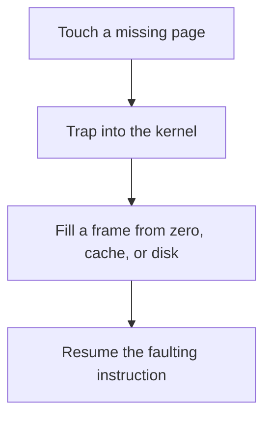

# D03-T016 — Page faults

Topic ID: `D03-T016`
Domain: Operating Systems
Subdomain: Page faults
Importance: core
Complexity: intermediate
Dependencies: `D03-T015`, `D03-T001`, `D01-T001`, `D01-T002`
Execution status of the code in section F: unexecuted

## A. Topic Overview

A page fault is a trap when a virtual page has no present mapping. A minor fault fills a page already in memory, such as a copy-on-write after fork. A major fault reads from disk or swap. The handler finds a frame, fills it, updates the page table, and resumes the instruction. A storm of major faults means the working set does not fit.

In production this shows up as follows: A deploy that forks a large Python process pays copy-on-write minor faults as children dirty pages. A cache bigger than RAM pays major faults and the request latency falls apart.

Interviewers use Page faults to see whether you can state the failure mode, not only the definition. The failure to name is: a latency spike or an OOM while the process allocates faster than faults can be satisfied

Prerequisites: `D03-T015`, `D03-T001`, `D01-T001`, `D01-T002`. Later notes should link here instead of repeating the mechanism.

## B. First-Principles Explanation

A page fault is a trap when a virtual page has no present mapping. A minor fault fills a page already in memory, such as a copy-on-write after fork. A major fault reads from disk or swap. The handler finds a frame, fills it, updates the page table, and resumes the instruction. A storm of major faults means the working set does not fit.

The useful picture is: A page fault is reaching for a book and finding a placeholder card. A minor fault means the book is already in the building. A major fault means someone has to fetch it from the warehouse.

What has to be true:

1. Touch a missing page
2. Trap into the kernel
3. Fill a frame from zero, cache, or disk
4. Resume the faulting instruction

It works when those steps preserve one invariant. It fails when a latency spike or an OOM while the process allocates faster than faults can be satisfied. The alternative is: the stall is a lock or a network call, which will not show up as a major fault

## C. Internal Working and Architecture

Components involved: the caller, the state Page faults mutates or reads, and the observer that reports major faults per second and the time spent in iowait during the spike.

Execution:

1. Touch a missing page
2. Trap into the kernel
3. Fill a frame from zero, cache, or disk
4. Resume the faulting instruction

Data moves only along that path. A retry re-enters at step 1, so the operation must say what a duplicate does. Memory and locks stay inside this mechanism. Callers see the result or a typed error, not a half-updated invariant.

State to remember: choose this when you are explaining a stall at first touch or under memory pressure. Do not choose it when the stall is a lock or a network call, which will not show up as a major fault.

## D. Diagrams and Visual Models



Read the diagram from top to bottom. Each box is one step of Page faults. The failure mode (a latency spike or an OOM while the process allocates faster than faults can be satisfied) is what you look for when a later box never happens or happens twice.

## E. Examples and Analogies

Analogy: A page fault is reaching for a book and finding a placeholder card. A minor fault means the book is already in the building. A major fault means someone has to fetch it from the warehouse.

Production example: A deploy that forks a large Python process pays copy-on-write minor faults as children dirty pages. A cache bigger than RAM pays major faults and the request latency falls apart.

A small counterexample is enough in an interview. Show the input, apply the steps, and show the broken outcome if someone uses the mechanism outside its rule: a latency spike or an OOM while the process allocates faster than faults can be satisfied.

## F. Code Examples

The snippet is labeled unexecuted. It illustrates the shape of the idea. It is not a benchmark and it embeds no secret.

```python
def working_set_warning(major_faults, limit):
    return major_faults > limit
```

After the snippet, check major faults per second and the time spent in iowait during the spike. If that signal moves the wrong way, the snippet is the wrong tool for the workload.

## G. Practical Backend Application

Use Page faults in a service when you are explaining a stall at first touch or under memory pressure.

A typical place is the production case already stated: A deploy that forks a large Python process pays copy-on-write minor faults as children dirty pages. A cache bigger than RAM pays major faults and the request latency falls apart.

Operationally you alert on major faults per second and the time spent in iowait during the spike. You do not alert only on process uptime. The dashboard should show the failure mode, a success rate, and the saturation signal (queue depth, lock wait, or latency) that predicts it.

## H. Advantages, Limitations and Trade-offs

| Choice | Benefit | Cost | Choose when | Avoid when |
| --- | --- | --- | --- | --- |
| Apply Page faults | you are explaining a stall at first touch or under memory pressure | Extra moving parts and a new failure mode | The failure you are preventing is already real | the stall is a lock or a network call, which will not show up as a major fault |
| Simpler alternative | Less code and fewer dependencies | a latency spike or an OOM while the process allocates faster than faults can be satisfied | The workload does not hit the limit | The invariant must hold under concurrency or failure |

Page faults is a trade. State the benefit and the cost in the same sentence when you propose it in a design review.

## I. Common Mistakes and Misconceptions

- Calling every fault a disk read.
- Pre-touching a multi-gigabyte cache on the request path.
- Ignoring copy-on-write after fork.
- Treating a diagram of Page faults as proof that the invariant holds in production.
- Copying a default configuration without naming major faults per second and the time spent in iowait during the spike.

## J. Debugging and Troubleshooting

Symptom: a latency spike or an OOM while the process allocates faster than faults can be satisfied

First check: major faults per second and the time spent in iowait during the spike.

Then compare one healthy instance against one unhealthy instance. Confirm whether retries are duplicating work. Confirm whether a timeout is shorter than the work. Fix the invariant, then watch the same metric for a full peak, not only for the next minute.

Useful questions: did the step order in section C actually happen, or did a caller skip a step? Did a deploy change the data shape that Page faults assumes?

## K. Interview Preparation

### Beginner

#### Q1. What problem does Page faults solve?

**Answer:** A page fault is a trap when a virtual page has no present mapping. A minor fault fills a page already in memory, such as a copy-on-write after fork. A major fault reads from disk or swap. The handler finds a frame, fills it, updates the page table, and resumes the instruction. A storm of major faults means the working set does not fit. Without it, the usual backend failure is: a latency spike or an OOM while the process allocates faster than faults can be satisfied.

#### Q2. Where does Page faults sit on a request path?

**Answer:** Page faults is not a library you sprinkle on every call. you are explaining a stall at first touch or under memory pressure You notice it when major faults per second and the time spent in iowait during the spike. Name the constraint that makes this choice correct. Say what you would measure to confirm it.

#### Q3. Give a concrete example of Page faults.

**Answer:** A deploy that forks a large Python process pays copy-on-write minor faults as children dirty pages. A cache bigger than RAM pays major faults and the request latency falls apart. Walk the input, the state change, and the observable output. Name the constraint that makes this choice correct.

#### Q4. What is a common mix-up around Page faults?

**Answer:** a latency spike or an OOM while the process allocates faster than faults can be satisfied The corrective check is major faults per second and the time spent in iowait during the spike. Name the constraint that makes this choice correct. Say what you would measure to confirm it. Say which alternative you rejected and why.

#### Q5. When would you skip Page faults?

**Answer:** the stall is a lock or a network call, which will not show up as a major fault Skipping is a decision with a measured cost, not a slogan. Name the constraint that makes this choice correct. Say what you would measure to confirm it. Say which alternative you rejected and why.

### Intermediate

#### Q1. What invariant makes Page faults correct?

**Answer:** A page fault is a trap when a virtual page has no present mapping. A minor fault fills a page already in memory, such as a copy-on-write after fork. A major fault reads from disk or swap. The handler finds a frame, fills it, updates the page table, and resumes the instruction. A storm of major faults means the working set does not fit. State the invariant before you name the tool.

#### Q2. How do you test Page faults?

**Answer:** Assert the failure mode directly: a latency spike or an OOM while the process allocates faster than faults can be satisfied. The assertion should watch major faults per second and the time spent in iowait during the spike. Include a concurrent or retry case if the bug only appears then. Name the constraint that makes this choice correct.

#### Q3. What signal tells you Page faults is misbehaving in production?

**Answer:** Watch major faults per second and the time spent in iowait during the spike. The user-visible symptom is usually a latency spike or an OOM while the process allocates faster than faults can be satisfied. Name the constraint that makes this choice correct. Say what you would measure to confirm it.

#### Q4. How would you introduce Page faults into a legacy service?

**Answer:** you are explaining a stall at first touch or under memory pressure Ship it behind a metric so you can compare the old path. Roll back if a latency spike or an OOM while the process allocates faster than faults can be satisfied gets worse. Name the constraint that makes this choice correct. Say what you would measure to confirm it.

#### Q5. What do you trade away by choosing Page faults?

**Answer:** you are explaining a stall at first touch or under memory pressure the stall is a lock or a network call, which will not show up as a major fault Say the cost in latency, storage, or operational load. Name the constraint that makes this choice correct. Say what you would measure to confirm it. Say which alternative you rejected and why.

### Advanced

#### Q1. What breaks if a dependency of Page faults is slow or down?

**Answer:** a latency spike or an OOM while the process allocates faster than faults can be satisfied Degrade using the rule: the stall is a lock or a network call, which will not show up as a major fault. Timeouts must be shorter than the caller's deadline. Name the constraint that makes this choice correct. Say what you would measure to confirm it.

#### Q2. How does Page faults behave under retries?

**Answer:** Retries repeat work, so Page faults must define what a duplicate does. a latency spike or an OOM while the process allocates faster than faults can be satisfied Idempotency keys or fences belong next to the write, not in a comment. Name the constraint that makes this choice correct. Say what you would measure to confirm it.

#### Q3. What is the capacity limit of Page faults?

**Answer:** The limit shows up as major faults per second and the time spent in iowait during the spike. Add capacity only after you know whether the bottleneck is CPU, lock wait, or network. Name the constraint that makes this choice correct. Say what you would measure to confirm it.

#### Q4. How do you evolve Page faults without a flag day?

**Answer:** you are explaining a stall at first touch or under memory pressure Version the contract or the on-disk format. Readers should tolerate one old and one new shape during the rollout. Name the constraint that makes this choice correct. Say what you would measure to confirm it.

#### Q5. What security or correctness bug hides inside Page faults?

**Answer:** a latency spike or an OOM while the process allocates faster than faults can be satisfied Check authorization and tenancy at the same boundary as the mechanism. A cache or queue must not widen who can read the data. Name the constraint that makes this choice correct. Say what you would measure to confirm it.

### Scenario

#### Q1. Incident: a latency spike or an OOM while the process allocates faster than faults can be satisfied. What do you check first?

**Answer:** Start with major faults per second and the time spent in iowait during the spike. Compare a good host and a bad host before you restart anything. A page fault is a trap when a virtual page has no present mapping. A minor fault fills a page already in memory, such as a copy-on-write after fork. A major fault reads from disk or swap. The handler finds a frame, fills it, updates the page table, and resumes the instruction. A storm of major faults means the working set does not fit.

#### Q2. A reviewer wants the clever version. What data settles it?

**Answer:** you are explaining a stall at first touch or under memory pressure the stall is a lock or a network call, which will not show up as a major fault Bring major faults per second and the time spent in iowait during the spike from a load test or from production, not a slogan. Name the constraint that makes this choice correct. Say what you would measure to confirm it. Say which alternative you rejected and why.

#### Q3. You have one hour to explain Page faults at a whiteboard.

**Answer:** Draw the happy path in four boxes. Then draw the failure: a latency spike or an OOM while the process allocates faster than faults can be satisfied. End with the metric you would page on. Name the constraint that makes this choice correct.

#### Q4. The bug only appears under two concurrent callers.

**Answer:** a latency spike or an OOM while the process allocates faster than faults can be satisfied Reproduce with a barrier so both sides enter the critical window. Confirm the fix with major faults per second and the time spent in iowait during the spike. Name the constraint that makes this choice correct. Say what you would measure to confirm it.

#### Q5. Leadership wants this on every service next week.

**Answer:** the stall is a lock or a network call, which will not show up as a major fault you are explaining a stall at first touch or under memory pressure Roll it out where the failure mode is already hurting users. Name the constraint that makes this choice correct. Say what you would measure to confirm it. Say which alternative you rejected and why.

### Follow-up

#### Q1. What did you assume about the data size or the clock?

**Answer:** A page fault is a trap when a virtual page has no present mapping. A minor fault fills a page already in memory, such as a copy-on-write after fork. A major fault reads from disk or swap. The handler finds a frame, fills it, updates the page table, and resumes the instruction. A storm of major faults means the working set does not fit. Clocks are not a total order across machines. State whether the algorithm needs bounded size or a single leader.

#### Q2. What would you measure after the change ships?

**Answer:** Page on major faults per second and the time spent in iowait during the spike. Keep a before/after dashboard for one week. Alert on the failure mode, not only on CPU. Name the constraint that makes this choice correct.

#### Q3. Which neighboring topic did you deliberately not re-teach?

**Answer:** This note owns Page faults. Related identifiers are in section N. Shared ideas are linked, not copied. Name the constraint that makes this choice correct.

## L. Practical Exercises

Solutions are in `EXERCISES/solutions/D03-T016.md`, not in this section.

1. Whiteboard the four steps of Page faults and mark where `a latency spike or an OOM while the process allocates faster than faults can be satisfied` enters.
2. Read the snippet in section F and write the assertion that would catch that failure. The assertion must mention `major faults per second and the time spent in iowait during the spike`.
3. Argue for or against using Page faults on a service you know. Use the choose and avoid rows from section H. Do not appeal to popularity.

## M. Revision Notes

- Mechanism: A page fault is a trap when a virtual page has no present mapping.
- Failure: a latency spike or an OOM while the process allocates faster than faults can be satisfied
- Metric: major faults per second and the time spent in iowait during the spike
- Choose when: you are explaining a stall at first touch or under memory pressure
- Avoid when: the stall is a lock or a network call, which will not show up as a major fault

## N. Related Topics

Dependencies to review first: `D03-T015`, `D03-T001`, `D01-T001`, `D01-T002`.

Shared ideas stay in those notes. This note does not restate them.

## O. Completion Criteria

- You can explain Page faults without reading this note, including the failure mode.
- You can draw the diagram in section D from memory.
- You can say when not to use it, using the avoid condition in section H.
- You can name the metric you would watch after shipping it.
