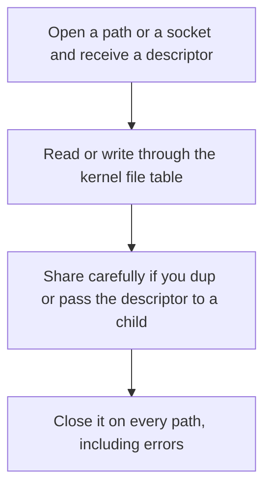

# D03-T017 — File descriptors and file systems

Topic ID: `D03-T017`
Domain: Operating Systems
Subdomain: File descriptors and file systems
Importance: core
Complexity: intermediate
Dependencies: `D03-T016`, `D03-T001`, `D01-T001`, `D01-T002`
Execution status of the code in section F: unexecuted

## A. Topic Overview

A file descriptor is a small integer in a process that names an open file, socket, or pipe in the kernel's file table. The descriptor points at a description that holds the offset and status flags. Two descriptors can share one offset, which is why dup changes both reads. File systems map names to inodes and inodes to blocks. Closing a descriptor releases the process's reference, not necessarily the underlying inode if another process still holds it.

In production this shows up as follows: A service that opens a log file per request eventually hits EMFILE. The fix is one shared logger, not a higher ulimit alone.

Interviewers use File descriptors and file systems to see whether you can state the failure mode, not only the definition. The failure to name is: descriptor exhaustion, a leaked socket, or two threads sharing one file offset and corrupting a read

Prerequisites: `D03-T016`, `D03-T001`, `D01-T001`, `D01-T002`. Later notes should link here instead of repeating the mechanism.

## B. First-Principles Explanation

A file descriptor is a small integer in a process that names an open file, socket, or pipe in the kernel's file table. The descriptor points at a description that holds the offset and status flags. Two descriptors can share one offset, which is why dup changes both reads. File systems map names to inodes and inodes to blocks. Closing a descriptor releases the process's reference, not necessarily the underlying inode if another process still holds it.

The useful picture is: A file descriptor is a coat-check ticket. Losing the ticket leaks the coat from your point of view. Two people holding tickets to the same coat share one hanger position.

What has to be true:

1. Open a path or a socket and receive a descriptor
2. Read or write through the kernel file table
3. Share carefully if you dup or pass the descriptor to a child
4. Close it on every path, including errors

It works when those steps preserve one invariant. It fails when descriptor exhaustion, a leaked socket, or two threads sharing one file offset and corrupting a read. The alternative is: you needed an application buffer, which is not a descriptor

## C. Internal Working and Architecture

Components involved: the caller, the state File descriptors and file systems mutates or reads, and the observer that reports open file count against ulimit, and the identity of descriptors that survive a request.

Execution:

1. Open a path or a socket and receive a descriptor
2. Read or write through the kernel file table
3. Share carefully if you dup or pass the descriptor to a child
4. Close it on every path, including errors

Data moves only along that path. A retry re-enters at step 1, so the operation must say what a duplicate does. Memory and locks stay inside this mechanism. Callers see the result or a typed error, not a half-updated invariant.

State to remember: choose this when you are debugging leaks, accidental sharing, or filesystem behavior. Do not choose it when you needed an application buffer, which is not a descriptor.

## D. Diagrams and Visual Models



Read the diagram from top to bottom. Each box is one step of File descriptors and file systems. The failure mode (descriptor exhaustion, a leaked socket, or two threads sharing one file offset and corrupting a read) is what you look for when a later box never happens or happens twice.

## E. Examples and Analogies

Analogy: A file descriptor is a coat-check ticket. Losing the ticket leaks the coat from your point of view. Two people holding tickets to the same coat share one hanger position.

Production example: A service that opens a log file per request eventually hits EMFILE. The fix is one shared logger, not a higher ulimit alone.

A small counterexample is enough in an interview. Show the input, apply the steps, and show the broken outcome if someone uses the mechanism outside its rule: descriptor exhaustion, a leaked socket, or two threads sharing one file offset and corrupting a read.

## F. Code Examples

The snippet is labeled unexecuted. It illustrates the shape of the idea. It is not a benchmark and it embeds no secret.

```python
def leaky_example():
    # unexecuted shape: always close
    f = open('data.txt', 'rb')
    try:
        return f.read(8)
    finally:
        f.close()
```

After the snippet, check open file count against ulimit, and the identity of descriptors that survive a request. If that signal moves the wrong way, the snippet is the wrong tool for the workload.

## G. Practical Backend Application

Use File descriptors and file systems in a service when you are debugging leaks, accidental sharing, or filesystem behavior.

A typical place is the production case already stated: A service that opens a log file per request eventually hits EMFILE. The fix is one shared logger, not a higher ulimit alone.

Operationally you alert on open file count against ulimit, and the identity of descriptors that survive a request. You do not alert only on process uptime. The dashboard should show the failure mode, a success rate, and the saturation signal (queue depth, lock wait, or latency) that predicts it.

## H. Advantages, Limitations and Trade-offs

| Choice | Benefit | Cost | Choose when | Avoid when |
| --- | --- | --- | --- | --- |
| Apply File descriptors and file systems | you are debugging leaks, accidental sharing, or filesystem behavior | Extra moving parts and a new failure mode | The failure you are preventing is already real | you needed an application buffer, which is not a descriptor |
| Simpler alternative | Less code and fewer dependencies | descriptor exhaustion, a leaked socket, or two threads sharing one file offset and corrupting a read | The workload does not hit the limit | The invariant must hold under concurrency or failure |

File descriptors and file systems is a trade. State the benefit and the cost in the same sentence when you propose it in a design review.

## I. Common Mistakes and Misconceptions

- Raising the ulimit without finding the leak.
- Assuming close is optional because the process will exit.
- Sharing one file object across threads without a position lock.
- Treating a diagram of File descriptors and file systems as proof that the invariant holds in production.
- Copying a default configuration without naming open file count against ulimit, and the identity of descriptors that survive a request.

## J. Debugging and Troubleshooting

Symptom: descriptor exhaustion, a leaked socket, or two threads sharing one file offset and corrupting a read

First check: open file count against ulimit, and the identity of descriptors that survive a request.

Then compare one healthy instance against one unhealthy instance. Confirm whether retries are duplicating work. Confirm whether a timeout is shorter than the work. Fix the invariant, then watch the same metric for a full peak, not only for the next minute.

Useful questions: did the step order in section C actually happen, or did a caller skip a step? Did a deploy change the data shape that File descriptors and file systems assumes?

## K. Interview Preparation

### Beginner

#### Q1. What problem does File descriptors and file systems solve?

**Answer:** A file descriptor is a small integer in a process that names an open file, socket, or pipe in the kernel's file table. The descriptor points at a description that holds the offset and status flags. Two descriptors can share one offset, which is why dup changes both reads. File systems map names to inodes and inodes to blocks. Closing a descriptor releases the process's reference, not necessarily the underlying inode if another process still holds it. Without it, the usual backend failure is: descriptor exhaustion, a leaked socket, or two threads sharing one file offset and corrupting a read.

#### Q2. Where does File descriptors and file systems sit on a request path?

**Answer:** File descriptors and file systems is not a library you sprinkle on every call. you are debugging leaks, accidental sharing, or filesystem behavior You notice it when open file count against ulimit, and the identity of descriptors that survive a request. Name the constraint that makes this choice correct. Say what you would measure to confirm it.

#### Q3. Give a concrete example of File descriptors and file systems.

**Answer:** A service that opens a log file per request eventually hits EMFILE. The fix is one shared logger, not a higher ulimit alone. Walk the input, the state change, and the observable output. Name the constraint that makes this choice correct.

#### Q4. What is a common mix-up around File descriptors and file systems?

**Answer:** descriptor exhaustion, a leaked socket, or two threads sharing one file offset and corrupting a read The corrective check is open file count against ulimit, and the identity of descriptors that survive a request. Name the constraint that makes this choice correct. Say what you would measure to confirm it. Say which alternative you rejected and why.

#### Q5. When would you skip File descriptors and file systems?

**Answer:** you needed an application buffer, which is not a descriptor Skipping is a decision with a measured cost, not a slogan. Name the constraint that makes this choice correct. Say what you would measure to confirm it. Say which alternative you rejected and why.

### Intermediate

#### Q1. What invariant makes File descriptors and file systems correct?

**Answer:** A file descriptor is a small integer in a process that names an open file, socket, or pipe in the kernel's file table. The descriptor points at a description that holds the offset and status flags. Two descriptors can share one offset, which is why dup changes both reads. File systems map names to inodes and inodes to blocks. Closing a descriptor releases the process's reference, not necessarily the underlying inode if another process still holds it. State the invariant before you name the tool.

#### Q2. How do you test File descriptors and file systems?

**Answer:** Assert the failure mode directly: descriptor exhaustion, a leaked socket, or two threads sharing one file offset and corrupting a read. The assertion should watch open file count against ulimit, and the identity of descriptors that survive a request. Include a concurrent or retry case if the bug only appears then. Name the constraint that makes this choice correct.

#### Q3. What signal tells you File descriptors and file systems is misbehaving in production?

**Answer:** Watch open file count against ulimit, and the identity of descriptors that survive a request. The user-visible symptom is usually descriptor exhaustion, a leaked socket, or two threads sharing one file offset and corrupting a read. Name the constraint that makes this choice correct. Say what you would measure to confirm it.

#### Q4. How would you introduce File descriptors and file systems into a legacy service?

**Answer:** you are debugging leaks, accidental sharing, or filesystem behavior Ship it behind a metric so you can compare the old path. Roll back if descriptor exhaustion, a leaked socket, or two threads sharing one file offset and corrupting a read gets worse. Name the constraint that makes this choice correct. Say what you would measure to confirm it.

#### Q5. What do you trade away by choosing File descriptors and file systems?

**Answer:** you are debugging leaks, accidental sharing, or filesystem behavior you needed an application buffer, which is not a descriptor Say the cost in latency, storage, or operational load. Name the constraint that makes this choice correct. Say what you would measure to confirm it. Say which alternative you rejected and why.

### Advanced

#### Q1. What breaks if a dependency of File descriptors and file systems is slow or down?

**Answer:** descriptor exhaustion, a leaked socket, or two threads sharing one file offset and corrupting a read Degrade using the rule: you needed an application buffer, which is not a descriptor. Timeouts must be shorter than the caller's deadline. Name the constraint that makes this choice correct. Say what you would measure to confirm it.

#### Q2. How does File descriptors and file systems behave under retries?

**Answer:** Retries repeat work, so File descriptors and file systems must define what a duplicate does. descriptor exhaustion, a leaked socket, or two threads sharing one file offset and corrupting a read Idempotency keys or fences belong next to the write, not in a comment. Name the constraint that makes this choice correct. Say what you would measure to confirm it.

#### Q3. What is the capacity limit of File descriptors and file systems?

**Answer:** The limit shows up as open file count against ulimit, and the identity of descriptors that survive a request. Add capacity only after you know whether the bottleneck is CPU, lock wait, or network. Name the constraint that makes this choice correct. Say what you would measure to confirm it.

#### Q4. How do you evolve File descriptors and file systems without a flag day?

**Answer:** you are debugging leaks, accidental sharing, or filesystem behavior Version the contract or the on-disk format. Readers should tolerate one old and one new shape during the rollout. Name the constraint that makes this choice correct. Say what you would measure to confirm it.

#### Q5. What security or correctness bug hides inside File descriptors and file systems?

**Answer:** descriptor exhaustion, a leaked socket, or two threads sharing one file offset and corrupting a read Check authorization and tenancy at the same boundary as the mechanism. A cache or queue must not widen who can read the data. Name the constraint that makes this choice correct. Say what you would measure to confirm it.

### Scenario

#### Q1. Incident: descriptor exhaustion, a leaked socket, or two threads sharing one file offset and corrupting a read. What do you check first?

**Answer:** Start with open file count against ulimit, and the identity of descriptors that survive a request. Compare a good host and a bad host before you restart anything. A file descriptor is a small integer in a process that names an open file, socket, or pipe in the kernel's file table. The descriptor points at a description that holds the offset and status flags. Two descriptors can share one offset, which is why dup changes both reads. File systems map names to inodes and inodes to blocks. Closing a descriptor releases the process's reference, not necessarily the underlying inode if another process still holds it.

#### Q2. A reviewer wants the clever version. What data settles it?

**Answer:** you are debugging leaks, accidental sharing, or filesystem behavior you needed an application buffer, which is not a descriptor Bring open file count against ulimit, and the identity of descriptors that survive a request from a load test or from production, not a slogan. Name the constraint that makes this choice correct. Say what you would measure to confirm it. Say which alternative you rejected and why.

#### Q3. You have one hour to explain File descriptors and file systems at a whiteboard.

**Answer:** Draw the happy path in four boxes. Then draw the failure: descriptor exhaustion, a leaked socket, or two threads sharing one file offset and corrupting a read. End with the metric you would page on. Name the constraint that makes this choice correct.

#### Q4. The bug only appears under two concurrent callers.

**Answer:** descriptor exhaustion, a leaked socket, or two threads sharing one file offset and corrupting a read Reproduce with a barrier so both sides enter the critical window. Confirm the fix with open file count against ulimit, and the identity of descriptors that survive a request. Name the constraint that makes this choice correct. Say what you would measure to confirm it.

#### Q5. Leadership wants this on every service next week.

**Answer:** you needed an application buffer, which is not a descriptor you are debugging leaks, accidental sharing, or filesystem behavior Roll it out where the failure mode is already hurting users. Name the constraint that makes this choice correct. Say what you would measure to confirm it. Say which alternative you rejected and why.

### Follow-up

#### Q1. What did you assume about the data size or the clock?

**Answer:** A file descriptor is a small integer in a process that names an open file, socket, or pipe in the kernel's file table. The descriptor points at a description that holds the offset and status flags. Two descriptors can share one offset, which is why dup changes both reads. File systems map names to inodes and inodes to blocks. Closing a descriptor releases the process's reference, not necessarily the underlying inode if another process still holds it. Clocks are not a total order across machines. State whether the algorithm needs bounded size or a single leader.

#### Q2. What would you measure after the change ships?

**Answer:** Page on open file count against ulimit, and the identity of descriptors that survive a request. Keep a before/after dashboard for one week. Alert on the failure mode, not only on CPU. Name the constraint that makes this choice correct.

#### Q3. Which neighboring topic did you deliberately not re-teach?

**Answer:** This note owns File descriptors and file systems. Related identifiers are in section N. Shared ideas are linked, not copied. Name the constraint that makes this choice correct.

## L. Practical Exercises

Solutions are in `EXERCISES/solutions/D03-T017.md`, not in this section.

1. Whiteboard the four steps of File descriptors and file systems and mark where `descriptor exhaustion, a leaked socket, or two threads sharing one file offset and corrupting a read` enters.
2. Read the snippet in section F and write the assertion that would catch that failure. The assertion must mention `open file count against ulimit, and the identity of descriptors that survive a request`.
3. Argue for or against using File descriptors and file systems on a service you know. Use the choose and avoid rows from section H. Do not appeal to popularity.

## M. Revision Notes

- Mechanism: A file descriptor is a small integer in a process that names an open file, socket, or pipe in the kernel's file table.
- Failure: descriptor exhaustion, a leaked socket, or two threads sharing one file offset and corrupting a read
- Metric: open file count against ulimit, and the identity of descriptors that survive a request
- Choose when: you are debugging leaks, accidental sharing, or filesystem behavior
- Avoid when: you needed an application buffer, which is not a descriptor

## N. Related Topics

Dependencies to review first: `D03-T016`, `D03-T001`, `D01-T001`, `D01-T002`.

Shared ideas stay in those notes. This note does not restate them.

## O. Completion Criteria

- You can explain File descriptors and file systems without reading this note, including the failure mode.
- You can draw the diagram in section D from memory.
- You can say when not to use it, using the avoid condition in section H.
- You can name the metric you would watch after shipping it.
