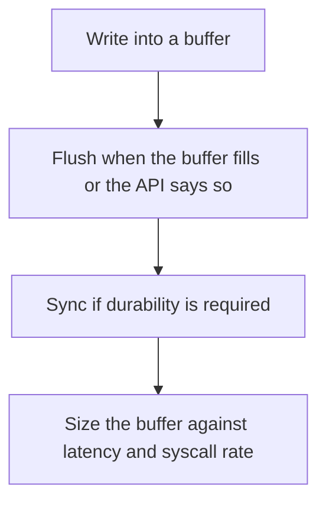

# D03-T018 — I/O buffering

Topic ID: `D03-T018`
Domain: Operating Systems
Subdomain: I/O buffering
Importance: core
Complexity: intermediate
Dependencies: `D03-T017`, `D03-T001`, `D01-T001`, `D01-T002`
Execution status of the code in section F: unexecuted

## A. Topic Overview

I/O buffering gathers bytes in memory so a device is touched in larger chunks. User-space stdio buffers, the kernel page cache, and a disk controller cache are different layers. A write can sit in a buffer and not be durable. Flush pushes the buffer toward the device. fsync asks the device to persist. Line buffering and full buffering change when a log line becomes visible.

In production this shows up as follows: An audit log that write()s without flush or fsync loses the last transactions on a kill -9. A payment ledger cannot treat a buffered write as a commit.

Interviewers use I/O buffering to see whether you can state the failure mode, not only the definition. The failure to name is: a log line missing after a crash because it was still in a user-space buffer, or a tiny write syscall per record

Prerequisites: `D03-T017`, `D03-T001`, `D01-T001`, `D01-T002`. Later notes should link here instead of repeating the mechanism.

## B. First-Principles Explanation

I/O buffering gathers bytes in memory so a device is touched in larger chunks. User-space stdio buffers, the kernel page cache, and a disk controller cache are different layers. A write can sit in a buffer and not be durable. Flush pushes the buffer toward the device. fsync asks the device to persist. Line buffering and full buffering change when a log line becomes visible.

The useful picture is: Buffering is stacking letters until the envelope is worth a trip to the mailbox. Flush is walking to the mailbox. It is not the same as the post office promising the letter is in the vault.

What has to be true:

1. Write into a buffer
2. Flush when the buffer fills or the API says so
3. Sync if durability is required
4. Size the buffer against latency and syscall rate

It works when those steps preserve one invariant. It fails when a log line missing after a crash because it was still in a user-space buffer, or a tiny write syscall per record. The alternative is: you need every record durable before the acknowledgment, unless you also sync

## C. Internal Working and Architecture

Components involved: the caller, the state I/O buffering mutates or reads, and the observer that reports write syscall rate, flush latency, and whether a crash test still contains the last record.

Execution:

1. Write into a buffer
2. Flush when the buffer fills or the API says so
3. Sync if durability is required
4. Size the buffer against latency and syscall rate

Data moves only along that path. A retry re-enters at step 1, so the operation must say what a duplicate does. Memory and locks stay inside this mechanism. Callers see the result or a typed error, not a half-updated invariant.

State to remember: choose this when you need fewer syscalls or you need to define durability. Do not choose it when you need every record durable before the acknowledgment, unless you also sync.

## D. Diagrams and Visual Models



Read the diagram from top to bottom. Each box is one step of I/O buffering. The failure mode (a log line missing after a crash because it was still in a user-space buffer, or a tiny write syscall per record) is what you look for when a later box never happens or happens twice.

## E. Examples and Analogies

Analogy: Buffering is stacking letters until the envelope is worth a trip to the mailbox. Flush is walking to the mailbox. It is not the same as the post office promising the letter is in the vault.

Production example: An audit log that write()s without flush or fsync loses the last transactions on a kill -9. A payment ledger cannot treat a buffered write as a commit.

A small counterexample is enough in an interview. Show the input, apply the steps, and show the broken outcome if someone uses the mechanism outside its rule: a log line missing after a crash because it was still in a user-space buffer, or a tiny write syscall per record.

## F. Code Examples

The snippet is labeled unexecuted. It illustrates the shape of the idea. It is not a benchmark and it embeds no secret.

```python
def write_record(f, line):
    f.write(line + '\n')
    f.flush()
```

After the snippet, check write syscall rate, flush latency, and whether a crash test still contains the last record. If that signal moves the wrong way, the snippet is the wrong tool for the workload.

## G. Practical Backend Application

Use I/O buffering in a service when you need fewer syscalls or you need to define durability.

A typical place is the production case already stated: An audit log that write()s without flush or fsync loses the last transactions on a kill -9. A payment ledger cannot treat a buffered write as a commit.

Operationally you alert on write syscall rate, flush latency, and whether a crash test still contains the last record. You do not alert only on process uptime. The dashboard should show the failure mode, a success rate, and the saturation signal (queue depth, lock wait, or latency) that predicts it.

## H. Advantages, Limitations and Trade-offs

| Choice | Benefit | Cost | Choose when | Avoid when |
| --- | --- | --- | --- | --- |
| Apply I/O buffering | you need fewer syscalls or you need to define durability | Extra moving parts and a new failure mode | The failure you are preventing is already real | you need every record durable before the acknowledgment, unless you also sync |
| Simpler alternative | Less code and fewer dependencies | a log line missing after a crash because it was still in a user-space buffer, or a tiny write syscall per record | The workload does not hit the limit | The invariant must hold under concurrency or failure |

I/O buffering is a trade. State the benefit and the cost in the same sentence when you propose it in a design review.

## I. Common Mistakes and Misconceptions

- Confusing flush with fsync.
- Disabling buffering and then wondering why the disk is saturated.
- Assuming the page cache is durable.
- Treating a diagram of I/O buffering as proof that the invariant holds in production.
- Copying a default configuration without naming write syscall rate, flush latency, and whether a crash test still contains the last record.

## J. Debugging and Troubleshooting

Symptom: a log line missing after a crash because it was still in a user-space buffer, or a tiny write syscall per record

First check: write syscall rate, flush latency, and whether a crash test still contains the last record.

Then compare one healthy instance against one unhealthy instance. Confirm whether retries are duplicating work. Confirm whether a timeout is shorter than the work. Fix the invariant, then watch the same metric for a full peak, not only for the next minute.

Useful questions: did the step order in section C actually happen, or did a caller skip a step? Did a deploy change the data shape that I/O buffering assumes?

## K. Interview Preparation

### Beginner

#### Q1. What problem does I/O buffering solve?

**Answer:** I/O buffering gathers bytes in memory so a device is touched in larger chunks. User-space stdio buffers, the kernel page cache, and a disk controller cache are different layers. A write can sit in a buffer and not be durable. Flush pushes the buffer toward the device. fsync asks the device to persist. Line buffering and full buffering change when a log line becomes visible. Without it, the usual backend failure is: a log line missing after a crash because it was still in a user-space buffer, or a tiny write syscall per record.

#### Q2. Where does I/O buffering sit on a request path?

**Answer:** I/O buffering is not a library you sprinkle on every call. you need fewer syscalls or you need to define durability You notice it when write syscall rate, flush latency, and whether a crash test still contains the last record. Name the constraint that makes this choice correct. Say what you would measure to confirm it.

#### Q3. Give a concrete example of I/O buffering.

**Answer:** An audit log that write()s without flush or fsync loses the last transactions on a kill -9. A payment ledger cannot treat a buffered write as a commit. Walk the input, the state change, and the observable output. Name the constraint that makes this choice correct.

#### Q4. What is a common mix-up around I/O buffering?

**Answer:** a log line missing after a crash because it was still in a user-space buffer, or a tiny write syscall per record The corrective check is write syscall rate, flush latency, and whether a crash test still contains the last record. Name the constraint that makes this choice correct. Say what you would measure to confirm it. Say which alternative you rejected and why.

#### Q5. When would you skip I/O buffering?

**Answer:** you need every record durable before the acknowledgment, unless you also sync Skipping is a decision with a measured cost, not a slogan. Name the constraint that makes this choice correct. Say what you would measure to confirm it. Say which alternative you rejected and why.

### Intermediate

#### Q1. What invariant makes I/O buffering correct?

**Answer:** I/O buffering gathers bytes in memory so a device is touched in larger chunks. User-space stdio buffers, the kernel page cache, and a disk controller cache are different layers. A write can sit in a buffer and not be durable. Flush pushes the buffer toward the device. fsync asks the device to persist. Line buffering and full buffering change when a log line becomes visible. State the invariant before you name the tool.

#### Q2. How do you test I/O buffering?

**Answer:** Assert the failure mode directly: a log line missing after a crash because it was still in a user-space buffer, or a tiny write syscall per record. The assertion should watch write syscall rate, flush latency, and whether a crash test still contains the last record. Include a concurrent or retry case if the bug only appears then. Name the constraint that makes this choice correct.

#### Q3. What signal tells you I/O buffering is misbehaving in production?

**Answer:** Watch write syscall rate, flush latency, and whether a crash test still contains the last record. The user-visible symptom is usually a log line missing after a crash because it was still in a user-space buffer, or a tiny write syscall per record. Name the constraint that makes this choice correct. Say what you would measure to confirm it.

#### Q4. How would you introduce I/O buffering into a legacy service?

**Answer:** you need fewer syscalls or you need to define durability Ship it behind a metric so you can compare the old path. Roll back if a log line missing after a crash because it was still in a user-space buffer, or a tiny write syscall per record gets worse. Name the constraint that makes this choice correct. Say what you would measure to confirm it.

#### Q5. What do you trade away by choosing I/O buffering?

**Answer:** you need fewer syscalls or you need to define durability you need every record durable before the acknowledgment, unless you also sync Say the cost in latency, storage, or operational load. Name the constraint that makes this choice correct. Say what you would measure to confirm it. Say which alternative you rejected and why.

### Advanced

#### Q1. What breaks if a dependency of I/O buffering is slow or down?

**Answer:** a log line missing after a crash because it was still in a user-space buffer, or a tiny write syscall per record Degrade using the rule: you need every record durable before the acknowledgment, unless you also sync. Timeouts must be shorter than the caller's deadline. Name the constraint that makes this choice correct. Say what you would measure to confirm it.

#### Q2. How does I/O buffering behave under retries?

**Answer:** Retries repeat work, so I/O buffering must define what a duplicate does. a log line missing after a crash because it was still in a user-space buffer, or a tiny write syscall per record Idempotency keys or fences belong next to the write, not in a comment. Name the constraint that makes this choice correct. Say what you would measure to confirm it.

#### Q3. What is the capacity limit of I/O buffering?

**Answer:** The limit shows up as write syscall rate, flush latency, and whether a crash test still contains the last record. Add capacity only after you know whether the bottleneck is CPU, lock wait, or network. Name the constraint that makes this choice correct. Say what you would measure to confirm it.

#### Q4. How do you evolve I/O buffering without a flag day?

**Answer:** you need fewer syscalls or you need to define durability Version the contract or the on-disk format. Readers should tolerate one old and one new shape during the rollout. Name the constraint that makes this choice correct. Say what you would measure to confirm it.

#### Q5. What security or correctness bug hides inside I/O buffering?

**Answer:** a log line missing after a crash because it was still in a user-space buffer, or a tiny write syscall per record Check authorization and tenancy at the same boundary as the mechanism. A cache or queue must not widen who can read the data. Name the constraint that makes this choice correct. Say what you would measure to confirm it.

### Scenario

#### Q1. Incident: a log line missing after a crash because it was still in a user-space buffer, or a tiny write syscall per record. What do you check first?

**Answer:** Start with write syscall rate, flush latency, and whether a crash test still contains the last record. Compare a good host and a bad host before you restart anything. I/O buffering gathers bytes in memory so a device is touched in larger chunks. User-space stdio buffers, the kernel page cache, and a disk controller cache are different layers. A write can sit in a buffer and not be durable. Flush pushes the buffer toward the device. fsync asks the device to persist. Line buffering and full buffering change when a log line becomes visible.

#### Q2. A reviewer wants the clever version. What data settles it?

**Answer:** you need fewer syscalls or you need to define durability you need every record durable before the acknowledgment, unless you also sync Bring write syscall rate, flush latency, and whether a crash test still contains the last record from a load test or from production, not a slogan. Name the constraint that makes this choice correct. Say what you would measure to confirm it. Say which alternative you rejected and why.

#### Q3. You have one hour to explain I/O buffering at a whiteboard.

**Answer:** Draw the happy path in four boxes. Then draw the failure: a log line missing after a crash because it was still in a user-space buffer, or a tiny write syscall per record. End with the metric you would page on. Name the constraint that makes this choice correct.

#### Q4. The bug only appears under two concurrent callers.

**Answer:** a log line missing after a crash because it was still in a user-space buffer, or a tiny write syscall per record Reproduce with a barrier so both sides enter the critical window. Confirm the fix with write syscall rate, flush latency, and whether a crash test still contains the last record. Name the constraint that makes this choice correct. Say what you would measure to confirm it.

#### Q5. Leadership wants this on every service next week.

**Answer:** you need every record durable before the acknowledgment, unless you also sync you need fewer syscalls or you need to define durability Roll it out where the failure mode is already hurting users. Name the constraint that makes this choice correct. Say what you would measure to confirm it. Say which alternative you rejected and why.

### Follow-up

#### Q1. What did you assume about the data size or the clock?

**Answer:** I/O buffering gathers bytes in memory so a device is touched in larger chunks. User-space stdio buffers, the kernel page cache, and a disk controller cache are different layers. A write can sit in a buffer and not be durable. Flush pushes the buffer toward the device. fsync asks the device to persist. Line buffering and full buffering change when a log line becomes visible. Clocks are not a total order across machines. State whether the algorithm needs bounded size or a single leader.

#### Q2. What would you measure after the change ships?

**Answer:** Page on write syscall rate, flush latency, and whether a crash test still contains the last record. Keep a before/after dashboard for one week. Alert on the failure mode, not only on CPU. Name the constraint that makes this choice correct.

#### Q3. Which neighboring topic did you deliberately not re-teach?

**Answer:** This note owns I/O buffering. Related identifiers are in section N. Shared ideas are linked, not copied. Name the constraint that makes this choice correct.

## L. Practical Exercises

Solutions are in `EXERCISES/solutions/D03-T018.md`, not in this section.

1. Whiteboard the four steps of I/O buffering and mark where `a log line missing after a crash because it was still in a user-space buffer, or a tiny write syscall per record` enters.
2. Read the snippet in section F and write the assertion that would catch that failure. The assertion must mention `write syscall rate, flush latency, and whether a crash test still contains the last record`.
3. Argue for or against using I/O buffering on a service you know. Use the choose and avoid rows from section H. Do not appeal to popularity.

## M. Revision Notes

- Mechanism: I/O buffering gathers bytes in memory so a device is touched in larger chunks.
- Failure: a log line missing after a crash because it was still in a user-space buffer, or a tiny write syscall per record
- Metric: write syscall rate, flush latency, and whether a crash test still contains the last record
- Choose when: you need fewer syscalls or you need to define durability
- Avoid when: you need every record durable before the acknowledgment, unless you also sync

## N. Related Topics

Dependencies to review first: `D03-T017`, `D03-T001`, `D01-T001`, `D01-T002`.

Shared ideas stay in those notes. This note does not restate them.

## O. Completion Criteria

- You can explain I/O buffering without reading this note, including the failure mode.
- You can draw the diagram in section D from memory.
- You can say when not to use it, using the avoid condition in section H.
- You can name the metric you would watch after shipping it.
