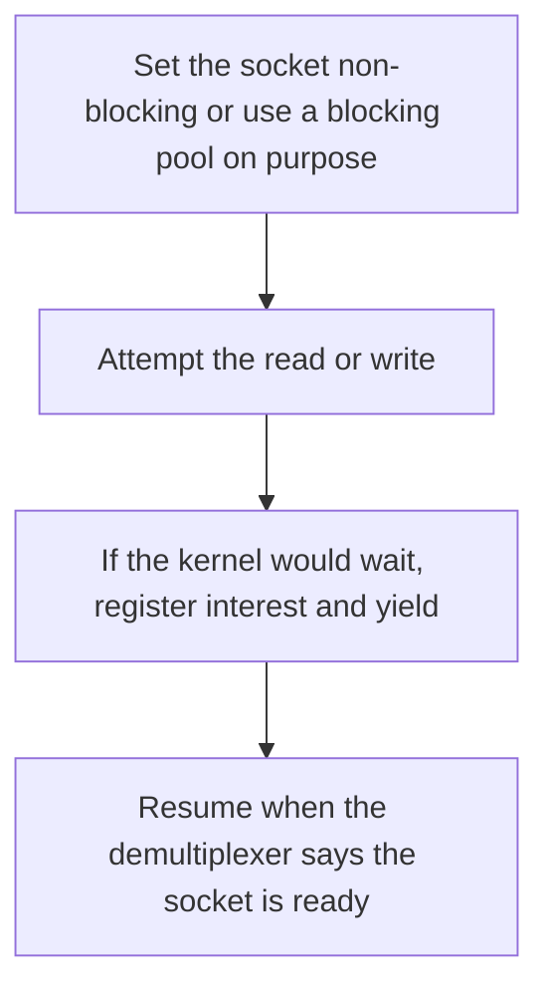

# D03-T019 — Blocking vs non-blocking I/O

Topic ID: `D03-T019`
Domain: Operating Systems
Subdomain: Blocking vs non-blocking I/O
Importance: core
Complexity: intermediate
Dependencies: `D03-T018`, `D03-T001`, `D01-T001`, `D01-T002`
Execution status of the code in section F: unexecuted

## A. Topic Overview

Blocking I/O puts the calling thread to sleep until the kernel finishes the operation. Non-blocking I/O returns immediately with a partial result or EAGAIN, and the caller polls or waits in an event demultiplexer. Non-blocking is not faster bytes. It lets one thread wait for many sockets. A blocking call hidden inside a non-blocking loop stalls every connection on that thread.

In production this shows up as follows: A Node or Java NIO server handles many idle sockets on one thread until a library call does a blocking file read. Event-loop lag jumps and health checks fail.

Interviewers use Blocking vs non-blocking I/O to see whether you can state the failure mode, not only the definition. The failure to name is: a DNS lookup or a disk read that blocks the event thread and stalls every other connection

Prerequisites: `D03-T018`, `D03-T001`, `D01-T001`, `D01-T002`. Later notes should link here instead of repeating the mechanism.

## B. First-Principles Explanation

Blocking I/O puts the calling thread to sleep until the kernel finishes the operation. Non-blocking I/O returns immediately with a partial result or EAGAIN, and the caller polls or waits in an event demultiplexer. Non-blocking is not faster bytes. It lets one thread wait for many sockets. A blocking call hidden inside a non-blocking loop stalls every connection on that thread.

The useful picture is: Blocking is standing at the counter until your order is ready. Non-blocking is taking a buzzer and talking to other customers until it rings.

What has to be true:

1. Set the socket non-blocking or use a blocking pool on purpose
2. Attempt the read or write
3. If the kernel would wait, register interest and yield
4. Resume when the demultiplexer says the socket is ready

It works when those steps preserve one invariant. It fails when a DNS lookup or a disk read that blocks the event thread and stalls every other connection. The alternative is: the work is CPU-heavy, where a thread per core is the honest model

## C. Internal Working and Architecture

Components involved: the caller, the state Blocking vs non-blocking I/O mutates or reads, and the observer that reports event-loop lag and the number of sockets handled per thread.

Execution:

1. Set the socket non-blocking or use a blocking pool on purpose
2. Attempt the read or write
3. If the kernel would wait, register interest and yield
4. Resume when the demultiplexer says the socket is ready

Data moves only along that path. A retry re-enters at step 1, so the operation must say what a duplicate does. Memory and locks stay inside this mechanism. Callers see the result or a typed error, not a half-updated invariant.

State to remember: choose this when many connections are idle most of the time. Do not choose it when the work is CPU-heavy, where a thread per core is the honest model.

## D. Diagrams and Visual Models



Read the diagram from top to bottom. Each box is one step of Blocking vs non-blocking I/O. The failure mode (a DNS lookup or a disk read that blocks the event thread and stalls every other connection) is what you look for when a later box never happens or happens twice.

## E. Examples and Analogies

Analogy: Blocking is standing at the counter until your order is ready. Non-blocking is taking a buzzer and talking to other customers until it rings.

Production example: A Node or Java NIO server handles many idle sockets on one thread until a library call does a blocking file read. Event-loop lag jumps and health checks fail.

A small counterexample is enough in an interview. Show the input, apply the steps, and show the broken outcome if someone uses the mechanism outside its rule: a DNS lookup or a disk read that blocks the event thread and stalls every other connection.

## F. Code Examples

The snippet is labeled unexecuted. It illustrates the shape of the idea. It is not a benchmark and it embeds no secret.

```python
def on_readable(conn, buf):
    chunk = conn.recv(4096)
    if chunk == b'':
        return 'closed'
    buf.extend(chunk)
    return 'again' if len(chunk) == 4096 else 'done'
```

After the snippet, check event-loop lag and the number of sockets handled per thread. If that signal moves the wrong way, the snippet is the wrong tool for the workload.

## G. Practical Backend Application

Use Blocking vs non-blocking I/O in a service when many connections are idle most of the time.

A typical place is the production case already stated: A Node or Java NIO server handles many idle sockets on one thread until a library call does a blocking file read. Event-loop lag jumps and health checks fail.

Operationally you alert on event-loop lag and the number of sockets handled per thread. You do not alert only on process uptime. The dashboard should show the failure mode, a success rate, and the saturation signal (queue depth, lock wait, or latency) that predicts it.

## H. Advantages, Limitations and Trade-offs

| Choice | Benefit | Cost | Choose when | Avoid when |
| --- | --- | --- | --- | --- |
| Apply Blocking vs non-blocking I/O | many connections are idle most of the time | Extra moving parts and a new failure mode | The failure you are preventing is already real | the work is CPU-heavy, where a thread per core is the honest model |
| Simpler alternative | Less code and fewer dependencies | a DNS lookup or a disk read that blocks the event thread and stalls every other connection | The workload does not hit the limit | The invariant must hold under concurrency or failure |

Blocking vs non-blocking I/O is a trade. State the benefit and the cost in the same sentence when you propose it in a design review.

## I. Common Mistakes and Misconceptions

- Calling a blocking library from the event thread.
- Equating non-blocking with parallel.
- Busy-polling instead of waiting in the demultiplexer.
- Treating a diagram of Blocking vs non-blocking I/O as proof that the invariant holds in production.
- Copying a default configuration without naming event-loop lag and the number of sockets handled per thread.

## J. Debugging and Troubleshooting

Symptom: a DNS lookup or a disk read that blocks the event thread and stalls every other connection

First check: event-loop lag and the number of sockets handled per thread.

Then compare one healthy instance against one unhealthy instance. Confirm whether retries are duplicating work. Confirm whether a timeout is shorter than the work. Fix the invariant, then watch the same metric for a full peak, not only for the next minute.

Useful questions: did the step order in section C actually happen, or did a caller skip a step? Did a deploy change the data shape that Blocking vs non-blocking I/O assumes?

## K. Interview Preparation

### Beginner

#### Q1. What problem does Blocking vs non-blocking I/O solve?

**Answer:** Blocking I/O puts the calling thread to sleep until the kernel finishes the operation. Non-blocking I/O returns immediately with a partial result or EAGAIN, and the caller polls or waits in an event demultiplexer. Non-blocking is not faster bytes. It lets one thread wait for many sockets. A blocking call hidden inside a non-blocking loop stalls every connection on that thread. Without it, the usual backend failure is: a DNS lookup or a disk read that blocks the event thread and stalls every other connection.

#### Q2. Where does Blocking vs non-blocking I/O sit on a request path?

**Answer:** Blocking vs non-blocking I/O is not a library you sprinkle on every call. many connections are idle most of the time You notice it when event-loop lag and the number of sockets handled per thread. Name the constraint that makes this choice correct. Say what you would measure to confirm it.

#### Q3. Give a concrete example of Blocking vs non-blocking I/O.

**Answer:** A Node or Java NIO server handles many idle sockets on one thread until a library call does a blocking file read. Event-loop lag jumps and health checks fail. Walk the input, the state change, and the observable output. Name the constraint that makes this choice correct.

#### Q4. What is a common mix-up around Blocking vs non-blocking I/O?

**Answer:** a DNS lookup or a disk read that blocks the event thread and stalls every other connection The corrective check is event-loop lag and the number of sockets handled per thread. Name the constraint that makes this choice correct. Say what you would measure to confirm it. Say which alternative you rejected and why.

#### Q5. When would you skip Blocking vs non-blocking I/O?

**Answer:** the work is CPU-heavy, where a thread per core is the honest model Skipping is a decision with a measured cost, not a slogan. Name the constraint that makes this choice correct. Say what you would measure to confirm it. Say which alternative you rejected and why.

### Intermediate

#### Q1. What invariant makes Blocking vs non-blocking I/O correct?

**Answer:** Blocking I/O puts the calling thread to sleep until the kernel finishes the operation. Non-blocking I/O returns immediately with a partial result or EAGAIN, and the caller polls or waits in an event demultiplexer. Non-blocking is not faster bytes. It lets one thread wait for many sockets. A blocking call hidden inside a non-blocking loop stalls every connection on that thread. State the invariant before you name the tool.

#### Q2. How do you test Blocking vs non-blocking I/O?

**Answer:** Assert the failure mode directly: a DNS lookup or a disk read that blocks the event thread and stalls every other connection. The assertion should watch event-loop lag and the number of sockets handled per thread. Include a concurrent or retry case if the bug only appears then. Name the constraint that makes this choice correct.

#### Q3. What signal tells you Blocking vs non-blocking I/O is misbehaving in production?

**Answer:** Watch event-loop lag and the number of sockets handled per thread. The user-visible symptom is usually a DNS lookup or a disk read that blocks the event thread and stalls every other connection. Name the constraint that makes this choice correct. Say what you would measure to confirm it.

#### Q4. How would you introduce Blocking vs non-blocking I/O into a legacy service?

**Answer:** many connections are idle most of the time Ship it behind a metric so you can compare the old path. Roll back if a DNS lookup or a disk read that blocks the event thread and stalls every other connection gets worse. Name the constraint that makes this choice correct. Say what you would measure to confirm it.

#### Q5. What do you trade away by choosing Blocking vs non-blocking I/O?

**Answer:** many connections are idle most of the time the work is CPU-heavy, where a thread per core is the honest model Say the cost in latency, storage, or operational load. Name the constraint that makes this choice correct. Say what you would measure to confirm it. Say which alternative you rejected and why.

### Advanced

#### Q1. What breaks if a dependency of Blocking vs non-blocking I/O is slow or down?

**Answer:** a DNS lookup or a disk read that blocks the event thread and stalls every other connection Degrade using the rule: the work is CPU-heavy, where a thread per core is the honest model. Timeouts must be shorter than the caller's deadline. Name the constraint that makes this choice correct. Say what you would measure to confirm it.

#### Q2. How does Blocking vs non-blocking I/O behave under retries?

**Answer:** Retries repeat work, so Blocking vs non-blocking I/O must define what a duplicate does. a DNS lookup or a disk read that blocks the event thread and stalls every other connection Idempotency keys or fences belong next to the write, not in a comment. Name the constraint that makes this choice correct. Say what you would measure to confirm it.

#### Q3. What is the capacity limit of Blocking vs non-blocking I/O?

**Answer:** The limit shows up as event-loop lag and the number of sockets handled per thread. Add capacity only after you know whether the bottleneck is CPU, lock wait, or network. Name the constraint that makes this choice correct. Say what you would measure to confirm it.

#### Q4. How do you evolve Blocking vs non-blocking I/O without a flag day?

**Answer:** many connections are idle most of the time Version the contract or the on-disk format. Readers should tolerate one old and one new shape during the rollout. Name the constraint that makes this choice correct. Say what you would measure to confirm it.

#### Q5. What security or correctness bug hides inside Blocking vs non-blocking I/O?

**Answer:** a DNS lookup or a disk read that blocks the event thread and stalls every other connection Check authorization and tenancy at the same boundary as the mechanism. A cache or queue must not widen who can read the data. Name the constraint that makes this choice correct. Say what you would measure to confirm it.

### Scenario

#### Q1. Incident: a DNS lookup or a disk read that blocks the event thread and stalls every other connection. What do you check first?

**Answer:** Start with event-loop lag and the number of sockets handled per thread. Compare a good host and a bad host before you restart anything. Blocking I/O puts the calling thread to sleep until the kernel finishes the operation. Non-blocking I/O returns immediately with a partial result or EAGAIN, and the caller polls or waits in an event demultiplexer. Non-blocking is not faster bytes. It lets one thread wait for many sockets. A blocking call hidden inside a non-blocking loop stalls every connection on that thread.

#### Q2. A reviewer wants the clever version. What data settles it?

**Answer:** many connections are idle most of the time the work is CPU-heavy, where a thread per core is the honest model Bring event-loop lag and the number of sockets handled per thread from a load test or from production, not a slogan. Name the constraint that makes this choice correct. Say what you would measure to confirm it. Say which alternative you rejected and why.

#### Q3. You have one hour to explain Blocking vs non-blocking I/O at a whiteboard.

**Answer:** Draw the happy path in four boxes. Then draw the failure: a DNS lookup or a disk read that blocks the event thread and stalls every other connection. End with the metric you would page on. Name the constraint that makes this choice correct.

#### Q4. The bug only appears under two concurrent callers.

**Answer:** a DNS lookup or a disk read that blocks the event thread and stalls every other connection Reproduce with a barrier so both sides enter the critical window. Confirm the fix with event-loop lag and the number of sockets handled per thread. Name the constraint that makes this choice correct. Say what you would measure to confirm it.

#### Q5. Leadership wants this on every service next week.

**Answer:** the work is CPU-heavy, where a thread per core is the honest model many connections are idle most of the time Roll it out where the failure mode is already hurting users. Name the constraint that makes this choice correct. Say what you would measure to confirm it. Say which alternative you rejected and why.

### Follow-up

#### Q1. What did you assume about the data size or the clock?

**Answer:** Blocking I/O puts the calling thread to sleep until the kernel finishes the operation. Non-blocking I/O returns immediately with a partial result or EAGAIN, and the caller polls or waits in an event demultiplexer. Non-blocking is not faster bytes. It lets one thread wait for many sockets. A blocking call hidden inside a non-blocking loop stalls every connection on that thread. Clocks are not a total order across machines. State whether the algorithm needs bounded size or a single leader.

#### Q2. What would you measure after the change ships?

**Answer:** Page on event-loop lag and the number of sockets handled per thread. Keep a before/after dashboard for one week. Alert on the failure mode, not only on CPU. Name the constraint that makes this choice correct.

#### Q3. Which neighboring topic did you deliberately not re-teach?

**Answer:** This note owns Blocking vs non-blocking I/O. Related identifiers are in section N. Shared ideas are linked, not copied. Name the constraint that makes this choice correct.

## L. Practical Exercises

Solutions are in `EXERCISES/solutions/D03-T019.md`, not in this section.

1. Whiteboard the four steps of Blocking vs non-blocking I/O and mark where `a DNS lookup or a disk read that blocks the event thread and stalls every other connection` enters.
2. Read the snippet in section F and write the assertion that would catch that failure. The assertion must mention `event-loop lag and the number of sockets handled per thread`.
3. Argue for or against using Blocking vs non-blocking I/O on a service you know. Use the choose and avoid rows from section H. Do not appeal to popularity.

## M. Revision Notes

- Mechanism: Blocking I/O puts the calling thread to sleep until the kernel finishes the operation.
- Failure: a DNS lookup or a disk read that blocks the event thread and stalls every other connection
- Metric: event-loop lag and the number of sockets handled per thread
- Choose when: many connections are idle most of the time
- Avoid when: the work is CPU-heavy, where a thread per core is the honest model

## N. Related Topics

Dependencies to review first: `D03-T018`, `D03-T001`, `D01-T001`, `D01-T002`.

Shared ideas stay in those notes. This note does not restate them.

## O. Completion Criteria

- You can explain Blocking vs non-blocking I/O without reading this note, including the failure mode.
- You can draw the diagram in section D from memory.
- You can say when not to use it, using the avoid condition in section H.
- You can name the metric you would watch after shipping it.
