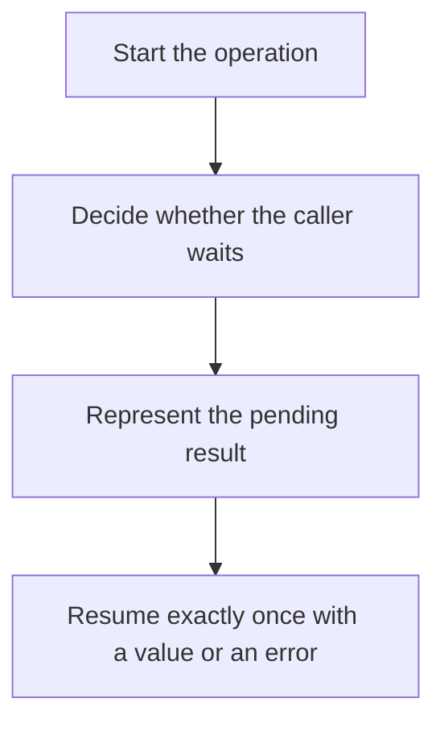

# D03-T020 — Synchronous vs asynchronous execution

Topic ID: `D03-T020`
Domain: Operating Systems
Subdomain: Synchronous vs asynchronous execution
Importance: core
Complexity: intermediate
Dependencies: `D03-T019`, `D03-T001`, `D01-T001`, `D01-T002`
Execution status of the code in section F: unexecuted

## A. Topic Overview

Synchronous execution means the caller waits for the result before continuing. Asynchronous execution means the caller starts the work and resumes on a callback, future, or later poll. Async does not imply another CPU. A synchronous API can wrap asynchronous machinery, and an async keyword can still block if the callee does. The contract that matters is whether the caller’s thread is occupied.

In production this shows up as follows: A request handler marked async that then calls a blocking database driver occupies the event loop for the whole query. The fix is a real async driver or a bounded worker pool.

Interviewers use Synchronous vs asynchronous execution to see whether you can state the failure mode, not only the definition. The failure to name is: an async function that blocks, or a callback that runs twice

Prerequisites: `D03-T019`, `D03-T001`, `D01-T001`, `D01-T002`. Later notes should link here instead of repeating the mechanism.

## B. First-Principles Explanation

Synchronous execution means the caller waits for the result before continuing. Asynchronous execution means the caller starts the work and resumes on a callback, future, or later poll. Async does not imply another CPU. A synchronous API can wrap asynchronous machinery, and an async keyword can still block if the callee does. The contract that matters is whether the caller’s thread is occupied.

The useful picture is: Synchronous is waiting on the phone. Asynchronous is asking someone to call you back. If they still make you stand there, the call was not asynchronous.

What has to be true:

1. Start the operation
2. Decide whether the caller waits
3. Represent the pending result
4. Resume exactly once with a value or an error

It works when those steps preserve one invariant. It fails when an async function that blocks, or a callback that runs twice. The alternative is: the operation is CPU-bound and short, where the callback machinery costs more than the work

## C. Internal Working and Architecture

Components involved: the caller, the state Synchronous vs asynchronous execution mutates or reads, and the observer that reports thread occupancy during the wait, and duplicate completion count.

Execution:

1. Start the operation
2. Decide whether the caller waits
3. Represent the pending result
4. Resume exactly once with a value or an error

Data moves only along that path. A retry re-enters at step 1, so the operation must say what a duplicate does. Memory and locks stay inside this mechanism. Callers see the result or a typed error, not a half-updated invariant.

State to remember: choose this when the caller has other useful work during the wait. Do not choose it when the operation is CPU-bound and short, where the callback machinery costs more than the work.

## D. Diagrams and Visual Models



Read the diagram from top to bottom. Each box is one step of Synchronous vs asynchronous execution. The failure mode (an async function that blocks, or a callback that runs twice) is what you look for when a later box never happens or happens twice.

## E. Examples and Analogies

Analogy: Synchronous is waiting on the phone. Asynchronous is asking someone to call you back. If they still make you stand there, the call was not asynchronous.

Production example: A request handler marked async that then calls a blocking database driver occupies the event loop for the whole query. The fix is a real async driver or a bounded worker pool.

A small counterexample is enough in an interview. Show the input, apply the steps, and show the broken outcome if someone uses the mechanism outside its rule: an async function that blocks, or a callback that runs twice.

## F. Code Examples

The snippet is labeled unexecuted. It illustrates the shape of the idea. It is not a benchmark and it embeds no secret.

```python
import asyncio

async def fetch(n):
    await asyncio.sleep(0)  # yields; a real service awaits I/O
    return n
```

After the snippet, check thread occupancy during the wait, and duplicate completion count. If that signal moves the wrong way, the snippet is the wrong tool for the workload.

## G. Practical Backend Application

Use Synchronous vs asynchronous execution in a service when the caller has other useful work during the wait.

A typical place is the production case already stated: A request handler marked async that then calls a blocking database driver occupies the event loop for the whole query. The fix is a real async driver or a bounded worker pool.

Operationally you alert on thread occupancy during the wait, and duplicate completion count. You do not alert only on process uptime. The dashboard should show the failure mode, a success rate, and the saturation signal (queue depth, lock wait, or latency) that predicts it.

## H. Advantages, Limitations and Trade-offs

| Choice | Benefit | Cost | Choose when | Avoid when |
| --- | --- | --- | --- | --- |
| Apply Synchronous vs asynchronous execution | the caller has other useful work during the wait | Extra moving parts and a new failure mode | The failure you are preventing is already real | the operation is CPU-bound and short, where the callback machinery costs more than the work |
| Simpler alternative | Less code and fewer dependencies | an async function that blocks, or a callback that runs twice | The workload does not hit the limit | The invariant must hold under concurrency or failure |

Synchronous vs asynchronous execution is a trade. State the benefit and the cost in the same sentence when you propose it in a design review.

## I. Common Mistakes and Misconceptions

- Assuming async means parallel.
- Completing a future twice.
- Swallowing the error on the callback path.
- Treating a diagram of Synchronous vs asynchronous execution as proof that the invariant holds in production.
- Copying a default configuration without naming thread occupancy during the wait, and duplicate completion count.

## J. Debugging and Troubleshooting

Symptom: an async function that blocks, or a callback that runs twice

First check: thread occupancy during the wait, and duplicate completion count.

Then compare one healthy instance against one unhealthy instance. Confirm whether retries are duplicating work. Confirm whether a timeout is shorter than the work. Fix the invariant, then watch the same metric for a full peak, not only for the next minute.

Useful questions: did the step order in section C actually happen, or did a caller skip a step? Did a deploy change the data shape that Synchronous vs asynchronous execution assumes?

## K. Interview Preparation

### Beginner

#### Q1. What problem does Synchronous vs asynchronous execution solve?

**Answer:** Synchronous execution means the caller waits for the result before continuing. Asynchronous execution means the caller starts the work and resumes on a callback, future, or later poll. Async does not imply another CPU. A synchronous API can wrap asynchronous machinery, and an async keyword can still block if the callee does. The contract that matters is whether the caller’s thread is occupied. Without it, the usual backend failure is: an async function that blocks, or a callback that runs twice.

#### Q2. Where does Synchronous vs asynchronous execution sit on a request path?

**Answer:** Synchronous vs asynchronous execution is not a library you sprinkle on every call. the caller has other useful work during the wait You notice it when thread occupancy during the wait, and duplicate completion count. Name the constraint that makes this choice correct. Say what you would measure to confirm it.

#### Q3. Give a concrete example of Synchronous vs asynchronous execution.

**Answer:** A request handler marked async that then calls a blocking database driver occupies the event loop for the whole query. The fix is a real async driver or a bounded worker pool. Walk the input, the state change, and the observable output. Name the constraint that makes this choice correct.

#### Q4. What is a common mix-up around Synchronous vs asynchronous execution?

**Answer:** an async function that blocks, or a callback that runs twice The corrective check is thread occupancy during the wait, and duplicate completion count. Name the constraint that makes this choice correct. Say what you would measure to confirm it. Say which alternative you rejected and why.

#### Q5. When would you skip Synchronous vs asynchronous execution?

**Answer:** the operation is CPU-bound and short, where the callback machinery costs more than the work Skipping is a decision with a measured cost, not a slogan. Name the constraint that makes this choice correct. Say what you would measure to confirm it. Say which alternative you rejected and why.

### Intermediate

#### Q1. What invariant makes Synchronous vs asynchronous execution correct?

**Answer:** Synchronous execution means the caller waits for the result before continuing. Asynchronous execution means the caller starts the work and resumes on a callback, future, or later poll. Async does not imply another CPU. A synchronous API can wrap asynchronous machinery, and an async keyword can still block if the callee does. The contract that matters is whether the caller’s thread is occupied. State the invariant before you name the tool.

#### Q2. How do you test Synchronous vs asynchronous execution?

**Answer:** Assert the failure mode directly: an async function that blocks, or a callback that runs twice. The assertion should watch thread occupancy during the wait, and duplicate completion count. Include a concurrent or retry case if the bug only appears then. Name the constraint that makes this choice correct.

#### Q3. What signal tells you Synchronous vs asynchronous execution is misbehaving in production?

**Answer:** Watch thread occupancy during the wait, and duplicate completion count. The user-visible symptom is usually an async function that blocks, or a callback that runs twice. Name the constraint that makes this choice correct. Say what you would measure to confirm it.

#### Q4. How would you introduce Synchronous vs asynchronous execution into a legacy service?

**Answer:** the caller has other useful work during the wait Ship it behind a metric so you can compare the old path. Roll back if an async function that blocks, or a callback that runs twice gets worse. Name the constraint that makes this choice correct. Say what you would measure to confirm it.

#### Q5. What do you trade away by choosing Synchronous vs asynchronous execution?

**Answer:** the caller has other useful work during the wait the operation is CPU-bound and short, where the callback machinery costs more than the work Say the cost in latency, storage, or operational load. Name the constraint that makes this choice correct. Say what you would measure to confirm it. Say which alternative you rejected and why.

### Advanced

#### Q1. What breaks if a dependency of Synchronous vs asynchronous execution is slow or down?

**Answer:** an async function that blocks, or a callback that runs twice Degrade using the rule: the operation is CPU-bound and short, where the callback machinery costs more than the work. Timeouts must be shorter than the caller's deadline. Name the constraint that makes this choice correct. Say what you would measure to confirm it.

#### Q2. How does Synchronous vs asynchronous execution behave under retries?

**Answer:** Retries repeat work, so Synchronous vs asynchronous execution must define what a duplicate does. an async function that blocks, or a callback that runs twice Idempotency keys or fences belong next to the write, not in a comment. Name the constraint that makes this choice correct. Say what you would measure to confirm it.

#### Q3. What is the capacity limit of Synchronous vs asynchronous execution?

**Answer:** The limit shows up as thread occupancy during the wait, and duplicate completion count. Add capacity only after you know whether the bottleneck is CPU, lock wait, or network. Name the constraint that makes this choice correct. Say what you would measure to confirm it.

#### Q4. How do you evolve Synchronous vs asynchronous execution without a flag day?

**Answer:** the caller has other useful work during the wait Version the contract or the on-disk format. Readers should tolerate one old and one new shape during the rollout. Name the constraint that makes this choice correct. Say what you would measure to confirm it.

#### Q5. What security or correctness bug hides inside Synchronous vs asynchronous execution?

**Answer:** an async function that blocks, or a callback that runs twice Check authorization and tenancy at the same boundary as the mechanism. A cache or queue must not widen who can read the data. Name the constraint that makes this choice correct. Say what you would measure to confirm it.

### Scenario

#### Q1. Incident: an async function that blocks, or a callback that runs twice. What do you check first?

**Answer:** Start with thread occupancy during the wait, and duplicate completion count. Compare a good host and a bad host before you restart anything. Synchronous execution means the caller waits for the result before continuing. Asynchronous execution means the caller starts the work and resumes on a callback, future, or later poll. Async does not imply another CPU. A synchronous API can wrap asynchronous machinery, and an async keyword can still block if the callee does. The contract that matters is whether the caller’s thread is occupied.

#### Q2. A reviewer wants the clever version. What data settles it?

**Answer:** the caller has other useful work during the wait the operation is CPU-bound and short, where the callback machinery costs more than the work Bring thread occupancy during the wait, and duplicate completion count from a load test or from production, not a slogan. Name the constraint that makes this choice correct. Say what you would measure to confirm it. Say which alternative you rejected and why.

#### Q3. You have one hour to explain Synchronous vs asynchronous execution at a whiteboard.

**Answer:** Draw the happy path in four boxes. Then draw the failure: an async function that blocks, or a callback that runs twice. End with the metric you would page on. Name the constraint that makes this choice correct.

#### Q4. The bug only appears under two concurrent callers.

**Answer:** an async function that blocks, or a callback that runs twice Reproduce with a barrier so both sides enter the critical window. Confirm the fix with thread occupancy during the wait, and duplicate completion count. Name the constraint that makes this choice correct. Say what you would measure to confirm it.

#### Q5. Leadership wants this on every service next week.

**Answer:** the operation is CPU-bound and short, where the callback machinery costs more than the work the caller has other useful work during the wait Roll it out where the failure mode is already hurting users. Name the constraint that makes this choice correct. Say what you would measure to confirm it. Say which alternative you rejected and why.

### Follow-up

#### Q1. What did you assume about the data size or the clock?

**Answer:** Synchronous execution means the caller waits for the result before continuing. Asynchronous execution means the caller starts the work and resumes on a callback, future, or later poll. Async does not imply another CPU. A synchronous API can wrap asynchronous machinery, and an async keyword can still block if the callee does. The contract that matters is whether the caller’s thread is occupied. Clocks are not a total order across machines. State whether the algorithm needs bounded size or a single leader.

#### Q2. What would you measure after the change ships?

**Answer:** Page on thread occupancy during the wait, and duplicate completion count. Keep a before/after dashboard for one week. Alert on the failure mode, not only on CPU. Name the constraint that makes this choice correct.

#### Q3. Which neighboring topic did you deliberately not re-teach?

**Answer:** This note owns Synchronous vs asynchronous execution. Related identifiers are in section N. Shared ideas are linked, not copied. Name the constraint that makes this choice correct.

## L. Practical Exercises

Solutions are in `EXERCISES/solutions/D03-T020.md`, not in this section.

1. Whiteboard the four steps of Synchronous vs asynchronous execution and mark where `an async function that blocks, or a callback that runs twice` enters.
2. Read the snippet in section F and write the assertion that would catch that failure. The assertion must mention `thread occupancy during the wait, and duplicate completion count`.
3. Argue for or against using Synchronous vs asynchronous execution on a service you know. Use the choose and avoid rows from section H. Do not appeal to popularity.

## M. Revision Notes

- Mechanism: Synchronous execution means the caller waits for the result before continuing.
- Failure: an async function that blocks, or a callback that runs twice
- Metric: thread occupancy during the wait, and duplicate completion count
- Choose when: the caller has other useful work during the wait
- Avoid when: the operation is CPU-bound and short, where the callback machinery costs more than the work

## N. Related Topics

Dependencies to review first: `D03-T019`, `D03-T001`, `D01-T001`, `D01-T002`.

Shared ideas stay in those notes. This note does not restate them.

## O. Completion Criteria

- You can explain Synchronous vs asynchronous execution without reading this note, including the failure mode.
- You can draw the diagram in section D from memory.
- You can say when not to use it, using the avoid condition in section H.
- You can name the metric you would watch after shipping it.
