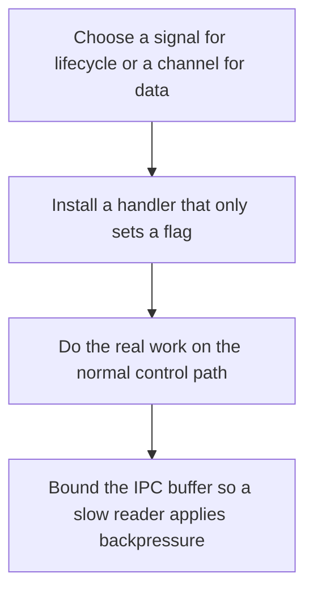

# D03-T022 — Signals and inter-process communication

Topic ID: `D03-T022`
Domain: Operating Systems
Subdomain: Signals and inter-process communication
Importance: core
Complexity: intermediate
Dependencies: `D03-T021`, `D03-T001`, `D01-T001`, `D01-T002`
Execution status of the code in section F: unexecuted

## A. Topic Overview

Signals are asynchronous notifications to a process, such as SIGTERM for a polite stop and SIGKILL which cannot be caught. Handlers must be async-signal-safe. Inter-process communication moves bytes or messages between processes: pipes, Unix sockets, shared memory, and message queues. Shared memory still needs synchronization. A pipe is a byte stream with a buffer and blocking behavior when it fills.

In production this shows up as follows: A container entrypoint that traps SIGTERM and finishes the current request drains cleanly. A handler that flushes logs in the signal context deadlocks on the allocator.

Interviewers use Signals and inter-process communication to see whether you can state the failure mode, not only the definition. The failure to name is: doing malloc or logging inside a signal handler, or a full pipe that deadlocks a writer the reader is waiting on

Prerequisites: `D03-T021`, `D03-T001`, `D01-T001`, `D01-T002`. Later notes should link here instead of repeating the mechanism.

## B. First-Principles Explanation

Signals are asynchronous notifications to a process, such as SIGTERM for a polite stop and SIGKILL which cannot be caught. Handlers must be async-signal-safe. Inter-process communication moves bytes or messages between processes: pipes, Unix sockets, shared memory, and message queues. Shared memory still needs synchronization. A pipe is a byte stream with a buffer and blocking behavior when it fills.

The useful picture is: A signal is someone tapping your shoulder. IPC is passing a note. The tap must stay tiny. The note can be long, but the mailbox can fill up.

What has to be true:

1. Choose a signal for lifecycle or a channel for data
2. Install a handler that only sets a flag
3. Do the real work on the normal control path
4. Bound the IPC buffer so a slow reader applies backpressure

It works when those steps preserve one invariant. It fails when doing malloc or logging inside a signal handler, or a full pipe that deadlocks a writer the reader is waiting on. The alternative is: you needed a durable queue, which a pipe is not

## C. Internal Working and Architecture

Components involved: the caller, the state Signals and inter-process communication mutates or reads, and the observer that reports time to notice SIGTERM and the depth of the IPC buffer.

Execution:

1. Choose a signal for lifecycle or a channel for data
2. Install a handler that only sets a flag
3. Do the real work on the normal control path
4. Bound the IPC buffer so a slow reader applies backpressure

Data moves only along that path. A retry re-enters at step 1, so the operation must say what a duplicate does. Memory and locks stay inside this mechanism. Callers see the result or a typed error, not a half-updated invariant.

State to remember: choose this when you need process lifecycle or a simple byte channel between processes. Do not choose it when you needed a durable queue, which a pipe is not.

## D. Diagrams and Visual Models



Read the diagram from top to bottom. Each box is one step of Signals and inter-process communication. The failure mode (doing malloc or logging inside a signal handler, or a full pipe that deadlocks a writer the reader is waiting on) is what you look for when a later box never happens or happens twice.

## E. Examples and Analogies

Analogy: A signal is someone tapping your shoulder. IPC is passing a note. The tap must stay tiny. The note can be long, but the mailbox can fill up.

Production example: A container entrypoint that traps SIGTERM and finishes the current request drains cleanly. A handler that flushes logs in the signal context deadlocks on the allocator.

A small counterexample is enough in an interview. Show the input, apply the steps, and show the broken outcome if someone uses the mechanism outside its rule: doing malloc or logging inside a signal handler, or a full pipe that deadlocks a writer the reader is waiting on.

## F. Code Examples

The snippet is labeled unexecuted. It illustrates the shape of the idea. It is not a benchmark and it embeds no secret.

```python
import signal
stop = False

def handle(signum, frame):
    global stop
    stop = True

signal.signal(signal.SIGTERM, handle)
```

After the snippet, check time to notice SIGTERM and the depth of the IPC buffer. If that signal moves the wrong way, the snippet is the wrong tool for the workload.

## G. Practical Backend Application

Use Signals and inter-process communication in a service when you need process lifecycle or a simple byte channel between processes.

A typical place is the production case already stated: A container entrypoint that traps SIGTERM and finishes the current request drains cleanly. A handler that flushes logs in the signal context deadlocks on the allocator.

Operationally you alert on time to notice SIGTERM and the depth of the IPC buffer. You do not alert only on process uptime. The dashboard should show the failure mode, a success rate, and the saturation signal (queue depth, lock wait, or latency) that predicts it.

## H. Advantages, Limitations and Trade-offs

| Choice | Benefit | Cost | Choose when | Avoid when |
| --- | --- | --- | --- | --- |
| Apply Signals and inter-process communication | you need process lifecycle or a simple byte channel between processes | Extra moving parts and a new failure mode | The failure you are preventing is already real | you needed a durable queue, which a pipe is not |
| Simpler alternative | Less code and fewer dependencies | doing malloc or logging inside a signal handler, or a full pipe that deadlocks a writer the reader is waiting on | The workload does not hit the limit | The invariant must hold under concurrency or failure |

Signals and inter-process communication is a trade. State the benefit and the cost in the same sentence when you propose it in a design review.

## I. Common Mistakes and Misconceptions

- Catching SIGKILL.
- Doing non-trivial work in the handler.
- Using shared memory without a protocol for who writes.
- Treating a diagram of Signals and inter-process communication as proof that the invariant holds in production.
- Copying a default configuration without naming time to notice SIGTERM and the depth of the IPC buffer.

## J. Debugging and Troubleshooting

Symptom: doing malloc or logging inside a signal handler, or a full pipe that deadlocks a writer the reader is waiting on

First check: time to notice SIGTERM and the depth of the IPC buffer.

Then compare one healthy instance against one unhealthy instance. Confirm whether retries are duplicating work. Confirm whether a timeout is shorter than the work. Fix the invariant, then watch the same metric for a full peak, not only for the next minute.

Useful questions: did the step order in section C actually happen, or did a caller skip a step? Did a deploy change the data shape that Signals and inter-process communication assumes?

## K. Interview Preparation

### Beginner

#### Q1. What problem does Signals and inter-process communication solve?

**Answer:** Signals are asynchronous notifications to a process, such as SIGTERM for a polite stop and SIGKILL which cannot be caught. Handlers must be async-signal-safe. Inter-process communication moves bytes or messages between processes: pipes, Unix sockets, shared memory, and message queues. Shared memory still needs synchronization. A pipe is a byte stream with a buffer and blocking behavior when it fills. Without it, the usual backend failure is: doing malloc or logging inside a signal handler, or a full pipe that deadlocks a writer the reader is waiting on.

#### Q2. Where does Signals and inter-process communication sit on a request path?

**Answer:** Signals and inter-process communication is not a library you sprinkle on every call. you need process lifecycle or a simple byte channel between processes You notice it when time to notice SIGTERM and the depth of the IPC buffer. Name the constraint that makes this choice correct. Say what you would measure to confirm it.

#### Q3. Give a concrete example of Signals and inter-process communication.

**Answer:** A container entrypoint that traps SIGTERM and finishes the current request drains cleanly. A handler that flushes logs in the signal context deadlocks on the allocator. Walk the input, the state change, and the observable output. Name the constraint that makes this choice correct.

#### Q4. What is a common mix-up around Signals and inter-process communication?

**Answer:** doing malloc or logging inside a signal handler, or a full pipe that deadlocks a writer the reader is waiting on The corrective check is time to notice SIGTERM and the depth of the IPC buffer. Name the constraint that makes this choice correct. Say what you would measure to confirm it. Say which alternative you rejected and why.

#### Q5. When would you skip Signals and inter-process communication?

**Answer:** you needed a durable queue, which a pipe is not Skipping is a decision with a measured cost, not a slogan. Name the constraint that makes this choice correct. Say what you would measure to confirm it. Say which alternative you rejected and why.

### Intermediate

#### Q1. What invariant makes Signals and inter-process communication correct?

**Answer:** Signals are asynchronous notifications to a process, such as SIGTERM for a polite stop and SIGKILL which cannot be caught. Handlers must be async-signal-safe. Inter-process communication moves bytes or messages between processes: pipes, Unix sockets, shared memory, and message queues. Shared memory still needs synchronization. A pipe is a byte stream with a buffer and blocking behavior when it fills. State the invariant before you name the tool.

#### Q2. How do you test Signals and inter-process communication?

**Answer:** Assert the failure mode directly: doing malloc or logging inside a signal handler, or a full pipe that deadlocks a writer the reader is waiting on. The assertion should watch time to notice SIGTERM and the depth of the IPC buffer. Include a concurrent or retry case if the bug only appears then. Name the constraint that makes this choice correct.

#### Q3. What signal tells you Signals and inter-process communication is misbehaving in production?

**Answer:** Watch time to notice SIGTERM and the depth of the IPC buffer. The user-visible symptom is usually doing malloc or logging inside a signal handler, or a full pipe that deadlocks a writer the reader is waiting on. Name the constraint that makes this choice correct. Say what you would measure to confirm it.

#### Q4. How would you introduce Signals and inter-process communication into a legacy service?

**Answer:** you need process lifecycle or a simple byte channel between processes Ship it behind a metric so you can compare the old path. Roll back if doing malloc or logging inside a signal handler, or a full pipe that deadlocks a writer the reader is waiting on gets worse. Name the constraint that makes this choice correct. Say what you would measure to confirm it.

#### Q5. What do you trade away by choosing Signals and inter-process communication?

**Answer:** you need process lifecycle or a simple byte channel between processes you needed a durable queue, which a pipe is not Say the cost in latency, storage, or operational load. Name the constraint that makes this choice correct. Say what you would measure to confirm it. Say which alternative you rejected and why.

### Advanced

#### Q1. What breaks if a dependency of Signals and inter-process communication is slow or down?

**Answer:** doing malloc or logging inside a signal handler, or a full pipe that deadlocks a writer the reader is waiting on Degrade using the rule: you needed a durable queue, which a pipe is not. Timeouts must be shorter than the caller's deadline. Name the constraint that makes this choice correct. Say what you would measure to confirm it.

#### Q2. How does Signals and inter-process communication behave under retries?

**Answer:** Retries repeat work, so Signals and inter-process communication must define what a duplicate does. doing malloc or logging inside a signal handler, or a full pipe that deadlocks a writer the reader is waiting on Idempotency keys or fences belong next to the write, not in a comment. Name the constraint that makes this choice correct. Say what you would measure to confirm it.

#### Q3. What is the capacity limit of Signals and inter-process communication?

**Answer:** The limit shows up as time to notice SIGTERM and the depth of the IPC buffer. Add capacity only after you know whether the bottleneck is CPU, lock wait, or network. Name the constraint that makes this choice correct. Say what you would measure to confirm it.

#### Q4. How do you evolve Signals and inter-process communication without a flag day?

**Answer:** you need process lifecycle or a simple byte channel between processes Version the contract or the on-disk format. Readers should tolerate one old and one new shape during the rollout. Name the constraint that makes this choice correct. Say what you would measure to confirm it.

#### Q5. What security or correctness bug hides inside Signals and inter-process communication?

**Answer:** doing malloc or logging inside a signal handler, or a full pipe that deadlocks a writer the reader is waiting on Check authorization and tenancy at the same boundary as the mechanism. A cache or queue must not widen who can read the data. Name the constraint that makes this choice correct. Say what you would measure to confirm it.

### Scenario

#### Q1. Incident: doing malloc or logging inside a signal handler, or a full pipe that deadlocks a writer the reader is waiting on. What do you check first?

**Answer:** Start with time to notice SIGTERM and the depth of the IPC buffer. Compare a good host and a bad host before you restart anything. Signals are asynchronous notifications to a process, such as SIGTERM for a polite stop and SIGKILL which cannot be caught. Handlers must be async-signal-safe. Inter-process communication moves bytes or messages between processes: pipes, Unix sockets, shared memory, and message queues. Shared memory still needs synchronization. A pipe is a byte stream with a buffer and blocking behavior when it fills.

#### Q2. A reviewer wants the clever version. What data settles it?

**Answer:** you need process lifecycle or a simple byte channel between processes you needed a durable queue, which a pipe is not Bring time to notice SIGTERM and the depth of the IPC buffer from a load test or from production, not a slogan. Name the constraint that makes this choice correct. Say what you would measure to confirm it. Say which alternative you rejected and why.

#### Q3. You have one hour to explain Signals and inter-process communication at a whiteboard.

**Answer:** Draw the happy path in four boxes. Then draw the failure: doing malloc or logging inside a signal handler, or a full pipe that deadlocks a writer the reader is waiting on. End with the metric you would page on. Name the constraint that makes this choice correct.

#### Q4. The bug only appears under two concurrent callers.

**Answer:** doing malloc or logging inside a signal handler, or a full pipe that deadlocks a writer the reader is waiting on Reproduce with a barrier so both sides enter the critical window. Confirm the fix with time to notice SIGTERM and the depth of the IPC buffer. Name the constraint that makes this choice correct. Say what you would measure to confirm it.

#### Q5. Leadership wants this on every service next week.

**Answer:** you needed a durable queue, which a pipe is not you need process lifecycle or a simple byte channel between processes Roll it out where the failure mode is already hurting users. Name the constraint that makes this choice correct. Say what you would measure to confirm it. Say which alternative you rejected and why.

### Follow-up

#### Q1. What did you assume about the data size or the clock?

**Answer:** Signals are asynchronous notifications to a process, such as SIGTERM for a polite stop and SIGKILL which cannot be caught. Handlers must be async-signal-safe. Inter-process communication moves bytes or messages between processes: pipes, Unix sockets, shared memory, and message queues. Shared memory still needs synchronization. A pipe is a byte stream with a buffer and blocking behavior when it fills. Clocks are not a total order across machines. State whether the algorithm needs bounded size or a single leader.

#### Q2. What would you measure after the change ships?

**Answer:** Page on time to notice SIGTERM and the depth of the IPC buffer. Keep a before/after dashboard for one week. Alert on the failure mode, not only on CPU. Name the constraint that makes this choice correct.

#### Q3. Which neighboring topic did you deliberately not re-teach?

**Answer:** This note owns Signals and inter-process communication. Related identifiers are in section N. Shared ideas are linked, not copied. Name the constraint that makes this choice correct.

## L. Practical Exercises

Solutions are in `EXERCISES/solutions/D03-T022.md`, not in this section.

1. Whiteboard the four steps of Signals and inter-process communication and mark where `doing malloc or logging inside a signal handler, or a full pipe that deadlocks a writer the reader is waiting on` enters.
2. Read the snippet in section F and write the assertion that would catch that failure. The assertion must mention `time to notice SIGTERM and the depth of the IPC buffer`.
3. Argue for or against using Signals and inter-process communication on a service you know. Use the choose and avoid rows from section H. Do not appeal to popularity.

## M. Revision Notes

- Mechanism: Signals are asynchronous notifications to a process, such as SIGTERM for a polite stop and SIGKILL which cannot be caught.
- Failure: doing malloc or logging inside a signal handler, or a full pipe that deadlocks a writer the reader is waiting on
- Metric: time to notice SIGTERM and the depth of the IPC buffer
- Choose when: you need process lifecycle or a simple byte channel between processes
- Avoid when: you needed a durable queue, which a pipe is not

## N. Related Topics

Dependencies to review first: `D03-T021`, `D03-T001`, `D01-T001`, `D01-T002`.

Shared ideas stay in those notes. This note does not restate them.

## O. Completion Criteria

- You can explain Signals and inter-process communication without reading this note, including the failure mode.
- You can draw the diagram in section D from memory.
- You can say when not to use it, using the avoid condition in section H.
- You can name the metric you would watch after shipping it.
