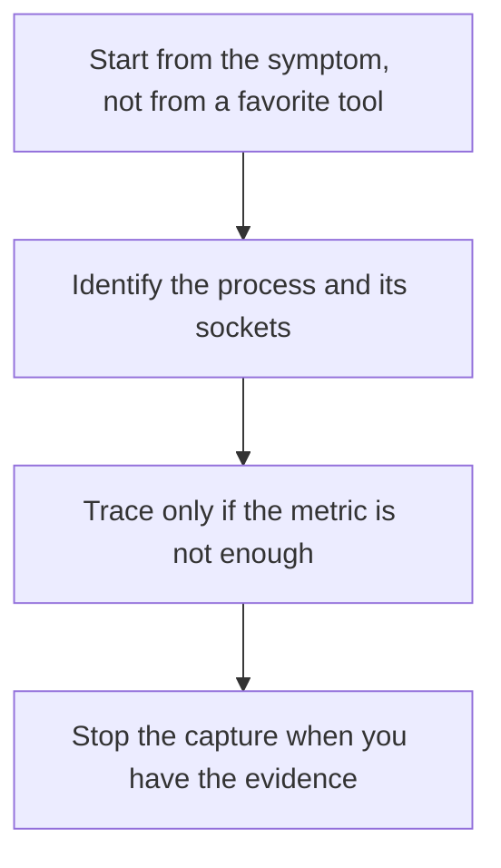

# D03-T023 — Linux process and networking commands

Topic ID: `D03-T023`
Domain: Operating Systems
Subdomain: Linux process and networking commands
Importance: core
Complexity: intermediate
Dependencies: `D03-T022`, `D03-T001`, `D01-T001`, `D01-T002`
Execution status of the code in section F: unexecuted

## A. Topic Overview

Linux process and networking commands inspect what the kernel is already doing. ps and top show processes. ss shows sockets. lsof shows descriptors. strace shows syscalls. tcpdump shows packets. These tools read state. They are not a substitute for application metrics, and tcpdump on a busy host can drop packets or cost CPU.

In production this shows up as follows: A service that is up but not accepting connections shows a listen socket in the wrong state or a process stuck in a syscall. ss answers that faster than another deploy.

Interviewers use Linux process and networking commands to see whether you can state the failure mode, not only the definition. The failure to name is: running tcpdump or strace in production without a filter and making the outage worse

Prerequisites: `D03-T022`, `D03-T001`, `D01-T001`, `D01-T002`. Later notes should link here instead of repeating the mechanism.

## B. First-Principles Explanation

Linux process and networking commands inspect what the kernel is already doing. ps and top show processes. ss shows sockets. lsof shows descriptors. strace shows syscalls. tcpdump shows packets. These tools read state. They are not a substitute for application metrics, and tcpdump on a busy host can drop packets or cost CPU.

The useful picture is: These commands are looking at the kitchen board, the order tickets, and the door, not redesigning the restaurant.

What has to be true:

1. Start from the symptom, not from a favorite tool
2. Identify the process and its sockets
3. Trace only if the metric is not enough
4. Stop the capture when you have the evidence

It works when those steps preserve one invariant. It fails when running tcpdump or strace in production without a filter and making the outage worse. The alternative is: the question is an application invariant, which belongs in logs and traces

## C. Internal Working and Architecture

Components involved: the caller, the state Linux process and networking commands mutates or reads, and the observer that reports the specific socket state or syscall error that matches the client symptom.

Execution:

1. Start from the symptom, not from a favorite tool
2. Identify the process and its sockets
3. Trace only if the metric is not enough
4. Stop the capture when you have the evidence

Data moves only along that path. A retry re-enters at step 1, so the operation must say what a duplicate does. Memory and locks stay inside this mechanism. Callers see the result or a typed error, not a half-updated invariant.

State to remember: choose this when you are on a host and need kernel-visible evidence. Do not choose it when the question is an application invariant, which belongs in logs and traces.

## D. Diagrams and Visual Models



Read the diagram from top to bottom. Each box is one step of Linux process and networking commands. The failure mode (running tcpdump or strace in production without a filter and making the outage worse) is what you look for when a later box never happens or happens twice.

## E. Examples and Analogies

Analogy: These commands are looking at the kitchen board, the order tickets, and the door, not redesigning the restaurant.

Production example: A service that is up but not accepting connections shows a listen socket in the wrong state or a process stuck in a syscall. ss answers that faster than another deploy.

A small counterexample is enough in an interview. Show the input, apply the steps, and show the broken outcome if someone uses the mechanism outside its rule: running tcpdump or strace in production without a filter and making the outage worse.

## F. Code Examples

The snippet is labeled unexecuted. It illustrates the shape of the idea. It is not a benchmark and it embeds no secret.

```text
# unexecuted examples, run only against a process you own
# ss -lntp
# ps -o pid,stat,wchan,cmd -p <pid>
```

After the snippet, check the specific socket state or syscall error that matches the client symptom. If that signal moves the wrong way, the snippet is the wrong tool for the workload.

## G. Practical Backend Application

Use Linux process and networking commands in a service when you are on a host and need kernel-visible evidence.

A typical place is the production case already stated: A service that is up but not accepting connections shows a listen socket in the wrong state or a process stuck in a syscall. ss answers that faster than another deploy.

Operationally you alert on the specific socket state or syscall error that matches the client symptom. You do not alert only on process uptime. The dashboard should show the failure mode, a success rate, and the saturation signal (queue depth, lock wait, or latency) that predicts it.

## H. Advantages, Limitations and Trade-offs

| Choice | Benefit | Cost | Choose when | Avoid when |
| --- | --- | --- | --- | --- |
| Apply Linux process and networking commands | you are on a host and need kernel-visible evidence | Extra moving parts and a new failure mode | The failure you are preventing is already real | the question is an application invariant, which belongs in logs and traces |
| Simpler alternative | Less code and fewer dependencies | running tcpdump or strace in production without a filter and making the outage worse | The workload does not hit the limit | The invariant must hold under concurrency or failure |

Linux process and networking commands is a trade. State the benefit and the cost in the same sentence when you propose it in a design review.

## I. Common Mistakes and Misconceptions

- Pasting strace of a production payment worker into a ticket with secrets in the arguments.
- Capturing all packets on a busy NIC.
- Killing a process to 'see if it comes back' before you record its state.
- Treating a diagram of Linux process and networking commands as proof that the invariant holds in production.
- Copying a default configuration without naming the specific socket state or syscall error that matches the client symptom.

## J. Debugging and Troubleshooting

Symptom: running tcpdump or strace in production without a filter and making the outage worse

First check: the specific socket state or syscall error that matches the client symptom.

Then compare one healthy instance against one unhealthy instance. Confirm whether retries are duplicating work. Confirm whether a timeout is shorter than the work. Fix the invariant, then watch the same metric for a full peak, not only for the next minute.

Useful questions: did the step order in section C actually happen, or did a caller skip a step? Did a deploy change the data shape that Linux process and networking commands assumes?

## K. Interview Preparation

### Beginner

#### Q1. What problem does Linux process and networking commands solve?

**Answer:** Linux process and networking commands inspect what the kernel is already doing. ps and top show processes. ss shows sockets. lsof shows descriptors. strace shows syscalls. tcpdump shows packets. These tools read state. They are not a substitute for application metrics, and tcpdump on a busy host can drop packets or cost CPU. Without it, the usual backend failure is: running tcpdump or strace in production without a filter and making the outage worse.

#### Q2. Where does Linux process and networking commands sit on a request path?

**Answer:** Linux process and networking commands is not a library you sprinkle on every call. you are on a host and need kernel-visible evidence You notice it when the specific socket state or syscall error that matches the client symptom. Name the constraint that makes this choice correct. Say what you would measure to confirm it.

#### Q3. Give a concrete example of Linux process and networking commands.

**Answer:** A service that is up but not accepting connections shows a listen socket in the wrong state or a process stuck in a syscall. ss answers that faster than another deploy. Walk the input, the state change, and the observable output. Name the constraint that makes this choice correct.

#### Q4. What is a common mix-up around Linux process and networking commands?

**Answer:** running tcpdump or strace in production without a filter and making the outage worse The corrective check is the specific socket state or syscall error that matches the client symptom. Name the constraint that makes this choice correct. Say what you would measure to confirm it. Say which alternative you rejected and why.

#### Q5. When would you skip Linux process and networking commands?

**Answer:** the question is an application invariant, which belongs in logs and traces Skipping is a decision with a measured cost, not a slogan. Name the constraint that makes this choice correct. Say what you would measure to confirm it. Say which alternative you rejected and why.

### Intermediate

#### Q1. What invariant makes Linux process and networking commands correct?

**Answer:** Linux process and networking commands inspect what the kernel is already doing. ps and top show processes. ss shows sockets. lsof shows descriptors. strace shows syscalls. tcpdump shows packets. These tools read state. They are not a substitute for application metrics, and tcpdump on a busy host can drop packets or cost CPU. State the invariant before you name the tool.

#### Q2. How do you test Linux process and networking commands?

**Answer:** Assert the failure mode directly: running tcpdump or strace in production without a filter and making the outage worse. The assertion should watch the specific socket state or syscall error that matches the client symptom. Include a concurrent or retry case if the bug only appears then. Name the constraint that makes this choice correct.

#### Q3. What signal tells you Linux process and networking commands is misbehaving in production?

**Answer:** Watch the specific socket state or syscall error that matches the client symptom. The user-visible symptom is usually running tcpdump or strace in production without a filter and making the outage worse. Name the constraint that makes this choice correct. Say what you would measure to confirm it.

#### Q4. How would you introduce Linux process and networking commands into a legacy service?

**Answer:** you are on a host and need kernel-visible evidence Ship it behind a metric so you can compare the old path. Roll back if running tcpdump or strace in production without a filter and making the outage worse gets worse. Name the constraint that makes this choice correct. Say what you would measure to confirm it.

#### Q5. What do you trade away by choosing Linux process and networking commands?

**Answer:** you are on a host and need kernel-visible evidence the question is an application invariant, which belongs in logs and traces Say the cost in latency, storage, or operational load. Name the constraint that makes this choice correct. Say what you would measure to confirm it. Say which alternative you rejected and why.

### Advanced

#### Q1. What breaks if a dependency of Linux process and networking commands is slow or down?

**Answer:** running tcpdump or strace in production without a filter and making the outage worse Degrade using the rule: the question is an application invariant, which belongs in logs and traces. Timeouts must be shorter than the caller's deadline. Name the constraint that makes this choice correct. Say what you would measure to confirm it.

#### Q2. How does Linux process and networking commands behave under retries?

**Answer:** Retries repeat work, so Linux process and networking commands must define what a duplicate does. running tcpdump or strace in production without a filter and making the outage worse Idempotency keys or fences belong next to the write, not in a comment. Name the constraint that makes this choice correct. Say what you would measure to confirm it.

#### Q3. What is the capacity limit of Linux process and networking commands?

**Answer:** The limit shows up as the specific socket state or syscall error that matches the client symptom. Add capacity only after you know whether the bottleneck is CPU, lock wait, or network. Name the constraint that makes this choice correct. Say what you would measure to confirm it.

#### Q4. How do you evolve Linux process and networking commands without a flag day?

**Answer:** you are on a host and need kernel-visible evidence Version the contract or the on-disk format. Readers should tolerate one old and one new shape during the rollout. Name the constraint that makes this choice correct. Say what you would measure to confirm it.

#### Q5. What security or correctness bug hides inside Linux process and networking commands?

**Answer:** running tcpdump or strace in production without a filter and making the outage worse Check authorization and tenancy at the same boundary as the mechanism. A cache or queue must not widen who can read the data. Name the constraint that makes this choice correct. Say what you would measure to confirm it.

### Scenario

#### Q1. Incident: running tcpdump or strace in production without a filter and making the outage worse. What do you check first?

**Answer:** Start with the specific socket state or syscall error that matches the client symptom. Compare a good host and a bad host before you restart anything. Linux process and networking commands inspect what the kernel is already doing. ps and top show processes. ss shows sockets. lsof shows descriptors. strace shows syscalls. tcpdump shows packets. These tools read state. They are not a substitute for application metrics, and tcpdump on a busy host can drop packets or cost CPU.

#### Q2. A reviewer wants the clever version. What data settles it?

**Answer:** you are on a host and need kernel-visible evidence the question is an application invariant, which belongs in logs and traces Bring the specific socket state or syscall error that matches the client symptom from a load test or from production, not a slogan. Name the constraint that makes this choice correct. Say what you would measure to confirm it. Say which alternative you rejected and why.

#### Q3. You have one hour to explain Linux process and networking commands at a whiteboard.

**Answer:** Draw the happy path in four boxes. Then draw the failure: running tcpdump or strace in production without a filter and making the outage worse. End with the metric you would page on. Name the constraint that makes this choice correct.

#### Q4. The bug only appears under two concurrent callers.

**Answer:** running tcpdump or strace in production without a filter and making the outage worse Reproduce with a barrier so both sides enter the critical window. Confirm the fix with the specific socket state or syscall error that matches the client symptom. Name the constraint that makes this choice correct. Say what you would measure to confirm it.

#### Q5. Leadership wants this on every service next week.

**Answer:** the question is an application invariant, which belongs in logs and traces you are on a host and need kernel-visible evidence Roll it out where the failure mode is already hurting users. Name the constraint that makes this choice correct. Say what you would measure to confirm it. Say which alternative you rejected and why.

### Follow-up

#### Q1. What did you assume about the data size or the clock?

**Answer:** Linux process and networking commands inspect what the kernel is already doing. ps and top show processes. ss shows sockets. lsof shows descriptors. strace shows syscalls. tcpdump shows packets. These tools read state. They are not a substitute for application metrics, and tcpdump on a busy host can drop packets or cost CPU. Clocks are not a total order across machines. State whether the algorithm needs bounded size or a single leader.

#### Q2. What would you measure after the change ships?

**Answer:** Page on the specific socket state or syscall error that matches the client symptom. Keep a before/after dashboard for one week. Alert on the failure mode, not only on CPU. Name the constraint that makes this choice correct.

#### Q3. Which neighboring topic did you deliberately not re-teach?

**Answer:** This note owns Linux process and networking commands. Related identifiers are in section N. Shared ideas are linked, not copied. Name the constraint that makes this choice correct.

## L. Practical Exercises

Solutions are in `EXERCISES/solutions/D03-T023.md`, not in this section.

1. Whiteboard the four steps of Linux process and networking commands and mark where `running tcpdump or strace in production without a filter and making the outage worse` enters.
2. Read the snippet in section F and write the assertion that would catch that failure. The assertion must mention `the specific socket state or syscall error that matches the client symptom`.
3. Argue for or against using Linux process and networking commands on a service you know. Use the choose and avoid rows from section H. Do not appeal to popularity.

## M. Revision Notes

- Mechanism: Linux process and networking commands inspect what the kernel is already doing.
- Failure: running tcpdump or strace in production without a filter and making the outage worse
- Metric: the specific socket state or syscall error that matches the client symptom
- Choose when: you are on a host and need kernel-visible evidence
- Avoid when: the question is an application invariant, which belongs in logs and traces

## N. Related Topics

Dependencies to review first: `D03-T022`, `D03-T001`, `D01-T001`, `D01-T002`.

Shared ideas stay in those notes. This note does not restate them.

## O. Completion Criteria

- You can explain Linux process and networking commands without reading this note, including the failure mode.
- You can draw the diagram in section D from memory.
- You can say when not to use it, using the avoid condition in section H.
- You can name the metric you would watch after shipping it.
