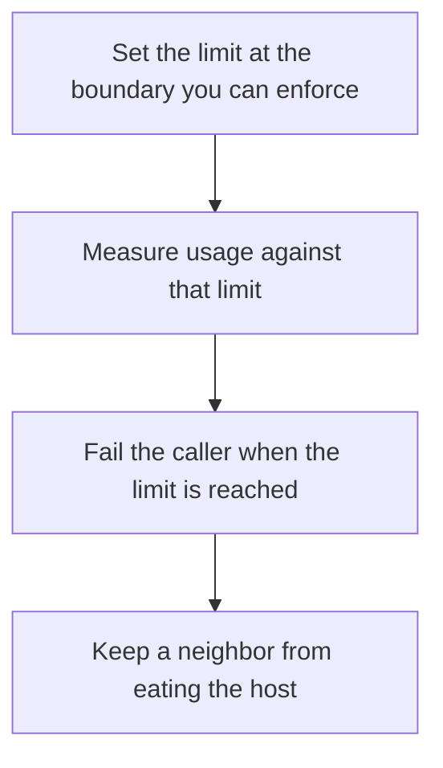

# D03-T024 — Resource limits and process isolation

Topic ID: `D03-T024`
Domain: Operating Systems
Subdomain: Resource limits and process isolation
Importance: core
Complexity: intermediate
Dependencies: `D03-T023`, `D03-T001`, `D01-T001`, `D01-T002`
Execution status of the code in section F: unexecuted

## A. Topic Overview

Resource limits cap what a process can consume: open files, address space, CPU time, and process count. cgroups on Linux group processes and apply the container's real limit. Isolation reduces what a fault can touch: namespaces, separate users, and read-only filesystems. A limit that is hit should fail the allocation, not stall the host.

In production this shows up as follows: Kubernetes memory limits are cgroup limits. A pod that exceeds it is OOMKilled. A pod with only a request and no limit can still hurt the node.

Interviewers use Resource limits and process isolation to see whether you can state the failure mode, not only the definition. The failure to name is: a container with no memory limit taking the node down, or a file-descriptor limit so low that health checks cannot open a socket

Prerequisites: `D03-T023`, `D03-T001`, `D01-T001`, `D01-T002`. Later notes should link here instead of repeating the mechanism.

## B. First-Principles Explanation

Resource limits cap what a process can consume: open files, address space, CPU time, and process count. cgroups on Linux group processes and apply the container's real limit. Isolation reduces what a fault can touch: namespaces, separate users, and read-only filesystems. A limit that is hit should fail the allocation, not stall the host.

The useful picture is: A limit is a fuse. Isolation is a separate apartment. The fuse trips one circuit. The apartment wall stops the fire next door.

What has to be true:

1. Set the limit at the boundary you can enforce
2. Measure usage against that limit
3. Fail the caller when the limit is reached
4. Keep a neighbor from eating the host

It works when those steps preserve one invariant. It fails when a container with no memory limit taking the node down, or a file-descriptor limit so low that health checks cannot open a socket. The alternative is: you are micro-optimizing a function, where a limit will not make it faster

## C. Internal Working and Architecture

Components involved: the caller, the state Resource limits and process isolation mutates or reads, and the observer that reports cgroup memory.current versus memory.max, and the rate of EMFILE or OOM kills.

Execution:

1. Set the limit at the boundary you can enforce
2. Measure usage against that limit
3. Fail the caller when the limit is reached
4. Keep a neighbor from eating the host

Data moves only along that path. A retry re-enters at step 1, so the operation must say what a duplicate does. Memory and locks stay inside this mechanism. Callers see the result or a typed error, not a half-updated invariant.

State to remember: choose this when you are drawing a tenant or a container boundary. Do not choose it when you are micro-optimizing a function, where a limit will not make it faster.

## D. Diagrams and Visual Models



Read the diagram from top to bottom. Each box is one step of Resource limits and process isolation. The failure mode (a container with no memory limit taking the node down, or a file-descriptor limit so low that health checks cannot open a socket) is what you look for when a later box never happens or happens twice.

## E. Examples and Analogies

Analogy: A limit is a fuse. Isolation is a separate apartment. The fuse trips one circuit. The apartment wall stops the fire next door.

Production example: Kubernetes memory limits are cgroup limits. A pod that exceeds it is OOMKilled. A pod with only a request and no limit can still hurt the node.

A small counterexample is enough in an interview. Show the input, apply the steps, and show the broken outcome if someone uses the mechanism outside its rule: a container with no memory limit taking the node down, or a file-descriptor limit so low that health checks cannot open a socket.

## F. Code Examples

The snippet is labeled unexecuted. It illustrates the shape of the idea. It is not a benchmark and it embeds no secret.

```python
def over_budget(used, limit):
    return used > limit
```

After the snippet, check cgroup memory.current versus memory.max, and the rate of EMFILE or OOM kills. If that signal moves the wrong way, the snippet is the wrong tool for the workload.

## G. Practical Backend Application

Use Resource limits and process isolation in a service when you are drawing a tenant or a container boundary.

A typical place is the production case already stated: Kubernetes memory limits are cgroup limits. A pod that exceeds it is OOMKilled. A pod with only a request and no limit can still hurt the node.

Operationally you alert on cgroup memory.current versus memory.max, and the rate of EMFILE or OOM kills. You do not alert only on process uptime. The dashboard should show the failure mode, a success rate, and the saturation signal (queue depth, lock wait, or latency) that predicts it.

## H. Advantages, Limitations and Trade-offs

| Choice | Benefit | Cost | Choose when | Avoid when |
| --- | --- | --- | --- | --- |
| Apply Resource limits and process isolation | you are drawing a tenant or a container boundary | Extra moving parts and a new failure mode | The failure you are preventing is already real | you are micro-optimizing a function, where a limit will not make it faster |
| Simpler alternative | Less code and fewer dependencies | a container with no memory limit taking the node down, or a file-descriptor limit so low that health checks cannot open a socket | The workload does not hit the limit | The invariant must hold under concurrency or failure |

Resource limits and process isolation is a trade. State the benefit and the cost in the same sentence when you propose it in a design review.

## I. Common Mistakes and Misconceptions

- Setting a request and calling it a limit.
- Raising nofile without a leak fix.
- Running everything as root in one namespace.
- Treating a diagram of Resource limits and process isolation as proof that the invariant holds in production.
- Copying a default configuration without naming cgroup memory.current versus memory.max, and the rate of EMFILE or OOM kills.

## J. Debugging and Troubleshooting

Symptom: a container with no memory limit taking the node down, or a file-descriptor limit so low that health checks cannot open a socket

First check: cgroup memory.current versus memory.max, and the rate of EMFILE or OOM kills.

Then compare one healthy instance against one unhealthy instance. Confirm whether retries are duplicating work. Confirm whether a timeout is shorter than the work. Fix the invariant, then watch the same metric for a full peak, not only for the next minute.

Useful questions: did the step order in section C actually happen, or did a caller skip a step? Did a deploy change the data shape that Resource limits and process isolation assumes?

## K. Interview Preparation

### Beginner

#### Q1. What problem does Resource limits and process isolation solve?

**Answer:** Resource limits cap what a process can consume: open files, address space, CPU time, and process count. cgroups on Linux group processes and apply the container's real limit. Isolation reduces what a fault can touch: namespaces, separate users, and read-only filesystems. A limit that is hit should fail the allocation, not stall the host. Without it, the usual backend failure is: a container with no memory limit taking the node down, or a file-descriptor limit so low that health checks cannot open a socket.

#### Q2. Where does Resource limits and process isolation sit on a request path?

**Answer:** Resource limits and process isolation is not a library you sprinkle on every call. you are drawing a tenant or a container boundary You notice it when cgroup memory.current versus memory.max, and the rate of EMFILE or OOM kills. Name the constraint that makes this choice correct. Say what you would measure to confirm it.

#### Q3. Give a concrete example of Resource limits and process isolation.

**Answer:** Kubernetes memory limits are cgroup limits. A pod that exceeds it is OOMKilled. A pod with only a request and no limit can still hurt the node. Walk the input, the state change, and the observable output.

#### Q4. What is a common mix-up around Resource limits and process isolation?

**Answer:** a container with no memory limit taking the node down, or a file-descriptor limit so low that health checks cannot open a socket The corrective check is cgroup memory.current versus memory.max, and the rate of EMFILE or OOM kills. Name the constraint that makes this choice correct. Say what you would measure to confirm it. Say which alternative you rejected and why.

#### Q5. When would you skip Resource limits and process isolation?

**Answer:** you are micro-optimizing a function, where a limit will not make it faster Skipping is a decision with a measured cost, not a slogan. Name the constraint that makes this choice correct. Say what you would measure to confirm it. Say which alternative you rejected and why.

### Intermediate

#### Q1. What invariant makes Resource limits and process isolation correct?

**Answer:** Resource limits cap what a process can consume: open files, address space, CPU time, and process count. cgroups on Linux group processes and apply the container's real limit. Isolation reduces what a fault can touch: namespaces, separate users, and read-only filesystems. A limit that is hit should fail the allocation, not stall the host. State the invariant before you name the tool.

#### Q2. How do you test Resource limits and process isolation?

**Answer:** Assert the failure mode directly: a container with no memory limit taking the node down, or a file-descriptor limit so low that health checks cannot open a socket. The assertion should watch cgroup memory.current versus memory.max, and the rate of EMFILE or OOM kills. Include a concurrent or retry case if the bug only appears then. Name the constraint that makes this choice correct.

#### Q3. What signal tells you Resource limits and process isolation is misbehaving in production?

**Answer:** Watch cgroup memory.current versus memory.max, and the rate of EMFILE or OOM kills. The user-visible symptom is usually a container with no memory limit taking the node down, or a file-descriptor limit so low that health checks cannot open a socket. Name the constraint that makes this choice correct. Say what you would measure to confirm it.

#### Q4. How would you introduce Resource limits and process isolation into a legacy service?

**Answer:** you are drawing a tenant or a container boundary Ship it behind a metric so you can compare the old path. Roll back if a container with no memory limit taking the node down, or a file-descriptor limit so low that health checks cannot open a socket gets worse. Name the constraint that makes this choice correct. Say what you would measure to confirm it.

#### Q5. What do you trade away by choosing Resource limits and process isolation?

**Answer:** you are drawing a tenant or a container boundary you are micro-optimizing a function, where a limit will not make it faster Say the cost in latency, storage, or operational load. Name the constraint that makes this choice correct. Say what you would measure to confirm it. Say which alternative you rejected and why.

### Advanced

#### Q1. What breaks if a dependency of Resource limits and process isolation is slow or down?

**Answer:** a container with no memory limit taking the node down, or a file-descriptor limit so low that health checks cannot open a socket Degrade using the rule: you are micro-optimizing a function, where a limit will not make it faster. Timeouts must be shorter than the caller's deadline. Name the constraint that makes this choice correct. Say what you would measure to confirm it.

#### Q2. How does Resource limits and process isolation behave under retries?

**Answer:** Retries repeat work, so Resource limits and process isolation must define what a duplicate does. a container with no memory limit taking the node down, or a file-descriptor limit so low that health checks cannot open a socket Idempotency keys or fences belong next to the write, not in a comment. Name the constraint that makes this choice correct. Say what you would measure to confirm it.

#### Q3. What is the capacity limit of Resource limits and process isolation?

**Answer:** The limit shows up as cgroup memory.current versus memory.max, and the rate of EMFILE or OOM kills. Add capacity only after you know whether the bottleneck is CPU, lock wait, or network. Name the constraint that makes this choice correct. Say what you would measure to confirm it.

#### Q4. How do you evolve Resource limits and process isolation without a flag day?

**Answer:** you are drawing a tenant or a container boundary Version the contract or the on-disk format. Readers should tolerate one old and one new shape during the rollout. Name the constraint that makes this choice correct. Say what you would measure to confirm it.

#### Q5. What security or correctness bug hides inside Resource limits and process isolation?

**Answer:** a container with no memory limit taking the node down, or a file-descriptor limit so low that health checks cannot open a socket Check authorization and tenancy at the same boundary as the mechanism. A cache or queue must not widen who can read the data. Name the constraint that makes this choice correct. Say what you would measure to confirm it.

### Scenario

#### Q1. Incident: a container with no memory limit taking the node down, or a file-descriptor limit so low that health checks cannot open a socket. What do you check first?

**Answer:** Start with cgroup memory.current versus memory.max, and the rate of EMFILE or OOM kills. Compare a good host and a bad host before you restart anything. Resource limits cap what a process can consume: open files, address space, CPU time, and process count. cgroups on Linux group processes and apply the container's real limit. Isolation reduces what a fault can touch: namespaces, separate users, and read-only filesystems. A limit that is hit should fail the allocation, not stall the host.

#### Q2. A reviewer wants the clever version. What data settles it?

**Answer:** you are drawing a tenant or a container boundary you are micro-optimizing a function, where a limit will not make it faster Bring cgroup memory.current versus memory.max, and the rate of EMFILE or OOM kills from a load test or from production, not a slogan. Name the constraint that makes this choice correct. Say what you would measure to confirm it. Say which alternative you rejected and why.

#### Q3. You have one hour to explain Resource limits and process isolation at a whiteboard.

**Answer:** Draw the happy path in four boxes. Then draw the failure: a container with no memory limit taking the node down, or a file-descriptor limit so low that health checks cannot open a socket. End with the metric you would page on. Name the constraint that makes this choice correct.

#### Q4. The bug only appears under two concurrent callers.

**Answer:** a container with no memory limit taking the node down, or a file-descriptor limit so low that health checks cannot open a socket Reproduce with a barrier so both sides enter the critical window. Confirm the fix with cgroup memory.current versus memory.max, and the rate of EMFILE or OOM kills. Name the constraint that makes this choice correct. Say what you would measure to confirm it.

#### Q5. Leadership wants this on every service next week.

**Answer:** you are micro-optimizing a function, where a limit will not make it faster you are drawing a tenant or a container boundary Roll it out where the failure mode is already hurting users. Name the constraint that makes this choice correct. Say what you would measure to confirm it. Say which alternative you rejected and why.

### Follow-up

#### Q1. What did you assume about the data size or the clock?

**Answer:** Resource limits cap what a process can consume: open files, address space, CPU time, and process count. cgroups on Linux group processes and apply the container's real limit. Isolation reduces what a fault can touch: namespaces, separate users, and read-only filesystems. A limit that is hit should fail the allocation, not stall the host. Clocks are not a total order across machines. State whether the algorithm needs bounded size or a single leader.

#### Q2. What would you measure after the change ships?

**Answer:** Page on cgroup memory.current versus memory.max, and the rate of EMFILE or OOM kills. Keep a before/after dashboard for one week. Alert on the failure mode, not only on CPU. Name the constraint that makes this choice correct.

#### Q3. Which neighboring topic did you deliberately not re-teach?

**Answer:** This note owns Resource limits and process isolation. Related identifiers are in section N. Shared ideas are linked, not copied. Name the constraint that makes this choice correct.

## L. Practical Exercises

Solutions are in `EXERCISES/solutions/D03-T024.md`, not in this section.

1. Whiteboard the four steps of Resource limits and process isolation and mark where `a container with no memory limit taking the node down, or a file-descriptor limit so low that health checks cannot open a socket` enters.
2. Read the snippet in section F and write the assertion that would catch that failure. The assertion must mention `cgroup memory.current versus memory.max, and the rate of EMFILE or OOM kills`.
3. Argue for or against using Resource limits and process isolation on a service you know. Use the choose and avoid rows from section H. Do not appeal to popularity.

## M. Revision Notes

- Mechanism: Resource limits cap what a process can consume: open files, address space, CPU time, and process count.
- Failure: a container with no memory limit taking the node down, or a file-descriptor limit so low that health checks cannot open a socket
- Metric: cgroup memory.current versus memory.max, and the rate of EMFILE or OOM kills
- Choose when: you are drawing a tenant or a container boundary
- Avoid when: you are micro-optimizing a function, where a limit will not make it faster

## N. Related Topics

Dependencies to review first: `D03-T023`, `D03-T001`, `D01-T001`, `D01-T002`.

Shared ideas stay in those notes. This note does not restate them.

## O. Completion Criteria

- You can explain Resource limits and process isolation without reading this note, including the failure mode.
- You can draw the diagram in section D from memory.
- You can say when not to use it, using the avoid condition in section H.
- You can name the metric you would watch after shipping it.
