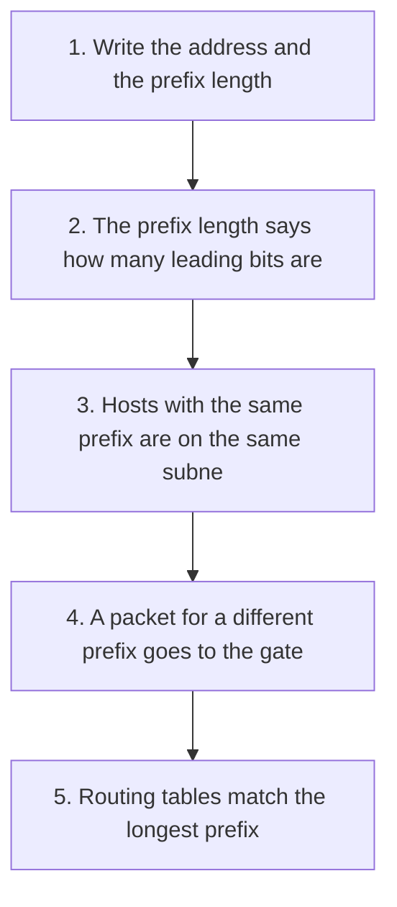

# D04-T002 — IP addressing, subnetting, CIDR

Topic ID: `D04-T002`
Domain: Computer Networks
Subdomain: IP addressing, subnetting, CIDR
Importance: core
Complexity: intermediate
Dependencies: `D04-T001`, `D01-T001`, `D01-T002`, `D03-T001`, `D03-T002`
Execution status of the code in section F: unexecuted. It is a teaching example, not a measured benchmark.

## A. Topic Overview

An IPv4 or IPv6 address identifies an interface. CIDR writes a prefix as address plus prefix length. The prefix is the network. The rest is the host.

Without prefixes, every router would need a route to every host. Subnets let a router advertise one block instead of thousands of hosts.

In production this is how it shows up: VPC subnets, security groups, Kubernetes pod CIDRs, and the address a load balancer listens on.

Interviewers ask this to see whether you can explain the mechanism, the failure mode, and the reason you would reject it. Memorizing the name is not enough.

Prerequisites: `D04-T001`, `D01-T001`, `D01-T002`, `D03-T001`, `D03-T002`.

## B. First-Principles Explanation

An IPv4 or IPv6 address identifies an interface. CIDR writes a prefix as address plus prefix length. The prefix is the network. The rest is the host.

Before this was a standard tool, Without prefixes, every router would need a route to every host. Subnets let a router advertise one block instead of thousands of hosts.

What happens internally is the sequence in section C. It works because Longest-prefix match lets a specific route override a summary route. That is how a VPC route to one subnet beats a default route to the internet.

Limitations:

- IPv4 private space overlaps across companies
- Longest prefix match can surprise you when a more specific route is wrong
- Broadcast domains that are too large waste and amplify noise

Alternatives:

- Giving every host a public address
- One flat network with no subnets

Terms: use the ordinary engineering meaning of **IP addressing, subnetting, CIDR**. Do not collapse it into a product name. The product is one implementation. The invariant is the thing you have to defend.

## C. Internal Working and Architecture

Components: the caller, the state this topic protects or transforms, and the failure path.

1. Write the address and the prefix length
2. The prefix length says how many leading bits are the network
3. Hosts with the same prefix are on the same subnet and talk at layer 2
4. A packet for a different prefix goes to the gateway
5. Routing tables match the longest prefix

Data and control follow that order. Skipping a step is the usual bug. Shared mutable state, partial failure, and retries sit around this sequence whenever the topic is used from a request handler or a consumer.

## D. Diagrams and Visual Models



Read the diagram from `s1` downward. Each node is one step from section C. The diagram is the control flow, not a deployment diagram. If a production incident skips a node, that node is the bug.

## E. Examples and Analogies

Analogy, not an implementation: An analogy only: a street name is the prefix and the house number is the host. Mail for another street goes to the post office, which is the gateway.

Small technical example: 10.0.0.0/24 has 256 addresses. The first and last are reserved in common IPv4 practice for the network and broadcast. Usable hosts are fewer than 256. 10.0.0.0/16 is 65,536 addresses and contains that /24.

Backend example: Put the database subnet in a private CIDR with no internet route. Put the load balancer in a public subnet. Security groups are not a substitute for the route table.

Do not use it when Do not overlap CIDRs you may later peer or connect with a VPN. Overlap makes routing ambiguous.

## F. Code Examples

The example is standard-library Python unless noted. It illustrates the invariant. It is not wired to a real database or network.

```python
def same_subnet(ip: str, other: str, prefix: int) -> bool:
    def bits(text: str) -> int:
        value = 0
        for part in text.split('.'):
            value = (value << 8) | int(part)
        return value
    shift = 32 - prefix
    return (bits(ip) >> shift) == (bits(other) >> shift)


if __name__ == '__main__':
    assert same_subnet('10.0.0.5', '10.0.0.20', 24)
    assert not same_subnet('10.0.0.5', '10.0.1.5', 24)
```

How to run: save as a `.py` file and run `python` on it. Expected result: The asserts pass. /24 groups 10.0.0.5 with 10.0.0.20 and not with 10.0.1.5.

Important part: Shifting away the host bits compares only the prefix. This is the same test a host uses to decide if a destination is local.

Edge cases and failure behavior: A /25 split in the middle of a live /24 will strand hosts that still use the old mask. They will ARP for addresses that are no longer local.

Execution status: unexecuted in this note. Do not treat the snippet as a benchmark.

## G. Practical Backend Application

Put the database subnet in a private CIDR with no internet route. Put the load balancer in a public subnet. Security groups are not a substitute for the route table.

On the request path, do the check before side effects. On failure, return a specific error rather than a generic 500 when the caller can correct the input. Log the decision and the correlation id. Do not log secrets. Under concurrency, assume two callers can pass a check before either write lands, unless the step itself is atomic. Scale by measuring Addressing does not get slower with QPS. Exhausting a small subnet does stop you from scaling out. Recovery is Add the missing route or fix the security group. If CIDRs overlap, renumber one side before peering.

## H. Advantages, Limitations and Trade-offs

| | |
| --- | --- |
| Benefit | One route entry covers a whole subnet, and private address space can be reused in unrelated networks. |
| Cost | Planning, renumbering, and the scarcity of public IPv4. IPv6 removes scarcity but not the need for a plan. |
| Choose when | Use private RFC 1918 space inside a VPC and public addresses only on the edge. |
| Avoid when | Do not overlap CIDRs you may later peer or connect with a VPN. Overlap makes routing ambiguous. |
| Under load | Addressing does not get slower with QPS. Exhausting a small subnet does stop you from scaling out. |
| Failure mode | The route table lacks a route for the destination CIDR, the security group drops it, or the CIDRs overlap so the local route wins. |

"It depends" is not an answer unless you name the constraint. Here the constraint is whether you can accept IPv4 private space overlaps across companies in exchange for One route entry covers a whole subnet, and private address space can be reused in unrelated networks.

## I. Common Mistakes and Misconceptions

- Counting 256 usable hosts in a /24 Network and broadcast addresses are not hosts in common IPv4 Subtract them when sizing
- Overlapping VPC CIDRs when peering The local route wins and traffic never leaves Renumber before you peer
- Confusing a security group with a route A route delivers the packet and a security group filters it Check both
- Using a default route when a more specific route is wrong Longest prefix wins even if you did not mean it Read the whole table, not only the default

A weak interview answer defines IP addressing, subnetting, CIDR and stops. A strong answer includes the failure mode and the signal you would graph.

## J. Debugging and Troubleshooting

Symptom: Two instances in the same VPC cannot connect, or traffic to a peered VPC blackholes.

Root cause to confirm: The route table lacks a route for the destination CIDR, the security group drops it, or the CIDRs overlap so the local route wins.

Diagnosis:

1. Check the route table for the destination prefix
2. Compare security groups and network ACLs
3. Confirm the two CIDRs do not overlap

Immediate mitigation: Add the missing route or fix the security group. If CIDRs overlap, renumber one side before peering.

Long-term prevention: Allocate prefixes from an IP plan. Record them. Refuse a peer that overlaps.

Do not treat the symptom as the cause. Restarting a process can clear the symptom and leave the cause in place.

## K. Interview Preparation

### Beginner

#### Q1. What is IP addressing, subnetting, CIDR?

**Answer:** An IPv4 or IPv6 address identifies an interface. CIDR writes a prefix as address plus prefix length. The prefix is the network. The rest is the host. It exists because Without prefixes, every router would need a route to every host. Subnets let a router advertise one block instead of thousands of hosts. The mechanism works because Longest-prefix match lets a specific route override a summary route. That is how a VPC route to one subnet beats a default route to the internet. You will meet it in production when VPC subnets, security groups, Kubernetes pod CIDRs, and the address a load balancer listens on.

#### Q2. What problem existed before IP addressing, subnetting, CIDR was used?

**Answer:** Without prefixes, every router would need a route to every host. Subnets let a router advertise one block instead of thousands of hosts. Teams paid for that with outages, incorrect data, or wasted capacity. IP addressing, subnetting, CIDR is the usual engineering response, not a decorative term. The limitation to remember is: IPv4 private space overlaps across companies.

#### Q3. Where does IP addressing, subnetting, CIDR show up in a backend service?

**Answer:** VPC subnets, security groups, Kubernetes pod CIDRs, and the address a load balancer listens on. It sits next to Put the database subnet in a private CIDR with no internet route. Put the load balancer in a public subnet. Security groups are not a substitute for the route table. A reviewer should be able to point at the module, config, or protocol step that implements it. If you cannot point at that place, the system does not really have it.

#### Q4. What are the main steps?

**Answer:** The flow is: Write the address and the prefix length Then The prefix length says how many leading bits are the network Then Hosts with the same prefix are on the same subnet and talk at layer 2 After that, A packet for a different prefix goes to the gateway Finally, Routing tables match the longest prefix.

#### Q5. What do beginners get wrong first?

**Answer:** Counting 256 usable hosts in a /24 Network and broadcast addresses are not hosts in common IPv4 Subtract them when sizing Interviewers notice if you only define the term and never mention this failure.

### Intermediate

#### Q1. How does it work internally?

**Answer:** Longest-prefix match lets a specific route override a summary route. That is how a VPC route to one subnet beats a default route to the internet. Write the address and the prefix length The prefix length says how many leading bits are the network Hosts with the same prefix are on the same subnet and talk at layer 2 The later steps matter operationally: A packet for a different prefix goes to the gateway Routing tables match the longest prefix.

#### Q2. What does this cost?

**Answer:** Planning, renumbering, and the scarcity of public IPv4. IPv6 removes scarcity but not the need for a plan. The benefit is One route entry covers a whole subnet, and private address space can be reused in unrelated networks. Choose it when Use private RFC 1918 space inside a VPC and public addresses only on the edge. Avoid it when Do not overlap CIDRs you may later peer or connect with a VPN. Overlap makes routing ambiguous.

#### Q3. How do you debug it?

**Answer:** The symptom is Two instances in the same VPC cannot connect, or traffic to a peered VPC blackholes. That symptom is not the root cause. The cause to confirm is The route table lacks a route for the destination CIDR, the security group drops it, or the CIDRs overlap so the local route wins. The first checks are Check the route table for the destination prefix and Compare security groups and network ACLs Mitigation is Add the missing route or fix the security group. If CIDRs overlap, renumber one side before peering.

#### Q4. What is a production-quality alternative?

**Answer:** Giving every host a public address One flat network with no subnets The deciding factors are correctness under failure, operational load, and how much complexity the team can carry. Naming a product without those factors is a weak answer.

#### Q5. How does it behave under load?

**Answer:** Addressing does not get slower with QPS. Exhausting a small subnet does stop you from scaling out. Measure the specific saturation signal instead of guessing. A fix that adds capacity without removing the bottleneck only moves the failure. Tie the alert to the cause you can act on.

### Advanced

#### Q1. What is the subtle bug?

**Answer:** Overlapping VPC CIDRs when peering The local route wins and traffic never leaves Renumber before you peer This is the follow-up that separates a definition from an engineer who has operated the system.

#### Q2. What security or correctness limit matters?

**Answer:** Longest prefix match can surprise you when a more specific route is wrong Also, Broadcast domains that are too large waste and amplify noise Defense is to keep the invariant in one place and test the failure path. Do not rely on a client to preserve it.

#### Q3. How would you design the boundary?

**Answer:** Put the database subnet in a private CIDR with no internet route. Put the load balancer in a public subnet. Security groups are not a substitute for the route table. Keep the policy next to the state it protects. Expose a small interface so callers cannot bypass the check. Log the decision with a correlation id, not with secrets.

#### Q4. What would you refuse to do?

**Answer:** Do not overlap CIDRs you may later peer or connect with a VPN. Overlap makes routing ambiguous. The short-term win is usually less code or less latency. The later cost is a class of incidents that are hard to reproduce. State that trade explicitly in the design note.

#### Q5. How does this connect to a neighboring topic?

**Answer:** This topic depends on `D04-T001`, `D01-T001`, `D01-T002`, `D03-T001`, `D03-T002`. Interviewers often combine it with `D04-T001`, `D01-T001`, `D01-T002`, `D03-T001`. Explain the dependency in one sentence, then say what breaks if that dependency is wrong.

### Scenarios

#### Q1. A service mishandles IP addressing, subnetting, CIDR: Counting 256 usable hosts in a /24. What do you do?

**Answer:** Treat the report as a symptom. Network and broadcast addresses are not hosts in common IPv4 Confirm it with Check the route table for the destination prefix Mitigate by Add the missing route or fix the security group. If CIDRs overlap, renumber one side before peering. Then Subtract them when sizing Prevent the next one with Allocate prefixes from an IP plan. Record them. Refuse a peer that overlaps.

#### Q2. A service mishandles IP addressing, subnetting, CIDR: Overlapping VPC CIDRs when peering. What do you do?

**Answer:** Treat the report as a symptom. The local route wins and traffic never leaves Confirm it with Compare security groups and network ACLs Mitigate by Add the missing route or fix the security group. If CIDRs overlap, renumber one side before peering. Then Renumber before you peer Prevent the next one with Allocate prefixes from an IP plan. Record them. Refuse a peer that overlaps.

#### Q3. A service mishandles IP addressing, subnetting, CIDR: Confusing a security group with a route. What do you do?

**Answer:** Treat the report as a symptom. A route delivers the packet and a security group filters it Confirm it with Confirm the two CIDRs do not overlap Mitigate by Add the missing route or fix the security group. If CIDRs overlap, renumber one side before peering. Then Check both Prevent the next one with Allocate prefixes from an IP plan. Record them. Refuse a peer that overlaps.

#### Q4. A service mishandles IP addressing, subnetting, CIDR: Using a default route when a more specific route is wrong. What do you do?

**Answer:** Treat the report as a symptom. Longest prefix wins even if you did not mean it Confirm it with Confirm the two CIDRs do not overlap Mitigate by Add the missing route or fix the security group. If CIDRs overlap, renumber one side before peering. Then Read the whole table, not only the default Prevent the next one with Allocate prefixes from an IP plan. Record them. Refuse a peer that overlaps.

#### Q5. Traffic rises and IP addressing, subnetting, CIDR is on the critical path. What do you expect?

**Answer:** Addressing does not get slower with QPS. Exhausting a small subnet does stop you from scaling out. Check saturation before you rewrite the feature. Immediate mitigation: Add the missing route or fix the security group. If CIDRs overlap, renumber one side before peering. Lasting prevention: Allocate prefixes from an IP plan. Record them. Refuse a peer that overlaps. Recheck the decision to use it: Use private RFC 1918 space inside a VPC and public addresses only on the edge.

### Follow-ups

#### Q1. What did you assume?

**Answer:** The explanation assumes The service can observe failures of IP addressing, subnetting, CIDR and can shed or retry work safely. If that assumption is false, the design changes. Say the assumption out loud in an interview before you defend the mechanism. Hidden assumptions are the usual reason a correct-sounding answer fails the follow-up.

#### Q2. When would you not use it?

**Answer:** Do not overlap CIDRs you may later peer or connect with a VPN. Overlap makes routing ambiguous. Prefer Giving every host a public address The reason is operational, not fashion. If the interviewer changes the constraint, change the choice and say which constraint moved.

#### Q3. How would you test it?

**Answer:** Test the success path and the failure path named in the mistakes. Include A /25 split in the middle of a live /24 will strand hosts that still use the old mask. They will ARP for addresses that are no longer local. A unit test that only covers the happy path will not catch Counting 256 usable hosts in a /24 Add an observability check so production agrees with the test.

## L. Practical Exercises

Solutions are in `EXERCISES/solutions/D04-T002.md`. Attempt these before opening that file.

### Exercise 1 — implementation

Implement a small pure function that models the decision for IP addressing, subnetting, CIDR. Include the failure path described in the note.

Acceptance: the behavior matches the steps in section C, including the failure path, and another person can run it from the instructions without guessing a framework.

### Exercise 2 — debugging

Symptom: Two instances in the same VPC cannot connect, or traffic to a peered VPC blackholes.

Write the first three checks you would run for this symptom: Two instances in the same VPC cannot connect, or traffic to a peered VPC blackholes.

Acceptance: you separate the symptom from the cause, name the first command or query, and state the mitigation and the prevention.

### Exercise 3 — trade-off

Choose between IP addressing, subnetting, CIDR and the alternative 'Giving every host a public address' for a service at 10x traffic. Name the constraint that decides it.

Acceptance: you name the deciding constraints, the option you reject, and what gets worse if you choose the rejected option under load.

## M. Revision Notes

- Definition: An IPv4 or IPv6 address identifies an interface. CIDR writes a prefix as address plus prefix length. The prefix is the network. The rest is the host.
- Works because: Longest-prefix match lets a specific route override a summary route. That is how a VPC route to one subnet beats a default route to the internet.
- Choose when: Use private RFC 1918 space inside a VPC and public addresses only on the edge.
- Avoid when: Do not overlap CIDRs you may later peer or connect with a VPN. Overlap makes routing ambiguous.
- First debug check: Check the route table for the destination prefix
- Trap: Counting 256 usable hosts in a /24

Flashcard: What is IP addressing, subnetting, CIDR? An IPv4 or IPv6 address identifies an interface. CIDR writes a prefix as address plus prefix length. The prefix is the network. The rest is the host.

## N. Related Topics

Prerequisites: `D04-T001`, `D01-T001`, `D01-T002`, `D03-T001`, `D03-T002`.

Often combined in interviews with `D04-T001`, `D01-T001`, `D01-T002`, `D03-T001`.

Commonly confused with: A subnet mask versus a security-group rule

## O. Completion Criteria

- Explain IP addressing, subnetting, CIDR from the problem, not from a memorized definition.
- Draw the steps in section C from memory.
- Implement the example in section F and state its failure behavior.
- Given the symptom in section J, separate it from the cause and name the mitigation.
- Say when you would not use it, and what you would use instead.
- Answer a follow-up that changes one constraint from section H.
