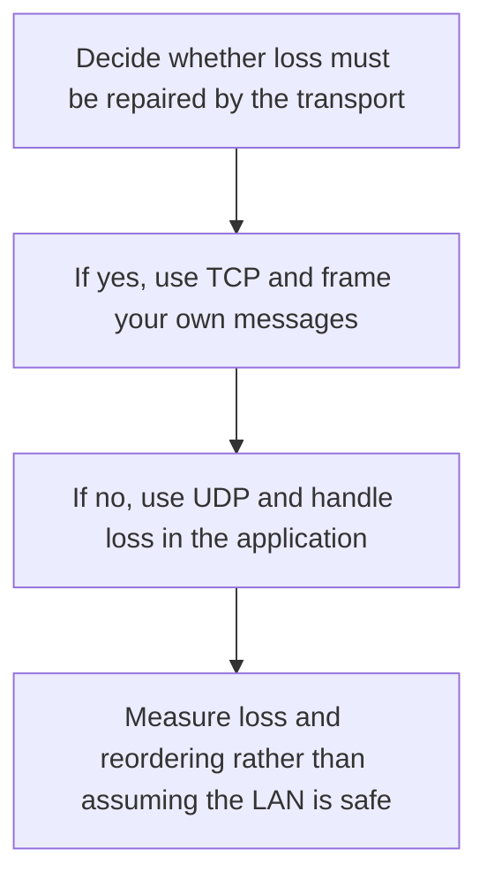

# D04-T004 — TCP vs UDP

Topic ID: `D04-T004`
Domain: Computer Networks
Subdomain: TCP vs UDP
Importance: core
Complexity: intermediate
Dependencies: `D04-T003`, `D04-T001`, `D01-T001`, `D01-T002`, `D03-T001`, `D03-T002`
Execution status of the code in section F: unexecuted

## A. Topic Overview

TCP is a connection-oriented, reliable byte stream with ordering, retransmission, and flow control. UDP is a connectionless datagram protocol: each message is independent, and the network may drop, reorder, or duplicate it. UDP does less so that the application can choose its own reliability, as DNS and RTP do. TCP's stream has no message boundaries.

In production this shows up as follows: DNS queries use UDP because a retry of a tiny idempotent query is cheaper than a connection. A database protocol uses TCP because a lost byte is corruption.

Interviewers use TCP vs UDP to see whether you can state the failure mode, not only the definition. The failure to name is: writing a UDP protocol that assumes in-order delivery, or using TCP for a small request and paying a handshake on every call

Prerequisites: `D04-T003`, `D04-T001`, `D01-T001`, `D01-T002`, `D03-T001`, `D03-T002`. Later notes should link here instead of repeating the mechanism.

## B. First-Principles Explanation

TCP is a connection-oriented, reliable byte stream with ordering, retransmission, and flow control. UDP is a connectionless datagram protocol: each message is independent, and the network may drop, reorder, or duplicate it. UDP does less so that the application can choose its own reliability, as DNS and RTP do. TCP's stream has no message boundaries.

The useful picture is: TCP is a signed-for courier that retries. UDP is dropping a postcard in the mail and accepting that it might vanish.

What has to be true:

1. Decide whether loss must be repaired by the transport
2. If yes, use TCP and frame your own messages
3. If no, use UDP and handle loss in the application
4. Measure loss and reordering rather than assuming the LAN is safe

It works when those steps preserve one invariant. It fails when writing a UDP protocol that assumes in-order delivery, or using TCP for a small request and paying a handshake on every call. The alternative is: you need bounded latency and can tolerate loss, or the message is idempotent and small

## C. Internal Working and Architecture

Components involved: the caller, the state TCP vs UDP mutates or reads, and the observer that reports packet loss, reordering, and connection-setup time versus datagram loss rate.

Execution:

1. Decide whether loss must be repaired by the transport
2. If yes, use TCP and frame your own messages
3. If no, use UDP and handle loss in the application
4. Measure loss and reordering rather than assuming the LAN is safe

Data moves only along that path. A retry re-enters at step 1, so the operation must say what a duplicate does. Memory and locks stay inside this mechanism. Callers see the result or a typed error, not a half-updated invariant.

State to remember: choose this when you need a reliable ordered byte stream. Do not choose it when you need bounded latency and can tolerate loss, or the message is idempotent and small.

## D. Diagrams and Visual Models



Read the diagram from top to bottom. Each box is one step of TCP vs UDP. The failure mode (writing a UDP protocol that assumes in-order delivery, or using TCP for a small request and paying a handshake on every call) is what you look for when a later box never happens or happens twice.

## E. Examples and Analogies

Analogy: TCP is a signed-for courier that retries. UDP is dropping a postcard in the mail and accepting that it might vanish.

Production example: DNS queries use UDP because a retry of a tiny idempotent query is cheaper than a connection. A database protocol uses TCP because a lost byte is corruption.

A small counterexample is enough in an interview. Show the input, apply the steps, and show the broken outcome if someone uses the mechanism outside its rule: writing a UDP protocol that assumes in-order delivery, or using TCP for a small request and paying a handshake on every call.

## F. Code Examples

The snippet is labeled unexecuted. It illustrates the shape of the idea. It is not a benchmark and it embeds no secret.

```python
def needs_tcp(must_not_lose: bool, has_app_retry: bool) -> bool:
    return must_not_lose and not has_app_retry
```

After the snippet, check packet loss, reordering, and connection-setup time versus datagram loss rate. If that signal moves the wrong way, the snippet is the wrong tool for the workload.

## G. Practical Backend Application

Use TCP vs UDP in a service when you need a reliable ordered byte stream.

A typical place is the production case already stated: DNS queries use UDP because a retry of a tiny idempotent query is cheaper than a connection. A database protocol uses TCP because a lost byte is corruption.

Operationally you alert on packet loss, reordering, and connection-setup time versus datagram loss rate. You do not alert only on process uptime. The dashboard should show the failure mode, a success rate, and the saturation signal (queue depth, lock wait, or latency) that predicts it.

## H. Advantages, Limitations and Trade-offs

| Choice | Benefit | Cost | Choose when | Avoid when |
| --- | --- | --- | --- | --- |
| Apply TCP vs UDP | you need a reliable ordered byte stream | Extra moving parts and a new failure mode | The failure you are preventing is already real | you need bounded latency and can tolerate loss, or the message is idempotent and small |
| Simpler alternative | Less code and fewer dependencies | writing a UDP protocol that assumes in-order delivery, or using TCP for a small request and paying a handshake on every call | The workload does not hit the limit | The invariant must hold under concurrency or failure |

TCP vs UDP is a trade. State the benefit and the cost in the same sentence when you propose it in a design review.

## I. Common Mistakes and Misconceptions

- Assuming TCP preserves message boundaries.
- Assuming UDP is faster without measuring.
- Building reliability on UDP by accident and poorly.
- Treating a diagram of TCP vs UDP as proof that the invariant holds in production.
- Copying a default configuration without naming packet loss, reordering, and connection-setup time versus datagram loss rate.

## J. Debugging and Troubleshooting

Symptom: writing a UDP protocol that assumes in-order delivery, or using TCP for a small request and paying a handshake on every call

First check: packet loss, reordering, and connection-setup time versus datagram loss rate.

Then compare one healthy instance against one unhealthy instance. Confirm whether retries are duplicating work. Confirm whether a timeout is shorter than the work. Fix the invariant, then watch the same metric for a full peak, not only for the next minute.

Useful questions: did the step order in section C actually happen, or did a caller skip a step? Did a deploy change the data shape that TCP vs UDP assumes?

## K. Interview Preparation

### Beginner

#### Q1. What problem does TCP vs UDP solve?

**Answer:** TCP is a connection-oriented, reliable byte stream with ordering, retransmission, and flow control. UDP is a connectionless datagram protocol: each message is independent, and the network may drop, reorder, or duplicate it. UDP does less so that the application can choose its own reliability, as DNS and RTP do. TCP's stream has no message boundaries. Without it, the usual backend failure is: writing a UDP protocol that assumes in-order delivery, or using TCP for a small request and paying a handshake on every call.

#### Q2. Where does TCP vs UDP sit on a request path?

**Answer:** TCP vs UDP is not a library you sprinkle on every call. you need a reliable ordered byte stream You notice it when packet loss, reordering, and connection-setup time versus datagram loss rate. Name the constraint that makes this choice correct. Say what you would measure to confirm it.

#### Q3. Give a concrete example of TCP vs UDP.

**Answer:** DNS queries use UDP because a retry of a tiny idempotent query is cheaper than a connection. A database protocol uses TCP because a lost byte is corruption. Walk the input, the state change, and the observable output. Name the constraint that makes this choice correct.

#### Q4. What is a common mix-up around TCP vs UDP?

**Answer:** writing a UDP protocol that assumes in-order delivery, or using TCP for a small request and paying a handshake on every call The corrective check is packet loss, reordering, and connection-setup time versus datagram loss rate. Name the constraint that makes this choice correct. Say what you would measure to confirm it. Say which alternative you rejected and why.

#### Q5. When would you skip TCP vs UDP?

**Answer:** you need bounded latency and can tolerate loss, or the message is idempotent and small Skipping is a decision with a measured cost, not a slogan. Name the constraint that makes this choice correct. Say what you would measure to confirm it. Say which alternative you rejected and why.

### Intermediate

#### Q1. What invariant makes TCP vs UDP correct?

**Answer:** TCP is a connection-oriented, reliable byte stream with ordering, retransmission, and flow control. UDP is a connectionless datagram protocol: each message is independent, and the network may drop, reorder, or duplicate it. UDP does less so that the application can choose its own reliability, as DNS and RTP do. TCP's stream has no message boundaries. State the invariant before you name the tool.

#### Q2. How do you test TCP vs UDP?

**Answer:** Assert the failure mode directly: writing a UDP protocol that assumes in-order delivery, or using TCP for a small request and paying a handshake on every call. The assertion should watch packet loss, reordering, and connection-setup time versus datagram loss rate. Include a concurrent or retry case if the bug only appears then. Name the constraint that makes this choice correct.

#### Q3. What signal tells you TCP vs UDP is misbehaving in production?

**Answer:** Watch packet loss, reordering, and connection-setup time versus datagram loss rate. The user-visible symptom is usually writing a UDP protocol that assumes in-order delivery, or using TCP for a small request and paying a handshake on every call. Name the constraint that makes this choice correct. Say what you would measure to confirm it.

#### Q4. How would you introduce TCP vs UDP into a legacy service?

**Answer:** you need a reliable ordered byte stream Ship it behind a metric so you can compare the old path. Roll back if writing a UDP protocol that assumes in-order delivery, or using TCP for a small request and paying a handshake on every call gets worse. Name the constraint that makes this choice correct. Say what you would measure to confirm it.

#### Q5. What do you trade away by choosing TCP vs UDP?

**Answer:** you need a reliable ordered byte stream you need bounded latency and can tolerate loss, or the message is idempotent and small Say the cost in latency, storage, or operational load. Name the constraint that makes this choice correct. Say what you would measure to confirm it. Say which alternative you rejected and why.

### Advanced

#### Q1. What breaks if a dependency of TCP vs UDP is slow or down?

**Answer:** writing a UDP protocol that assumes in-order delivery, or using TCP for a small request and paying a handshake on every call Degrade using the rule: you need bounded latency and can tolerate loss, or the message is idempotent and small. Timeouts must be shorter than the caller's deadline. Name the constraint that makes this choice correct. Say what you would measure to confirm it.

#### Q2. How does TCP vs UDP behave under retries?

**Answer:** Retries repeat work, so TCP vs UDP must define what a duplicate does. writing a UDP protocol that assumes in-order delivery, or using TCP for a small request and paying a handshake on every call Idempotency keys or fences belong next to the write, not in a comment. Name the constraint that makes this choice correct. Say what you would measure to confirm it.

#### Q3. What is the capacity limit of TCP vs UDP?

**Answer:** The limit shows up as packet loss, reordering, and connection-setup time versus datagram loss rate. Add capacity only after you know whether the bottleneck is CPU, lock wait, or network. Name the constraint that makes this choice correct. Say what you would measure to confirm it.

#### Q4. How do you evolve TCP vs UDP without a flag day?

**Answer:** you need a reliable ordered byte stream Version the contract or the on-disk format. Readers should tolerate one old and one new shape during the rollout. Name the constraint that makes this choice correct. Say what you would measure to confirm it.

#### Q5. What security or correctness bug hides inside TCP vs UDP?

**Answer:** writing a UDP protocol that assumes in-order delivery, or using TCP for a small request and paying a handshake on every call Check authorization and tenancy at the same boundary as the mechanism. A cache or queue must not widen who can read the data. Name the constraint that makes this choice correct. Say what you would measure to confirm it.

### Scenario

#### Q1. Incident: writing a UDP protocol that assumes in-order delivery, or using TCP for a small request and paying a handshake on every call. What do you check first?

**Answer:** Start with packet loss, reordering, and connection-setup time versus datagram loss rate. Compare a good host and a bad host before you restart anything. TCP is a connection-oriented, reliable byte stream with ordering, retransmission, and flow control. UDP is a connectionless datagram protocol: each message is independent, and the network may drop, reorder, or duplicate it. UDP does less so that the application can choose its own reliability, as DNS and RTP do. TCP's stream has no message boundaries.

#### Q2. A reviewer wants the clever version. What data settles it?

**Answer:** you need a reliable ordered byte stream you need bounded latency and can tolerate loss, or the message is idempotent and small Bring packet loss, reordering, and connection-setup time versus datagram loss rate from a load test or from production, not a slogan. Name the constraint that makes this choice correct. Say what you would measure to confirm it. Say which alternative you rejected and why.

#### Q3. You have one hour to explain TCP vs UDP at a whiteboard.

**Answer:** Draw the happy path in four boxes. Then draw the failure: writing a UDP protocol that assumes in-order delivery, or using TCP for a small request and paying a handshake on every call. End with the metric you would page on. Name the constraint that makes this choice correct.

#### Q4. The bug only appears under two concurrent callers.

**Answer:** writing a UDP protocol that assumes in-order delivery, or using TCP for a small request and paying a handshake on every call Reproduce with a barrier so both sides enter the critical window. Confirm the fix with packet loss, reordering, and connection-setup time versus datagram loss rate. Name the constraint that makes this choice correct. Say what you would measure to confirm it.

#### Q5. Leadership wants this on every service next week.

**Answer:** you need bounded latency and can tolerate loss, or the message is idempotent and small you need a reliable ordered byte stream Roll it out where the failure mode is already hurting users. Name the constraint that makes this choice correct. Say what you would measure to confirm it. Say which alternative you rejected and why.

### Follow-up

#### Q1. What did you assume about the data size or the clock?

**Answer:** TCP is a connection-oriented, reliable byte stream with ordering, retransmission, and flow control. UDP is a connectionless datagram protocol: each message is independent, and the network may drop, reorder, or duplicate it. UDP does less so that the application can choose its own reliability, as DNS and RTP do. TCP's stream has no message boundaries. Clocks are not a total order across machines. State whether the algorithm needs bounded size or a single leader.

#### Q2. What would you measure after the change ships?

**Answer:** Page on packet loss, reordering, and connection-setup time versus datagram loss rate. Keep a before/after dashboard for one week. Alert on the failure mode, not only on CPU. Name the constraint that makes this choice correct.

#### Q3. Which neighboring topic did you deliberately not re-teach?

**Answer:** This note owns TCP vs UDP. Related identifiers are in section N. Shared ideas are linked, not copied. Name the constraint that makes this choice correct.

## L. Practical Exercises

Solutions are in `EXERCISES/solutions/D04-T004.md`, not in this section.

1. Whiteboard the four steps of TCP vs UDP and mark where `writing a UDP protocol that assumes in-order delivery, or using TCP for a small request and paying a handshake on every call` enters.
2. Read the snippet in section F and write the assertion that would catch that failure. The assertion must mention `packet loss, reordering, and connection-setup time versus datagram loss rate`.
3. Argue for or against using TCP vs UDP on a service you know. Use the choose and avoid rows from section H. Do not appeal to popularity.

## M. Revision Notes

- Mechanism: TCP is a connection-oriented, reliable byte stream with ordering, retransmission, and flow control.
- Failure: writing a UDP protocol that assumes in-order delivery, or using TCP for a small request and paying a handshake on every call
- Metric: packet loss, reordering, and connection-setup time versus datagram loss rate
- Choose when: you need a reliable ordered byte stream
- Avoid when: you need bounded latency and can tolerate loss, or the message is idempotent and small

## N. Related Topics

Dependencies to review first: `D04-T003`, `D04-T001`, `D01-T001`, `D01-T002`, `D03-T001`, `D03-T002`.

Shared ideas stay in those notes. This note does not restate them.

## O. Completion Criteria

- You can explain TCP vs UDP without reading this note, including the failure mode.
- You can draw the diagram in section D from memory.
- You can say when not to use it, using the avoid condition in section H.
- You can name the metric you would watch after shipping it.
