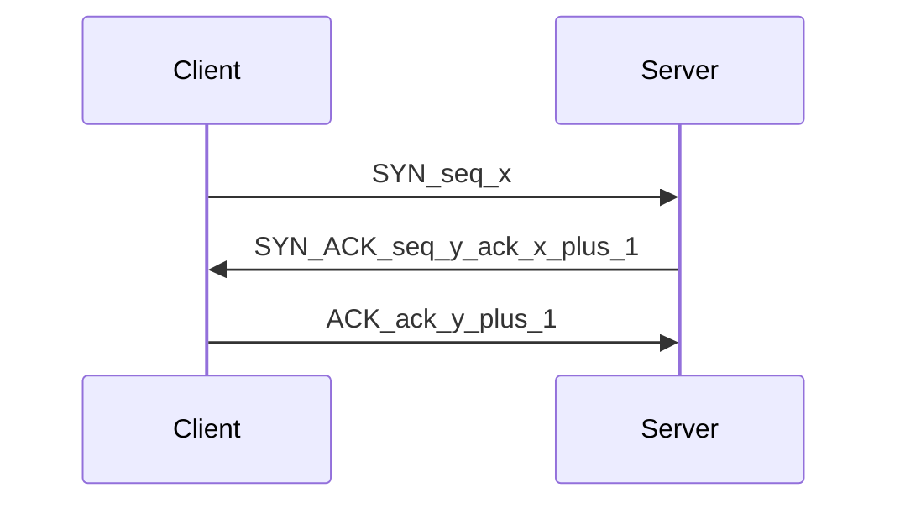

# D04-T005 — TCP handshake and connection termination

Topic ID: `D04-T005`
Domain: Computer Networks
Subdomain: TCP handshake and connection termination
Importance: core
Complexity: intermediate
Dependencies: `D04-T004`, `D04-T001`, `D01-T001`, `D01-T002`, `D03-T001`, `D03-T002`
Execution status of the code in section F: not executed (local)

## A. Topic Overview

TCP is connection-oriented: endpoints synchronize initial sequence numbers and agree on parameters before exchanging application data.

The three-way handshake uses SYN, SYN-ACK, and ACK control flags so both sides know the peer is reachable and sequence space is initialized.

Graceful shutdown exchanges FIN and ACK so each direction of the byte stream can finish independently; RST aborts immediately.

Backend latency and reliability depend on handshake RTT, listen backlogs, and how often you open new connections versus reuse pools.

Prerequisites: `D04-T004` TCP versus UDP. Leads into retransmissions (`D04-T006`) and TIME-WAIT (`D04-T008`).

## B. First-Principles Explanation

The client sends SYN with an initial sequence number (ISN). The server responds SYN-ACK with its own ISN and acknowledges the client ISN plus one. The client sends ACK acknowledging the server ISN plus one; both sides enter ESTABLISHED.

Neither side should treat the connection as open for application data until the handshake completes (except optional TCP Fast Open when negotiated).

Graceful close: one side sends FIN meaning it will not send more data; the peer ACKs. When the peer is also done, it sends FIN; the side that sent the first FIN eventually receives ACK and may enter TIME-WAIT on the side that sent the last ACK of the four-way close.

RST signals an immediate abort—invalid state, refused port, or application reset—without the orderly FIN exchange.

## C. Internal Working and Architecture

Kernel TCP state machines track SYN-SENT, SYN-RECEIVED, ESTABLISHED, and closing states. The listen socket backlog and `somaxconn` cap half-open and established queues.

Load balancers may terminate TCP, proxy handshakes with SYN cookies, or pass through with direct server return.

TLS handshakes generally start after TCP is ESTABLISHED unless using combined stacks; do not confuse TCP SYN with TLS ClientHello timing in captures.

Application `close()` initiates graceful shutdown; `SO_LINGER` and hard process kill influence whether FIN or RST is seen.

## D. Diagrams and Visual Models



Both ISNs are independent. ACK numbers increment by one for SYN and FIN because they consume one sequence number each.

## E. Examples and Analogies

Analogy: handshake is agreeing on a shared notebook page number before writing messages; FIN is marking “I will not write more”; RST is ripping the notebook.

Microservice cold starts that open a new JDBC connection per request pay one RTT of TCP (plus TLS) each time—pooling avoids repeated handshakes.

## F. Code Examples

File: `examples/d04_t005_handshake.py`

```python
# Observe real handshakes with: tcpdump -i any 'tcp[tcpflags] & tcp-syn != 0'
print("Use packet capture tools; do not simulate kernel TCP in user space.")
```

This example was not executed.

## G. Practical Backend Application

Tune connection pools for HTTP and databases to amortize handshake cost. Align idle timeouts between client, load balancer, and server so one side does not RST while the other still believes the connection is idle.

Monitor SYN retransmits and `accept` queue drops during incidents. Scale replicas or increase backlog when SYN floods are legitimate traffic spikes.

## H. Advantages, Limitations and Trade-offs

| Choice | Benefit | Cost | Choose when | Avoid when |
| --- | --- | --- | --- | --- |
| Graceful FIN close | Clean connection accounting | TIME-WAIT on active closer | HTTP keep-alive end | Must drop instantly |
| RST abort | Fast teardown | Peers may lose in-flight data | Health check fail closed | Normal request completion |
| SYN cookies | Survive SYN flood | Limited options on first packet | Public listeners | Tiny embedded stacks |
| TCP Fast Open | Save RTT with cookie | Deployment complexity | Repeat clients to same POP | Strict middlebox environments |

## I. Common Mistakes and Misconceptions

- Drawing a two-step handshake without the final ACK.
- Claiming TIME-WAIT always happens on the server (it is tied to active close and who sends the last ACK).
- Confusing TLS ClientHello with TCP SYN in latency breakdowns.
- Assuming `close()` on one side instantly closes the TCP connection for both directions.
- Ignoring SYN backlog when errors look like application timeouts.

## J. Debugging and Troubleshooting

SYN retransmits without SYN-ACK: routing, firewall, wrong port, or listener down. SYN-ACK without final ACK: client-side filters or middleboxes.

Many connections in FIN-WAIT or CLOSE-WAIT: application not reading or not calling `close`. Use `ss -tan state fin-wait-*`.

## K. Interview Preparation

### Beginner

#### Q1. What are the three TCP handshake steps?

**Answer:** The client sends SYN with an ISN. The server replies SYN-ACK with its ISN and ack client ISN plus one. The client sends ACK acking server ISN plus one. Only then is the connection established for data.

#### Q2. Why are sequence numbers needed?

**Answer:** TCP delivers a byte stream reliably over an unreliable network. Sequence numbers label bytes so duplicates can be detected and gaps retransmitted. The handshake initializes both ISNs.

#### Q3. What does FIN mean?

**Answer:** FIN means the sender will not send more data on the connection. It still can receive until both sides finish shutting down. FIN consumes one sequence number like SYN.

#### Q4. What does RST mean?

**Answer:** RST aborts the connection immediately. Peers should not expect orderly delivery of remaining bytes. It often follows refused ports or invalid segments.

#### Q5. Does handshake cost latency?

**Answer:** Yes, at least one round trip before data on a new connection. Long geographic RTT dominates small API calls. Reusing connections avoids repeating the handshake.

### Intermediate

#### Q1. Who sends the first FIN on graceful close?

**Answer:** Either side may close first when it has no more data to send. That side becomes the active closer for the first FIN. The peer ACKs and may later send its own FIN when done.

#### Q2. How does SYN backlog relate to outages?

**Answer:** If the listen backlog is full, the kernel may drop SYNs or completed connections. Clients see timeouts or retries. Increasing backlog and worker accept rate fixes legitimate spikes; SYN cookies help floods.

#### Q3. How does TLS relate to TCP handshake?

**Answer:** TLS usually starts after TCP is established. Extra round trips add to time-to-first-byte. Separate TCP SYN RTT from TLS handshake RTT in traces.

#### Q4. What is TCP Fast Open?

**Answer:** It can send limited data in the SYN after a prior negotiated cookie. It saves RTT for repeat clients. Many networks and servers do not enable it.

#### Q5. Why pool TCP connections?

**Answer:** Each new connection pays handshake (and often TLS). Pools keep warm sockets to databases and HTTP origins. Misconfigured pool size causes queueing or SYN storms.

### Advanced

#### Q1. What is simultaneous open?

**Answer:** Both sides may send SYN at once; both reply SYN-ACK and ACK. The state machine handles it without a classic client/server ordering. Rare in client-server HTTP but possible in peer designs.

#### Q2. How do load balancers affect handshake RTT?

**Answer:** Terminating TCP at the edge adds processing but can place listeners closer to clients. Passthrough preserves end-to-end TLS but does not remove RTT to origin. Measure per path.

#### Q3. What is a half-open connection?

**Answer:** One side believes the connection is up while the other does not. Causes include crashed hosts or middlebox state loss. Keepalives and timeouts detect and clean them.

#### Q4. How does `SO_LINGER` change termination?

**Answer:** It controls whether `close` blocks to flush data or sends RST on timeout. Wrong settings can truncate responses or leave RSTs that confuse clients.

#### Q5. SYN flood mitigation?

**Answer:** SYN cookies let the server respond without storing full state until ACK completes. Rate limits and SYN proxies add defense. Legitimate traffic spikes need capacity, not only cookies.

### Scenarios

#### Q1. API latency jumps only on new pods.

**Answer:** New pods cold-start TCP and TLS to dependencies. Without pooling, every request pays handshake RTT. Warm pools and readiness probes that establish connections fix it.

#### Q2. Clients timeout during traffic spike; SYNs retransmit.

**Answer:** Check listen backlog, accept rate, and SYN flood settings. Compare with CPU on listeners. Scale replicas or tune kernel and LB SYN handling.

#### Q3. Database sees many TIME-WAIT from app servers.

**Answer:** App is active closer on many short connections. Prefer pooling or longer-lived connections. TIME-WAIT on clients is often normal; investigate if ephemeral ports exhaust.

#### Q4. TLS works with openssl but app fails at connect.

**Answer:** App may use wrong port or proxy. Confirm TCP ESTABLISHED before TLS. Separate TCP refused from TLS alert failures in logs.

#### Q5. Rolling deploy drops in-flight requests.

**Answer:** Pods killed without graceful drain send RST or cut TCP. Use preStop hooks and LB deregistration delay so FIN/ACK can complete.

### Follow-ups

#### Q1. Link to sequence numbers (`D04-T006`)?

**Answer:** Handshake sets initial ISNs used by all later segments. Retransmissions reference those sequence spaces. Understanding setup is prerequisite to loss recovery.

#### Q2. Link to TIME-WAIT (`D04-T008`)?

**Answer:** Active close after FIN/ACK exchange leads to TIME-WAIT on the side sending the final ACK. Duration is about two MSL. High counts often mean many short-lived client connections.

#### Q3. Link to HTTP keep-alive (`D04-T022`)?

**Answer:** Keep-alive reuses TCP to avoid repeated handshakes for multiple HTTP requests. Align idle timeouts across client, proxy, and server.

## L. Practical Exercises

Solutions are in `EXERCISES/solutions/D04-T005.md`.

### Exercise 1 — implementation

Draw the three-way handshake with sequence and acknowledgment numbers labeled x and y.

Acceptance: Three steps shown; ack values are ISN plus one after SYN.

### Exercise 2 — debugging

`ss` shows thousands of SYN-SENT from a service to Redis. What do you check before blaming Redis CPU?

Acceptance: Network path, security groups, DNS to wrong IP, and Redis listen address.

### Exercise 3 — trade-off

Compare per-request new TCP to a connection pool for a latency-sensitive internal RPC.

Acceptance: Names handshake RTT cost and pool memory or staleness trade-offs.

## M. Revision Notes

- SYN, SYN-ACK, ACK opens TCP.
- FIN/ACK closes gracefully; RST aborts.
- Handshake adds at least one RTT.
- Pool connections to reduce setup cost.
- Do not confuse TCP and TLS handshakes.

## N. Related Topics

Understand before: `D04-T004`. Supports: `D04-T006`, `D04-T008`, `D04-T022`.

## O. Completion Criteria

- Draw three-way handshake with correct ack numbers.
- Explain FIN versus RST.
- Relate handshake RTT to API design.
- Name one SYN flood defense.
- Describe why pooling helps databases.
