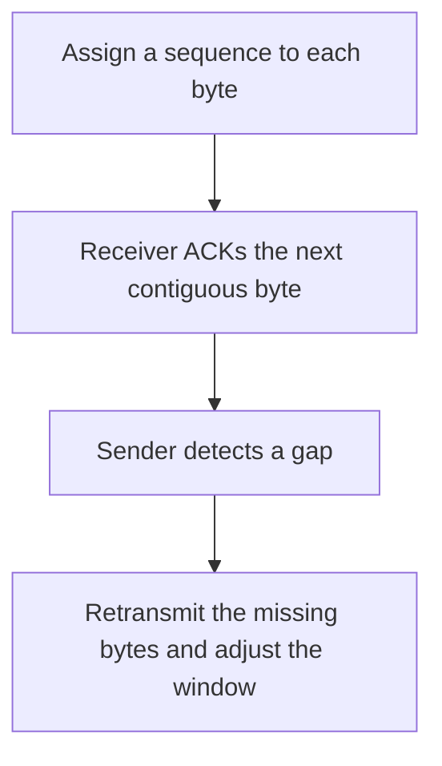

# D04-T006 — Sequence numbers, ACKs, retransmission

Topic ID: `D04-T006`
Domain: Computer Networks
Subdomain: Sequence numbers, ACKs, retransmission
Importance: core
Complexity: intermediate
Dependencies: `D04-T005`, `D04-T001`, `D01-T001`, `D01-T002`, `D03-T001`, `D03-T002`
Execution status of the code in section F: unexecuted

## A. Topic Overview

TCP sequence numbers count bytes in each direction. An acknowledgment names the next byte the receiver has contiguously received. A gap means the sender must retransmit the missing range. Cumulative ACKs do not say which later bytes arrived. Selective acknowledgments fill that gap. Retransmission is triggered by timeout or by duplicate ACKs.

In production this shows up as follows: A service behind a lossy path shows rising retransmits and flat goodput. The fix starts by comparing RTO to measured RTT, not by adding application retries on top.

Interviewers use Sequence numbers, ACKs, retransmission to see whether you can state the failure mode, not only the definition. The failure to name is: a timeout that is shorter than the real RTT, causing spurious retransmission and collapse

Prerequisites: `D04-T005`, `D04-T001`, `D01-T001`, `D01-T002`, `D03-T001`, `D03-T002`. Later notes should link here instead of repeating the mechanism.

## B. First-Principles Explanation

TCP sequence numbers count bytes in each direction. An acknowledgment names the next byte the receiver has contiguously received. A gap means the sender must retransmit the missing range. Cumulative ACKs do not say which later bytes arrived. Selective acknowledgments fill that gap. Retransmission is triggered by timeout or by duplicate ACKs.

The useful picture is: Sequence numbers are page numbers. The ACK says 'I have every page up to this one.' A missing page 4 is not fixed by also receiving page 5.

What has to be true:

1. Assign a sequence to each byte
2. Receiver ACKs the next contiguous byte
3. Sender detects a gap
4. Retransmit the missing bytes and adjust the window

It works when those steps preserve one invariant. It fails when a timeout that is shorter than the real RTT, causing spurious retransmission and collapse. The alternative is: you are on UDP, which has none of this machinery

## C. Internal Working and Architecture

Components involved: the caller, the state Sequence numbers, ACKs, retransmission mutates or reads, and the observer that reports retransmission rate and RTT versus the retransmission timeout.

Execution:

1. Assign a sequence to each byte
2. Receiver ACKs the next contiguous byte
3. Sender detects a gap
4. Retransmit the missing bytes and adjust the window

Data moves only along that path. A retry re-enters at step 1, so the operation must say what a duplicate does. Memory and locks stay inside this mechanism. Callers see the result or a typed error, not a half-updated invariant.

State to remember: choose this when you are explaining reliability or a throughput collapse on TCP. Do not choose it when you are on UDP, which has none of this machinery.

## D. Diagrams and Visual Models



Read the diagram from top to bottom. Each box is one step of Sequence numbers, ACKs, retransmission. The failure mode (a timeout that is shorter than the real RTT, causing spurious retransmission and collapse) is what you look for when a later box never happens or happens twice.

## E. Examples and Analogies

Analogy: Sequence numbers are page numbers. The ACK says 'I have every page up to this one.' A missing page 4 is not fixed by also receiving page 5.

Production example: A service behind a lossy path shows rising retransmits and flat goodput. The fix starts by comparing RTO to measured RTT, not by adding application retries on top.

A small counterexample is enough in an interview. Show the input, apply the steps, and show the broken outcome if someone uses the mechanism outside its rule: a timeout that is shorter than the real RTT, causing spurious retransmission and collapse.

## F. Code Examples

The snippet is labeled unexecuted. It illustrates the shape of the idea. It is not a benchmark and it embeds no secret.

```python
def next_expected(received):
    # received is a set of contiguous bytes starting at 0
    n = 0
    while n in received:
        n += 1
    return n
```

After the snippet, check retransmission rate and RTT versus the retransmission timeout. If that signal moves the wrong way, the snippet is the wrong tool for the workload.

## G. Practical Backend Application

Use Sequence numbers, ACKs, retransmission in a service when you are explaining reliability or a throughput collapse on TCP.

A typical place is the production case already stated: A service behind a lossy path shows rising retransmits and flat goodput. The fix starts by comparing RTO to measured RTT, not by adding application retries on top.

Operationally you alert on retransmission rate and RTT versus the retransmission timeout. You do not alert only on process uptime. The dashboard should show the failure mode, a success rate, and the saturation signal (queue depth, lock wait, or latency) that predicts it.

## H. Advantages, Limitations and Trade-offs

| Choice | Benefit | Cost | Choose when | Avoid when |
| --- | --- | --- | --- | --- |
| Apply Sequence numbers, ACKs, retransmission | you are explaining reliability or a throughput collapse on TCP | Extra moving parts and a new failure mode | The failure you are preventing is already real | you are on UDP, which has none of this machinery |
| Simpler alternative | Less code and fewer dependencies | a timeout that is shorter than the real RTT, causing spurious retransmission and collapse | The workload does not hit the limit | The invariant must hold under concurrency or failure |

Sequence numbers, ACKs, retransmission is a trade. State the benefit and the cost in the same sentence when you propose it in a design review.

## I. Common Mistakes and Misconceptions

- Retrying the whole RPC because one segment was lost, without idempotency.
- Ignoring SACK and assuming every loss waits for a timeout.
- Treating sequence numbers as packet counts.
- Treating a diagram of Sequence numbers, ACKs, retransmission as proof that the invariant holds in production.
- Copying a default configuration without naming retransmission rate and RTT versus the retransmission timeout.

## J. Debugging and Troubleshooting

Symptom: a timeout that is shorter than the real RTT, causing spurious retransmission and collapse

First check: retransmission rate and RTT versus the retransmission timeout.

Then compare one healthy instance against one unhealthy instance. Confirm whether retries are duplicating work. Confirm whether a timeout is shorter than the work. Fix the invariant, then watch the same metric for a full peak, not only for the next minute.

Useful questions: did the step order in section C actually happen, or did a caller skip a step? Did a deploy change the data shape that Sequence numbers, ACKs, retransmission assumes?

## K. Interview Preparation

### Beginner

#### Q1. What problem does Sequence numbers, ACKs, retransmission solve?

**Answer:** TCP sequence numbers count bytes in each direction. An acknowledgment names the next byte the receiver has contiguously received. A gap means the sender must retransmit the missing range. Cumulative ACKs do not say which later bytes arrived. Selective acknowledgments fill that gap. Retransmission is triggered by timeout or by duplicate ACKs. Without it, the usual backend failure is: a timeout that is shorter than the real RTT, causing spurious retransmission and collapse.

#### Q2. Where does Sequence numbers, ACKs, retransmission sit on a request path?

**Answer:** Sequence numbers, ACKs, retransmission is not a library you sprinkle on every call. you are explaining reliability or a throughput collapse on TCP You notice it when retransmission rate and RTT versus the retransmission timeout. Name the constraint that makes this choice correct. Say what you would measure to confirm it.

#### Q3. Give a concrete example of Sequence numbers, ACKs, retransmission.

**Answer:** A service behind a lossy path shows rising retransmits and flat goodput. The fix starts by comparing RTO to measured RTT, not by adding application retries on top. Walk the input, the state change, and the observable output. Name the constraint that makes this choice correct.

#### Q4. What is a common mix-up around Sequence numbers, ACKs, retransmission?

**Answer:** a timeout that is shorter than the real RTT, causing spurious retransmission and collapse The corrective check is retransmission rate and RTT versus the retransmission timeout. Name the constraint that makes this choice correct. Say what you would measure to confirm it. Say which alternative you rejected and why.

#### Q5. When would you skip Sequence numbers, ACKs, retransmission?

**Answer:** you are on UDP, which has none of this machinery Skipping is a decision with a measured cost, not a slogan. Name the constraint that makes this choice correct. Say what you would measure to confirm it. Say which alternative you rejected and why.

### Intermediate

#### Q1. What invariant makes Sequence numbers, ACKs, retransmission correct?

**Answer:** TCP sequence numbers count bytes in each direction. An acknowledgment names the next byte the receiver has contiguously received. A gap means the sender must retransmit the missing range. Cumulative ACKs do not say which later bytes arrived. Selective acknowledgments fill that gap. Retransmission is triggered by timeout or by duplicate ACKs. State the invariant before you name the tool.

#### Q2. How do you test Sequence numbers, ACKs, retransmission?

**Answer:** Assert the failure mode directly: a timeout that is shorter than the real RTT, causing spurious retransmission and collapse. The assertion should watch retransmission rate and RTT versus the retransmission timeout. Include a concurrent or retry case if the bug only appears then. Name the constraint that makes this choice correct.

#### Q3. What signal tells you Sequence numbers, ACKs, retransmission is misbehaving in production?

**Answer:** Watch retransmission rate and RTT versus the retransmission timeout. The user-visible symptom is usually a timeout that is shorter than the real RTT, causing spurious retransmission and collapse. Name the constraint that makes this choice correct. Say what you would measure to confirm it.

#### Q4. How would you introduce Sequence numbers, ACKs, retransmission into a legacy service?

**Answer:** you are explaining reliability or a throughput collapse on TCP Ship it behind a metric so you can compare the old path. Roll back if a timeout that is shorter than the real RTT, causing spurious retransmission and collapse gets worse. Name the constraint that makes this choice correct. Say what you would measure to confirm it.

#### Q5. What do you trade away by choosing Sequence numbers, ACKs, retransmission?

**Answer:** you are explaining reliability or a throughput collapse on TCP you are on UDP, which has none of this machinery Say the cost in latency, storage, or operational load. Name the constraint that makes this choice correct. Say what you would measure to confirm it. Say which alternative you rejected and why.

### Advanced

#### Q1. What breaks if a dependency of Sequence numbers, ACKs, retransmission is slow or down?

**Answer:** a timeout that is shorter than the real RTT, causing spurious retransmission and collapse Degrade using the rule: you are on UDP, which has none of this machinery. Timeouts must be shorter than the caller's deadline. Name the constraint that makes this choice correct. Say what you would measure to confirm it.

#### Q2. How does Sequence numbers, ACKs, retransmission behave under retries?

**Answer:** Retries repeat work, so Sequence numbers, ACKs, retransmission must define what a duplicate does. a timeout that is shorter than the real RTT, causing spurious retransmission and collapse Idempotency keys or fences belong next to the write, not in a comment. Name the constraint that makes this choice correct. Say what you would measure to confirm it.

#### Q3. What is the capacity limit of Sequence numbers, ACKs, retransmission?

**Answer:** The limit shows up as retransmission rate and RTT versus the retransmission timeout. Add capacity only after you know whether the bottleneck is CPU, lock wait, or network. Name the constraint that makes this choice correct. Say what you would measure to confirm it.

#### Q4. How do you evolve Sequence numbers, ACKs, retransmission without a flag day?

**Answer:** you are explaining reliability or a throughput collapse on TCP Version the contract or the on-disk format. Readers should tolerate one old and one new shape during the rollout. Name the constraint that makes this choice correct. Say what you would measure to confirm it.

#### Q5. What security or correctness bug hides inside Sequence numbers, ACKs, retransmission?

**Answer:** a timeout that is shorter than the real RTT, causing spurious retransmission and collapse Check authorization and tenancy at the same boundary as the mechanism. A cache or queue must not widen who can read the data. Name the constraint that makes this choice correct. Say what you would measure to confirm it.

### Scenario

#### Q1. Incident: a timeout that is shorter than the real RTT, causing spurious retransmission and collapse. What do you check first?

**Answer:** Start with retransmission rate and RTT versus the retransmission timeout. Compare a good host and a bad host before you restart anything. TCP sequence numbers count bytes in each direction. An acknowledgment names the next byte the receiver has contiguously received. A gap means the sender must retransmit the missing range. Cumulative ACKs do not say which later bytes arrived. Selective acknowledgments fill that gap. Retransmission is triggered by timeout or by duplicate ACKs.

#### Q2. A reviewer wants the clever version. What data settles it?

**Answer:** you are explaining reliability or a throughput collapse on TCP you are on UDP, which has none of this machinery Bring retransmission rate and RTT versus the retransmission timeout from a load test or from production, not a slogan. Name the constraint that makes this choice correct. Say what you would measure to confirm it. Say which alternative you rejected and why.

#### Q3. You have one hour to explain Sequence numbers, ACKs, retransmission at a whiteboard.

**Answer:** Draw the happy path in four boxes. Then draw the failure: a timeout that is shorter than the real RTT, causing spurious retransmission and collapse. End with the metric you would page on. Name the constraint that makes this choice correct.

#### Q4. The bug only appears under two concurrent callers.

**Answer:** a timeout that is shorter than the real RTT, causing spurious retransmission and collapse Reproduce with a barrier so both sides enter the critical window. Confirm the fix with retransmission rate and RTT versus the retransmission timeout. Name the constraint that makes this choice correct. Say what you would measure to confirm it.

#### Q5. Leadership wants this on every service next week.

**Answer:** you are on UDP, which has none of this machinery you are explaining reliability or a throughput collapse on TCP Roll it out where the failure mode is already hurting users. Name the constraint that makes this choice correct. Say what you would measure to confirm it. Say which alternative you rejected and why.

### Follow-up

#### Q1. What did you assume about the data size or the clock?

**Answer:** TCP sequence numbers count bytes in each direction. An acknowledgment names the next byte the receiver has contiguously received. A gap means the sender must retransmit the missing range. Cumulative ACKs do not say which later bytes arrived. Selective acknowledgments fill that gap. Retransmission is triggered by timeout or by duplicate ACKs. Clocks are not a total order across machines. State whether the algorithm needs bounded size or a single leader.

#### Q2. What would you measure after the change ships?

**Answer:** Page on retransmission rate and RTT versus the retransmission timeout. Keep a before/after dashboard for one week. Alert on the failure mode, not only on CPU. Name the constraint that makes this choice correct.

#### Q3. Which neighboring topic did you deliberately not re-teach?

**Answer:** This note owns Sequence numbers, ACKs, retransmission. Related identifiers are in section N. Shared ideas are linked, not copied. Name the constraint that makes this choice correct.

## L. Practical Exercises

Solutions are in `EXERCISES/solutions/D04-T006.md`, not in this section.

1. Whiteboard the four steps of Sequence numbers, ACKs, retransmission and mark where `a timeout that is shorter than the real RTT, causing spurious retransmission and collapse` enters.
2. Read the snippet in section F and write the assertion that would catch that failure. The assertion must mention `retransmission rate and RTT versus the retransmission timeout`.
3. Argue for or against using Sequence numbers, ACKs, retransmission on a service you know. Use the choose and avoid rows from section H. Do not appeal to popularity.

## M. Revision Notes

- Mechanism: TCP sequence numbers count bytes in each direction.
- Failure: a timeout that is shorter than the real RTT, causing spurious retransmission and collapse
- Metric: retransmission rate and RTT versus the retransmission timeout
- Choose when: you are explaining reliability or a throughput collapse on TCP
- Avoid when: you are on UDP, which has none of this machinery

## N. Related Topics

Dependencies to review first: `D04-T005`, `D04-T001`, `D01-T001`, `D01-T002`, `D03-T001`, `D03-T002`.

Shared ideas stay in those notes. This note does not restate them.

## O. Completion Criteria

- You can explain Sequence numbers, ACKs, retransmission without reading this note, including the failure mode.
- You can draw the diagram in section D from memory.
- You can say when not to use it, using the avoid condition in section H.
- You can name the metric you would watch after shipping it.
