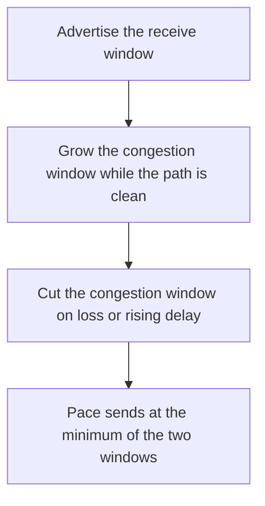

# D04-T007 — Flow control and congestion control

Topic ID: `D04-T007`
Domain: Computer Networks
Subdomain: Flow control and congestion control
Importance: core
Complexity: intermediate
Dependencies: `D04-T006`, `D04-T001`, `D01-T001`, `D01-T002`, `D03-T001`, `D03-T002`
Execution status of the code in section F: unexecuted

## A. Topic Overview

Flow control is the receiver telling the sender how much buffer remains, via the window. Congestion control is the sender estimating the network's capacity and backing off on loss or delay. They are different windows. The send rate follows the minimum of the two. Slow start probes upward. Congestion avoidance grows more slowly. A loss is treated as a congestion signal by classic algorithms.

In production this shows up as follows: A bulk export saturates a link and starves latency-sensitive calls that share it. Congestion control on the bulk flow, or a separate queue, is the lever. Raising the socket buffer alone is not.

Interviewers use Flow control and congestion control to see whether you can state the failure mode, not only the definition. The failure to name is: a large receive window on a lossy path, so the sender overruns the network and goodput falls

Prerequisites: `D04-T006`, `D04-T001`, `D01-T001`, `D01-T002`, `D03-T001`, `D03-T002`. Later notes should link here instead of repeating the mechanism.

## B. First-Principles Explanation

Flow control is the receiver telling the sender how much buffer remains, via the window. Congestion control is the sender estimating the network's capacity and backing off on loss or delay. They are different windows. The send rate follows the minimum of the two. Slow start probes upward. Congestion avoidance grows more slowly. A loss is treated as a congestion signal by classic algorithms.

The useful picture is: Flow control is the listener saying 'I can hold three more sentences.' Congestion control is noticing the hallway is crowded and speaking less.

What has to be true:

1. Advertise the receive window
2. Grow the congestion window while the path is clean
3. Cut the congestion window on loss or rising delay
4. Pace sends at the minimum of the two windows

It works when those steps preserve one invariant. It fails when a large receive window on a lossy path, so the sender overruns the network and goodput falls. The alternative is: the bottleneck is application lock time, which no window will fix

## C. Internal Working and Architecture

Components involved: the caller, the state Flow control and congestion control mutates or reads, and the observer that reports congestion window, retransmits, and goodput versus offered load.

Execution:

1. Advertise the receive window
2. Grow the congestion window while the path is clean
3. Cut the congestion window on loss or rising delay
4. Pace sends at the minimum of the two windows

Data moves only along that path. A retry re-enters at step 1, so the operation must say what a duplicate does. Memory and locks stay inside this mechanism. Callers see the result or a typed error, not a half-updated invariant.

State to remember: choose this when you are explaining why throughput flattened or why latency spiked under load. Do not choose it when the bottleneck is application lock time, which no window will fix.

## D. Diagrams and Visual Models



Read the diagram from top to bottom. Each box is one step of Flow control and congestion control. The failure mode (a large receive window on a lossy path, so the sender overruns the network and goodput falls) is what you look for when a later box never happens or happens twice.

## E. Examples and Analogies

Analogy: Flow control is the listener saying 'I can hold three more sentences.' Congestion control is noticing the hallway is crowded and speaking less.

Production example: A bulk export saturates a link and starves latency-sensitive calls that share it. Congestion control on the bulk flow, or a separate queue, is the lever. Raising the socket buffer alone is not.

A small counterexample is enough in an interview. Show the input, apply the steps, and show the broken outcome if someone uses the mechanism outside its rule: a large receive window on a lossy path, so the sender overruns the network and goodput falls.

## F. Code Examples

The snippet is labeled unexecuted. It illustrates the shape of the idea. It is not a benchmark and it embeds no secret.

```python
def send_window(receive_window, congestion_window):
    return min(receive_window, congestion_window)
```

After the snippet, check congestion window, retransmits, and goodput versus offered load. If that signal moves the wrong way, the snippet is the wrong tool for the workload.

## G. Practical Backend Application

Use Flow control and congestion control in a service when you are explaining why throughput flattened or why latency spiked under load.

A typical place is the production case already stated: A bulk export saturates a link and starves latency-sensitive calls that share it. Congestion control on the bulk flow, or a separate queue, is the lever. Raising the socket buffer alone is not.

Operationally you alert on congestion window, retransmits, and goodput versus offered load. You do not alert only on process uptime. The dashboard should show the failure mode, a success rate, and the saturation signal (queue depth, lock wait, or latency) that predicts it.

## H. Advantages, Limitations and Trade-offs

| Choice | Benefit | Cost | Choose when | Avoid when |
| --- | --- | --- | --- | --- |
| Apply Flow control and congestion control | you are explaining why throughput flattened or why latency spiked under load | Extra moving parts and a new failure mode | The failure you are preventing is already real | the bottleneck is application lock time, which no window will fix |
| Simpler alternative | Less code and fewer dependencies | a large receive window on a lossy path, so the sender overruns the network and goodput falls | The workload does not hit the limit | The invariant must hold under concurrency or failure |

Flow control and congestion control is a trade. State the benefit and the cost in the same sentence when you propose it in a design review.

## I. Common Mistakes and Misconceptions

- Equating the two windows.
- Disabling congestion control to 'go faster.'
- Adding parallel connections until the path collapses.
- Treating a diagram of Flow control and congestion control as proof that the invariant holds in production.
- Copying a default configuration without naming congestion window, retransmits, and goodput versus offered load.

## J. Debugging and Troubleshooting

Symptom: a large receive window on a lossy path, so the sender overruns the network and goodput falls

First check: congestion window, retransmits, and goodput versus offered load.

Then compare one healthy instance against one unhealthy instance. Confirm whether retries are duplicating work. Confirm whether a timeout is shorter than the work. Fix the invariant, then watch the same metric for a full peak, not only for the next minute.

Useful questions: did the step order in section C actually happen, or did a caller skip a step? Did a deploy change the data shape that Flow control and congestion control assumes?

## K. Interview Preparation

### Beginner

#### Q1. What problem does Flow control and congestion control solve?

**Answer:** Flow control is the receiver telling the sender how much buffer remains, via the window. Congestion control is the sender estimating the network's capacity and backing off on loss or delay. They are different windows. The send rate follows the minimum of the two. Slow start probes upward. Congestion avoidance grows more slowly. A loss is treated as a congestion signal by classic algorithms. Without it, the usual backend failure is: a large receive window on a lossy path, so the sender overruns the network and goodput falls.

#### Q2. Where does Flow control and congestion control sit on a request path?

**Answer:** Flow control and congestion control is not a library you sprinkle on every call. you are explaining why throughput flattened or why latency spiked under load You notice it when congestion window, retransmits, and goodput versus offered load. Name the constraint that makes this choice correct. Say what you would measure to confirm it.

#### Q3. Give a concrete example of Flow control and congestion control.

**Answer:** A bulk export saturates a link and starves latency-sensitive calls that share it. Congestion control on the bulk flow, or a separate queue, is the lever. Raising the socket buffer alone is not. Walk the input, the state change, and the observable output.

#### Q4. What is a common mix-up around Flow control and congestion control?

**Answer:** a large receive window on a lossy path, so the sender overruns the network and goodput falls The corrective check is congestion window, retransmits, and goodput versus offered load. Name the constraint that makes this choice correct. Say what you would measure to confirm it. Say which alternative you rejected and why.

#### Q5. When would you skip Flow control and congestion control?

**Answer:** the bottleneck is application lock time, which no window will fix Skipping is a decision with a measured cost, not a slogan. Name the constraint that makes this choice correct. Say what you would measure to confirm it. Say which alternative you rejected and why.

### Intermediate

#### Q1. What invariant makes Flow control and congestion control correct?

**Answer:** Flow control is the receiver telling the sender how much buffer remains, via the window. Congestion control is the sender estimating the network's capacity and backing off on loss or delay. They are different windows. The send rate follows the minimum of the two. Slow start probes upward. Congestion avoidance grows more slowly. A loss is treated as a congestion signal by classic algorithms. State the invariant before you name the tool.

#### Q2. How do you test Flow control and congestion control?

**Answer:** Assert the failure mode directly: a large receive window on a lossy path, so the sender overruns the network and goodput falls. The assertion should watch congestion window, retransmits, and goodput versus offered load. Include a concurrent or retry case if the bug only appears then. Name the constraint that makes this choice correct.

#### Q3. What signal tells you Flow control and congestion control is misbehaving in production?

**Answer:** Watch congestion window, retransmits, and goodput versus offered load. The user-visible symptom is usually a large receive window on a lossy path, so the sender overruns the network and goodput falls. Name the constraint that makes this choice correct. Say what you would measure to confirm it.

#### Q4. How would you introduce Flow control and congestion control into a legacy service?

**Answer:** you are explaining why throughput flattened or why latency spiked under load Ship it behind a metric so you can compare the old path. Roll back if a large receive window on a lossy path, so the sender overruns the network and goodput falls gets worse. Name the constraint that makes this choice correct. Say what you would measure to confirm it.

#### Q5. What do you trade away by choosing Flow control and congestion control?

**Answer:** you are explaining why throughput flattened or why latency spiked under load the bottleneck is application lock time, which no window will fix Say the cost in latency, storage, or operational load. Name the constraint that makes this choice correct. Say what you would measure to confirm it. Say which alternative you rejected and why.

### Advanced

#### Q1. What breaks if a dependency of Flow control and congestion control is slow or down?

**Answer:** a large receive window on a lossy path, so the sender overruns the network and goodput falls Degrade using the rule: the bottleneck is application lock time, which no window will fix. Timeouts must be shorter than the caller's deadline. Name the constraint that makes this choice correct. Say what you would measure to confirm it.

#### Q2. How does Flow control and congestion control behave under retries?

**Answer:** Retries repeat work, so Flow control and congestion control must define what a duplicate does. a large receive window on a lossy path, so the sender overruns the network and goodput falls Idempotency keys or fences belong next to the write, not in a comment. Name the constraint that makes this choice correct. Say what you would measure to confirm it.

#### Q3. What is the capacity limit of Flow control and congestion control?

**Answer:** The limit shows up as congestion window, retransmits, and goodput versus offered load. Add capacity only after you know whether the bottleneck is CPU, lock wait, or network. Name the constraint that makes this choice correct. Say what you would measure to confirm it.

#### Q4. How do you evolve Flow control and congestion control without a flag day?

**Answer:** you are explaining why throughput flattened or why latency spiked under load Version the contract or the on-disk format. Readers should tolerate one old and one new shape during the rollout. Name the constraint that makes this choice correct. Say what you would measure to confirm it.

#### Q5. What security or correctness bug hides inside Flow control and congestion control?

**Answer:** a large receive window on a lossy path, so the sender overruns the network and goodput falls Check authorization and tenancy at the same boundary as the mechanism. A cache or queue must not widen who can read the data. Name the constraint that makes this choice correct. Say what you would measure to confirm it.

### Scenario

#### Q1. Incident: a large receive window on a lossy path, so the sender overruns the network and goodput falls. What do you check first?

**Answer:** Start with congestion window, retransmits, and goodput versus offered load. Compare a good host and a bad host before you restart anything. Flow control is the receiver telling the sender how much buffer remains, via the window. Congestion control is the sender estimating the network's capacity and backing off on loss or delay. They are different windows. The send rate follows the minimum of the two. Slow start probes upward. Congestion avoidance grows more slowly. A loss is treated as a congestion signal by classic algorithms.

#### Q2. A reviewer wants the clever version. What data settles it?

**Answer:** you are explaining why throughput flattened or why latency spiked under load the bottleneck is application lock time, which no window will fix Bring congestion window, retransmits, and goodput versus offered load from a load test or from production, not a slogan. Name the constraint that makes this choice correct. Say what you would measure to confirm it. Say which alternative you rejected and why.

#### Q3. You have one hour to explain Flow control and congestion control at a whiteboard.

**Answer:** Draw the happy path in four boxes. Then draw the failure: a large receive window on a lossy path, so the sender overruns the network and goodput falls. End with the metric you would page on. Name the constraint that makes this choice correct.

#### Q4. The bug only appears under two concurrent callers.

**Answer:** a large receive window on a lossy path, so the sender overruns the network and goodput falls Reproduce with a barrier so both sides enter the critical window. Confirm the fix with congestion window, retransmits, and goodput versus offered load. Name the constraint that makes this choice correct. Say what you would measure to confirm it.

#### Q5. Leadership wants this on every service next week.

**Answer:** the bottleneck is application lock time, which no window will fix you are explaining why throughput flattened or why latency spiked under load Roll it out where the failure mode is already hurting users. Name the constraint that makes this choice correct. Say what you would measure to confirm it. Say which alternative you rejected and why.

### Follow-up

#### Q1. What did you assume about the data size or the clock?

**Answer:** Flow control is the receiver telling the sender how much buffer remains, via the window. Congestion control is the sender estimating the network's capacity and backing off on loss or delay. They are different windows. The send rate follows the minimum of the two. Slow start probes upward. Congestion avoidance grows more slowly. A loss is treated as a congestion signal by classic algorithms. Clocks are not a total order across machines. State whether the algorithm needs bounded size or a single leader.

#### Q2. What would you measure after the change ships?

**Answer:** Page on congestion window, retransmits, and goodput versus offered load. Keep a before/after dashboard for one week. Alert on the failure mode, not only on CPU. Name the constraint that makes this choice correct.

#### Q3. Which neighboring topic did you deliberately not re-teach?

**Answer:** This note owns Flow control and congestion control. Related identifiers are in section N. Shared ideas are linked, not copied. Name the constraint that makes this choice correct.

## L. Practical Exercises

Solutions are in `EXERCISES/solutions/D04-T007.md`, not in this section.

1. Whiteboard the four steps of Flow control and congestion control and mark where `a large receive window on a lossy path, so the sender overruns the network and goodput falls` enters.
2. Read the snippet in section F and write the assertion that would catch that failure. The assertion must mention `congestion window, retransmits, and goodput versus offered load`.
3. Argue for or against using Flow control and congestion control on a service you know. Use the choose and avoid rows from section H. Do not appeal to popularity.

## M. Revision Notes

- Mechanism: Flow control is the receiver telling the sender how much buffer remains, via the window.
- Failure: a large receive window on a lossy path, so the sender overruns the network and goodput falls
- Metric: congestion window, retransmits, and goodput versus offered load
- Choose when: you are explaining why throughput flattened or why latency spiked under load
- Avoid when: the bottleneck is application lock time, which no window will fix

## N. Related Topics

Dependencies to review first: `D04-T006`, `D04-T001`, `D01-T001`, `D01-T002`, `D03-T001`, `D03-T002`.

Shared ideas stay in those notes. This note does not restate them.

## O. Completion Criteria

- You can explain Flow control and congestion control without reading this note, including the failure mode.
- You can draw the diagram in section D from memory.
- You can say when not to use it, using the avoid condition in section H.
- You can name the metric you would watch after shipping it.
