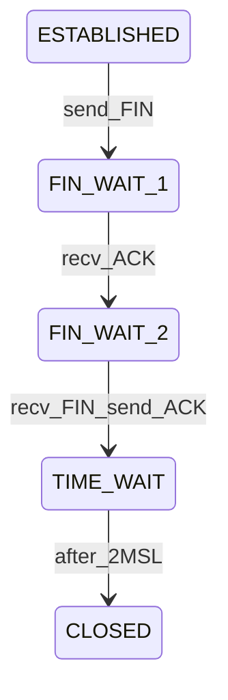

# D04-T008 — TCP connection states and TIME_WAIT

Topic ID: `D04-T008`
Domain: Computer Networks
Subdomain: TCP connection states and TIME_WAIT
Importance: core
Complexity: intermediate
Dependencies: `D04-T007`, `D04-T001`, `D01-T001`, `D01-T002`, `D03-T001`, `D03-T002`
Execution status of the code in section F: not executed (local)

## A. Topic Overview

TCP endpoints move through well-defined states from connection setup through teardown. Operators diagnose stuck connections with tools like `ss` by state name.

TIME_WAIT is entered by the side that sends the final ACK completing an active close. It lasts approximately twice the maximum segment lifetime (2MSL).

The wait prevents delayed duplicates from an old connection incarnation from being accepted as valid on a reused quadruple (source IP, source port, destination IP, destination port).

High TIME-WAIT counts on clients after many short API calls can be normal; on servers they suggest close patterns or missing connection reuse.

## B. First-Principles Explanation

States include LISTEN, SYN-SENT, SYN-RECEIVED, ESTABLISHED, FIN-WAIT-1, FIN-WAIT-2, CLOSE-WAIT, CLOSING, LAST-ACK, TIME-WAIT, and CLOSED.

Active close: local side sends FIN first. Passive close: peer sends FIN first while local is in CLOSE-WAIT until the application closes.

After the four-way FIN/ACK exchange, the endpoint that sent the last ACK enters TIME-WAIT for 2MSL before the quadruple is free for a new incarnation with the same ports.

MSL is a conceptual upper bound on segment lifetime in the network; Linux commonly uses 30 seconds per direction of wait totaling about 60 seconds in TIME-WAIT unless tuned.

## C. Internal Working and Architecture

Applications call `close` when done writing; the kernel sends FIN when send buffer is drained. Half-close allows shutdown of write while still reading.

`SO_REUSEADDR` allows binding to a port in TIME-WAIT for new listening sockets with constraints; it does not eliminate TIME-WAIT on the closing side.

Linux `tcp_tw_reuse` allows reusing TIME-WAIT sockets for new outgoing connections to the same quadruple in specific safe cases; it does not remove all TIME-WAIT sockets.

Load balancers and NAT track connection state; asymmetric close can leave orphan entries in conntrack tables.

## D. Diagrams and Visual Models



Passive close path uses CLOSE-WAIT and LAST-ACK instead of FIN-WAIT on the side that did not send the first FIN.

## E. Examples and Analogies

A browser opening many short HTTPS connections to the same host may accumulate TIME-WAIT on the client—often harmless unless ephemeral ports exhaust.

A server with TIME-WAIT after each API call suggests the server initiated active close every time; prefer keep-alive and client-side pooling.

## F. Code Examples

File: `examples/d04_t008_time_wait.py`

```python
# Inspect: ss -tan state time-wait | wc -l
print("TIME_WAIT is kernel state; tune only with measurement")
```

Not executed.

## G. Practical Backend Application

Align `keep-alive` and idle timeouts so the client does not reuse a connection the server already closed into TIME-WAIT awkwardly.

When benchmarking, distinguish client TIME-WAIT from server accept queue issues.

Document whether your service actively closes connections after each response.

## H. Advantages, Limitations and Trade-offs

| Choice | Benefit | Cost | Choose when | Avoid when |
| --- | --- | --- | --- | --- |
| Graceful close | Reliable byte stream end | TIME-WAIT on active closer | Correct HTTP semantics | Need instant port reuse on same host |
| Client pooling | Fewer TIME-WAIT sockets | Pool tuning | Database clients | Stateless UDP |
| Lower MSL sysctl | Shorter TIME-WAIT | Risk if late duplicates exist | Controlled LAN | Internet-facing without care |
| RST on shutdown | No TIME-WAIT | Data loss | Hard kill | User-facing APIs |

## I. Common Mistakes and Misconceptions

- Saying TIME-WAIT is always on the server.
- Confusing CLOSE-WAIT (app not closing) with TIME-WAIT.
- Enabling reuse sysctl without reading platform docs.
- Treating all TIME-WAIT as a leak—many are expected on clients.
- Ignoring ephemeral port exhaustion when TIME-WAIT is high.

## J. Debugging and Troubleshooting

Many CLOSE-WAIT: application bug not calling `close` after peer FIN. Many FIN-WAIT-2: peer not closing its side.

Count TIME-WAIT per role (client vs server). Correlate with connection churn metrics.

## K. Interview Preparation

### Beginner

#### Q1. What is TIME_WAIT?

**Answer:** It is a TCP state after active close where the side that sent the last ACK waits about 2MSL. The wait lets late segments from the old connection die. After that the quadruple can be reused safely.

#### Q2. Which side enters TIME_WAIT?

**Answer:** The side that performs active close and sends the final ACK enters TIME_WAIT. The passive closer may not enter TIME_WAIT at all. Role depends on who closes first, not client versus server label.

#### Q3. How long does TIME_WAIT last?

**Answer:** Approximately two maximum segment lifetimes. On many Linux systems this is about 60 seconds total with a 30 second MSL assumption. Exact values are OS-dependent.

#### Q4. Why not close instantly?

**Answer:** Late duplicates could be mistaken for part of a new connection with the same ports. Waiting drains those segments from the network. It protects reliability of future connections.

#### Q5. What tool shows TCP states?

**Answer:** `ss -tan` on Linux shows state per socket. `netstat` is legacy equivalent. Filters like `state time-wait` help quantify churn.

### Intermediate

#### Q1. TIME_WAIT versus CLOSE-WAIT?

**Answer:** CLOSE-WAIT means the peer sent FIN and local application has not closed yet. TIME-WAIT follows completed graceful shutdown on the active closer. CLOSE-WAIT often indicates application bugs.

#### Q2. Is high TIME_WAIT always bad?

**Answer:** Clients with many short connections to one host often show high TIME_WAIT normally. Problems appear when ephemeral ports exhaust or server mis-closes every response. Context matters.

#### Q3. What is 2MSL?

**Answer:** Twice the maximum segment lifetime, a conservative bound on how long a segment might live in the Internet. TCP uses it to time TIME-WAIT. It is not the same as RTT.

#### Q4. How does keep-alive interact?

**Answer:** Reusing connections reduces how often you enter close and TIME-WAIT. Misaligned idle timeouts cause close while the other side still sends, leading to RST or extra handshakes.

#### Q5. SO_REUSEADDR effect?

**Answer:** It helps servers rebind listening ports quickly after restart. It does not remove TIME-WAIT on outbound connections the same way. Read man pages before assuming port reuse for clients.

### Advanced

#### Q1. tcp_tw_reuse on Linux?

**Answer:** It allows certain new outgoing connections to reuse TIME-WAIT quadruples safely. It is not a blanket disable of TIME-WAIT. Wrong tuning can cause subtle connection errors.

#### Q2. NAT and TIME_WAIT?

**Answer:** NAT gateways track flows; lingering TIME-WAIT on clients still holds local state. NAT entries have their own timeouts that must exceed communication idle periods.

#### Q3. Simultaneous close?

**Answer:** Both sides may send FIN; both can pass through closing states. TIME-WAIT may appear on both in some paths. Captures clarify the actual sequence.

#### Q4. Port exhaustion?

**Answer:** Each TIME-WAIT quadruple ties local ephemeral port until expiry. Millions of short connections can exhaust the ephemeral range. Fix with pooling or more source IPs.

#### Q5. Kubernetes pod churn?

**Answer:** Rapid pod restarts change endpoints while clients hold old connections. Combine graceful drain with LB deregistration delay to avoid RST storms unrelated to TIME-WAIT math.

### Scenarios

#### Q1. Load test finishes; client host has 30k TIME_WAIT.

**Answer:** Expected if the load generator opened many unique connections and actively closed. Check ephemeral port range and duration. Use keep-alive in tests if measuring steady-state.

#### Q2. Server stuck with CLOSE-WAIT growing.

**Answer:** Application threads not closing sockets after client disconnect. Fix code paths in finally blocks. CLOSE-WAIT is not fixed by sysctl.

#### Q3. Cannot rebind port 8080 immediately after crash.

**Answer:** TIME-WAIT on old connections or SO_REUSEADDR not set on listener. Wait 2MSL or configure reuse for listen socket appropriately.

#### Q4. Microservice mesh shows asymmetric resets.

**Answer:** Sidecar idle timeout shorter than app keep-alive. Align timeouts across hop. RST bypasses TIME_WAIT but breaks clients mid-request.

#### Q5. Incident after lowering tcp_fin_timeout.

**Answer:** Shorter timeouts change FIN-WAIT timing but do not replace TIME_WAIT purpose. Validate no duplicate segment issues on high-latency paths.

### Follow-ups

#### Q1. Link to handshake (`D04-T005`)?

**Answer:** TIME-WAIT follows graceful teardown after established connections created by handshake. Setup and teardown are separate state machines.

#### Q2. Link to HTTP (`D04-T009`/`D04-T022`)?

**Answer:** HTTP keep-alive reduces teardown frequency. HTTP/2 multiplexing further amortizes one TCP connection.

#### Q3. Link to observability?

**Answer:** Export TCP state histograms from node agents or eBPF where available. Correlate with request rate and pool settings.

## L. Practical Exercises

Solutions: `EXERCISES/solutions/D04-T008.md`.

### Exercise 1 — implementation

Sketch active versus passive close state transitions on a whiteboard.

Acceptance: FIN-WAIT and CLOSE-WAIT paths labeled; TIME_WAIT on active closer with last ACK.

### Exercise 2 — debugging

`ss` shows 500 CLOSE-WAIT to database port. What is the likely bug class?

Acceptance: Application not closing connections after server FIN or pool leak.

### Exercise 3 — trade-off

A benchmark reports TIME_WAIT on clients only. Is that necessarily an incident?

Acceptance: Distinguish expected churn from port exhaustion; mention pooling.

## M. Revision Notes

- TIME_WAIT follows active close last ACK.
- Duration about 2MSL (~60s on many Linux hosts).
- CLOSE-WAIT means app has not closed.
- Client churn can create many TIME_WAIT sockets.
- Pooling and keep-alive reduce teardown rate.

## N. Related Topics

`D04-T005` teardown, `D04-T022` keep-alive, `D04-T007` congestion unrelated but co-tuned.

## O. Completion Criteria

- Explain why TIME_WAIT exists.
- Name who enters TIME_WAIT.
- Contrast CLOSE-WAIT and TIME-WAIT.
- Use `ss` to count states.
- Decide if TIME_WAIT is a problem in a scenario.
