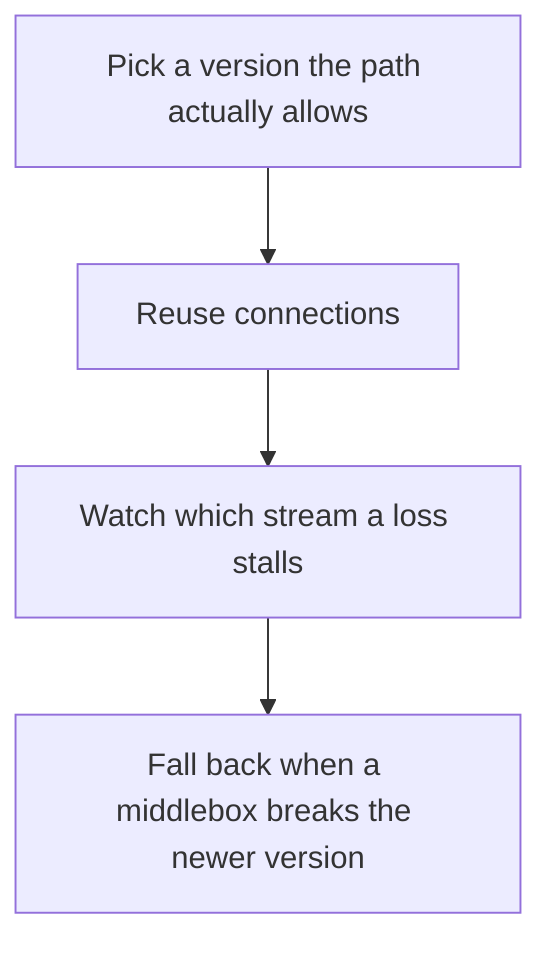

# D04-T009 — HTTP/1.1, HTTP/2, HTTP/3

Topic ID: `D04-T009`
Domain: Computer Networks
Subdomain: HTTP/1.1, HTTP/2, HTTP/3
Importance: core
Complexity: intermediate
Dependencies: `D04-T008`, `D04-T001`, `D01-T001`, `D01-T002`, `D03-T001`, `D03-T002`
Execution status of the code in section F: unexecuted

## A. Topic Overview

HTTP/1.1 is a text protocol with one response in flight per connection unless pipelines are used, and pipelines stall on a slow response. HTTP/2 multiplexes streams on one connection and compresses headers, but it can block a connection on a lost TCP packet. HTTP/3 runs the same stream model over QUIC on UDP, so one lost packet stalls one stream rather than every stream. Semantics of methods and status codes stay shared. The version changes framing and head-of-line behavior.

In production this shows up as follows: A browser to a CDN benefits from HTTP/2 or HTTP/3. A service mesh that hairpins HTTP/2 through a single TCP connection can couple unrelated requests when that connection loses a packet.

Interviewers use HTTP/1.1, HTTP/2, HTTP/3 to see whether you can state the failure mode, not only the definition. The failure to name is: head-of-line blocking on HTTP/2 over a lossy TCP path, or assuming a proxy speaks HTTP/3 because the origin does

Prerequisites: `D04-T008`, `D04-T001`, `D01-T001`, `D01-T002`, `D03-T001`, `D03-T002`. Later notes should link here instead of repeating the mechanism.

## B. First-Principles Explanation

HTTP/1.1 is a text protocol with one response in flight per connection unless pipelines are used, and pipelines stall on a slow response. HTTP/2 multiplexes streams on one connection and compresses headers, but it can block a connection on a lost TCP packet. HTTP/3 runs the same stream model over QUIC on UDP, so one lost packet stalls one stream rather than every stream. Semantics of methods and status codes stay shared. The version changes framing and head-of-line behavior.

The useful picture is: HTTP/1.1 is one conversation per phone line. HTTP/2 is several conversations on one line where a garbled sentence stalls all of them. HTTP/3 gives each conversation its own recovery.

What has to be true:

1. Pick a version the path actually allows
2. Reuse connections
3. Watch which stream a loss stalls
4. Fall back when a middlebox breaks the newer version

It works when those steps preserve one invariant. It fails when head-of-line blocking on HTTP/2 over a lossy TCP path, or assuming a proxy speaks HTTP/3 because the origin does. The alternative is: you have one request per connection and no header repetition, where the version is not the bottleneck

## C. Internal Working and Architecture

Components involved: the caller, the state HTTP/1.1, HTTP/2, HTTP/3 mutates or reads, and the observer that reports stream concurrency, connection count, and tail latency under packet loss.

Execution:

1. Pick a version the path actually allows
2. Reuse connections
3. Watch which stream a loss stalls
4. Fall back when a middlebox breaks the newer version

Data moves only along that path. A retry re-enters at step 1, so the operation must say what a duplicate does. Memory and locks stay inside this mechanism. Callers see the result or a typed error, not a half-updated invariant.

State to remember: choose this when you are choosing a framing version for many concurrent requests. Do not choose it when you have one request per connection and no header repetition, where the version is not the bottleneck.

## D. Diagrams and Visual Models



Read the diagram from top to bottom. Each box is one step of HTTP/1.1, HTTP/2, HTTP/3. The failure mode (head-of-line blocking on HTTP/2 over a lossy TCP path, or assuming a proxy speaks HTTP/3 because the origin does) is what you look for when a later box never happens or happens twice.

## E. Examples and Analogies

Analogy: HTTP/1.1 is one conversation per phone line. HTTP/2 is several conversations on one line where a garbled sentence stalls all of them. HTTP/3 gives each conversation its own recovery.

Production example: A browser to a CDN benefits from HTTP/2 or HTTP/3. A service mesh that hairpins HTTP/2 through a single TCP connection can couple unrelated requests when that connection loses a packet.

A small counterexample is enough in an interview. Show the input, apply the steps, and show the broken outcome if someone uses the mechanism outside its rule: head-of-line blocking on HTTP/2 over a lossy TCP path, or assuming a proxy speaks HTTP/3 because the origin does.

## F. Code Examples

The snippet is labeled unexecuted. It illustrates the shape of the idea. It is not a benchmark and it embeds no secret.

```python
def stalled_streams(version, loss_on_connection):
    if not loss_on_connection:
        return 0
    return 1 if version == 'h3' else 'all-on-connection'
```

After the snippet, check stream concurrency, connection count, and tail latency under packet loss. If that signal moves the wrong way, the snippet is the wrong tool for the workload.

## G. Practical Backend Application

Use HTTP/1.1, HTTP/2, HTTP/3 in a service when you are choosing a framing version for many concurrent requests.

A typical place is the production case already stated: A browser to a CDN benefits from HTTP/2 or HTTP/3. A service mesh that hairpins HTTP/2 through a single TCP connection can couple unrelated requests when that connection loses a packet.

Operationally you alert on stream concurrency, connection count, and tail latency under packet loss. You do not alert only on process uptime. The dashboard should show the failure mode, a success rate, and the saturation signal (queue depth, lock wait, or latency) that predicts it.

## H. Advantages, Limitations and Trade-offs

| Choice | Benefit | Cost | Choose when | Avoid when |
| --- | --- | --- | --- | --- |
| Apply HTTP/1.1, HTTP/2, HTTP/3 | you are choosing a framing version for many concurrent requests | Extra moving parts and a new failure mode | The failure you are preventing is already real | you have one request per connection and no header repetition, where the version is not the bottleneck |
| Simpler alternative | Less code and fewer dependencies | head-of-line blocking on HTTP/2 over a lossy TCP path, or assuming a proxy speaks HTTP/3 because the origin does | The workload does not hit the limit | The invariant must hold under concurrency or failure |

HTTP/1.1, HTTP/2, HTTP/3 is a trade. State the benefit and the cost in the same sentence when you propose it in a design review.

## I. Common Mistakes and Misconceptions

- Assuming HTTP/2 is always lower latency.
- Pipelining HTTP/1.1 without testing proxies.
- Forgetting middleboxes when enabling HTTP/3.
- Treating a diagram of HTTP/1.1, HTTP/2, HTTP/3 as proof that the invariant holds in production.
- Copying a default configuration without naming stream concurrency, connection count, and tail latency under packet loss.

## J. Debugging and Troubleshooting

Symptom: head-of-line blocking on HTTP/2 over a lossy TCP path, or assuming a proxy speaks HTTP/3 because the origin does

First check: stream concurrency, connection count, and tail latency under packet loss.

Then compare one healthy instance against one unhealthy instance. Confirm whether retries are duplicating work. Confirm whether a timeout is shorter than the work. Fix the invariant, then watch the same metric for a full peak, not only for the next minute.

Useful questions: did the step order in section C actually happen, or did a caller skip a step? Did a deploy change the data shape that HTTP/1.1, HTTP/2, HTTP/3 assumes?

## K. Interview Preparation

### Beginner

#### Q1. What problem does HTTP/1.1, HTTP/2, HTTP/3 solve?

**Answer:** HTTP/1.1 is a text protocol with one response in flight per connection unless pipelines are used, and pipelines stall on a slow response. HTTP/2 multiplexes streams on one connection and compresses headers, but it can block a connection on a lost TCP packet. HTTP/3 runs the same stream model over QUIC on UDP, so one lost packet stalls one stream rather than every stream. Semantics of methods and status codes stay shared. The version changes framing and head-of-line behavior. Without it, the usual backend failure is: head-of-line blocking on HTTP/2 over a lossy TCP path, or assuming a proxy speaks HTTP/3 because the origin does.

#### Q2. Where does HTTP/1.1, HTTP/2, HTTP/3 sit on a request path?

**Answer:** HTTP/1.1, HTTP/2, HTTP/3 is not a library you sprinkle on every call. you are choosing a framing version for many concurrent requests You notice it when stream concurrency, connection count, and tail latency under packet loss. Name the constraint that makes this choice correct. Say what you would measure to confirm it.

#### Q3. Give a concrete example of HTTP/1.1, HTTP/2, HTTP/3.

**Answer:** A browser to a CDN benefits from HTTP/2 or HTTP/3. A service mesh that hairpins HTTP/2 through a single TCP connection can couple unrelated requests when that connection loses a packet. Walk the input, the state change, and the observable output. Name the constraint that makes this choice correct.

#### Q4. What is a common mix-up around HTTP/1.1, HTTP/2, HTTP/3?

**Answer:** head-of-line blocking on HTTP/2 over a lossy TCP path, or assuming a proxy speaks HTTP/3 because the origin does The corrective check is stream concurrency, connection count, and tail latency under packet loss. Name the constraint that makes this choice correct. Say what you would measure to confirm it. Say which alternative you rejected and why.

#### Q5. When would you skip HTTP/1.1, HTTP/2, HTTP/3?

**Answer:** you have one request per connection and no header repetition, where the version is not the bottleneck Skipping is a decision with a measured cost, not a slogan. Name the constraint that makes this choice correct. Say what you would measure to confirm it. Say which alternative you rejected and why.

### Intermediate

#### Q1. What invariant makes HTTP/1.1, HTTP/2, HTTP/3 correct?

**Answer:** HTTP/1.1 is a text protocol with one response in flight per connection unless pipelines are used, and pipelines stall on a slow response. HTTP/2 multiplexes streams on one connection and compresses headers, but it can block a connection on a lost TCP packet. HTTP/3 runs the same stream model over QUIC on UDP, so one lost packet stalls one stream rather than every stream. Semantics of methods and status codes stay shared. The version changes framing and head-of-line behavior. State the invariant before you name the tool.

#### Q2. How do you test HTTP/1.1, HTTP/2, HTTP/3?

**Answer:** Assert the failure mode directly: head-of-line blocking on HTTP/2 over a lossy TCP path, or assuming a proxy speaks HTTP/3 because the origin does. The assertion should watch stream concurrency, connection count, and tail latency under packet loss. Include a concurrent or retry case if the bug only appears then. Name the constraint that makes this choice correct.

#### Q3. What signal tells you HTTP/1.1, HTTP/2, HTTP/3 is misbehaving in production?

**Answer:** Watch stream concurrency, connection count, and tail latency under packet loss. The user-visible symptom is usually head-of-line blocking on HTTP/2 over a lossy TCP path, or assuming a proxy speaks HTTP/3 because the origin does. Name the constraint that makes this choice correct. Say what you would measure to confirm it.

#### Q4. How would you introduce HTTP/1.1, HTTP/2, HTTP/3 into a legacy service?

**Answer:** you are choosing a framing version for many concurrent requests Ship it behind a metric so you can compare the old path. Roll back if head-of-line blocking on HTTP/2 over a lossy TCP path, or assuming a proxy speaks HTTP/3 because the origin does gets worse. Name the constraint that makes this choice correct. Say what you would measure to confirm it.

#### Q5. What do you trade away by choosing HTTP/1.1, HTTP/2, HTTP/3?

**Answer:** you are choosing a framing version for many concurrent requests you have one request per connection and no header repetition, where the version is not the bottleneck Say the cost in latency, storage, or operational load. Name the constraint that makes this choice correct. Say what you would measure to confirm it. Say which alternative you rejected and why.

### Advanced

#### Q1. What breaks if a dependency of HTTP/1.1, HTTP/2, HTTP/3 is slow or down?

**Answer:** head-of-line blocking on HTTP/2 over a lossy TCP path, or assuming a proxy speaks HTTP/3 because the origin does Degrade using the rule: you have one request per connection and no header repetition, where the version is not the bottleneck. Timeouts must be shorter than the caller's deadline. Name the constraint that makes this choice correct. Say what you would measure to confirm it.

#### Q2. How does HTTP/1.1, HTTP/2, HTTP/3 behave under retries?

**Answer:** Retries repeat work, so HTTP/1.1, HTTP/2, HTTP/3 must define what a duplicate does. head-of-line blocking on HTTP/2 over a lossy TCP path, or assuming a proxy speaks HTTP/3 because the origin does Idempotency keys or fences belong next to the write, not in a comment. Name the constraint that makes this choice correct. Say what you would measure to confirm it.

#### Q3. What is the capacity limit of HTTP/1.1, HTTP/2, HTTP/3?

**Answer:** The limit shows up as stream concurrency, connection count, and tail latency under packet loss. Add capacity only after you know whether the bottleneck is CPU, lock wait, or network. Name the constraint that makes this choice correct. Say what you would measure to confirm it.

#### Q4. How do you evolve HTTP/1.1, HTTP/2, HTTP/3 without a flag day?

**Answer:** you are choosing a framing version for many concurrent requests Version the contract or the on-disk format. Readers should tolerate one old and one new shape during the rollout. Name the constraint that makes this choice correct. Say what you would measure to confirm it.

#### Q5. What security or correctness bug hides inside HTTP/1.1, HTTP/2, HTTP/3?

**Answer:** head-of-line blocking on HTTP/2 over a lossy TCP path, or assuming a proxy speaks HTTP/3 because the origin does Check authorization and tenancy at the same boundary as the mechanism. A cache or queue must not widen who can read the data. Name the constraint that makes this choice correct. Say what you would measure to confirm it.

### Scenario

#### Q1. Incident: head-of-line blocking on HTTP/2 over a lossy TCP path, or assuming a proxy speaks HTTP/3 because the origin does. What do you check first?

**Answer:** Start with stream concurrency, connection count, and tail latency under packet loss. Compare a good host and a bad host before you restart anything. HTTP/1.1 is a text protocol with one response in flight per connection unless pipelines are used, and pipelines stall on a slow response. HTTP/2 multiplexes streams on one connection and compresses headers, but it can block a connection on a lost TCP packet. HTTP/3 runs the same stream model over QUIC on UDP, so one lost packet stalls one stream rather than every stream. Semantics of methods and status codes stay shared. The version changes framing and head-of-line behavior.

#### Q2. A reviewer wants the clever version. What data settles it?

**Answer:** you are choosing a framing version for many concurrent requests you have one request per connection and no header repetition, where the version is not the bottleneck Bring stream concurrency, connection count, and tail latency under packet loss from a load test or from production, not a slogan. Name the constraint that makes this choice correct. Say what you would measure to confirm it. Say which alternative you rejected and why.

#### Q3. You have one hour to explain HTTP/1.1, HTTP/2, HTTP/3 at a whiteboard.

**Answer:** Draw the happy path in four boxes. Then draw the failure: head-of-line blocking on HTTP/2 over a lossy TCP path, or assuming a proxy speaks HTTP/3 because the origin does. End with the metric you would page on. Name the constraint that makes this choice correct.

#### Q4. The bug only appears under two concurrent callers.

**Answer:** head-of-line blocking on HTTP/2 over a lossy TCP path, or assuming a proxy speaks HTTP/3 because the origin does Reproduce with a barrier so both sides enter the critical window. Confirm the fix with stream concurrency, connection count, and tail latency under packet loss. Name the constraint that makes this choice correct. Say what you would measure to confirm it.

#### Q5. Leadership wants this on every service next week.

**Answer:** you have one request per connection and no header repetition, where the version is not the bottleneck you are choosing a framing version for many concurrent requests Roll it out where the failure mode is already hurting users. Name the constraint that makes this choice correct. Say what you would measure to confirm it. Say which alternative you rejected and why.

### Follow-up

#### Q1. What did you assume about the data size or the clock?

**Answer:** HTTP/1.1 is a text protocol with one response in flight per connection unless pipelines are used, and pipelines stall on a slow response. HTTP/2 multiplexes streams on one connection and compresses headers, but it can block a connection on a lost TCP packet. HTTP/3 runs the same stream model over QUIC on UDP, so one lost packet stalls one stream rather than every stream. Semantics of methods and status codes stay shared. The version changes framing and head-of-line behavior. Clocks are not a total order across machines. State whether the algorithm needs bounded size or a single leader.

#### Q2. What would you measure after the change ships?

**Answer:** Page on stream concurrency, connection count, and tail latency under packet loss. Keep a before/after dashboard for one week. Alert on the failure mode, not only on CPU. Name the constraint that makes this choice correct.

#### Q3. Which neighboring topic did you deliberately not re-teach?

**Answer:** This note owns HTTP/1.1, HTTP/2, HTTP/3. Related identifiers are in section N. Shared ideas are linked, not copied. Name the constraint that makes this choice correct.

## L. Practical Exercises

Solutions are in `EXERCISES/solutions/D04-T009.md`, not in this section.

1. Whiteboard the four steps of HTTP/1.1, HTTP/2, HTTP/3 and mark where `head-of-line blocking on HTTP/2 over a lossy TCP path, or assuming a proxy speaks HTTP/3 because the origin does` enters.
2. Read the snippet in section F and write the assertion that would catch that failure. The assertion must mention `stream concurrency, connection count, and tail latency under packet loss`.
3. Argue for or against using HTTP/1.1, HTTP/2, HTTP/3 on a service you know. Use the choose and avoid rows from section H. Do not appeal to popularity.

## M. Revision Notes

- Mechanism: HTTP/1.
- Failure: head-of-line blocking on HTTP/2 over a lossy TCP path, or assuming a proxy speaks HTTP/3 because the origin does
- Metric: stream concurrency, connection count, and tail latency under packet loss
- Choose when: you are choosing a framing version for many concurrent requests
- Avoid when: you have one request per connection and no header repetition, where the version is not the bottleneck

## N. Related Topics

Dependencies to review first: `D04-T008`, `D04-T001`, `D01-T001`, `D01-T002`, `D03-T001`, `D03-T002`.

Shared ideas stay in those notes. This note does not restate them.

## O. Completion Criteria

- You can explain HTTP/1.1, HTTP/2, HTTP/3 without reading this note, including the failure mode.
- You can draw the diagram in section D from memory.
- You can say when not to use it, using the avoid condition in section H.
- You can name the metric you would watch after shipping it.
