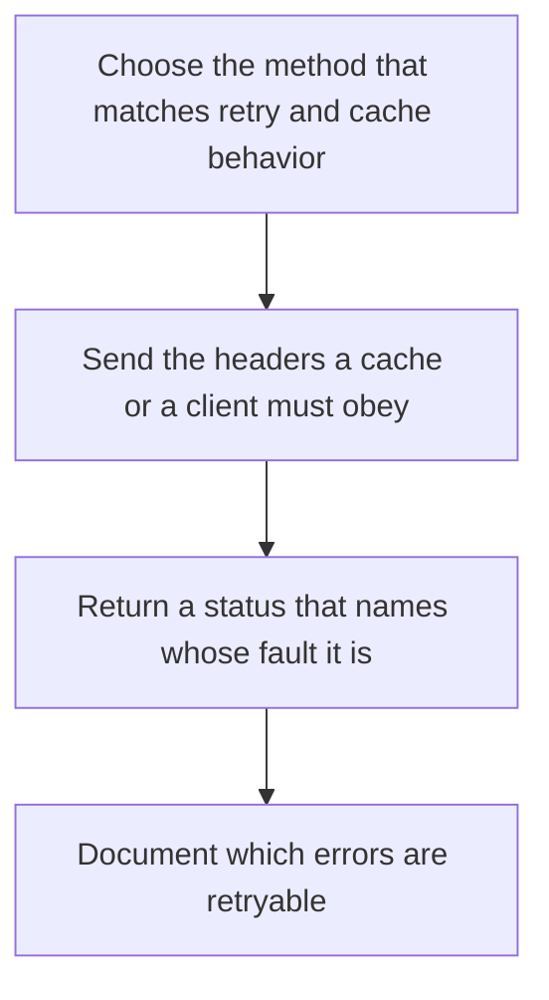

# D04-T010 — HTTP methods, headers, status codes

Topic ID: `D04-T010`
Domain: Computer Networks
Subdomain: HTTP methods, headers, status codes
Importance: core
Complexity: intermediate
Dependencies: `D04-T009`, `D04-T001`, `D01-T001`, `D01-T002`, `D03-T001`, `D03-T002`
Execution status of the code in section F: unexecuted

## A. Topic Overview

HTTP methods name intent. GET and HEAD are safe and idempotent. PUT and DELETE are idempotent. POST is not. Headers carry metadata such as content type, caching, and authentication. Status codes are the contract: 2xx success, 3xx redirection, 4xx the client's request is wrong, 5xx the server failed. A 404 is not a 500. A 409 says the state conflicts. Clients and caches treat the method and status as instructions, not as decoration.

In production this shows up as follows: An API that returns 200 with an error JSON trains clients to ignore status and breaks caches. A payment POST without an idempotency key doubles charges when the client retries on a timeout.

Interviewers use HTTP methods, headers, status codes to see whether you can state the failure mode, not only the definition. The failure to name is: a POST retried by a proxy, creating a second charge, or a 200 returned for an error payload

Prerequisites: `D04-T009`, `D04-T001`, `D01-T001`, `D01-T002`, `D03-T001`, `D03-T002`. Later notes should link here instead of repeating the mechanism.

## B. First-Principles Explanation

HTTP methods name intent. GET and HEAD are safe and idempotent. PUT and DELETE are idempotent. POST is not. Headers carry metadata such as content type, caching, and authentication. Status codes are the contract: 2xx success, 3xx redirection, 4xx the client's request is wrong, 5xx the server failed. A 404 is not a 500. A 409 says the state conflicts. Clients and caches treat the method and status as instructions, not as decoration.

The useful picture is: The method is the verb on a form. The status code is the clerk's stamp. A smile on the form does not mean the stamp said approved.

What has to be true:

1. Choose the method that matches retry and cache behavior
2. Send the headers a cache or a client must obey
3. Return a status that names whose fault it is
4. Document which errors are retryable

It works when those steps preserve one invariant. It fails when a POST retried by a proxy, creating a second charge, or a 200 returned for an error payload. The alternative is: you overload POST for every action and then cannot use caches or safe retries

## C. Internal Working and Architecture

Components involved: the caller, the state HTTP methods, headers, status codes mutates or reads, and the observer that reports the ratio of 4xx to 5xx, and duplicate side effects after a retry.

Execution:

1. Choose the method that matches retry and cache behavior
2. Send the headers a cache or a client must obey
3. Return a status that names whose fault it is
4. Document which errors are retryable

Data moves only along that path. A retry re-enters at step 1, so the operation must say what a duplicate does. Memory and locks stay inside this mechanism. Callers see the result or a typed error, not a half-updated invariant.

State to remember: choose this when you are defining an HTTP contract. Do not choose it when you overload POST for every action and then cannot use caches or safe retries.

## D. Diagrams and Visual Models



Read the diagram from top to bottom. Each box is one step of HTTP methods, headers, status codes. The failure mode (a POST retried by a proxy, creating a second charge, or a 200 returned for an error payload) is what you look for when a later box never happens or happens twice.

## E. Examples and Analogies

Analogy: The method is the verb on a form. The status code is the clerk's stamp. A smile on the form does not mean the stamp said approved.

Production example: An API that returns 200 with an error JSON trains clients to ignore status and breaks caches. A payment POST without an idempotency key doubles charges when the client retries on a timeout.

A small counterexample is enough in an interview. Show the input, apply the steps, and show the broken outcome if someone uses the mechanism outside its rule: a POST retried by a proxy, creating a second charge, or a 200 returned for an error payload.

## F. Code Examples

The snippet is labeled unexecuted. It illustrates the shape of the idea. It is not a benchmark and it embeds no secret.

```python
def retryable(method, status):
    if method == 'POST':
        return False
    return status in (502, 503, 504)
```

After the snippet, check the ratio of 4xx to 5xx, and duplicate side effects after a retry. If that signal moves the wrong way, the snippet is the wrong tool for the workload.

## G. Practical Backend Application

Use HTTP methods, headers, status codes in a service when you are defining an HTTP contract.

A typical place is the production case already stated: An API that returns 200 with an error JSON trains clients to ignore status and breaks caches. A payment POST without an idempotency key doubles charges when the client retries on a timeout.

Operationally you alert on the ratio of 4xx to 5xx, and duplicate side effects after a retry. You do not alert only on process uptime. The dashboard should show the failure mode, a success rate, and the saturation signal (queue depth, lock wait, or latency) that predicts it.

## H. Advantages, Limitations and Trade-offs

| Choice | Benefit | Cost | Choose when | Avoid when |
| --- | --- | --- | --- | --- |
| Apply HTTP methods, headers, status codes | you are defining an HTTP contract | Extra moving parts and a new failure mode | The failure you are preventing is already real | you overload POST for every action and then cannot use caches or safe retries |
| Simpler alternative | Less code and fewer dependencies | a POST retried by a proxy, creating a second charge, or a 200 returned for an error payload | The workload does not hit the limit | The invariant must hold under concurrency or failure |

HTTP methods, headers, status codes is a trade. State the benefit and the cost in the same sentence when you propose it in a design review.

## I. Common Mistakes and Misconceptions

- Returning 200 for failures.
- Retrying POST blindly.
- Using 500 for validation errors.
- Treating a diagram of HTTP methods, headers, status codes as proof that the invariant holds in production.
- Copying a default configuration without naming the ratio of 4xx to 5xx, and duplicate side effects after a retry.

## J. Debugging and Troubleshooting

Symptom: a POST retried by a proxy, creating a second charge, or a 200 returned for an error payload

First check: the ratio of 4xx to 5xx, and duplicate side effects after a retry.

Then compare one healthy instance against one unhealthy instance. Confirm whether retries are duplicating work. Confirm whether a timeout is shorter than the work. Fix the invariant, then watch the same metric for a full peak, not only for the next minute.

Useful questions: did the step order in section C actually happen, or did a caller skip a step? Did a deploy change the data shape that HTTP methods, headers, status codes assumes?

## K. Interview Preparation

### Beginner

#### Q1. What problem does HTTP methods, headers, status codes solve?

**Answer:** HTTP methods name intent. GET and HEAD are safe and idempotent. PUT and DELETE are idempotent. POST is not. Headers carry metadata such as content type, caching, and authentication. Status codes are the contract: 2xx success, 3xx redirection, 4xx the client's request is wrong, 5xx the server failed. A 404 is not a 500. A 409 says the state conflicts. Clients and caches treat the method and status as instructions, not as decoration. Without it, the usual backend failure is: a POST retried by a proxy, creating a second charge, or a 200 returned for an error payload.

#### Q2. Where does HTTP methods, headers, status codes sit on a request path?

**Answer:** HTTP methods, headers, status codes is not a library you sprinkle on every call. you are defining an HTTP contract You notice it when the ratio of 4xx to 5xx, and duplicate side effects after a retry. Name the constraint that makes this choice correct. Say what you would measure to confirm it.

#### Q3. Give a concrete example of HTTP methods, headers, status codes.

**Answer:** An API that returns 200 with an error JSON trains clients to ignore status and breaks caches. A payment POST without an idempotency key doubles charges when the client retries on a timeout. Walk the input, the state change, and the observable output. Name the constraint that makes this choice correct.

#### Q4. What is a common mix-up around HTTP methods, headers, status codes?

**Answer:** a POST retried by a proxy, creating a second charge, or a 200 returned for an error payload The corrective check is the ratio of 4xx to 5xx, and duplicate side effects after a retry. Name the constraint that makes this choice correct. Say what you would measure to confirm it. Say which alternative you rejected and why.

#### Q5. When would you skip HTTP methods, headers, status codes?

**Answer:** you overload POST for every action and then cannot use caches or safe retries Skipping is a decision with a measured cost, not a slogan. Name the constraint that makes this choice correct. Say what you would measure to confirm it. Say which alternative you rejected and why.

### Intermediate

#### Q1. What invariant makes HTTP methods, headers, status codes correct?

**Answer:** HTTP methods name intent. GET and HEAD are safe and idempotent. PUT and DELETE are idempotent. POST is not. Headers carry metadata such as content type, caching, and authentication. Status codes are the contract: 2xx success, 3xx redirection, 4xx the client's request is wrong, 5xx the server failed. A 404 is not a 500. A 409 says the state conflicts. Clients and caches treat the method and status as instructions, not as decoration. State the invariant before you name the tool.

#### Q2. How do you test HTTP methods, headers, status codes?

**Answer:** Assert the failure mode directly: a POST retried by a proxy, creating a second charge, or a 200 returned for an error payload. The assertion should watch the ratio of 4xx to 5xx, and duplicate side effects after a retry. Include a concurrent or retry case if the bug only appears then. Name the constraint that makes this choice correct.

#### Q3. What signal tells you HTTP methods, headers, status codes is misbehaving in production?

**Answer:** Watch the ratio of 4xx to 5xx, and duplicate side effects after a retry. The user-visible symptom is usually a POST retried by a proxy, creating a second charge, or a 200 returned for an error payload. Name the constraint that makes this choice correct. Say what you would measure to confirm it.

#### Q4. How would you introduce HTTP methods, headers, status codes into a legacy service?

**Answer:** you are defining an HTTP contract Ship it behind a metric so you can compare the old path. Roll back if a POST retried by a proxy, creating a second charge, or a 200 returned for an error payload gets worse. Name the constraint that makes this choice correct. Say what you would measure to confirm it.

#### Q5. What do you trade away by choosing HTTP methods, headers, status codes?

**Answer:** you are defining an HTTP contract you overload POST for every action and then cannot use caches or safe retries Say the cost in latency, storage, or operational load. Name the constraint that makes this choice correct. Say what you would measure to confirm it. Say which alternative you rejected and why.

### Advanced

#### Q1. What breaks if a dependency of HTTP methods, headers, status codes is slow or down?

**Answer:** a POST retried by a proxy, creating a second charge, or a 200 returned for an error payload Degrade using the rule: you overload POST for every action and then cannot use caches or safe retries. Timeouts must be shorter than the caller's deadline. Name the constraint that makes this choice correct. Say what you would measure to confirm it.

#### Q2. How does HTTP methods, headers, status codes behave under retries?

**Answer:** Retries repeat work, so HTTP methods, headers, status codes must define what a duplicate does. a POST retried by a proxy, creating a second charge, or a 200 returned for an error payload Idempotency keys or fences belong next to the write, not in a comment. Name the constraint that makes this choice correct. Say what you would measure to confirm it.

#### Q3. What is the capacity limit of HTTP methods, headers, status codes?

**Answer:** The limit shows up as the ratio of 4xx to 5xx, and duplicate side effects after a retry. Add capacity only after you know whether the bottleneck is CPU, lock wait, or network. Name the constraint that makes this choice correct. Say what you would measure to confirm it.

#### Q4. How do you evolve HTTP methods, headers, status codes without a flag day?

**Answer:** you are defining an HTTP contract Version the contract or the on-disk format. Readers should tolerate one old and one new shape during the rollout. Name the constraint that makes this choice correct. Say what you would measure to confirm it.

#### Q5. What security or correctness bug hides inside HTTP methods, headers, status codes?

**Answer:** a POST retried by a proxy, creating a second charge, or a 200 returned for an error payload Check authorization and tenancy at the same boundary as the mechanism. A cache or queue must not widen who can read the data. Name the constraint that makes this choice correct. Say what you would measure to confirm it.

### Scenario

#### Q1. Incident: a POST retried by a proxy, creating a second charge, or a 200 returned for an error payload. What do you check first?

**Answer:** Start with the ratio of 4xx to 5xx, and duplicate side effects after a retry. Compare a good host and a bad host before you restart anything. HTTP methods name intent. GET and HEAD are safe and idempotent. PUT and DELETE are idempotent. POST is not. Headers carry metadata such as content type, caching, and authentication. Status codes are the contract: 2xx success, 3xx redirection, 4xx the client's request is wrong, 5xx the server failed. A 404 is not a 500. A 409 says the state conflicts. Clients and caches treat the method and status as instructions, not as decoration.

#### Q2. A reviewer wants the clever version. What data settles it?

**Answer:** you are defining an HTTP contract you overload POST for every action and then cannot use caches or safe retries Bring the ratio of 4xx to 5xx, and duplicate side effects after a retry from a load test or from production, not a slogan. Name the constraint that makes this choice correct. Say what you would measure to confirm it. Say which alternative you rejected and why.

#### Q3. You have one hour to explain HTTP methods, headers, status codes at a whiteboard.

**Answer:** Draw the happy path in four boxes. Then draw the failure: a POST retried by a proxy, creating a second charge, or a 200 returned for an error payload. End with the metric you would page on. Name the constraint that makes this choice correct.

#### Q4. The bug only appears under two concurrent callers.

**Answer:** a POST retried by a proxy, creating a second charge, or a 200 returned for an error payload Reproduce with a barrier so both sides enter the critical window. Confirm the fix with the ratio of 4xx to 5xx, and duplicate side effects after a retry. Name the constraint that makes this choice correct. Say what you would measure to confirm it.

#### Q5. Leadership wants this on every service next week.

**Answer:** you overload POST for every action and then cannot use caches or safe retries you are defining an HTTP contract Roll it out where the failure mode is already hurting users. Name the constraint that makes this choice correct. Say what you would measure to confirm it. Say which alternative you rejected and why.

### Follow-up

#### Q1. What did you assume about the data size or the clock?

**Answer:** HTTP methods name intent. GET and HEAD are safe and idempotent. PUT and DELETE are idempotent. POST is not. Headers carry metadata such as content type, caching, and authentication. Status codes are the contract: 2xx success, 3xx redirection, 4xx the client's request is wrong, 5xx the server failed. A 404 is not a 500. A 409 says the state conflicts. Clients and caches treat the method and status as instructions, not as decoration. Clocks are not a total order across machines. State whether the algorithm needs bounded size or a single leader.

#### Q2. What would you measure after the change ships?

**Answer:** Page on the ratio of 4xx to 5xx, and duplicate side effects after a retry. Keep a before/after dashboard for one week. Alert on the failure mode, not only on CPU. Name the constraint that makes this choice correct.

#### Q3. Which neighboring topic did you deliberately not re-teach?

**Answer:** This note owns HTTP methods, headers, status codes. Related identifiers are in section N. Shared ideas are linked, not copied. Name the constraint that makes this choice correct.

## L. Practical Exercises

Solutions are in `EXERCISES/solutions/D04-T010.md`, not in this section.

1. Whiteboard the four steps of HTTP methods, headers, status codes and mark where `a POST retried by a proxy, creating a second charge, or a 200 returned for an error payload` enters.
2. Read the snippet in section F and write the assertion that would catch that failure. The assertion must mention `the ratio of 4xx to 5xx, and duplicate side effects after a retry`.
3. Argue for or against using HTTP methods, headers, status codes on a service you know. Use the choose and avoid rows from section H. Do not appeal to popularity.

## M. Revision Notes

- Mechanism: HTTP methods name intent.
- Failure: a POST retried by a proxy, creating a second charge, or a 200 returned for an error payload
- Metric: the ratio of 4xx to 5xx, and duplicate side effects after a retry
- Choose when: you are defining an HTTP contract
- Avoid when: you overload POST for every action and then cannot use caches or safe retries

## N. Related Topics

Dependencies to review first: `D04-T009`, `D04-T001`, `D01-T001`, `D01-T002`, `D03-T001`, `D03-T002`.

Shared ideas stay in those notes. This note does not restate them.

## O. Completion Criteria

- You can explain HTTP methods, headers, status codes without reading this note, including the failure mode.
- You can draw the diagram in section D from memory.
- You can say when not to use it, using the avoid condition in section H.
- You can name the metric you would watch after shipping it.
