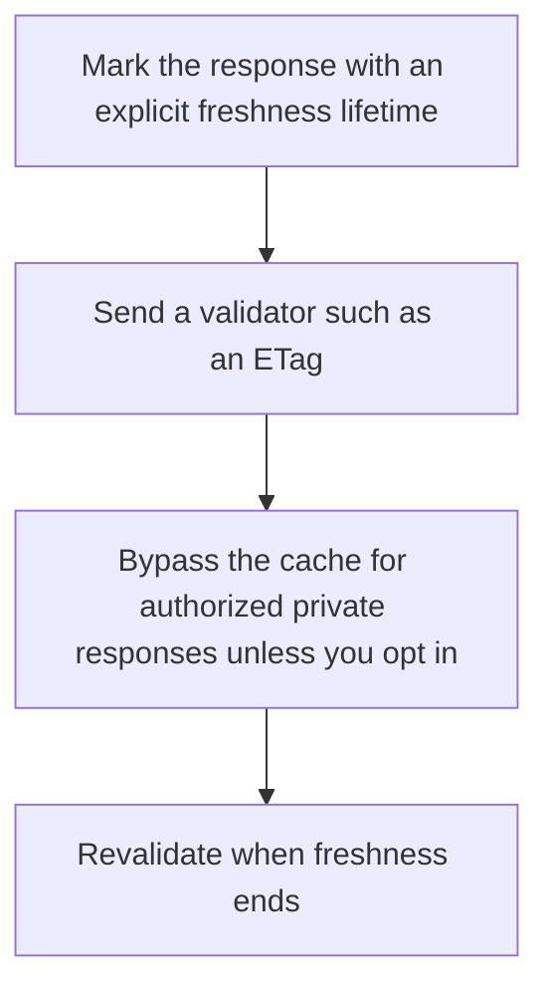

# D04-T011 — HTTP caching semantics

Topic ID: `D04-T011`
Domain: Computer Networks
Subdomain: HTTP caching semantics
Importance: core
Complexity: intermediate
Dependencies: `D04-T010`, `D04-T001`, `D01-T001`, `D01-T002`, `D03-T001`, `D03-T002`
Execution status of the code in section F: unexecuted

## A. Topic Overview

HTTP caching is defined by method, status, and headers such as Cache-Control, ETag, and Last-Modified. Freshness lets a cache serve without contacting the origin until max-age passes. Validation sends If-None-Match and may receive 304. Shared caches must not store responses with Authorization unless the response explicitly says they can. GET is cacheable. POST is not, by default.

In production this shows up as follows: A CDN caches a public product image for an hour. It must not cache a GET /account response that varies by cookie unless Vary and private are set correctly.

Interviewers use HTTP caching semantics to see whether you can state the failure mode, not only the definition. The failure to name is: a shared cache storing a response that includes one user's data, or a client caching an error

Prerequisites: `D04-T010`, `D04-T001`, `D01-T001`, `D01-T002`, `D03-T001`, `D03-T002`. Later notes should link here instead of repeating the mechanism.

## B. First-Principles Explanation

HTTP caching is defined by method, status, and headers such as Cache-Control, ETag, and Last-Modified. Freshness lets a cache serve without contacting the origin until max-age passes. Validation sends If-None-Match and may receive 304. Shared caches must not store responses with Authorization unless the response explicitly says they can. GET is cacheable. POST is not, by default.

The useful picture is: A cache is a photocopy with an expiry date. The ETag is the edition number you quote when asking if the original changed.

What has to be true:

1. Mark the response with an explicit freshness lifetime
2. Send a validator such as an ETag
3. Bypass the cache for authorized private responses unless you opt in
4. Revalidate when freshness ends

It works when those steps preserve one invariant. It fails when a shared cache storing a response that includes one user's data, or a client caching an error. The alternative is: the response is unique per user or must be current to the second

## C. Internal Working and Architecture

Components involved: the caller, the state HTTP caching semantics mutates or reads, and the observer that reports cache hit ratio and the number of private responses stored in a shared cache.

Execution:

1. Mark the response with an explicit freshness lifetime
2. Send a validator such as an ETag
3. Bypass the cache for authorized private responses unless you opt in
4. Revalidate when freshness ends

Data moves only along that path. A retry re-enters at step 1, so the operation must say what a duplicate does. Memory and locks stay inside this mechanism. Callers see the result or a typed error, not a half-updated invariant.

State to remember: choose this when the representation is the same for many callers and tolerates a bounded age. Do not choose it when the response is unique per user or must be current to the second.

## D. Diagrams and Visual Models



Read the diagram from top to bottom. Each box is one step of HTTP caching semantics. The failure mode (a shared cache storing a response that includes one user's data, or a client caching an error) is what you look for when a later box never happens or happens twice.

## E. Examples and Analogies

Analogy: A cache is a photocopy with an expiry date. The ETag is the edition number you quote when asking if the original changed.

Production example: A CDN caches a public product image for an hour. It must not cache a GET /account response that varies by cookie unless Vary and private are set correctly.

A small counterexample is enough in an interview. Show the input, apply the steps, and show the broken outcome if someone uses the mechanism outside its rule: a shared cache storing a response that includes one user's data, or a client caching an error.

## F. Code Examples

The snippet is labeled unexecuted. It illustrates the shape of the idea. It is not a benchmark and it embeds no secret.

```python
def cache_control(private, max_age):
    scope = 'private' if private else 'public'
    return f'{scope}, max-age={max_age}'
```

After the snippet, check cache hit ratio and the number of private responses stored in a shared cache. If that signal moves the wrong way, the snippet is the wrong tool for the workload.

## G. Practical Backend Application

Use HTTP caching semantics in a service when the representation is the same for many callers and tolerates a bounded age.

A typical place is the production case already stated: A CDN caches a public product image for an hour. It must not cache a GET /account response that varies by cookie unless Vary and private are set correctly.

Operationally you alert on cache hit ratio and the number of private responses stored in a shared cache. You do not alert only on process uptime. The dashboard should show the failure mode, a success rate, and the saturation signal (queue depth, lock wait, or latency) that predicts it.

## H. Advantages, Limitations and Trade-offs

| Choice | Benefit | Cost | Choose when | Avoid when |
| --- | --- | --- | --- | --- |
| Apply HTTP caching semantics | the representation is the same for many callers and tolerates a bounded age | Extra moving parts and a new failure mode | The failure you are preventing is already real | the response is unique per user or must be current to the second |
| Simpler alternative | Less code and fewer dependencies | a shared cache storing a response that includes one user's data, or a client caching an error | The workload does not hit the limit | The invariant must hold under concurrency or failure |

HTTP caching semantics is a trade. State the benefit and the cost in the same sentence when you propose it in a design review.

## I. Common Mistakes and Misconceptions

- Caching Set-Cookie responses in a shared cache.
- Omitting Vary when the body depends on a header.
- Using a query string as a cache-buster and then wondering why the origin melts.
- Treating a diagram of HTTP caching semantics as proof that the invariant holds in production.
- Copying a default configuration without naming cache hit ratio and the number of private responses stored in a shared cache.

## J. Debugging and Troubleshooting

Symptom: a shared cache storing a response that includes one user's data, or a client caching an error

First check: cache hit ratio and the number of private responses stored in a shared cache.

Then compare one healthy instance against one unhealthy instance. Confirm whether retries are duplicating work. Confirm whether a timeout is shorter than the work. Fix the invariant, then watch the same metric for a full peak, not only for the next minute.

Useful questions: did the step order in section C actually happen, or did a caller skip a step? Did a deploy change the data shape that HTTP caching semantics assumes?

## K. Interview Preparation

### Beginner

#### Q1. What problem does HTTP caching semantics solve?

**Answer:** HTTP caching is defined by method, status, and headers such as Cache-Control, ETag, and Last-Modified. Freshness lets a cache serve without contacting the origin until max-age passes. Validation sends If-None-Match and may receive 304. Shared caches must not store responses with Authorization unless the response explicitly says they can. GET is cacheable. POST is not, by default. Without it, the usual backend failure is: a shared cache storing a response that includes one user's data, or a client caching an error.

#### Q2. Where does HTTP caching semantics sit on a request path?

**Answer:** HTTP caching semantics is not a library you sprinkle on every call. the representation is the same for many callers and tolerates a bounded age You notice it when cache hit ratio and the number of private responses stored in a shared cache. Name the constraint that makes this choice correct. Say what you would measure to confirm it.

#### Q3. Give a concrete example of HTTP caching semantics.

**Answer:** A CDN caches a public product image for an hour. It must not cache a GET /account response that varies by cookie unless Vary and private are set correctly. Walk the input, the state change, and the observable output. Name the constraint that makes this choice correct.

#### Q4. What is a common mix-up around HTTP caching semantics?

**Answer:** a shared cache storing a response that includes one user's data, or a client caching an error The corrective check is cache hit ratio and the number of private responses stored in a shared cache. Name the constraint that makes this choice correct. Say what you would measure to confirm it. Say which alternative you rejected and why.

#### Q5. When would you skip HTTP caching semantics?

**Answer:** the response is unique per user or must be current to the second Skipping is a decision with a measured cost, not a slogan. Name the constraint that makes this choice correct. Say what you would measure to confirm it. Say which alternative you rejected and why.

### Intermediate

#### Q1. What invariant makes HTTP caching semantics correct?

**Answer:** HTTP caching is defined by method, status, and headers such as Cache-Control, ETag, and Last-Modified. Freshness lets a cache serve without contacting the origin until max-age passes. Validation sends If-None-Match and may receive 304. Shared caches must not store responses with Authorization unless the response explicitly says they can. GET is cacheable. POST is not, by default. State the invariant before you name the tool.

#### Q2. How do you test HTTP caching semantics?

**Answer:** Assert the failure mode directly: a shared cache storing a response that includes one user's data, or a client caching an error. The assertion should watch cache hit ratio and the number of private responses stored in a shared cache. Include a concurrent or retry case if the bug only appears then. Name the constraint that makes this choice correct.

#### Q3. What signal tells you HTTP caching semantics is misbehaving in production?

**Answer:** Watch cache hit ratio and the number of private responses stored in a shared cache. The user-visible symptom is usually a shared cache storing a response that includes one user's data, or a client caching an error. Name the constraint that makes this choice correct. Say what you would measure to confirm it.

#### Q4. How would you introduce HTTP caching semantics into a legacy service?

**Answer:** the representation is the same for many callers and tolerates a bounded age Ship it behind a metric so you can compare the old path. Roll back if a shared cache storing a response that includes one user's data, or a client caching an error gets worse. Name the constraint that makes this choice correct. Say what you would measure to confirm it.

#### Q5. What do you trade away by choosing HTTP caching semantics?

**Answer:** the representation is the same for many callers and tolerates a bounded age the response is unique per user or must be current to the second Say the cost in latency, storage, or operational load. Name the constraint that makes this choice correct. Say what you would measure to confirm it. Say which alternative you rejected and why.

### Advanced

#### Q1. What breaks if a dependency of HTTP caching semantics is slow or down?

**Answer:** a shared cache storing a response that includes one user's data, or a client caching an error Degrade using the rule: the response is unique per user or must be current to the second. Timeouts must be shorter than the caller's deadline. Name the constraint that makes this choice correct. Say what you would measure to confirm it.

#### Q2. How does HTTP caching semantics behave under retries?

**Answer:** Retries repeat work, so HTTP caching semantics must define what a duplicate does. a shared cache storing a response that includes one user's data, or a client caching an error Idempotency keys or fences belong next to the write, not in a comment. Name the constraint that makes this choice correct. Say what you would measure to confirm it.

#### Q3. What is the capacity limit of HTTP caching semantics?

**Answer:** The limit shows up as cache hit ratio and the number of private responses stored in a shared cache. Add capacity only after you know whether the bottleneck is CPU, lock wait, or network. Name the constraint that makes this choice correct. Say what you would measure to confirm it.

#### Q4. How do you evolve HTTP caching semantics without a flag day?

**Answer:** the representation is the same for many callers and tolerates a bounded age Version the contract or the on-disk format. Readers should tolerate one old and one new shape during the rollout. Name the constraint that makes this choice correct. Say what you would measure to confirm it.

#### Q5. What security or correctness bug hides inside HTTP caching semantics?

**Answer:** a shared cache storing a response that includes one user's data, or a client caching an error Check authorization and tenancy at the same boundary as the mechanism. A cache or queue must not widen who can read the data. Name the constraint that makes this choice correct. Say what you would measure to confirm it.

### Scenario

#### Q1. Incident: a shared cache storing a response that includes one user's data, or a client caching an error. What do you check first?

**Answer:** Start with cache hit ratio and the number of private responses stored in a shared cache. Compare a good host and a bad host before you restart anything. HTTP caching is defined by method, status, and headers such as Cache-Control, ETag, and Last-Modified. Freshness lets a cache serve without contacting the origin until max-age passes. Validation sends If-None-Match and may receive 304. Shared caches must not store responses with Authorization unless the response explicitly says they can. GET is cacheable. POST is not, by default.

#### Q2. A reviewer wants the clever version. What data settles it?

**Answer:** the representation is the same for many callers and tolerates a bounded age the response is unique per user or must be current to the second Bring cache hit ratio and the number of private responses stored in a shared cache from a load test or from production, not a slogan. Name the constraint that makes this choice correct. Say what you would measure to confirm it. Say which alternative you rejected and why.

#### Q3. You have one hour to explain HTTP caching semantics at a whiteboard.

**Answer:** Draw the happy path in four boxes. Then draw the failure: a shared cache storing a response that includes one user's data, or a client caching an error. End with the metric you would page on. Name the constraint that makes this choice correct.

#### Q4. The bug only appears under two concurrent callers.

**Answer:** a shared cache storing a response that includes one user's data, or a client caching an error Reproduce with a barrier so both sides enter the critical window. Confirm the fix with cache hit ratio and the number of private responses stored in a shared cache. Name the constraint that makes this choice correct. Say what you would measure to confirm it.

#### Q5. Leadership wants this on every service next week.

**Answer:** the response is unique per user or must be current to the second the representation is the same for many callers and tolerates a bounded age Roll it out where the failure mode is already hurting users. Name the constraint that makes this choice correct. Say what you would measure to confirm it. Say which alternative you rejected and why.

### Follow-up

#### Q1. What did you assume about the data size or the clock?

**Answer:** HTTP caching is defined by method, status, and headers such as Cache-Control, ETag, and Last-Modified. Freshness lets a cache serve without contacting the origin until max-age passes. Validation sends If-None-Match and may receive 304. Shared caches must not store responses with Authorization unless the response explicitly says they can. GET is cacheable. POST is not, by default. Clocks are not a total order across machines. State whether the algorithm needs bounded size or a single leader.

#### Q2. What would you measure after the change ships?

**Answer:** Page on cache hit ratio and the number of private responses stored in a shared cache. Keep a before/after dashboard for one week. Alert on the failure mode, not only on CPU. Name the constraint that makes this choice correct.

#### Q3. Which neighboring topic did you deliberately not re-teach?

**Answer:** This note owns HTTP caching semantics. Related identifiers are in section N. Shared ideas are linked, not copied. Name the constraint that makes this choice correct.

## L. Practical Exercises

Solutions are in `EXERCISES/solutions/D04-T011.md`, not in this section.

1. Whiteboard the four steps of HTTP caching semantics and mark where `a shared cache storing a response that includes one user's data, or a client caching an error` enters.
2. Read the snippet in section F and write the assertion that would catch that failure. The assertion must mention `cache hit ratio and the number of private responses stored in a shared cache`.
3. Argue for or against using HTTP caching semantics on a service you know. Use the choose and avoid rows from section H. Do not appeal to popularity.

## M. Revision Notes

- Mechanism: HTTP caching is defined by method, status, and headers such as Cache-Control, ETag, and Last-Modified.
- Failure: a shared cache storing a response that includes one user's data, or a client caching an error
- Metric: cache hit ratio and the number of private responses stored in a shared cache
- Choose when: the representation is the same for many callers and tolerates a bounded age
- Avoid when: the response is unique per user or must be current to the second

## N. Related Topics

Dependencies to review first: `D04-T010`, `D04-T001`, `D01-T001`, `D01-T002`, `D03-T001`, `D03-T002`.

Shared ideas stay in those notes. This note does not restate them.

## O. Completion Criteria

- You can explain HTTP caching semantics without reading this note, including the failure mode.
- You can draw the diagram in section D from memory.
- You can say when not to use it, using the avoid condition in section H.
- You can name the metric you would watch after shipping it.
