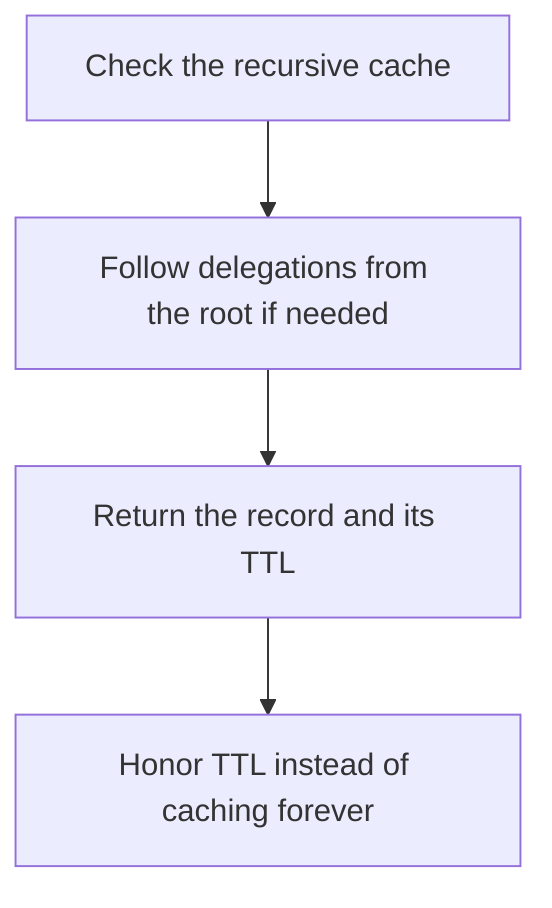

# D04-T012 — DNS resolution and record types

Topic ID: `D04-T012`
Domain: Computer Networks
Subdomain: DNS resolution and record types
Importance: core
Complexity: intermediate
Dependencies: `D04-T011`, `D04-T001`, `D01-T001`, `D01-T002`, `D03-T001`, `D03-T002`
Execution status of the code in section F: unexecuted

## A. Topic Overview

DNS resolution walks from a stub resolver to a recursive resolver, which queries the root, the TLD, and the authoritative server unless a cache hits. Record types include A and AAAA for addresses, CNAME for an alias, NS for delegation, MX for mail, and TXT for arbitrary text used by verification. TTL is the cache lifetime. A CNAME chain adds latency and a failure point.

In production this shows up as follows: A failover that updates an A record still leaves clients on the old IP until the previous TTL expires. Health-checked load balancers move traffic faster than DNS alone.

Interviewers use DNS resolution and record types to see whether you can state the failure mode, not only the definition. The failure to name is: a long TTL on a record you need to fail over, or a CNAME to a name that is itself a CNAME in a loop

Prerequisites: `D04-T011`, `D04-T001`, `D01-T001`, `D01-T002`, `D03-T001`, `D03-T002`. Later notes should link here instead of repeating the mechanism.

## B. First-Principles Explanation

DNS resolution walks from a stub resolver to a recursive resolver, which queries the root, the TLD, and the authoritative server unless a cache hits. Record types include A and AAAA for addresses, CNAME for an alias, NS for delegation, MX for mail, and TXT for arbitrary text used by verification. TTL is the cache lifetime. A CNAME chain adds latency and a failure point.

The useful picture is: DNS is a chain of directories. Each clerk can answer from a photocopy until the photocopy's TTL expires.

What has to be true:

1. Check the recursive cache
2. Follow delegations from the root if needed
3. Return the record and its TTL
4. Honor TTL instead of caching forever

It works when those steps preserve one invariant. It fails when a long TTL on a record you need to fail over, or a CNAME to a name that is itself a CNAME in a loop. The alternative is: you need instant drain of one task, which DNS TTL will not do

## C. Internal Working and Architecture

Components involved: the caller, the state DNS resolution and record types mutates or reads, and the observer that reports resolver latency and the time a changed record still returns the old address.

Execution:

1. Check the recursive cache
2. Follow delegations from the root if needed
3. Return the record and its TTL
4. Honor TTL instead of caching forever

Data moves only along that path. A retry re-enters at step 1, so the operation must say what a duplicate does. Memory and locks stay inside this mechanism. Callers see the result or a typed error, not a half-updated invariant.

State to remember: choose this when you are naming a service or explaining a failover delay. Do not choose it when you need instant drain of one task, which DNS TTL will not do.

## D. Diagrams and Visual Models



Read the diagram from top to bottom. Each box is one step of DNS resolution and record types. The failure mode (a long TTL on a record you need to fail over, or a CNAME to a name that is itself a CNAME in a loop) is what you look for when a later box never happens or happens twice.

## E. Examples and Analogies

Analogy: DNS is a chain of directories. Each clerk can answer from a photocopy until the photocopy's TTL expires.

Production example: A failover that updates an A record still leaves clients on the old IP until the previous TTL expires. Health-checked load balancers move traffic faster than DNS alone.

A small counterexample is enough in an interview. Show the input, apply the steps, and show the broken outcome if someone uses the mechanism outside its rule: a long TTL on a record you need to fail over, or a CNAME to a name that is itself a CNAME in a loop.

## F. Code Examples

The snippet is labeled unexecuted. It illustrates the shape of the idea. It is not a benchmark and it embeds no secret.

```python
def cache_until(now, ttl):
    return now + ttl
```

After the snippet, check resolver latency and the time a changed record still returns the old address. If that signal moves the wrong way, the snippet is the wrong tool for the workload.

## G. Practical Backend Application

Use DNS resolution and record types in a service when you are naming a service or explaining a failover delay.

A typical place is the production case already stated: A failover that updates an A record still leaves clients on the old IP until the previous TTL expires. Health-checked load balancers move traffic faster than DNS alone.

Operationally you alert on resolver latency and the time a changed record still returns the old address. You do not alert only on process uptime. The dashboard should show the failure mode, a success rate, and the saturation signal (queue depth, lock wait, or latency) that predicts it.

## H. Advantages, Limitations and Trade-offs

| Choice | Benefit | Cost | Choose when | Avoid when |
| --- | --- | --- | --- | --- |
| Apply DNS resolution and record types | you are naming a service or explaining a failover delay | Extra moving parts and a new failure mode | The failure you are preventing is already real | you need instant drain of one task, which DNS TTL will not do |
| Simpler alternative | Less code and fewer dependencies | a long TTL on a record you need to fail over, or a CNAME to a name that is itself a CNAME in a loop | The workload does not hit the limit | The invariant must hold under concurrency or failure |

DNS resolution and record types is a trade. State the benefit and the cost in the same sentence when you propose it in a design review.

## I. Common Mistakes and Misconceptions

- Setting TTL to a day and expecting a one-minute failover.
- Breaking a CNAME at the zone apex where the DNS spec forbids it.
- Caching NXDOMAIN for too long.
- Treating a diagram of DNS resolution and record types as proof that the invariant holds in production.
- Copying a default configuration without naming resolver latency and the time a changed record still returns the old address.

## J. Debugging and Troubleshooting

Symptom: a long TTL on a record you need to fail over, or a CNAME to a name that is itself a CNAME in a loop

First check: resolver latency and the time a changed record still returns the old address.

Then compare one healthy instance against one unhealthy instance. Confirm whether retries are duplicating work. Confirm whether a timeout is shorter than the work. Fix the invariant, then watch the same metric for a full peak, not only for the next minute.

Useful questions: did the step order in section C actually happen, or did a caller skip a step? Did a deploy change the data shape that DNS resolution and record types assumes?

## K. Interview Preparation

### Beginner

#### Q1. What problem does DNS resolution and record types solve?

**Answer:** DNS resolution walks from a stub resolver to a recursive resolver, which queries the root, the TLD, and the authoritative server unless a cache hits. Record types include A and AAAA for addresses, CNAME for an alias, NS for delegation, MX for mail, and TXT for arbitrary text used by verification. TTL is the cache lifetime. A CNAME chain adds latency and a failure point. Without it, the usual backend failure is: a long TTL on a record you need to fail over, or a CNAME to a name that is itself a CNAME in a loop.

#### Q2. Where does DNS resolution and record types sit on a request path?

**Answer:** DNS resolution and record types is not a library you sprinkle on every call. you are naming a service or explaining a failover delay You notice it when resolver latency and the time a changed record still returns the old address. Name the constraint that makes this choice correct. Say what you would measure to confirm it.

#### Q3. Give a concrete example of DNS resolution and record types.

**Answer:** A failover that updates an A record still leaves clients on the old IP until the previous TTL expires. Health-checked load balancers move traffic faster than DNS alone. Walk the input, the state change, and the observable output. Name the constraint that makes this choice correct.

#### Q4. What is a common mix-up around DNS resolution and record types?

**Answer:** a long TTL on a record you need to fail over, or a CNAME to a name that is itself a CNAME in a loop The corrective check is resolver latency and the time a changed record still returns the old address. Name the constraint that makes this choice correct. Say what you would measure to confirm it. Say which alternative you rejected and why.

#### Q5. When would you skip DNS resolution and record types?

**Answer:** you need instant drain of one task, which DNS TTL will not do Skipping is a decision with a measured cost, not a slogan. Name the constraint that makes this choice correct. Say what you would measure to confirm it. Say which alternative you rejected and why.

### Intermediate

#### Q1. What invariant makes DNS resolution and record types correct?

**Answer:** DNS resolution walks from a stub resolver to a recursive resolver, which queries the root, the TLD, and the authoritative server unless a cache hits. Record types include A and AAAA for addresses, CNAME for an alias, NS for delegation, MX for mail, and TXT for arbitrary text used by verification. TTL is the cache lifetime. A CNAME chain adds latency and a failure point. State the invariant before you name the tool.

#### Q2. How do you test DNS resolution and record types?

**Answer:** Assert the failure mode directly: a long TTL on a record you need to fail over, or a CNAME to a name that is itself a CNAME in a loop. The assertion should watch resolver latency and the time a changed record still returns the old address. Include a concurrent or retry case if the bug only appears then. Name the constraint that makes this choice correct.

#### Q3. What signal tells you DNS resolution and record types is misbehaving in production?

**Answer:** Watch resolver latency and the time a changed record still returns the old address. The user-visible symptom is usually a long TTL on a record you need to fail over, or a CNAME to a name that is itself a CNAME in a loop. Name the constraint that makes this choice correct. Say what you would measure to confirm it.

#### Q4. How would you introduce DNS resolution and record types into a legacy service?

**Answer:** you are naming a service or explaining a failover delay Ship it behind a metric so you can compare the old path. Roll back if a long TTL on a record you need to fail over, or a CNAME to a name that is itself a CNAME in a loop gets worse. Name the constraint that makes this choice correct. Say what you would measure to confirm it.

#### Q5. What do you trade away by choosing DNS resolution and record types?

**Answer:** you are naming a service or explaining a failover delay you need instant drain of one task, which DNS TTL will not do Say the cost in latency, storage, or operational load. Name the constraint that makes this choice correct. Say what you would measure to confirm it. Say which alternative you rejected and why.

### Advanced

#### Q1. What breaks if a dependency of DNS resolution and record types is slow or down?

**Answer:** a long TTL on a record you need to fail over, or a CNAME to a name that is itself a CNAME in a loop Degrade using the rule: you need instant drain of one task, which DNS TTL will not do. Timeouts must be shorter than the caller's deadline. Name the constraint that makes this choice correct. Say what you would measure to confirm it.

#### Q2. How does DNS resolution and record types behave under retries?

**Answer:** Retries repeat work, so DNS resolution and record types must define what a duplicate does. a long TTL on a record you need to fail over, or a CNAME to a name that is itself a CNAME in a loop Idempotency keys or fences belong next to the write, not in a comment. Name the constraint that makes this choice correct. Say what you would measure to confirm it.

#### Q3. What is the capacity limit of DNS resolution and record types?

**Answer:** The limit shows up as resolver latency and the time a changed record still returns the old address. Add capacity only after you know whether the bottleneck is CPU, lock wait, or network. Name the constraint that makes this choice correct. Say what you would measure to confirm it.

#### Q4. How do you evolve DNS resolution and record types without a flag day?

**Answer:** you are naming a service or explaining a failover delay Version the contract or the on-disk format. Readers should tolerate one old and one new shape during the rollout. Name the constraint that makes this choice correct. Say what you would measure to confirm it.

#### Q5. What security or correctness bug hides inside DNS resolution and record types?

**Answer:** a long TTL on a record you need to fail over, or a CNAME to a name that is itself a CNAME in a loop Check authorization and tenancy at the same boundary as the mechanism. A cache or queue must not widen who can read the data. Name the constraint that makes this choice correct. Say what you would measure to confirm it.

### Scenario

#### Q1. Incident: a long TTL on a record you need to fail over, or a CNAME to a name that is itself a CNAME in a loop. What do you check first?

**Answer:** Start with resolver latency and the time a changed record still returns the old address. Compare a good host and a bad host before you restart anything. DNS resolution walks from a stub resolver to a recursive resolver, which queries the root, the TLD, and the authoritative server unless a cache hits. Record types include A and AAAA for addresses, CNAME for an alias, NS for delegation, MX for mail, and TXT for arbitrary text used by verification. TTL is the cache lifetime. A CNAME chain adds latency and a failure point.

#### Q2. A reviewer wants the clever version. What data settles it?

**Answer:** you are naming a service or explaining a failover delay you need instant drain of one task, which DNS TTL will not do Bring resolver latency and the time a changed record still returns the old address from a load test or from production, not a slogan. Name the constraint that makes this choice correct. Say what you would measure to confirm it. Say which alternative you rejected and why.

#### Q3. You have one hour to explain DNS resolution and record types at a whiteboard.

**Answer:** Draw the happy path in four boxes. Then draw the failure: a long TTL on a record you need to fail over, or a CNAME to a name that is itself a CNAME in a loop. End with the metric you would page on. Name the constraint that makes this choice correct.

#### Q4. The bug only appears under two concurrent callers.

**Answer:** a long TTL on a record you need to fail over, or a CNAME to a name that is itself a CNAME in a loop Reproduce with a barrier so both sides enter the critical window. Confirm the fix with resolver latency and the time a changed record still returns the old address. Name the constraint that makes this choice correct. Say what you would measure to confirm it.

#### Q5. Leadership wants this on every service next week.

**Answer:** you need instant drain of one task, which DNS TTL will not do you are naming a service or explaining a failover delay Roll it out where the failure mode is already hurting users. Name the constraint that makes this choice correct. Say what you would measure to confirm it. Say which alternative you rejected and why.

### Follow-up

#### Q1. What did you assume about the data size or the clock?

**Answer:** DNS resolution walks from a stub resolver to a recursive resolver, which queries the root, the TLD, and the authoritative server unless a cache hits. Record types include A and AAAA for addresses, CNAME for an alias, NS for delegation, MX for mail, and TXT for arbitrary text used by verification. TTL is the cache lifetime. A CNAME chain adds latency and a failure point. Clocks are not a total order across machines. State whether the algorithm needs bounded size or a single leader.

#### Q2. What would you measure after the change ships?

**Answer:** Page on resolver latency and the time a changed record still returns the old address. Keep a before/after dashboard for one week. Alert on the failure mode, not only on CPU. Name the constraint that makes this choice correct.

#### Q3. Which neighboring topic did you deliberately not re-teach?

**Answer:** This note owns DNS resolution and record types. Related identifiers are in section N. Shared ideas are linked, not copied. Name the constraint that makes this choice correct.

## L. Practical Exercises

Solutions are in `EXERCISES/solutions/D04-T012.md`, not in this section.

1. Whiteboard the four steps of DNS resolution and record types and mark where `a long TTL on a record you need to fail over, or a CNAME to a name that is itself a CNAME in a loop` enters.
2. Read the snippet in section F and write the assertion that would catch that failure. The assertion must mention `resolver latency and the time a changed record still returns the old address`.
3. Argue for or against using DNS resolution and record types on a service you know. Use the choose and avoid rows from section H. Do not appeal to popularity.

## M. Revision Notes

- Mechanism: DNS resolution walks from a stub resolver to a recursive resolver, which queries the root, the TLD, and the authoritative server unless a cache hits.
- Failure: a long TTL on a record you need to fail over, or a CNAME to a name that is itself a CNAME in a loop
- Metric: resolver latency and the time a changed record still returns the old address
- Choose when: you are naming a service or explaining a failover delay
- Avoid when: you need instant drain of one task, which DNS TTL will not do

## N. Related Topics

Dependencies to review first: `D04-T011`, `D04-T001`, `D01-T001`, `D01-T002`, `D03-T001`, `D03-T002`.

Shared ideas stay in those notes. This note does not restate them.

## O. Completion Criteria

- You can explain DNS resolution and record types without reading this note, including the failure mode.
- You can draw the diagram in section D from memory.
- You can say when not to use it, using the avoid condition in section H.
- You can name the metric you would watch after shipping it.
