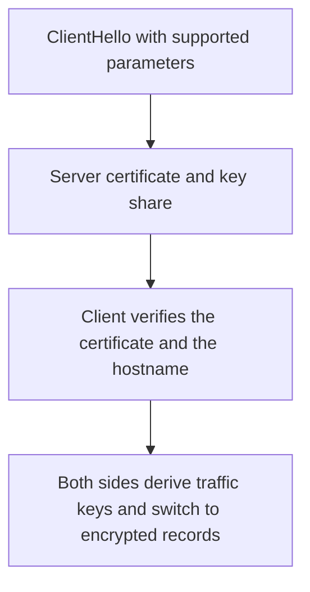

# D04-T013 — TLS/SSL handshake

Topic ID: `D04-T013`
Domain: Computer Networks
Subdomain: TLS/SSL handshake
Importance: core
Complexity: intermediate
Dependencies: `D04-T012`, `D04-T001`, `D01-T001`, `D01-T002`, `D03-T001`, `D03-T002`
Execution status of the code in section F: unexecuted

## A. Topic Overview

A TLS handshake authenticates the server and agrees on session keys. The client offers versions and cipher suites. The server sends a certificate chain. The client checks the chain, the name, and the expiry. Modern TLS 1.3 does this in one round trip after the ClientHello, then both sides derive traffic keys. Session resumption avoids a full handshake. The handshake is not the bulk encryption. It sets it up.

In production this shows up as follows: A service that disables certificate verification to 'fix' a hostname mismatch is accepting any impostor. The fix is the right name on the certificate or the right name in the client config.

Interviewers use TLS/SSL handshake to see whether you can state the failure mode, not only the definition. The failure to name is: accepting a certificate for the wrong hostname, or an old TLS version a middlebox downgrades you into

Prerequisites: `D04-T012`, `D04-T001`, `D01-T001`, `D01-T002`, `D03-T001`, `D03-T002`. Later notes should link here instead of repeating the mechanism.

## B. First-Principles Explanation

A TLS handshake authenticates the server and agrees on session keys. The client offers versions and cipher suites. The server sends a certificate chain. The client checks the chain, the name, and the expiry. Modern TLS 1.3 does this in one round trip after the ClientHello, then both sides derive traffic keys. Session resumption avoids a full handshake. The handshake is not the bulk encryption. It sets it up.

The useful picture is: The handshake is exchanging badges and agreeing on a code phrase before you speak in that code. The badge check is the certificate verification.

What has to be true:

1. ClientHello with supported parameters
2. Server certificate and key share
3. Client verifies the certificate and the hostname
4. Both sides derive traffic keys and switch to encrypted records

It works when those steps preserve one invariant. It fails when accepting a certificate for the wrong hostname, or an old TLS version a middlebox downgrades you into. The alternative is: you turn verification off to silence an error

## C. Internal Working and Architecture

Components involved: the caller, the state TLS/SSL handshake mutates or reads, and the observer that reports handshake failures by alert code, and the fraction of resumed sessions.

Execution:

1. ClientHello with supported parameters
2. Server certificate and key share
3. Client verifies the certificate and the hostname
4. Both sides derive traffic keys and switch to encrypted records

Data moves only along that path. A retry re-enters at step 1, so the operation must say what a duplicate does. Memory and locks stay inside this mechanism. Callers see the result or a typed error, not a half-updated invariant.

State to remember: choose this when you are explaining why a connection is authenticated. Do not choose it when you turn verification off to silence an error.

## D. Diagrams and Visual Models



Read the diagram from top to bottom. Each box is one step of TLS/SSL handshake. The failure mode (accepting a certificate for the wrong hostname, or an old TLS version a middlebox downgrades you into) is what you look for when a later box never happens or happens twice.

## E. Examples and Analogies

Analogy: The handshake is exchanging badges and agreeing on a code phrase before you speak in that code. The badge check is the certificate verification.

Production example: A service that disables certificate verification to 'fix' a hostname mismatch is accepting any impostor. The fix is the right name on the certificate or the right name in the client config.

A small counterexample is enough in an interview. Show the input, apply the steps, and show the broken outcome if someone uses the mechanism outside its rule: accepting a certificate for the wrong hostname, or an old TLS version a middlebox downgrades you into.

## F. Code Examples

The snippet is labeled unexecuted. It illustrates the shape of the idea. It is not a benchmark and it embeds no secret.

```python
def hostname_ok(cert_names, host):
    return host in cert_names
```

After the snippet, check handshake failures by alert code, and the fraction of resumed sessions. If that signal moves the wrong way, the snippet is the wrong tool for the workload.

## G. Practical Backend Application

Use TLS/SSL handshake in a service when you are explaining why a connection is authenticated.

A typical place is the production case already stated: A service that disables certificate verification to 'fix' a hostname mismatch is accepting any impostor. The fix is the right name on the certificate or the right name in the client config.

Operationally you alert on handshake failures by alert code, and the fraction of resumed sessions. You do not alert only on process uptime. The dashboard should show the failure mode, a success rate, and the saturation signal (queue depth, lock wait, or latency) that predicts it.

## H. Advantages, Limitations and Trade-offs

| Choice | Benefit | Cost | Choose when | Avoid when |
| --- | --- | --- | --- | --- |
| Apply TLS/SSL handshake | you are explaining why a connection is authenticated | Extra moving parts and a new failure mode | The failure you are preventing is already real | you turn verification off to silence an error |
| Simpler alternative | Less code and fewer dependencies | accepting a certificate for the wrong hostname, or an old TLS version a middlebox downgrades you into | The workload does not hit the limit | The invariant must hold under concurrency or failure |

TLS/SSL handshake is a trade. State the benefit and the cost in the same sentence when you propose it in a design review.

## I. Common Mistakes and Misconceptions

- Skipping hostname checks.
- Leaving TLS 1.0 enabled.
- Assuming a private network does not need authentication.
- Treating a diagram of TLS/SSL handshake as proof that the invariant holds in production.
- Copying a default configuration without naming handshake failures by alert code, and the fraction of resumed sessions.

## J. Debugging and Troubleshooting

Symptom: accepting a certificate for the wrong hostname, or an old TLS version a middlebox downgrades you into

First check: handshake failures by alert code, and the fraction of resumed sessions.

Then compare one healthy instance against one unhealthy instance. Confirm whether retries are duplicating work. Confirm whether a timeout is shorter than the work. Fix the invariant, then watch the same metric for a full peak, not only for the next minute.

Useful questions: did the step order in section C actually happen, or did a caller skip a step? Did a deploy change the data shape that TLS/SSL handshake assumes?

## K. Interview Preparation

### Beginner

#### Q1. What problem does TLS/SSL handshake solve?

**Answer:** A TLS handshake authenticates the server and agrees on session keys. The client offers versions and cipher suites. The server sends a certificate chain. The client checks the chain, the name, and the expiry. Modern TLS 1.3 does this in one round trip after the ClientHello, then both sides derive traffic keys. Session resumption avoids a full handshake. The handshake is not the bulk encryption. It sets it up. Without it, the usual backend failure is: accepting a certificate for the wrong hostname, or an old TLS version a middlebox downgrades you into.

#### Q2. Where does TLS/SSL handshake sit on a request path?

**Answer:** TLS/SSL handshake is not a library you sprinkle on every call. you are explaining why a connection is authenticated You notice it when handshake failures by alert code, and the fraction of resumed sessions. Name the constraint that makes this choice correct. Say what you would measure to confirm it.

#### Q3. Give a concrete example of TLS/SSL handshake.

**Answer:** A service that disables certificate verification to 'fix' a hostname mismatch is accepting any impostor. The fix is the right name on the certificate or the right name in the client config. Walk the input, the state change, and the observable output. Name the constraint that makes this choice correct.

#### Q4. What is a common mix-up around TLS/SSL handshake?

**Answer:** accepting a certificate for the wrong hostname, or an old TLS version a middlebox downgrades you into The corrective check is handshake failures by alert code, and the fraction of resumed sessions. Name the constraint that makes this choice correct. Say what you would measure to confirm it. Say which alternative you rejected and why.

#### Q5. When would you skip TLS/SSL handshake?

**Answer:** you turn verification off to silence an error Skipping is a decision with a measured cost, not a slogan. Name the constraint that makes this choice correct. Say what you would measure to confirm it. Say which alternative you rejected and why.

### Intermediate

#### Q1. What invariant makes TLS/SSL handshake correct?

**Answer:** A TLS handshake authenticates the server and agrees on session keys. The client offers versions and cipher suites. The server sends a certificate chain. The client checks the chain, the name, and the expiry. Modern TLS 1.3 does this in one round trip after the ClientHello, then both sides derive traffic keys. Session resumption avoids a full handshake. The handshake is not the bulk encryption. It sets it up. State the invariant before you name the tool.

#### Q2. How do you test TLS/SSL handshake?

**Answer:** Assert the failure mode directly: accepting a certificate for the wrong hostname, or an old TLS version a middlebox downgrades you into. The assertion should watch handshake failures by alert code, and the fraction of resumed sessions. Include a concurrent or retry case if the bug only appears then. Name the constraint that makes this choice correct.

#### Q3. What signal tells you TLS/SSL handshake is misbehaving in production?

**Answer:** Watch handshake failures by alert code, and the fraction of resumed sessions. The user-visible symptom is usually accepting a certificate for the wrong hostname, or an old TLS version a middlebox downgrades you into. Name the constraint that makes this choice correct. Say what you would measure to confirm it.

#### Q4. How would you introduce TLS/SSL handshake into a legacy service?

**Answer:** you are explaining why a connection is authenticated Ship it behind a metric so you can compare the old path. Roll back if accepting a certificate for the wrong hostname, or an old TLS version a middlebox downgrades you into gets worse. Name the constraint that makes this choice correct. Say what you would measure to confirm it.

#### Q5. What do you trade away by choosing TLS/SSL handshake?

**Answer:** you are explaining why a connection is authenticated you turn verification off to silence an error Say the cost in latency, storage, or operational load. Name the constraint that makes this choice correct. Say what you would measure to confirm it. Say which alternative you rejected and why.

### Advanced

#### Q1. What breaks if a dependency of TLS/SSL handshake is slow or down?

**Answer:** accepting a certificate for the wrong hostname, or an old TLS version a middlebox downgrades you into Degrade using the rule: you turn verification off to silence an error. Timeouts must be shorter than the caller's deadline. Name the constraint that makes this choice correct. Say what you would measure to confirm it.

#### Q2. How does TLS/SSL handshake behave under retries?

**Answer:** Retries repeat work, so TLS/SSL handshake must define what a duplicate does. accepting a certificate for the wrong hostname, or an old TLS version a middlebox downgrades you into Idempotency keys or fences belong next to the write, not in a comment. Name the constraint that makes this choice correct. Say what you would measure to confirm it.

#### Q3. What is the capacity limit of TLS/SSL handshake?

**Answer:** The limit shows up as handshake failures by alert code, and the fraction of resumed sessions. Add capacity only after you know whether the bottleneck is CPU, lock wait, or network. Name the constraint that makes this choice correct. Say what you would measure to confirm it.

#### Q4. How do you evolve TLS/SSL handshake without a flag day?

**Answer:** you are explaining why a connection is authenticated Version the contract or the on-disk format. Readers should tolerate one old and one new shape during the rollout. Name the constraint that makes this choice correct. Say what you would measure to confirm it.

#### Q5. What security or correctness bug hides inside TLS/SSL handshake?

**Answer:** accepting a certificate for the wrong hostname, or an old TLS version a middlebox downgrades you into Check authorization and tenancy at the same boundary as the mechanism. A cache or queue must not widen who can read the data. Name the constraint that makes this choice correct. Say what you would measure to confirm it.

### Scenario

#### Q1. Incident: accepting a certificate for the wrong hostname, or an old TLS version a middlebox downgrades you into. What do you check first?

**Answer:** Start with handshake failures by alert code, and the fraction of resumed sessions. Compare a good host and a bad host before you restart anything. A TLS handshake authenticates the server and agrees on session keys. The client offers versions and cipher suites. The server sends a certificate chain. The client checks the chain, the name, and the expiry. Modern TLS 1.3 does this in one round trip after the ClientHello, then both sides derive traffic keys. Session resumption avoids a full handshake. The handshake is not the bulk encryption. It sets it up.

#### Q2. A reviewer wants the clever version. What data settles it?

**Answer:** you are explaining why a connection is authenticated you turn verification off to silence an error Bring handshake failures by alert code, and the fraction of resumed sessions from a load test or from production, not a slogan. Name the constraint that makes this choice correct. Say what you would measure to confirm it. Say which alternative you rejected and why.

#### Q3. You have one hour to explain TLS/SSL handshake at a whiteboard.

**Answer:** Draw the happy path in four boxes. Then draw the failure: accepting a certificate for the wrong hostname, or an old TLS version a middlebox downgrades you into. End with the metric you would page on. Name the constraint that makes this choice correct.

#### Q4. The bug only appears under two concurrent callers.

**Answer:** accepting a certificate for the wrong hostname, or an old TLS version a middlebox downgrades you into Reproduce with a barrier so both sides enter the critical window. Confirm the fix with handshake failures by alert code, and the fraction of resumed sessions. Name the constraint that makes this choice correct. Say what you would measure to confirm it.

#### Q5. Leadership wants this on every service next week.

**Answer:** you turn verification off to silence an error you are explaining why a connection is authenticated Roll it out where the failure mode is already hurting users. Name the constraint that makes this choice correct. Say what you would measure to confirm it. Say which alternative you rejected and why.

### Follow-up

#### Q1. What did you assume about the data size or the clock?

**Answer:** A TLS handshake authenticates the server and agrees on session keys. The client offers versions and cipher suites. The server sends a certificate chain. The client checks the chain, the name, and the expiry. Modern TLS 1.3 does this in one round trip after the ClientHello, then both sides derive traffic keys. Session resumption avoids a full handshake. The handshake is not the bulk encryption. It sets it up. Clocks are not a total order across machines. State whether the algorithm needs bounded size or a single leader.

#### Q2. What would you measure after the change ships?

**Answer:** Page on handshake failures by alert code, and the fraction of resumed sessions. Keep a before/after dashboard for one week. Alert on the failure mode, not only on CPU. Name the constraint that makes this choice correct.

#### Q3. Which neighboring topic did you deliberately not re-teach?

**Answer:** This note owns TLS/SSL handshake. Related identifiers are in section N. Shared ideas are linked, not copied. Name the constraint that makes this choice correct.

## L. Practical Exercises

Solutions are in `EXERCISES/solutions/D04-T013.md`, not in this section.

1. Whiteboard the four steps of TLS/SSL handshake and mark where `accepting a certificate for the wrong hostname, or an old TLS version a middlebox downgrades you into` enters.
2. Read the snippet in section F and write the assertion that would catch that failure. The assertion must mention `handshake failures by alert code, and the fraction of resumed sessions`.
3. Argue for or against using TLS/SSL handshake on a service you know. Use the choose and avoid rows from section H. Do not appeal to popularity.

## M. Revision Notes

- Mechanism: A TLS handshake authenticates the server and agrees on session keys.
- Failure: accepting a certificate for the wrong hostname, or an old TLS version a middlebox downgrades you into
- Metric: handshake failures by alert code, and the fraction of resumed sessions
- Choose when: you are explaining why a connection is authenticated
- Avoid when: you turn verification off to silence an error

## N. Related Topics

Dependencies to review first: `D04-T012`, `D04-T001`, `D01-T001`, `D01-T002`, `D03-T001`, `D03-T002`.

Shared ideas stay in those notes. This note does not restate them.

## O. Completion Criteria

- You can explain TLS/SSL handshake without reading this note, including the failure mode.
- You can draw the diagram in section D from memory.
- You can say when not to use it, using the avoid condition in section H.
- You can name the metric you would watch after shipping it.
