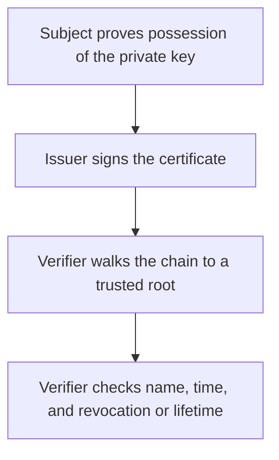

# D04-T014 — Certificates, CAs, public/private keys

Topic ID: `D04-T014`
Domain: Computer Networks
Subdomain: Certificates, CAs, public/private keys
Importance: core
Complexity: intermediate
Dependencies: `D04-T013`, `D04-T001`, `D01-T001`, `D01-T002`, `D03-T001`, `D03-T002`
Execution status of the code in section F: unexecuted

## A. Topic Overview

A certificate binds a public key to a name, signed by an issuer. A certificate authority is an issuer that verifiers have chosen to trust, often through a chain ending at a root in the trust store. The private key stays with the subject and signs or decrypts. The public key is in the certificate and verifies. Revocation and short lifetimes limit the damage of a stolen key. A self-signed certificate is trusted only if you installed it deliberately.

In production this shows up as follows: A Kubernetes ingress certificate that expires on a Saturday takes every public API down. Alerting on days-to-expiry is the operational half of the cryptography.

Interviewers use Certificates, CAs, public/private keys to see whether you can state the failure mode, not only the definition. The failure to name is: trusting a self-signed certificate you did not pin, or a chain that is valid for a different name

Prerequisites: `D04-T013`, `D04-T001`, `D01-T001`, `D01-T002`, `D03-T001`, `D03-T002`. Later notes should link here instead of repeating the mechanism.

## B. First-Principles Explanation

A certificate binds a public key to a name, signed by an issuer. A certificate authority is an issuer that verifiers have chosen to trust, often through a chain ending at a root in the trust store. The private key stays with the subject and signs or decrypts. The public key is in the certificate and verifies. Revocation and short lifetimes limit the damage of a stolen key. A self-signed certificate is trusted only if you installed it deliberately.

The useful picture is: A certificate is a sealed letter of introduction. The CA is the official whose seal you already trust. The private key is the pen that only the owner should hold.

What has to be true:

1. Subject proves possession of the private key
2. Issuer signs the certificate
3. Verifier walks the chain to a trusted root
4. Verifier checks name, time, and revocation or lifetime

It works when those steps preserve one invariant. It fails when trusting a self-signed certificate you did not pin, or a chain that is valid for a different name. The alternative is: you copy a private key into a repo or a ticket

## C. Internal Working and Architecture

Components involved: the caller, the state Certificates, CAs, public/private keys mutates or reads, and the observer that reports days to expiry and handshake failures after a rotation.

Execution:

1. Subject proves possession of the private key
2. Issuer signs the certificate
3. Verifier walks the chain to a trusted root
4. Verifier checks name, time, and revocation or lifetime

Data moves only along that path. A retry re-enters at step 1, so the operation must say what a duplicate does. Memory and locks stay inside this mechanism. Callers see the result or a typed error, not a half-updated invariant.

State to remember: choose this when you are issuing or verifying identity for TLS or code signing. Do not choose it when you copy a private key into a repo or a ticket.

## D. Diagrams and Visual Models



Read the diagram from top to bottom. Each box is one step of Certificates, CAs, public/private keys. The failure mode (trusting a self-signed certificate you did not pin, or a chain that is valid for a different name) is what you look for when a later box never happens or happens twice.

## E. Examples and Analogies

Analogy: A certificate is a sealed letter of introduction. The CA is the official whose seal you already trust. The private key is the pen that only the owner should hold.

Production example: A Kubernetes ingress certificate that expires on a Saturday takes every public API down. Alerting on days-to-expiry is the operational half of the cryptography.

A small counterexample is enough in an interview. Show the input, apply the steps, and show the broken outcome if someone uses the mechanism outside its rule: trusting a self-signed certificate you did not pin, or a chain that is valid for a different name.

## F. Code Examples

The snippet is labeled unexecuted. It illustrates the shape of the idea. It is not a benchmark and it embeds no secret.

```python
def chain_ends_at_root(issuers, roots):
    return issuers[-1] in roots
```

After the snippet, check days to expiry and handshake failures after a rotation. If that signal moves the wrong way, the snippet is the wrong tool for the workload.

## G. Practical Backend Application

Use Certificates, CAs, public/private keys in a service when you are issuing or verifying identity for TLS or code signing.

A typical place is the production case already stated: A Kubernetes ingress certificate that expires on a Saturday takes every public API down. Alerting on days-to-expiry is the operational half of the cryptography.

Operationally you alert on days to expiry and handshake failures after a rotation. You do not alert only on process uptime. The dashboard should show the failure mode, a success rate, and the saturation signal (queue depth, lock wait, or latency) that predicts it.

## H. Advantages, Limitations and Trade-offs

| Choice | Benefit | Cost | Choose when | Avoid when |
| --- | --- | --- | --- | --- |
| Apply Certificates, CAs, public/private keys | you are issuing or verifying identity for TLS or code signing | Extra moving parts and a new failure mode | The failure you are preventing is already real | you copy a private key into a repo or a ticket |
| Simpler alternative | Less code and fewer dependencies | trusting a self-signed certificate you did not pin, or a chain that is valid for a different name | The workload does not hit the limit | The invariant must hold under concurrency or failure |

Certificates, CAs, public/private keys is a trade. State the benefit and the cost in the same sentence when you propose it in a design review.

## I. Common Mistakes and Misconceptions

- Committing private keys.
- Adding a broad private CA to every trust store.
- Ignoring expiry because the chain was valid last month.
- Treating a diagram of Certificates, CAs, public/private keys as proof that the invariant holds in production.
- Copying a default configuration without naming days to expiry and handshake failures after a rotation.

## J. Debugging and Troubleshooting

Symptom: trusting a self-signed certificate you did not pin, or a chain that is valid for a different name

First check: days to expiry and handshake failures after a rotation.

Then compare one healthy instance against one unhealthy instance. Confirm whether retries are duplicating work. Confirm whether a timeout is shorter than the work. Fix the invariant, then watch the same metric for a full peak, not only for the next minute.

Useful questions: did the step order in section C actually happen, or did a caller skip a step? Did a deploy change the data shape that Certificates, CAs, public/private keys assumes?

## K. Interview Preparation

### Beginner

#### Q1. What problem does Certificates, CAs, public/private keys solve?

**Answer:** A certificate binds a public key to a name, signed by an issuer. A certificate authority is an issuer that verifiers have chosen to trust, often through a chain ending at a root in the trust store. The private key stays with the subject and signs or decrypts. The public key is in the certificate and verifies. Revocation and short lifetimes limit the damage of a stolen key. A self-signed certificate is trusted only if you installed it deliberately. Without it, the usual backend failure is: trusting a self-signed certificate you did not pin, or a chain that is valid for a different name.

#### Q2. Where does Certificates, CAs, public/private keys sit on a request path?

**Answer:** Certificates, CAs, public/private keys is not a library you sprinkle on every call. you are issuing or verifying identity for TLS or code signing You notice it when days to expiry and handshake failures after a rotation. Name the constraint that makes this choice correct. Say what you would measure to confirm it.

#### Q3. Give a concrete example of Certificates, CAs, public/private keys.

**Answer:** A Kubernetes ingress certificate that expires on a Saturday takes every public API down. Alerting on days-to-expiry is the operational half of the cryptography. Walk the input, the state change, and the observable output. Name the constraint that makes this choice correct.

#### Q4. What is a common mix-up around Certificates, CAs, public/private keys?

**Answer:** trusting a self-signed certificate you did not pin, or a chain that is valid for a different name The corrective check is days to expiry and handshake failures after a rotation. Name the constraint that makes this choice correct. Say what you would measure to confirm it. Say which alternative you rejected and why.

#### Q5. When would you skip Certificates, CAs, public/private keys?

**Answer:** you copy a private key into a repo or a ticket Skipping is a decision with a measured cost, not a slogan. Name the constraint that makes this choice correct. Say what you would measure to confirm it. Say which alternative you rejected and why.

### Intermediate

#### Q1. What invariant makes Certificates, CAs, public/private keys correct?

**Answer:** A certificate binds a public key to a name, signed by an issuer. A certificate authority is an issuer that verifiers have chosen to trust, often through a chain ending at a root in the trust store. The private key stays with the subject and signs or decrypts. The public key is in the certificate and verifies. Revocation and short lifetimes limit the damage of a stolen key. A self-signed certificate is trusted only if you installed it deliberately. State the invariant before you name the tool.

#### Q2. How do you test Certificates, CAs, public/private keys?

**Answer:** Assert the failure mode directly: trusting a self-signed certificate you did not pin, or a chain that is valid for a different name. The assertion should watch days to expiry and handshake failures after a rotation. Include a concurrent or retry case if the bug only appears then. Name the constraint that makes this choice correct.

#### Q3. What signal tells you Certificates, CAs, public/private keys is misbehaving in production?

**Answer:** Watch days to expiry and handshake failures after a rotation. The user-visible symptom is usually trusting a self-signed certificate you did not pin, or a chain that is valid for a different name. Name the constraint that makes this choice correct. Say what you would measure to confirm it.

#### Q4. How would you introduce Certificates, CAs, public/private keys into a legacy service?

**Answer:** you are issuing or verifying identity for TLS or code signing Ship it behind a metric so you can compare the old path. Roll back if trusting a self-signed certificate you did not pin, or a chain that is valid for a different name gets worse. Name the constraint that makes this choice correct. Say what you would measure to confirm it.

#### Q5. What do you trade away by choosing Certificates, CAs, public/private keys?

**Answer:** you are issuing or verifying identity for TLS or code signing you copy a private key into a repo or a ticket Say the cost in latency, storage, or operational load. Name the constraint that makes this choice correct. Say what you would measure to confirm it. Say which alternative you rejected and why.

### Advanced

#### Q1. What breaks if a dependency of Certificates, CAs, public/private keys is slow or down?

**Answer:** trusting a self-signed certificate you did not pin, or a chain that is valid for a different name Degrade using the rule: you copy a private key into a repo or a ticket. Timeouts must be shorter than the caller's deadline. Name the constraint that makes this choice correct. Say what you would measure to confirm it.

#### Q2. How does Certificates, CAs, public/private keys behave under retries?

**Answer:** Retries repeat work, so Certificates, CAs, public/private keys must define what a duplicate does. trusting a self-signed certificate you did not pin, or a chain that is valid for a different name Idempotency keys or fences belong next to the write, not in a comment. Name the constraint that makes this choice correct. Say what you would measure to confirm it.

#### Q3. What is the capacity limit of Certificates, CAs, public/private keys?

**Answer:** The limit shows up as days to expiry and handshake failures after a rotation. Add capacity only after you know whether the bottleneck is CPU, lock wait, or network. Name the constraint that makes this choice correct. Say what you would measure to confirm it.

#### Q4. How do you evolve Certificates, CAs, public/private keys without a flag day?

**Answer:** you are issuing or verifying identity for TLS or code signing Version the contract or the on-disk format. Readers should tolerate one old and one new shape during the rollout. Name the constraint that makes this choice correct. Say what you would measure to confirm it.

#### Q5. What security or correctness bug hides inside Certificates, CAs, public/private keys?

**Answer:** trusting a self-signed certificate you did not pin, or a chain that is valid for a different name Check authorization and tenancy at the same boundary as the mechanism. A cache or queue must not widen who can read the data. Name the constraint that makes this choice correct. Say what you would measure to confirm it.

### Scenario

#### Q1. Incident: trusting a self-signed certificate you did not pin, or a chain that is valid for a different name. What do you check first?

**Answer:** Start with days to expiry and handshake failures after a rotation. Compare a good host and a bad host before you restart anything. A certificate binds a public key to a name, signed by an issuer. A certificate authority is an issuer that verifiers have chosen to trust, often through a chain ending at a root in the trust store. The private key stays with the subject and signs or decrypts. The public key is in the certificate and verifies. Revocation and short lifetimes limit the damage of a stolen key. A self-signed certificate is trusted only if you installed it deliberately.

#### Q2. A reviewer wants the clever version. What data settles it?

**Answer:** you are issuing or verifying identity for TLS or code signing you copy a private key into a repo or a ticket Bring days to expiry and handshake failures after a rotation from a load test or from production, not a slogan. Name the constraint that makes this choice correct. Say what you would measure to confirm it. Say which alternative you rejected and why.

#### Q3. You have one hour to explain Certificates, CAs, public/private keys at a whiteboard.

**Answer:** Draw the happy path in four boxes. Then draw the failure: trusting a self-signed certificate you did not pin, or a chain that is valid for a different name. End with the metric you would page on. Name the constraint that makes this choice correct.

#### Q4. The bug only appears under two concurrent callers.

**Answer:** trusting a self-signed certificate you did not pin, or a chain that is valid for a different name Reproduce with a barrier so both sides enter the critical window. Confirm the fix with days to expiry and handshake failures after a rotation. Name the constraint that makes this choice correct. Say what you would measure to confirm it.

#### Q5. Leadership wants this on every service next week.

**Answer:** you copy a private key into a repo or a ticket you are issuing or verifying identity for TLS or code signing Roll it out where the failure mode is already hurting users. Name the constraint that makes this choice correct. Say what you would measure to confirm it. Say which alternative you rejected and why.

### Follow-up

#### Q1. What did you assume about the data size or the clock?

**Answer:** A certificate binds a public key to a name, signed by an issuer. A certificate authority is an issuer that verifiers have chosen to trust, often through a chain ending at a root in the trust store. The private key stays with the subject and signs or decrypts. The public key is in the certificate and verifies. Revocation and short lifetimes limit the damage of a stolen key. A self-signed certificate is trusted only if you installed it deliberately. Clocks are not a total order across machines. State whether the algorithm needs bounded size or a single leader.

#### Q2. What would you measure after the change ships?

**Answer:** Page on days to expiry and handshake failures after a rotation. Keep a before/after dashboard for one week. Alert on the failure mode, not only on CPU. Name the constraint that makes this choice correct.

#### Q3. Which neighboring topic did you deliberately not re-teach?

**Answer:** This note owns Certificates, CAs, public/private keys. Related identifiers are in section N. Shared ideas are linked, not copied. Name the constraint that makes this choice correct.

## L. Practical Exercises

Solutions are in `EXERCISES/solutions/D04-T014.md`, not in this section.

1. Whiteboard the four steps of Certificates, CAs, public/private keys and mark where `trusting a self-signed certificate you did not pin, or a chain that is valid for a different name` enters.
2. Read the snippet in section F and write the assertion that would catch that failure. The assertion must mention `days to expiry and handshake failures after a rotation`.
3. Argue for or against using Certificates, CAs, public/private keys on a service you know. Use the choose and avoid rows from section H. Do not appeal to popularity.

## M. Revision Notes

- Mechanism: A certificate binds a public key to a name, signed by an issuer.
- Failure: trusting a self-signed certificate you did not pin, or a chain that is valid for a different name
- Metric: days to expiry and handshake failures after a rotation
- Choose when: you are issuing or verifying identity for TLS or code signing
- Avoid when: you copy a private key into a repo or a ticket

## N. Related Topics

Dependencies to review first: `D04-T013`, `D04-T001`, `D01-T001`, `D01-T002`, `D03-T001`, `D03-T002`.

Shared ideas stay in those notes. This note does not restate them.

## O. Completion Criteria

- You can explain Certificates, CAs, public/private keys without reading this note, including the failure mode.
- You can draw the diagram in section D from memory.
- You can say when not to use it, using the avoid condition in section H.
- You can name the metric you would watch after shipping it.
