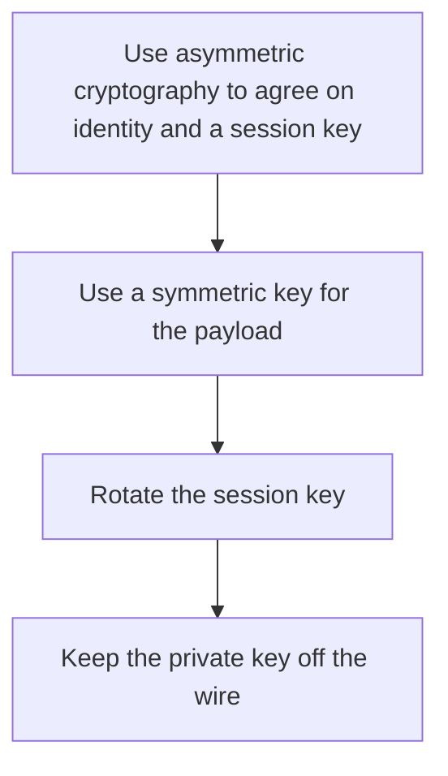

# D04-T015 — Symmetric vs asymmetric encryption

Topic ID: `D04-T015`
Domain: Computer Networks
Subdomain: Symmetric vs asymmetric encryption
Importance: core
Complexity: intermediate
Dependencies: `D04-T014`, `D04-T001`, `D01-T001`, `D01-T002`, `D03-T001`, `D03-T002`
Execution status of the code in section F: unexecuted

## A. Topic Overview

Symmetric encryption uses one shared key to encrypt and decrypt. It is fast and is what protects bulk TLS records. Asymmetric encryption uses a key pair. The public key can be distributed. The private key cannot. Asymmetric algorithms authenticate and exchange a symmetric session key because they are too slow and too large for bulk data. Hashing is neither. It does not encrypt.

In production this shows up as follows: TLS uses the certificate's key pair to authenticate and to help derive a symmetric session key. Application code that RSA-encrypts every database field pays CPU and key-management cost it did not need.

Interviewers use Symmetric vs asymmetric encryption to see whether you can state the failure mode, not only the definition. The failure to name is: encrypting a large payload with RSA, or calling a hash an encryption scheme

Prerequisites: `D04-T014`, `D04-T001`, `D01-T001`, `D01-T002`, `D03-T001`, `D03-T002`. Later notes should link here instead of repeating the mechanism.

## B. First-Principles Explanation

Symmetric encryption uses one shared key to encrypt and decrypt. It is fast and is what protects bulk TLS records. Asymmetric encryption uses a key pair. The public key can be distributed. The private key cannot. Asymmetric algorithms authenticate and exchange a symmetric session key because they are too slow and too large for bulk data. Hashing is neither. It does not encrypt.

The useful picture is: Symmetric crypto is a shared padlock key. Asymmetric crypto is a padlock that anyone can close and only one person can open.

What has to be true:

1. Use asymmetric cryptography to agree on identity and a session key
2. Use a symmetric key for the payload
3. Rotate the session key
4. Keep the private key off the wire

It works when those steps preserve one invariant. It fails when encrypting a large payload with RSA, or calling a hash an encryption scheme. The alternative is: you need a one-way fingerprint, which is a hash, not encryption

## C. Internal Working and Architecture

Components involved: the caller, the state Symmetric vs asymmetric encryption mutates or reads, and the observer that reports handshake CPU versus record CPU, and where private keys are stored.

Execution:

1. Use asymmetric cryptography to agree on identity and a session key
2. Use a symmetric key for the payload
3. Rotate the session key
4. Keep the private key off the wire

Data moves only along that path. A retry re-enters at step 1, so the operation must say what a duplicate does. Memory and locks stay inside this mechanism. Callers see the result or a typed error, not a half-updated invariant.

State to remember: choose this when you are choosing a primitive for a real payload size. Do not choose it when you need a one-way fingerprint, which is a hash, not encryption.

## D. Diagrams and Visual Models



Read the diagram from top to bottom. Each box is one step of Symmetric vs asymmetric encryption. The failure mode (encrypting a large payload with RSA, or calling a hash an encryption scheme) is what you look for when a later box never happens or happens twice.

## E. Examples and Analogies

Analogy: Symmetric crypto is a shared padlock key. Asymmetric crypto is a padlock that anyone can close and only one person can open.

Production example: TLS uses the certificate's key pair to authenticate and to help derive a symmetric session key. Application code that RSA-encrypts every database field pays CPU and key-management cost it did not need.

A small counterexample is enough in an interview. Show the input, apply the steps, and show the broken outcome if someone uses the mechanism outside its rule: encrypting a large payload with RSA, or calling a hash an encryption scheme.

## F. Code Examples

The snippet is labeled unexecuted. It illustrates the shape of the idea. It is not a benchmark and it embeds no secret.

```python
def uses_symmetric_for_bulk(nbytes):
    return nbytes > 0
```

After the snippet, check handshake CPU versus record CPU, and where private keys are stored. If that signal moves the wrong way, the snippet is the wrong tool for the workload.

## G. Practical Backend Application

Use Symmetric vs asymmetric encryption in a service when you are choosing a primitive for a real payload size.

A typical place is the production case already stated: TLS uses the certificate's key pair to authenticate and to help derive a symmetric session key. Application code that RSA-encrypts every database field pays CPU and key-management cost it did not need.

Operationally you alert on handshake CPU versus record CPU, and where private keys are stored. You do not alert only on process uptime. The dashboard should show the failure mode, a success rate, and the saturation signal (queue depth, lock wait, or latency) that predicts it.

## H. Advantages, Limitations and Trade-offs

| Choice | Benefit | Cost | Choose when | Avoid when |
| --- | --- | --- | --- | --- |
| Apply Symmetric vs asymmetric encryption | you are choosing a primitive for a real payload size | Extra moving parts and a new failure mode | The failure you are preventing is already real | you need a one-way fingerprint, which is a hash, not encryption |
| Simpler alternative | Less code and fewer dependencies | encrypting a large payload with RSA, or calling a hash an encryption scheme | The workload does not hit the limit | The invariant must hold under concurrency or failure |

Symmetric vs asymmetric encryption is a trade. State the benefit and the cost in the same sentence when you propose it in a design review.

## I. Common Mistakes and Misconceptions

- Storing data encrypted under a key that lives next to the data.
- Using ECB.
- Confusing encoding such as base64 with encryption.
- Treating a diagram of Symmetric vs asymmetric encryption as proof that the invariant holds in production.
- Copying a default configuration without naming handshake CPU versus record CPU, and where private keys are stored.

## J. Debugging and Troubleshooting

Symptom: encrypting a large payload with RSA, or calling a hash an encryption scheme

First check: handshake CPU versus record CPU, and where private keys are stored.

Then compare one healthy instance against one unhealthy instance. Confirm whether retries are duplicating work. Confirm whether a timeout is shorter than the work. Fix the invariant, then watch the same metric for a full peak, not only for the next minute.

Useful questions: did the step order in section C actually happen, or did a caller skip a step? Did a deploy change the data shape that Symmetric vs asymmetric encryption assumes?

## K. Interview Preparation

### Beginner

#### Q1. What problem does Symmetric vs asymmetric encryption solve?

**Answer:** Symmetric encryption uses one shared key to encrypt and decrypt. It is fast and is what protects bulk TLS records. Asymmetric encryption uses a key pair. The public key can be distributed. The private key cannot. Asymmetric algorithms authenticate and exchange a symmetric session key because they are too slow and too large for bulk data. Hashing is neither. It does not encrypt. Without it, the usual backend failure is: encrypting a large payload with RSA, or calling a hash an encryption scheme.

#### Q2. Where does Symmetric vs asymmetric encryption sit on a request path?

**Answer:** Symmetric vs asymmetric encryption is not a library you sprinkle on every call. you are choosing a primitive for a real payload size You notice it when handshake CPU versus record CPU, and where private keys are stored. Name the constraint that makes this choice correct. Say what you would measure to confirm it.

#### Q3. Give a concrete example of Symmetric vs asymmetric encryption.

**Answer:** TLS uses the certificate's key pair to authenticate and to help derive a symmetric session key. Application code that RSA-encrypts every database field pays CPU and key-management cost it did not need. Walk the input, the state change, and the observable output. Name the constraint that makes this choice correct.

#### Q4. What is a common mix-up around Symmetric vs asymmetric encryption?

**Answer:** encrypting a large payload with RSA, or calling a hash an encryption scheme The corrective check is handshake CPU versus record CPU, and where private keys are stored. Name the constraint that makes this choice correct. Say what you would measure to confirm it. Say which alternative you rejected and why.

#### Q5. When would you skip Symmetric vs asymmetric encryption?

**Answer:** you need a one-way fingerprint, which is a hash, not encryption Skipping is a decision with a measured cost, not a slogan. Name the constraint that makes this choice correct. Say what you would measure to confirm it. Say which alternative you rejected and why.

### Intermediate

#### Q1. What invariant makes Symmetric vs asymmetric encryption correct?

**Answer:** Symmetric encryption uses one shared key to encrypt and decrypt. It is fast and is what protects bulk TLS records. Asymmetric encryption uses a key pair. The public key can be distributed. The private key cannot. Asymmetric algorithms authenticate and exchange a symmetric session key because they are too slow and too large for bulk data. Hashing is neither. It does not encrypt. State the invariant before you name the tool.

#### Q2. How do you test Symmetric vs asymmetric encryption?

**Answer:** Assert the failure mode directly: encrypting a large payload with RSA, or calling a hash an encryption scheme. The assertion should watch handshake CPU versus record CPU, and where private keys are stored. Include a concurrent or retry case if the bug only appears then. Name the constraint that makes this choice correct.

#### Q3. What signal tells you Symmetric vs asymmetric encryption is misbehaving in production?

**Answer:** Watch handshake CPU versus record CPU, and where private keys are stored. The user-visible symptom is usually encrypting a large payload with RSA, or calling a hash an encryption scheme. Name the constraint that makes this choice correct. Say what you would measure to confirm it.

#### Q4. How would you introduce Symmetric vs asymmetric encryption into a legacy service?

**Answer:** you are choosing a primitive for a real payload size Ship it behind a metric so you can compare the old path. Roll back if encrypting a large payload with RSA, or calling a hash an encryption scheme gets worse. Name the constraint that makes this choice correct. Say what you would measure to confirm it.

#### Q5. What do you trade away by choosing Symmetric vs asymmetric encryption?

**Answer:** you are choosing a primitive for a real payload size you need a one-way fingerprint, which is a hash, not encryption Say the cost in latency, storage, or operational load. Name the constraint that makes this choice correct. Say what you would measure to confirm it. Say which alternative you rejected and why.

### Advanced

#### Q1. What breaks if a dependency of Symmetric vs asymmetric encryption is slow or down?

**Answer:** encrypting a large payload with RSA, or calling a hash an encryption scheme Degrade using the rule: you need a one-way fingerprint, which is a hash, not encryption. Timeouts must be shorter than the caller's deadline. Name the constraint that makes this choice correct. Say what you would measure to confirm it.

#### Q2. How does Symmetric vs asymmetric encryption behave under retries?

**Answer:** Retries repeat work, so Symmetric vs asymmetric encryption must define what a duplicate does. encrypting a large payload with RSA, or calling a hash an encryption scheme Idempotency keys or fences belong next to the write, not in a comment. Name the constraint that makes this choice correct. Say what you would measure to confirm it.

#### Q3. What is the capacity limit of Symmetric vs asymmetric encryption?

**Answer:** The limit shows up as handshake CPU versus record CPU, and where private keys are stored. Add capacity only after you know whether the bottleneck is CPU, lock wait, or network. Name the constraint that makes this choice correct. Say what you would measure to confirm it.

#### Q4. How do you evolve Symmetric vs asymmetric encryption without a flag day?

**Answer:** you are choosing a primitive for a real payload size Version the contract or the on-disk format. Readers should tolerate one old and one new shape during the rollout. Name the constraint that makes this choice correct. Say what you would measure to confirm it.

#### Q5. What security or correctness bug hides inside Symmetric vs asymmetric encryption?

**Answer:** encrypting a large payload with RSA, or calling a hash an encryption scheme Check authorization and tenancy at the same boundary as the mechanism. A cache or queue must not widen who can read the data. Name the constraint that makes this choice correct. Say what you would measure to confirm it.

### Scenario

#### Q1. Incident: encrypting a large payload with RSA, or calling a hash an encryption scheme. What do you check first?

**Answer:** Start with handshake CPU versus record CPU, and where private keys are stored. Compare a good host and a bad host before you restart anything. Symmetric encryption uses one shared key to encrypt and decrypt. It is fast and is what protects bulk TLS records. Asymmetric encryption uses a key pair. The public key can be distributed. The private key cannot. Asymmetric algorithms authenticate and exchange a symmetric session key because they are too slow and too large for bulk data. Hashing is neither. It does not encrypt.

#### Q2. A reviewer wants the clever version. What data settles it?

**Answer:** you are choosing a primitive for a real payload size you need a one-way fingerprint, which is a hash, not encryption Bring handshake CPU versus record CPU, and where private keys are stored from a load test or from production, not a slogan. Name the constraint that makes this choice correct. Say what you would measure to confirm it. Say which alternative you rejected and why.

#### Q3. You have one hour to explain Symmetric vs asymmetric encryption at a whiteboard.

**Answer:** Draw the happy path in four boxes. Then draw the failure: encrypting a large payload with RSA, or calling a hash an encryption scheme. End with the metric you would page on. Name the constraint that makes this choice correct.

#### Q4. The bug only appears under two concurrent callers.

**Answer:** encrypting a large payload with RSA, or calling a hash an encryption scheme Reproduce with a barrier so both sides enter the critical window. Confirm the fix with handshake CPU versus record CPU, and where private keys are stored. Name the constraint that makes this choice correct. Say what you would measure to confirm it.

#### Q5. Leadership wants this on every service next week.

**Answer:** you need a one-way fingerprint, which is a hash, not encryption you are choosing a primitive for a real payload size Roll it out where the failure mode is already hurting users. Name the constraint that makes this choice correct. Say what you would measure to confirm it. Say which alternative you rejected and why.

### Follow-up

#### Q1. What did you assume about the data size or the clock?

**Answer:** Symmetric encryption uses one shared key to encrypt and decrypt. It is fast and is what protects bulk TLS records. Asymmetric encryption uses a key pair. The public key can be distributed. The private key cannot. Asymmetric algorithms authenticate and exchange a symmetric session key because they are too slow and too large for bulk data. Hashing is neither. It does not encrypt. Clocks are not a total order across machines. State whether the algorithm needs bounded size or a single leader.

#### Q2. What would you measure after the change ships?

**Answer:** Page on handshake CPU versus record CPU, and where private keys are stored. Keep a before/after dashboard for one week. Alert on the failure mode, not only on CPU. Name the constraint that makes this choice correct.

#### Q3. Which neighboring topic did you deliberately not re-teach?

**Answer:** This note owns Symmetric vs asymmetric encryption. Related identifiers are in section N. Shared ideas are linked, not copied. Name the constraint that makes this choice correct.

## L. Practical Exercises

Solutions are in `EXERCISES/solutions/D04-T015.md`, not in this section.

1. Whiteboard the four steps of Symmetric vs asymmetric encryption and mark where `encrypting a large payload with RSA, or calling a hash an encryption scheme` enters.
2. Read the snippet in section F and write the assertion that would catch that failure. The assertion must mention `handshake CPU versus record CPU, and where private keys are stored`.
3. Argue for or against using Symmetric vs asymmetric encryption on a service you know. Use the choose and avoid rows from section H. Do not appeal to popularity.

## M. Revision Notes

- Mechanism: Symmetric encryption uses one shared key to encrypt and decrypt.
- Failure: encrypting a large payload with RSA, or calling a hash an encryption scheme
- Metric: handshake CPU versus record CPU, and where private keys are stored
- Choose when: you are choosing a primitive for a real payload size
- Avoid when: you need a one-way fingerprint, which is a hash, not encryption

## N. Related Topics

Dependencies to review first: `D04-T014`, `D04-T001`, `D01-T001`, `D01-T002`, `D03-T001`, `D03-T002`.

Shared ideas stay in those notes. This note does not restate them.

## O. Completion Criteria

- You can explain Symmetric vs asymmetric encryption without reading this note, including the failure mode.
- You can draw the diagram in section D from memory.
- You can say when not to use it, using the avoid condition in section H.
- You can name the metric you would watch after shipping it.
