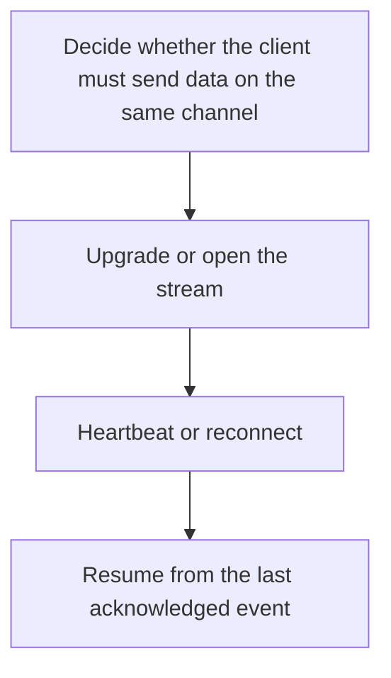

# D04-T016 — WebSockets and Server-Sent Events

Topic ID: `D04-T016`
Domain: Computer Networks
Subdomain: WebSockets and Server-Sent Events
Importance: core
Complexity: intermediate
Dependencies: `D04-T015`, `D04-T001`, `D01-T001`, `D01-T002`, `D03-T001`, `D03-T002`
Execution status of the code in section F: unexecuted

## A. Topic Overview

A WebSocket starts as an HTTP upgrade and then becomes a framed, full-duplex connection. Either side can send. Server-Sent Events stay on HTTP and carry a one-way stream of text events from server to client, with the browser reconnecting automatically. WebSockets need their own heartbeat because intermediaries time out idle TCP. SSE reconnects with Last-Event-ID if the application sets ids.

In production this shows up as follows: A trading UI that must send orders and receive ticks uses a WebSocket. A notification ticker that only displays server events is simpler as SSE, if proxies are configured not to buffer it.

Interviewers use WebSockets and Server-Sent Events to see whether you can state the failure mode, not only the definition. The failure to name is: a load balancer idle timeout killing a quiet WebSocket, or an SSE proxy that buffers the whole stream

Prerequisites: `D04-T015`, `D04-T001`, `D01-T001`, `D01-T002`, `D03-T001`, `D03-T002`. Later notes should link here instead of repeating the mechanism.

## B. First-Principles Explanation

A WebSocket starts as an HTTP upgrade and then becomes a framed, full-duplex connection. Either side can send. Server-Sent Events stay on HTTP and carry a one-way stream of text events from server to client, with the browser reconnecting automatically. WebSockets need their own heartbeat because intermediaries time out idle TCP. SSE reconnects with Last-Event-ID if the application sets ids.

The useful picture is: A WebSocket is a phone call after the front desk transfers you. SSE is a radio station you can retune, with a bookmark of the last story you heard.

What has to be true:

1. Decide whether the client must send data on the same channel
2. Upgrade or open the stream
3. Heartbeat or reconnect
4. Resume from the last acknowledged event

It works when those steps preserve one invariant. It fails when a load balancer idle timeout killing a quiet WebSocket, or an SSE proxy that buffers the whole stream. The alternative is: a request/response API is enough, in which case a socket is an idle-connection leak

## C. Internal Working and Architecture

Components involved: the caller, the state WebSockets and Server-Sent Events mutates or reads, and the observer that reports connection age, heartbeat misses, and the gap in event ids after reconnect.

Execution:

1. Decide whether the client must send data on the same channel
2. Upgrade or open the stream
3. Heartbeat or reconnect
4. Resume from the last acknowledged event

Data moves only along that path. A retry re-enters at step 1, so the operation must say what a duplicate does. Memory and locks stay inside this mechanism. Callers see the result or a typed error, not a half-updated invariant.

State to remember: choose this when you need a long-lived stream and you have checked the proxies. Do not choose it when a request/response API is enough, in which case a socket is an idle-connection leak.

## D. Diagrams and Visual Models



Read the diagram from top to bottom. Each box is one step of WebSockets and Server-Sent Events. The failure mode (a load balancer idle timeout killing a quiet WebSocket, or an SSE proxy that buffers the whole stream) is what you look for when a later box never happens or happens twice.

## E. Examples and Analogies

Analogy: A WebSocket is a phone call after the front desk transfers you. SSE is a radio station you can retune, with a bookmark of the last story you heard.

Production example: A trading UI that must send orders and receive ticks uses a WebSocket. A notification ticker that only displays server events is simpler as SSE, if proxies are configured not to buffer it.

A small counterexample is enough in an interview. Show the input, apply the steps, and show the broken outcome if someone uses the mechanism outside its rule: a load balancer idle timeout killing a quiet WebSocket, or an SSE proxy that buffers the whole stream.

## F. Code Examples

The snippet is labeled unexecuted. It illustrates the shape of the idea. It is not a benchmark and it embeds no secret.

```python
def sse_frame(event_id, data):
    return f'id: {event_id}\ndata: {data}\n\n'
```

After the snippet, check connection age, heartbeat misses, and the gap in event ids after reconnect. If that signal moves the wrong way, the snippet is the wrong tool for the workload.

## G. Practical Backend Application

Use WebSockets and Server-Sent Events in a service when you need a long-lived stream and you have checked the proxies.

A typical place is the production case already stated: A trading UI that must send orders and receive ticks uses a WebSocket. A notification ticker that only displays server events is simpler as SSE, if proxies are configured not to buffer it.

Operationally you alert on connection age, heartbeat misses, and the gap in event ids after reconnect. You do not alert only on process uptime. The dashboard should show the failure mode, a success rate, and the saturation signal (queue depth, lock wait, or latency) that predicts it.

## H. Advantages, Limitations and Trade-offs

| Choice | Benefit | Cost | Choose when | Avoid when |
| --- | --- | --- | --- | --- |
| Apply WebSockets and Server-Sent Events | you need a long-lived stream and you have checked the proxies | Extra moving parts and a new failure mode | The failure you are preventing is already real | a request/response API is enough, in which case a socket is an idle-connection leak |
| Simpler alternative | Less code and fewer dependencies | a load balancer idle timeout killing a quiet WebSocket, or an SSE proxy that buffers the whole stream | The workload does not hit the limit | The invariant must hold under concurrency or failure |

WebSockets and Server-Sent Events is a trade. State the benefit and the cost in the same sentence when you propose it in a design review.

## I. Common Mistakes and Misconceptions

- No heartbeat.
- Buffering SSE at a proxy.
- Storing session state only in the process that holds the socket.
- Treating a diagram of WebSockets and Server-Sent Events as proof that the invariant holds in production.
- Copying a default configuration without naming connection age, heartbeat misses, and the gap in event ids after reconnect.

## J. Debugging and Troubleshooting

Symptom: a load balancer idle timeout killing a quiet WebSocket, or an SSE proxy that buffers the whole stream

First check: connection age, heartbeat misses, and the gap in event ids after reconnect.

Then compare one healthy instance against one unhealthy instance. Confirm whether retries are duplicating work. Confirm whether a timeout is shorter than the work. Fix the invariant, then watch the same metric for a full peak, not only for the next minute.

Useful questions: did the step order in section C actually happen, or did a caller skip a step? Did a deploy change the data shape that WebSockets and Server-Sent Events assumes?

## K. Interview Preparation

### Beginner

#### Q1. What problem does WebSockets and Server-Sent Events solve?

**Answer:** A WebSocket starts as an HTTP upgrade and then becomes a framed, full-duplex connection. Either side can send. Server-Sent Events stay on HTTP and carry a one-way stream of text events from server to client, with the browser reconnecting automatically. WebSockets need their own heartbeat because intermediaries time out idle TCP. SSE reconnects with Last-Event-ID if the application sets ids. Without it, the usual backend failure is: a load balancer idle timeout killing a quiet WebSocket, or an SSE proxy that buffers the whole stream.

#### Q2. Where does WebSockets and Server-Sent Events sit on a request path?

**Answer:** WebSockets and Server-Sent Events is not a library you sprinkle on every call. you need a long-lived stream and you have checked the proxies You notice it when connection age, heartbeat misses, and the gap in event ids after reconnect. Name the constraint that makes this choice correct. Say what you would measure to confirm it.

#### Q3. Give a concrete example of WebSockets and Server-Sent Events.

**Answer:** A trading UI that must send orders and receive ticks uses a WebSocket. A notification ticker that only displays server events is simpler as SSE, if proxies are configured not to buffer it. Walk the input, the state change, and the observable output. Name the constraint that makes this choice correct.

#### Q4. What is a common mix-up around WebSockets and Server-Sent Events?

**Answer:** a load balancer idle timeout killing a quiet WebSocket, or an SSE proxy that buffers the whole stream The corrective check is connection age, heartbeat misses, and the gap in event ids after reconnect. Name the constraint that makes this choice correct. Say what you would measure to confirm it. Say which alternative you rejected and why.

#### Q5. When would you skip WebSockets and Server-Sent Events?

**Answer:** a request/response API is enough, in which case a socket is an idle-connection leak Skipping is a decision with a measured cost, not a slogan. Name the constraint that makes this choice correct. Say what you would measure to confirm it. Say which alternative you rejected and why.

### Intermediate

#### Q1. What invariant makes WebSockets and Server-Sent Events correct?

**Answer:** A WebSocket starts as an HTTP upgrade and then becomes a framed, full-duplex connection. Either side can send. Server-Sent Events stay on HTTP and carry a one-way stream of text events from server to client, with the browser reconnecting automatically. WebSockets need their own heartbeat because intermediaries time out idle TCP. SSE reconnects with Last-Event-ID if the application sets ids. State the invariant before you name the tool.

#### Q2. How do you test WebSockets and Server-Sent Events?

**Answer:** Assert the failure mode directly: a load balancer idle timeout killing a quiet WebSocket, or an SSE proxy that buffers the whole stream. The assertion should watch connection age, heartbeat misses, and the gap in event ids after reconnect. Include a concurrent or retry case if the bug only appears then. Name the constraint that makes this choice correct.

#### Q3. What signal tells you WebSockets and Server-Sent Events is misbehaving in production?

**Answer:** Watch connection age, heartbeat misses, and the gap in event ids after reconnect. The user-visible symptom is usually a load balancer idle timeout killing a quiet WebSocket, or an SSE proxy that buffers the whole stream. Name the constraint that makes this choice correct. Say what you would measure to confirm it.

#### Q4. How would you introduce WebSockets and Server-Sent Events into a legacy service?

**Answer:** you need a long-lived stream and you have checked the proxies Ship it behind a metric so you can compare the old path. Roll back if a load balancer idle timeout killing a quiet WebSocket, or an SSE proxy that buffers the whole stream gets worse. Name the constraint that makes this choice correct. Say what you would measure to confirm it.

#### Q5. What do you trade away by choosing WebSockets and Server-Sent Events?

**Answer:** you need a long-lived stream and you have checked the proxies a request/response API is enough, in which case a socket is an idle-connection leak Say the cost in latency, storage, or operational load. Name the constraint that makes this choice correct. Say what you would measure to confirm it. Say which alternative you rejected and why.

### Advanced

#### Q1. What breaks if a dependency of WebSockets and Server-Sent Events is slow or down?

**Answer:** a load balancer idle timeout killing a quiet WebSocket, or an SSE proxy that buffers the whole stream Degrade using the rule: a request/response API is enough, in which case a socket is an idle-connection leak. Timeouts must be shorter than the caller's deadline. Name the constraint that makes this choice correct. Say what you would measure to confirm it.

#### Q2. How does WebSockets and Server-Sent Events behave under retries?

**Answer:** Retries repeat work, so WebSockets and Server-Sent Events must define what a duplicate does. a load balancer idle timeout killing a quiet WebSocket, or an SSE proxy that buffers the whole stream Idempotency keys or fences belong next to the write, not in a comment. Name the constraint that makes this choice correct. Say what you would measure to confirm it.

#### Q3. What is the capacity limit of WebSockets and Server-Sent Events?

**Answer:** The limit shows up as connection age, heartbeat misses, and the gap in event ids after reconnect. Add capacity only after you know whether the bottleneck is CPU, lock wait, or network. Name the constraint that makes this choice correct. Say what you would measure to confirm it.

#### Q4. How do you evolve WebSockets and Server-Sent Events without a flag day?

**Answer:** you need a long-lived stream and you have checked the proxies Version the contract or the on-disk format. Readers should tolerate one old and one new shape during the rollout. Name the constraint that makes this choice correct. Say what you would measure to confirm it.

#### Q5. What security or correctness bug hides inside WebSockets and Server-Sent Events?

**Answer:** a load balancer idle timeout killing a quiet WebSocket, or an SSE proxy that buffers the whole stream Check authorization and tenancy at the same boundary as the mechanism. A cache or queue must not widen who can read the data. Name the constraint that makes this choice correct. Say what you would measure to confirm it.

### Scenario

#### Q1. Incident: a load balancer idle timeout killing a quiet WebSocket, or an SSE proxy that buffers the whole stream. What do you check first?

**Answer:** Start with connection age, heartbeat misses, and the gap in event ids after reconnect. Compare a good host and a bad host before you restart anything. A WebSocket starts as an HTTP upgrade and then becomes a framed, full-duplex connection. Either side can send. Server-Sent Events stay on HTTP and carry a one-way stream of text events from server to client, with the browser reconnecting automatically. WebSockets need their own heartbeat because intermediaries time out idle TCP. SSE reconnects with Last-Event-ID if the application sets ids.

#### Q2. A reviewer wants the clever version. What data settles it?

**Answer:** you need a long-lived stream and you have checked the proxies a request/response API is enough, in which case a socket is an idle-connection leak Bring connection age, heartbeat misses, and the gap in event ids after reconnect from a load test or from production, not a slogan. Name the constraint that makes this choice correct. Say what you would measure to confirm it. Say which alternative you rejected and why.

#### Q3. You have one hour to explain WebSockets and Server-Sent Events at a whiteboard.

**Answer:** Draw the happy path in four boxes. Then draw the failure: a load balancer idle timeout killing a quiet WebSocket, or an SSE proxy that buffers the whole stream. End with the metric you would page on. Name the constraint that makes this choice correct.

#### Q4. The bug only appears under two concurrent callers.

**Answer:** a load balancer idle timeout killing a quiet WebSocket, or an SSE proxy that buffers the whole stream Reproduce with a barrier so both sides enter the critical window. Confirm the fix with connection age, heartbeat misses, and the gap in event ids after reconnect. Name the constraint that makes this choice correct. Say what you would measure to confirm it.

#### Q5. Leadership wants this on every service next week.

**Answer:** a request/response API is enough, in which case a socket is an idle-connection leak you need a long-lived stream and you have checked the proxies Roll it out where the failure mode is already hurting users. Name the constraint that makes this choice correct. Say what you would measure to confirm it. Say which alternative you rejected and why.

### Follow-up

#### Q1. What did you assume about the data size or the clock?

**Answer:** A WebSocket starts as an HTTP upgrade and then becomes a framed, full-duplex connection. Either side can send. Server-Sent Events stay on HTTP and carry a one-way stream of text events from server to client, with the browser reconnecting automatically. WebSockets need their own heartbeat because intermediaries time out idle TCP. SSE reconnects with Last-Event-ID if the application sets ids. Clocks are not a total order across machines. State whether the algorithm needs bounded size or a single leader.

#### Q2. What would you measure after the change ships?

**Answer:** Page on connection age, heartbeat misses, and the gap in event ids after reconnect. Keep a before/after dashboard for one week. Alert on the failure mode, not only on CPU. Name the constraint that makes this choice correct.

#### Q3. Which neighboring topic did you deliberately not re-teach?

**Answer:** This note owns WebSockets and Server-Sent Events. Related identifiers are in section N. Shared ideas are linked, not copied. Name the constraint that makes this choice correct.

## L. Practical Exercises

Solutions are in `EXERCISES/solutions/D04-T016.md`, not in this section.

1. Whiteboard the four steps of WebSockets and Server-Sent Events and mark where `a load balancer idle timeout killing a quiet WebSocket, or an SSE proxy that buffers the whole stream` enters.
2. Read the snippet in section F and write the assertion that would catch that failure. The assertion must mention `connection age, heartbeat misses, and the gap in event ids after reconnect`.
3. Argue for or against using WebSockets and Server-Sent Events on a service you know. Use the choose and avoid rows from section H. Do not appeal to popularity.

## M. Revision Notes

- Mechanism: A WebSocket starts as an HTTP upgrade and then becomes a framed, full-duplex connection.
- Failure: a load balancer idle timeout killing a quiet WebSocket, or an SSE proxy that buffers the whole stream
- Metric: connection age, heartbeat misses, and the gap in event ids after reconnect
- Choose when: you need a long-lived stream and you have checked the proxies
- Avoid when: a request/response API is enough, in which case a socket is an idle-connection leak

## N. Related Topics

Dependencies to review first: `D04-T015`, `D04-T001`, `D01-T001`, `D01-T002`, `D03-T001`, `D03-T002`.

Shared ideas stay in those notes. This note does not restate them.

## O. Completion Criteria

- You can explain WebSockets and Server-Sent Events without reading this note, including the failure mode.
- You can draw the diagram in section D from memory.
- You can say when not to use it, using the avoid condition in section H.
- You can name the metric you would watch after shipping it.
