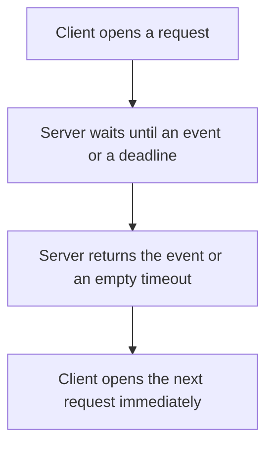

# D04-T017 — Long polling

Topic ID: `D04-T017`
Domain: Computer Networks
Subdomain: Long polling
Importance: core
Complexity: intermediate
Dependencies: `D04-T016`, `D04-T001`, `D01-T001`, `D01-T002`, `D03-T001`, `D03-T002`
Execution status of the code in section F: unexecuted

## A. Topic Overview

Long polling holds an HTTP request open until the server has an event or a timeout, then the client immediately opens another request. It works through ordinary HTTP stacks. It pays a request per event and a herd of reconnects at the timeout. The server must not tie up an unbounded worker per parked request. A timeout response is not an error.

In production this shows up as follows: A legacy notification channel uses long polling because a corporate proxy blocks WebSockets. The server parks the request in an async wait, not on a thread per user.

Interviewers use Long polling to see whether you can state the failure mode, not only the definition. The failure to name is: a timeout of every parked request at the same instant, stampeding the server, or a worker-per-connection pool that runs out

Prerequisites: `D04-T016`, `D04-T001`, `D01-T001`, `D01-T002`, `D03-T001`, `D03-T002`. Later notes should link here instead of repeating the mechanism.

## B. First-Principles Explanation

Long polling holds an HTTP request open until the server has an event or a timeout, then the client immediately opens another request. It works through ordinary HTTP stacks. It pays a request per event and a herd of reconnects at the timeout. The server must not tie up an unbounded worker per parked request. A timeout response is not an error.

The useful picture is: Long polling is calling a shop and being put on hold until the item arrives, then calling again.

What has to be true:

1. Client opens a request
2. Server waits until an event or a deadline
3. Server returns the event or an empty timeout
4. Client opens the next request immediately

It works when those steps preserve one invariant. It fails when a timeout of every parked request at the same instant, stampeding the server, or a worker-per-connection pool that runs out. The alternative is: event rates are high, where the request overhead dominates

## C. Internal Working and Architecture

Components involved: the caller, the state Long polling mutates or reads, and the observer that reports parked-request count, reconnect herd size, and event delivery delay.

Execution:

1. Client opens a request
2. Server waits until an event or a deadline
3. Server returns the event or an empty timeout
4. Client opens the next request immediately

Data moves only along that path. A retry re-enters at step 1, so the operation must say what a duplicate does. Memory and locks stay inside this mechanism. Callers see the result or a typed error, not a half-updated invariant.

State to remember: choose this when you cannot use a real push channel and events are infrequent. Do not choose it when event rates are high, where the request overhead dominates.

## D. Diagrams and Visual Models



Read the diagram from top to bottom. Each box is one step of Long polling. The failure mode (a timeout of every parked request at the same instant, stampeding the server, or a worker-per-connection pool that runs out) is what you look for when a later box never happens or happens twice.

## E. Examples and Analogies

Analogy: Long polling is calling a shop and being put on hold until the item arrives, then calling again.

Production example: A legacy notification channel uses long polling because a corporate proxy blocks WebSockets. The server parks the request in an async wait, not on a thread per user.

A small counterexample is enough in an interview. Show the input, apply the steps, and show the broken outcome if someone uses the mechanism outside its rule: a timeout of every parked request at the same instant, stampeding the server, or a worker-per-connection pool that runs out.

## F. Code Examples

The snippet is labeled unexecuted. It illustrates the shape of the idea. It is not a benchmark and it embeds no secret.

```python
def next_wait(timeout_s):
    return timeout_s
```

After the snippet, check parked-request count, reconnect herd size, and event delivery delay. If that signal moves the wrong way, the snippet is the wrong tool for the workload.

## G. Practical Backend Application

Use Long polling in a service when you cannot use a real push channel and events are infrequent.

A typical place is the production case already stated: A legacy notification channel uses long polling because a corporate proxy blocks WebSockets. The server parks the request in an async wait, not on a thread per user.

Operationally you alert on parked-request count, reconnect herd size, and event delivery delay. You do not alert only on process uptime. The dashboard should show the failure mode, a success rate, and the saturation signal (queue depth, lock wait, or latency) that predicts it.

## H. Advantages, Limitations and Trade-offs

| Choice | Benefit | Cost | Choose when | Avoid when |
| --- | --- | --- | --- | --- |
| Apply Long polling | you cannot use a real push channel and events are infrequent | Extra moving parts and a new failure mode | The failure you are preventing is already real | event rates are high, where the request overhead dominates |
| Simpler alternative | Less code and fewer dependencies | a timeout of every parked request at the same instant, stampeding the server, or a worker-per-connection pool that runs out | The workload does not hit the limit | The invariant must hold under concurrency or failure |

Long polling is a trade. State the benefit and the cost in the same sentence when you propose it in a design review.

## I. Common Mistakes and Misconceptions

- Allocating a thread per parked client.
- Treating the timeout as a 500.
- Forgetting to dedupe when the client retries and the event is delivered twice.
- Treating a diagram of Long polling as proof that the invariant holds in production.
- Copying a default configuration without naming parked-request count, reconnect herd size, and event delivery delay.

## J. Debugging and Troubleshooting

Symptom: a timeout of every parked request at the same instant, stampeding the server, or a worker-per-connection pool that runs out

First check: parked-request count, reconnect herd size, and event delivery delay.

Then compare one healthy instance against one unhealthy instance. Confirm whether retries are duplicating work. Confirm whether a timeout is shorter than the work. Fix the invariant, then watch the same metric for a full peak, not only for the next minute.

Useful questions: did the step order in section C actually happen, or did a caller skip a step? Did a deploy change the data shape that Long polling assumes?

## K. Interview Preparation

### Beginner

#### Q1. What problem does Long polling solve?

**Answer:** Long polling holds an HTTP request open until the server has an event or a timeout, then the client immediately opens another request. It works through ordinary HTTP stacks. It pays a request per event and a herd of reconnects at the timeout. The server must not tie up an unbounded worker per parked request. A timeout response is not an error. Without it, the usual backend failure is: a timeout of every parked request at the same instant, stampeding the server, or a worker-per-connection pool that runs out.

#### Q2. Where does Long polling sit on a request path?

**Answer:** Long polling is not a library you sprinkle on every call. you cannot use a real push channel and events are infrequent You notice it when parked-request count, reconnect herd size, and event delivery delay. Name the constraint that makes this choice correct. Say what you would measure to confirm it.

#### Q3. Give a concrete example of Long polling.

**Answer:** A legacy notification channel uses long polling because a corporate proxy blocks WebSockets. The server parks the request in an async wait, not on a thread per user. Walk the input, the state change, and the observable output. Name the constraint that makes this choice correct.

#### Q4. What is a common mix-up around Long polling?

**Answer:** a timeout of every parked request at the same instant, stampeding the server, or a worker-per-connection pool that runs out The corrective check is parked-request count, reconnect herd size, and event delivery delay. Name the constraint that makes this choice correct. Say what you would measure to confirm it. Say which alternative you rejected and why.

#### Q5. When would you skip Long polling?

**Answer:** event rates are high, where the request overhead dominates Skipping is a decision with a measured cost, not a slogan. Name the constraint that makes this choice correct. Say what you would measure to confirm it. Say which alternative you rejected and why.

### Intermediate

#### Q1. What invariant makes Long polling correct?

**Answer:** Long polling holds an HTTP request open until the server has an event or a timeout, then the client immediately opens another request. It works through ordinary HTTP stacks. It pays a request per event and a herd of reconnects at the timeout. The server must not tie up an unbounded worker per parked request. A timeout response is not an error. State the invariant before you name the tool.

#### Q2. How do you test Long polling?

**Answer:** Assert the failure mode directly: a timeout of every parked request at the same instant, stampeding the server, or a worker-per-connection pool that runs out. The assertion should watch parked-request count, reconnect herd size, and event delivery delay. Include a concurrent or retry case if the bug only appears then. Name the constraint that makes this choice correct.

#### Q3. What signal tells you Long polling is misbehaving in production?

**Answer:** Watch parked-request count, reconnect herd size, and event delivery delay. The user-visible symptom is usually a timeout of every parked request at the same instant, stampeding the server, or a worker-per-connection pool that runs out. Name the constraint that makes this choice correct. Say what you would measure to confirm it.

#### Q4. How would you introduce Long polling into a legacy service?

**Answer:** you cannot use a real push channel and events are infrequent Ship it behind a metric so you can compare the old path. Roll back if a timeout of every parked request at the same instant, stampeding the server, or a worker-per-connection pool that runs out gets worse. Name the constraint that makes this choice correct. Say what you would measure to confirm it.

#### Q5. What do you trade away by choosing Long polling?

**Answer:** you cannot use a real push channel and events are infrequent event rates are high, where the request overhead dominates Say the cost in latency, storage, or operational load. Name the constraint that makes this choice correct. Say what you would measure to confirm it. Say which alternative you rejected and why.

### Advanced

#### Q1. What breaks if a dependency of Long polling is slow or down?

**Answer:** a timeout of every parked request at the same instant, stampeding the server, or a worker-per-connection pool that runs out Degrade using the rule: event rates are high, where the request overhead dominates. Timeouts must be shorter than the caller's deadline. Name the constraint that makes this choice correct. Say what you would measure to confirm it.

#### Q2. How does Long polling behave under retries?

**Answer:** Retries repeat work, so Long polling must define what a duplicate does. a timeout of every parked request at the same instant, stampeding the server, or a worker-per-connection pool that runs out Idempotency keys or fences belong next to the write, not in a comment. Name the constraint that makes this choice correct. Say what you would measure to confirm it.

#### Q3. What is the capacity limit of Long polling?

**Answer:** The limit shows up as parked-request count, reconnect herd size, and event delivery delay. Add capacity only after you know whether the bottleneck is CPU, lock wait, or network. Name the constraint that makes this choice correct. Say what you would measure to confirm it.

#### Q4. How do you evolve Long polling without a flag day?

**Answer:** you cannot use a real push channel and events are infrequent Version the contract or the on-disk format. Readers should tolerate one old and one new shape during the rollout. Name the constraint that makes this choice correct. Say what you would measure to confirm it.

#### Q5. What security or correctness bug hides inside Long polling?

**Answer:** a timeout of every parked request at the same instant, stampeding the server, or a worker-per-connection pool that runs out Check authorization and tenancy at the same boundary as the mechanism. A cache or queue must not widen who can read the data. Name the constraint that makes this choice correct. Say what you would measure to confirm it.

### Scenario

#### Q1. Incident: a timeout of every parked request at the same instant, stampeding the server, or a worker-per-connection pool that runs out. What do you check first?

**Answer:** Start with parked-request count, reconnect herd size, and event delivery delay. Compare a good host and a bad host before you restart anything. Long polling holds an HTTP request open until the server has an event or a timeout, then the client immediately opens another request. It works through ordinary HTTP stacks. It pays a request per event and a herd of reconnects at the timeout. The server must not tie up an unbounded worker per parked request. A timeout response is not an error.

#### Q2. A reviewer wants the clever version. What data settles it?

**Answer:** you cannot use a real push channel and events are infrequent event rates are high, where the request overhead dominates Bring parked-request count, reconnect herd size, and event delivery delay from a load test or from production, not a slogan. Name the constraint that makes this choice correct. Say what you would measure to confirm it. Say which alternative you rejected and why.

#### Q3. You have one hour to explain Long polling at a whiteboard.

**Answer:** Draw the happy path in four boxes. Then draw the failure: a timeout of every parked request at the same instant, stampeding the server, or a worker-per-connection pool that runs out. End with the metric you would page on. Name the constraint that makes this choice correct.

#### Q4. The bug only appears under two concurrent callers.

**Answer:** a timeout of every parked request at the same instant, stampeding the server, or a worker-per-connection pool that runs out Reproduce with a barrier so both sides enter the critical window. Confirm the fix with parked-request count, reconnect herd size, and event delivery delay. Name the constraint that makes this choice correct. Say what you would measure to confirm it.

#### Q5. Leadership wants this on every service next week.

**Answer:** event rates are high, where the request overhead dominates you cannot use a real push channel and events are infrequent Roll it out where the failure mode is already hurting users. Name the constraint that makes this choice correct. Say what you would measure to confirm it. Say which alternative you rejected and why.

### Follow-up

#### Q1. What did you assume about the data size or the clock?

**Answer:** Long polling holds an HTTP request open until the server has an event or a timeout, then the client immediately opens another request. It works through ordinary HTTP stacks. It pays a request per event and a herd of reconnects at the timeout. The server must not tie up an unbounded worker per parked request. A timeout response is not an error. Clocks are not a total order across machines. State whether the algorithm needs bounded size or a single leader.

#### Q2. What would you measure after the change ships?

**Answer:** Page on parked-request count, reconnect herd size, and event delivery delay. Keep a before/after dashboard for one week. Alert on the failure mode, not only on CPU. Name the constraint that makes this choice correct.

#### Q3. Which neighboring topic did you deliberately not re-teach?

**Answer:** This note owns Long polling. Related identifiers are in section N. Shared ideas are linked, not copied. Name the constraint that makes this choice correct.

## L. Practical Exercises

Solutions are in `EXERCISES/solutions/D04-T017.md`, not in this section.

1. Whiteboard the four steps of Long polling and mark where `a timeout of every parked request at the same instant, stampeding the server, or a worker-per-connection pool that runs out` enters.
2. Read the snippet in section F and write the assertion that would catch that failure. The assertion must mention `parked-request count, reconnect herd size, and event delivery delay`.
3. Argue for or against using Long polling on a service you know. Use the choose and avoid rows from section H. Do not appeal to popularity.

## M. Revision Notes

- Mechanism: Long polling holds an HTTP request open until the server has an event or a timeout, then the client immediately opens another request.
- Failure: a timeout of every parked request at the same instant, stampeding the server, or a worker-per-connection pool that runs out
- Metric: parked-request count, reconnect herd size, and event delivery delay
- Choose when: you cannot use a real push channel and events are infrequent
- Avoid when: event rates are high, where the request overhead dominates

## N. Related Topics

Dependencies to review first: `D04-T016`, `D04-T001`, `D01-T001`, `D01-T002`, `D03-T001`, `D03-T002`.

Shared ideas stay in those notes. This note does not restate them.

## O. Completion Criteria

- You can explain Long polling without reading this note, including the failure mode.
- You can draw the diagram in section D from memory.
- You can say when not to use it, using the avoid condition in section H.
- You can name the metric you would watch after shipping it.
