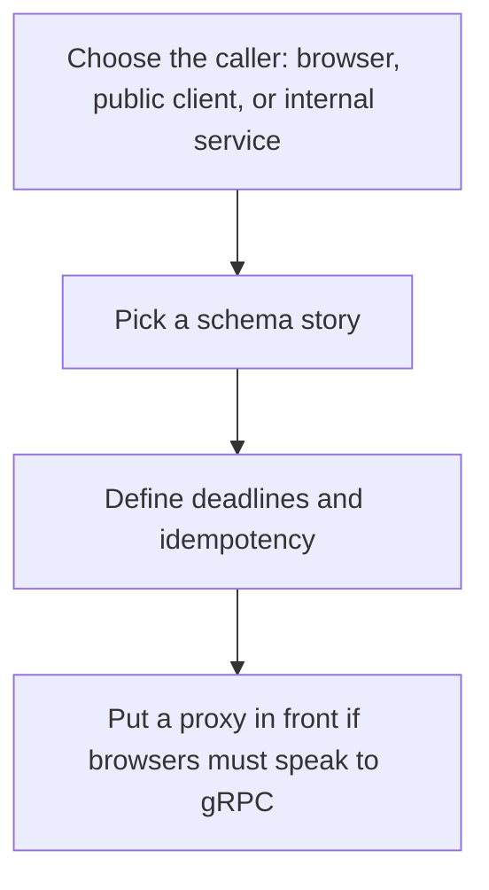

# D04-T018 — REST vs gRPC

Topic ID: `D04-T018`
Domain: Computer Networks
Subdomain: REST vs gRPC
Importance: core
Complexity: intermediate
Dependencies: `D04-T017`, `D04-T001`, `D01-T001`, `D01-T002`, `D03-T001`, `D03-T002`
Execution status of the code in section F: unexecuted

## A. Topic Overview

REST here means HTTP with resources, methods, and status codes, usually JSON. gRPC is HTTP/2 with protobuf contracts, generated clients, and streaming. REST is easy to debug with curl and caches GET. gRPC gives a schema and efficient binary calls inside a datacenter, and it is awkward for browsers without a proxy. Neither fixes a bad domain model.

In production this shows up as follows: Internal order-to-inventory calls use gRPC with deadlines. The public API stays HTTP JSON so third parties can call it without your protobuf toolchain.

Interviewers use REST vs gRPC to see whether you can state the failure mode, not only the definition. The failure to name is: a public JSON API modeled as a single POST RPC, or a gRPC API exposed to browsers without grpc-web

Prerequisites: `D04-T017`, `D04-T001`, `D01-T001`, `D01-T002`, `D03-T001`, `D03-T002`. Later notes should link here instead of repeating the mechanism.

## B. First-Principles Explanation

REST here means HTTP with resources, methods, and status codes, usually JSON. gRPC is HTTP/2 with protobuf contracts, generated clients, and streaming. REST is easy to debug with curl and caches GET. gRPC gives a schema and efficient binary calls inside a datacenter, and it is awkward for browsers without a proxy. Neither fixes a bad domain model.

The useful picture is: REST is a set of labeled drawers a person can open with a standard key. gRPC is a preprinted form both offices already agreed on, which is faster inside the building and opaque on the street.

What has to be true:

1. Choose the caller: browser, public client, or internal service
2. Pick a schema story
3. Define deadlines and idempotency
4. Put a proxy in front if browsers must speak to gRPC

It works when those steps preserve one invariant. It fails when a public JSON API modeled as a single POST RPC, or a gRPC API exposed to browsers without grpc-web. The alternative is: you choose gRPC only because it is newer, without a schema or a deadline story

## C. Internal Working and Architecture

Components involved: the caller, the state REST vs gRPC mutates or reads, and the observer that reports contract-breakage count, payload size, and client generation lag.

Execution:

1. Choose the caller: browser, public client, or internal service
2. Pick a schema story
3. Define deadlines and idempotency
4. Put a proxy in front if browsers must speak to gRPC

Data moves only along that path. A retry re-enters at step 1, so the operation must say what a duplicate does. Memory and locks stay inside this mechanism. Callers see the result or a typed error, not a half-updated invariant.

State to remember: choose this when you are picking a service contract style. Do not choose it when you choose gRPC only because it is newer, without a schema or a deadline story.

## D. Diagrams and Visual Models



Read the diagram from top to bottom. Each box is one step of REST vs gRPC. The failure mode (a public JSON API modeled as a single POST RPC, or a gRPC API exposed to browsers without grpc-web) is what you look for when a later box never happens or happens twice.

## E. Examples and Analogies

Analogy: REST is a set of labeled drawers a person can open with a standard key. gRPC is a preprinted form both offices already agreed on, which is faster inside the building and opaque on the street.

Production example: Internal order-to-inventory calls use gRPC with deadlines. The public API stays HTTP JSON so third parties can call it without your protobuf toolchain.

A small counterexample is enough in an interview. Show the input, apply the steps, and show the broken outcome if someone uses the mechanism outside its rule: a public JSON API modeled as a single POST RPC, or a gRPC API exposed to browsers without grpc-web.

## F. Code Examples

The snippet is labeled unexecuted. It illustrates the shape of the idea. It is not a benchmark and it embeds no secret.

```python
def style(public_browser: bool):
    return 'http-json' if public_browser else 'grpc-internal'
```

After the snippet, check contract-breakage count, payload size, and client generation lag. If that signal moves the wrong way, the snippet is the wrong tool for the workload.

## G. Practical Backend Application

Use REST vs gRPC in a service when you are picking a service contract style.

A typical place is the production case already stated: Internal order-to-inventory calls use gRPC with deadlines. The public API stays HTTP JSON so third parties can call it without your protobuf toolchain.

Operationally you alert on contract-breakage count, payload size, and client generation lag. You do not alert only on process uptime. The dashboard should show the failure mode, a success rate, and the saturation signal (queue depth, lock wait, or latency) that predicts it.

## H. Advantages, Limitations and Trade-offs

| Choice | Benefit | Cost | Choose when | Avoid when |
| --- | --- | --- | --- | --- |
| Apply REST vs gRPC | you are picking a service contract style | Extra moving parts and a new failure mode | The failure you are preventing is already real | you choose gRPC only because it is newer, without a schema or a deadline story |
| Simpler alternative | Less code and fewer dependencies | a public JSON API modeled as a single POST RPC, or a gRPC API exposed to browsers without grpc-web | The workload does not hit the limit | The invariant must hold under concurrency or failure |

REST vs gRPC is a trade. State the benefit and the cost in the same sentence when you propose it in a design review.

## I. Common Mistakes and Misconceptions

- Protobuf without compatibility rules.
- REST without status codes.
- Sharing one client timeout for every method.
- Treating a diagram of REST vs gRPC as proof that the invariant holds in production.
- Copying a default configuration without naming contract-breakage count, payload size, and client generation lag.

## J. Debugging and Troubleshooting

Symptom: a public JSON API modeled as a single POST RPC, or a gRPC API exposed to browsers without grpc-web

First check: contract-breakage count, payload size, and client generation lag.

Then compare one healthy instance against one unhealthy instance. Confirm whether retries are duplicating work. Confirm whether a timeout is shorter than the work. Fix the invariant, then watch the same metric for a full peak, not only for the next minute.

Useful questions: did the step order in section C actually happen, or did a caller skip a step? Did a deploy change the data shape that REST vs gRPC assumes?

## K. Interview Preparation

### Beginner

#### Q1. What problem does REST vs gRPC solve?

**Answer:** REST here means HTTP with resources, methods, and status codes, usually JSON. gRPC is HTTP/2 with protobuf contracts, generated clients, and streaming. REST is easy to debug with curl and caches GET. gRPC gives a schema and efficient binary calls inside a datacenter, and it is awkward for browsers without a proxy. Neither fixes a bad domain model. Without it, the usual backend failure is: a public JSON API modeled as a single POST RPC, or a gRPC API exposed to browsers without grpc-web.

#### Q2. Where does REST vs gRPC sit on a request path?

**Answer:** REST vs gRPC is not a library you sprinkle on every call. you are picking a service contract style You notice it when contract-breakage count, payload size, and client generation lag. Name the constraint that makes this choice correct. Say what you would measure to confirm it.

#### Q3. Give a concrete example of REST vs gRPC.

**Answer:** Internal order-to-inventory calls use gRPC with deadlines. The public API stays HTTP JSON so third parties can call it without your protobuf toolchain. Walk the input, the state change, and the observable output. Name the constraint that makes this choice correct.

#### Q4. What is a common mix-up around REST vs gRPC?

**Answer:** a public JSON API modeled as a single POST RPC, or a gRPC API exposed to browsers without grpc-web The corrective check is contract-breakage count, payload size, and client generation lag. Name the constraint that makes this choice correct. Say what you would measure to confirm it. Say which alternative you rejected and why.

#### Q5. When would you skip REST vs gRPC?

**Answer:** you choose gRPC only because it is newer, without a schema or a deadline story Skipping is a decision with a measured cost, not a slogan. Name the constraint that makes this choice correct. Say what you would measure to confirm it. Say which alternative you rejected and why.

### Intermediate

#### Q1. What invariant makes REST vs gRPC correct?

**Answer:** REST here means HTTP with resources, methods, and status codes, usually JSON. gRPC is HTTP/2 with protobuf contracts, generated clients, and streaming. REST is easy to debug with curl and caches GET. gRPC gives a schema and efficient binary calls inside a datacenter, and it is awkward for browsers without a proxy. Neither fixes a bad domain model. State the invariant before you name the tool.

#### Q2. How do you test REST vs gRPC?

**Answer:** Assert the failure mode directly: a public JSON API modeled as a single POST RPC, or a gRPC API exposed to browsers without grpc-web. The assertion should watch contract-breakage count, payload size, and client generation lag. Include a concurrent or retry case if the bug only appears then. Name the constraint that makes this choice correct.

#### Q3. What signal tells you REST vs gRPC is misbehaving in production?

**Answer:** Watch contract-breakage count, payload size, and client generation lag. The user-visible symptom is usually a public JSON API modeled as a single POST RPC, or a gRPC API exposed to browsers without grpc-web. Name the constraint that makes this choice correct. Say what you would measure to confirm it.

#### Q4. How would you introduce REST vs gRPC into a legacy service?

**Answer:** you are picking a service contract style Ship it behind a metric so you can compare the old path. Roll back if a public JSON API modeled as a single POST RPC, or a gRPC API exposed to browsers without grpc-web gets worse. Name the constraint that makes this choice correct. Say what you would measure to confirm it.

#### Q5. What do you trade away by choosing REST vs gRPC?

**Answer:** you are picking a service contract style you choose gRPC only because it is newer, without a schema or a deadline story Say the cost in latency, storage, or operational load. Name the constraint that makes this choice correct. Say what you would measure to confirm it. Say which alternative you rejected and why.

### Advanced

#### Q1. What breaks if a dependency of REST vs gRPC is slow or down?

**Answer:** a public JSON API modeled as a single POST RPC, or a gRPC API exposed to browsers without grpc-web Degrade using the rule: you choose gRPC only because it is newer, without a schema or a deadline story. Timeouts must be shorter than the caller's deadline. Name the constraint that makes this choice correct. Say what you would measure to confirm it.

#### Q2. How does REST vs gRPC behave under retries?

**Answer:** Retries repeat work, so REST vs gRPC must define what a duplicate does. a public JSON API modeled as a single POST RPC, or a gRPC API exposed to browsers without grpc-web Idempotency keys or fences belong next to the write, not in a comment. Name the constraint that makes this choice correct. Say what you would measure to confirm it.

#### Q3. What is the capacity limit of REST vs gRPC?

**Answer:** The limit shows up as contract-breakage count, payload size, and client generation lag. Add capacity only after you know whether the bottleneck is CPU, lock wait, or network. Name the constraint that makes this choice correct. Say what you would measure to confirm it.

#### Q4. How do you evolve REST vs gRPC without a flag day?

**Answer:** you are picking a service contract style Version the contract or the on-disk format. Readers should tolerate one old and one new shape during the rollout. Name the constraint that makes this choice correct. Say what you would measure to confirm it.

#### Q5. What security or correctness bug hides inside REST vs gRPC?

**Answer:** a public JSON API modeled as a single POST RPC, or a gRPC API exposed to browsers without grpc-web Check authorization and tenancy at the same boundary as the mechanism. A cache or queue must not widen who can read the data. Name the constraint that makes this choice correct. Say what you would measure to confirm it.

### Scenario

#### Q1. Incident: a public JSON API modeled as a single POST RPC, or a gRPC API exposed to browsers without grpc-web. What do you check first?

**Answer:** Start with contract-breakage count, payload size, and client generation lag. Compare a good host and a bad host before you restart anything. REST here means HTTP with resources, methods, and status codes, usually JSON. gRPC is HTTP/2 with protobuf contracts, generated clients, and streaming. REST is easy to debug with curl and caches GET. gRPC gives a schema and efficient binary calls inside a datacenter, and it is awkward for browsers without a proxy. Neither fixes a bad domain model.

#### Q2. A reviewer wants the clever version. What data settles it?

**Answer:** you are picking a service contract style you choose gRPC only because it is newer, without a schema or a deadline story Bring contract-breakage count, payload size, and client generation lag from a load test or from production, not a slogan. Name the constraint that makes this choice correct. Say what you would measure to confirm it. Say which alternative you rejected and why.

#### Q3. You have one hour to explain REST vs gRPC at a whiteboard.

**Answer:** Draw the happy path in four boxes. Then draw the failure: a public JSON API modeled as a single POST RPC, or a gRPC API exposed to browsers without grpc-web. End with the metric you would page on. Name the constraint that makes this choice correct.

#### Q4. The bug only appears under two concurrent callers.

**Answer:** a public JSON API modeled as a single POST RPC, or a gRPC API exposed to browsers without grpc-web Reproduce with a barrier so both sides enter the critical window. Confirm the fix with contract-breakage count, payload size, and client generation lag. Name the constraint that makes this choice correct. Say what you would measure to confirm it.

#### Q5. Leadership wants this on every service next week.

**Answer:** you choose gRPC only because it is newer, without a schema or a deadline story you are picking a service contract style Roll it out where the failure mode is already hurting users. Name the constraint that makes this choice correct. Say what you would measure to confirm it. Say which alternative you rejected and why.

### Follow-up

#### Q1. What did you assume about the data size or the clock?

**Answer:** REST here means HTTP with resources, methods, and status codes, usually JSON. gRPC is HTTP/2 with protobuf contracts, generated clients, and streaming. REST is easy to debug with curl and caches GET. gRPC gives a schema and efficient binary calls inside a datacenter, and it is awkward for browsers without a proxy. Neither fixes a bad domain model. Clocks are not a total order across machines. State whether the algorithm needs bounded size or a single leader.

#### Q2. What would you measure after the change ships?

**Answer:** Page on contract-breakage count, payload size, and client generation lag. Keep a before/after dashboard for one week. Alert on the failure mode, not only on CPU. Name the constraint that makes this choice correct.

#### Q3. Which neighboring topic did you deliberately not re-teach?

**Answer:** This note owns REST vs gRPC. Related identifiers are in section N. Shared ideas are linked, not copied. Name the constraint that makes this choice correct.

## L. Practical Exercises

Solutions are in `EXERCISES/solutions/D04-T018.md`, not in this section.

1. Whiteboard the four steps of REST vs gRPC and mark where `a public JSON API modeled as a single POST RPC, or a gRPC API exposed to browsers without grpc-web` enters.
2. Read the snippet in section F and write the assertion that would catch that failure. The assertion must mention `contract-breakage count, payload size, and client generation lag`.
3. Argue for or against using REST vs gRPC on a service you know. Use the choose and avoid rows from section H. Do not appeal to popularity.

## M. Revision Notes

- Mechanism: REST here means HTTP with resources, methods, and status codes, usually JSON.
- Failure: a public JSON API modeled as a single POST RPC, or a gRPC API exposed to browsers without grpc-web
- Metric: contract-breakage count, payload size, and client generation lag
- Choose when: you are picking a service contract style
- Avoid when: you choose gRPC only because it is newer, without a schema or a deadline story

## N. Related Topics

Dependencies to review first: `D04-T017`, `D04-T001`, `D01-T001`, `D01-T002`, `D03-T001`, `D03-T002`.

Shared ideas stay in those notes. This note does not restate them.

## O. Completion Criteria

- You can explain REST vs gRPC without reading this note, including the failure mode.
- You can draw the diagram in section D from memory.
- You can say when not to use it, using the avoid condition in section H.
- You can name the metric you would watch after shipping it.
