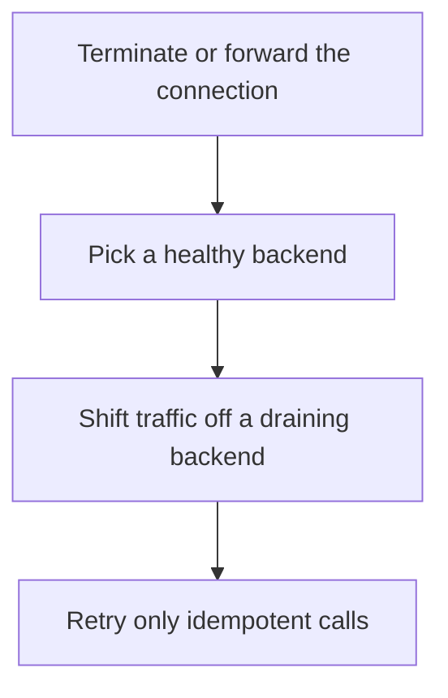

# D04-T019 — Proxies, reverse proxies and load balancers

Topic ID: `D04-T019`
Domain: Computer Networks
Subdomain: Proxies, reverse proxies and load balancers
Importance: core
Complexity: intermediate
Dependencies: `D04-T018`, `D04-T001`, `D01-T001`, `D01-T002`, `D03-T001`, `D03-T002`
Execution status of the code in section F: unexecuted

## A. Topic Overview

A forward proxy acts for clients leaving a network. A reverse proxy acts for servers, terminating client connections and forwarding inward. A load balancer distributes requests across healthy backends using round-robin, least-connections, or consistent hashing. Health checks decide membership. A balancer that does not drain connections will send traffic to a task that is shutting down.

In production this shows up as follows: An ingress controller stops sending new requests to a pod that failed readiness, and it keeps existing requests until the grace period ends. Without a drain, users see resets on every deploy.

Interviewers use Proxies, reverse proxies and load balancers to see whether you can state the failure mode, not only the definition. The failure to name is: health checks that hit a shallow endpoint while the real dependency is down, so the balancer keeps sending users to a broken task

Prerequisites: `D04-T018`, `D04-T001`, `D01-T001`, `D01-T002`, `D03-T001`, `D03-T002`. Later notes should link here instead of repeating the mechanism.

## B. First-Principles Explanation

A forward proxy acts for clients leaving a network. A reverse proxy acts for servers, terminating client connections and forwarding inward. A load balancer distributes requests across healthy backends using round-robin, least-connections, or consistent hashing. Health checks decide membership. A balancer that does not drain connections will send traffic to a task that is shutting down.

The useful picture is: A reverse proxy is the restaurant host who seats you. A load balancer is that host choosing the least busy section. A forward proxy is your company's door on the way out.

What has to be true:

1. Terminate or forward the connection
2. Pick a healthy backend
3. Shift traffic off a draining backend
4. Retry only idempotent calls

It works when those steps preserve one invariant. It fails when health checks that hit a shallow endpoint while the real dependency is down, so the balancer keeps sending users to a broken task. The alternative is: you have one process and are adding a proxy that becomes the new single point of failure without a reason

## C. Internal Working and Architecture

Components involved: the caller, the state Proxies, reverse proxies and load balancers mutates or reads, and the observer that reports unhealthy-backend ejection time and error rate during deploys.

Execution:

1. Terminate or forward the connection
2. Pick a healthy backend
3. Shift traffic off a draining backend
4. Retry only idempotent calls

Data moves only along that path. A retry re-enters at step 1, so the operation must say what a duplicate does. Memory and locks stay inside this mechanism. Callers see the result or a typed error, not a half-updated invariant.

State to remember: choose this when you are placing a tier in front of replicated services. Do not choose it when you have one process and are adding a proxy that becomes the new single point of failure without a reason.

## D. Diagrams and Visual Models



Read the diagram from top to bottom. Each box is one step of Proxies, reverse proxies and load balancers. The failure mode (health checks that hit a shallow endpoint while the real dependency is down, so the balancer keeps sending users to a broken task) is what you look for when a later box never happens or happens twice.

## E. Examples and Analogies

Analogy: A reverse proxy is the restaurant host who seats you. A load balancer is that host choosing the least busy section. A forward proxy is your company's door on the way out.

Production example: An ingress controller stops sending new requests to a pod that failed readiness, and it keeps existing requests until the grace period ends. Without a drain, users see resets on every deploy.

A small counterexample is enough in an interview. Show the input, apply the steps, and show the broken outcome if someone uses the mechanism outside its rule: health checks that hit a shallow endpoint while the real dependency is down, so the balancer keeps sending users to a broken task.

## F. Code Examples

The snippet is labeled unexecuted. It illustrates the shape of the idea. It is not a benchmark and it embeds no secret.

```python
def choose(backends):
    live = [b for b in backends if b['healthy']]
    return live[0] if live else None
```

After the snippet, check unhealthy-backend ejection time and error rate during deploys. If that signal moves the wrong way, the snippet is the wrong tool for the workload.

## G. Practical Backend Application

Use Proxies, reverse proxies and load balancers in a service when you are placing a tier in front of replicated services.

A typical place is the production case already stated: An ingress controller stops sending new requests to a pod that failed readiness, and it keeps existing requests until the grace period ends. Without a drain, users see resets on every deploy.

Operationally you alert on unhealthy-backend ejection time and error rate during deploys. You do not alert only on process uptime. The dashboard should show the failure mode, a success rate, and the saturation signal (queue depth, lock wait, or latency) that predicts it.

## H. Advantages, Limitations and Trade-offs

| Choice | Benefit | Cost | Choose when | Avoid when |
| --- | --- | --- | --- | --- |
| Apply Proxies, reverse proxies and load balancers | you are placing a tier in front of replicated services | Extra moving parts and a new failure mode | The failure you are preventing is already real | you have one process and are adding a proxy that becomes the new single point of failure without a reason |
| Simpler alternative | Less code and fewer dependencies | health checks that hit a shallow endpoint while the real dependency is down, so the balancer keeps sending users to a broken task | The workload does not hit the limit | The invariant must hold under concurrency or failure |

Proxies, reverse proxies and load balancers is a trade. State the benefit and the cost in the same sentence when you propose it in a design review.

## I. Common Mistakes and Misconceptions

- Health-checking only the process, not the dependency.
- Retrying POST at the proxy.
- Forgetting connection drain on shutdown.
- Treating a diagram of Proxies, reverse proxies and load balancers as proof that the invariant holds in production.
- Copying a default configuration without naming unhealthy-backend ejection time and error rate during deploys.

## J. Debugging and Troubleshooting

Symptom: health checks that hit a shallow endpoint while the real dependency is down, so the balancer keeps sending users to a broken task

First check: unhealthy-backend ejection time and error rate during deploys.

Then compare one healthy instance against one unhealthy instance. Confirm whether retries are duplicating work. Confirm whether a timeout is shorter than the work. Fix the invariant, then watch the same metric for a full peak, not only for the next minute.

Useful questions: did the step order in section C actually happen, or did a caller skip a step? Did a deploy change the data shape that Proxies, reverse proxies and load balancers assumes?

## K. Interview Preparation

### Beginner

#### Q1. What problem does Proxies, reverse proxies and load balancers solve?

**Answer:** A forward proxy acts for clients leaving a network. A reverse proxy acts for servers, terminating client connections and forwarding inward. A load balancer distributes requests across healthy backends using round-robin, least-connections, or consistent hashing. Health checks decide membership. A balancer that does not drain connections will send traffic to a task that is shutting down. Without it, the usual backend failure is: health checks that hit a shallow endpoint while the real dependency is down, so the balancer keeps sending users to a broken task.

#### Q2. Where does Proxies, reverse proxies and load balancers sit on a request path?

**Answer:** Proxies, reverse proxies and load balancers is not a library you sprinkle on every call. you are placing a tier in front of replicated services You notice it when unhealthy-backend ejection time and error rate during deploys. Name the constraint that makes this choice correct. Say what you would measure to confirm it.

#### Q3. Give a concrete example of Proxies, reverse proxies and load balancers.

**Answer:** An ingress controller stops sending new requests to a pod that failed readiness, and it keeps existing requests until the grace period ends. Without a drain, users see resets on every deploy. Walk the input, the state change, and the observable output. Name the constraint that makes this choice correct.

#### Q4. What is a common mix-up around Proxies, reverse proxies and load balancers?

**Answer:** health checks that hit a shallow endpoint while the real dependency is down, so the balancer keeps sending users to a broken task The corrective check is unhealthy-backend ejection time and error rate during deploys. Name the constraint that makes this choice correct. Say what you would measure to confirm it. Say which alternative you rejected and why.

#### Q5. When would you skip Proxies, reverse proxies and load balancers?

**Answer:** you have one process and are adding a proxy that becomes the new single point of failure without a reason Skipping is a decision with a measured cost, not a slogan. Name the constraint that makes this choice correct. Say what you would measure to confirm it. Say which alternative you rejected and why.

### Intermediate

#### Q1. What invariant makes Proxies, reverse proxies and load balancers correct?

**Answer:** A forward proxy acts for clients leaving a network. A reverse proxy acts for servers, terminating client connections and forwarding inward. A load balancer distributes requests across healthy backends using round-robin, least-connections, or consistent hashing. Health checks decide membership. A balancer that does not drain connections will send traffic to a task that is shutting down. State the invariant before you name the tool.

#### Q2. How do you test Proxies, reverse proxies and load balancers?

**Answer:** Assert the failure mode directly: health checks that hit a shallow endpoint while the real dependency is down, so the balancer keeps sending users to a broken task. The assertion should watch unhealthy-backend ejection time and error rate during deploys. Include a concurrent or retry case if the bug only appears then. Name the constraint that makes this choice correct.

#### Q3. What signal tells you Proxies, reverse proxies and load balancers is misbehaving in production?

**Answer:** Watch unhealthy-backend ejection time and error rate during deploys. The user-visible symptom is usually health checks that hit a shallow endpoint while the real dependency is down, so the balancer keeps sending users to a broken task. Name the constraint that makes this choice correct. Say what you would measure to confirm it.

#### Q4. How would you introduce Proxies, reverse proxies and load balancers into a legacy service?

**Answer:** you are placing a tier in front of replicated services Ship it behind a metric so you can compare the old path. Roll back if health checks that hit a shallow endpoint while the real dependency is down, so the balancer keeps sending users to a broken task gets worse. Name the constraint that makes this choice correct. Say what you would measure to confirm it.

#### Q5. What do you trade away by choosing Proxies, reverse proxies and load balancers?

**Answer:** you are placing a tier in front of replicated services you have one process and are adding a proxy that becomes the new single point of failure without a reason Say the cost in latency, storage, or operational load. Name the constraint that makes this choice correct. Say what you would measure to confirm it. Say which alternative you rejected and why.

### Advanced

#### Q1. What breaks if a dependency of Proxies, reverse proxies and load balancers is slow or down?

**Answer:** health checks that hit a shallow endpoint while the real dependency is down, so the balancer keeps sending users to a broken task Degrade using the rule: you have one process and are adding a proxy that becomes the new single point of failure without a reason. Timeouts must be shorter than the caller's deadline. Name the constraint that makes this choice correct. Say what you would measure to confirm it.

#### Q2. How does Proxies, reverse proxies and load balancers behave under retries?

**Answer:** Retries repeat work, so Proxies, reverse proxies and load balancers must define what a duplicate does. health checks that hit a shallow endpoint while the real dependency is down, so the balancer keeps sending users to a broken task Idempotency keys or fences belong next to the write, not in a comment. Name the constraint that makes this choice correct. Say what you would measure to confirm it.

#### Q3. What is the capacity limit of Proxies, reverse proxies and load balancers?

**Answer:** The limit shows up as unhealthy-backend ejection time and error rate during deploys. Add capacity only after you know whether the bottleneck is CPU, lock wait, or network. Name the constraint that makes this choice correct. Say what you would measure to confirm it.

#### Q4. How do you evolve Proxies, reverse proxies and load balancers without a flag day?

**Answer:** you are placing a tier in front of replicated services Version the contract or the on-disk format. Readers should tolerate one old and one new shape during the rollout. Name the constraint that makes this choice correct. Say what you would measure to confirm it.

#### Q5. What security or correctness bug hides inside Proxies, reverse proxies and load balancers?

**Answer:** health checks that hit a shallow endpoint while the real dependency is down, so the balancer keeps sending users to a broken task Check authorization and tenancy at the same boundary as the mechanism. A cache or queue must not widen who can read the data. Name the constraint that makes this choice correct. Say what you would measure to confirm it.

### Scenario

#### Q1. Incident: health checks that hit a shallow endpoint while the real dependency is down, so the balancer keeps sending users to a broken task. What do you check first?

**Answer:** Start with unhealthy-backend ejection time and error rate during deploys. Compare a good host and a bad host before you restart anything. A forward proxy acts for clients leaving a network. A reverse proxy acts for servers, terminating client connections and forwarding inward. A load balancer distributes requests across healthy backends using round-robin, least-connections, or consistent hashing. Health checks decide membership. A balancer that does not drain connections will send traffic to a task that is shutting down.

#### Q2. A reviewer wants the clever version. What data settles it?

**Answer:** you are placing a tier in front of replicated services you have one process and are adding a proxy that becomes the new single point of failure without a reason Bring unhealthy-backend ejection time and error rate during deploys from a load test or from production, not a slogan. Name the constraint that makes this choice correct. Say what you would measure to confirm it. Say which alternative you rejected and why.

#### Q3. You have one hour to explain Proxies, reverse proxies and load balancers at a whiteboard.

**Answer:** Draw the happy path in four boxes. Then draw the failure: health checks that hit a shallow endpoint while the real dependency is down, so the balancer keeps sending users to a broken task. End with the metric you would page on. Name the constraint that makes this choice correct.

#### Q4. The bug only appears under two concurrent callers.

**Answer:** health checks that hit a shallow endpoint while the real dependency is down, so the balancer keeps sending users to a broken task Reproduce with a barrier so both sides enter the critical window. Confirm the fix with unhealthy-backend ejection time and error rate during deploys. Name the constraint that makes this choice correct. Say what you would measure to confirm it.

#### Q5. Leadership wants this on every service next week.

**Answer:** you have one process and are adding a proxy that becomes the new single point of failure without a reason you are placing a tier in front of replicated services Roll it out where the failure mode is already hurting users. Name the constraint that makes this choice correct. Say what you would measure to confirm it. Say which alternative you rejected and why.

### Follow-up

#### Q1. What did you assume about the data size or the clock?

**Answer:** A forward proxy acts for clients leaving a network. A reverse proxy acts for servers, terminating client connections and forwarding inward. A load balancer distributes requests across healthy backends using round-robin, least-connections, or consistent hashing. Health checks decide membership. A balancer that does not drain connections will send traffic to a task that is shutting down. Clocks are not a total order across machines. State whether the algorithm needs bounded size or a single leader.

#### Q2. What would you measure after the change ships?

**Answer:** Page on unhealthy-backend ejection time and error rate during deploys. Keep a before/after dashboard for one week. Alert on the failure mode, not only on CPU. Name the constraint that makes this choice correct.

#### Q3. Which neighboring topic did you deliberately not re-teach?

**Answer:** This note owns Proxies, reverse proxies and load balancers. Related identifiers are in section N. Shared ideas are linked, not copied. Name the constraint that makes this choice correct.

## L. Practical Exercises

Solutions are in `EXERCISES/solutions/D04-T019.md`, not in this section.

1. Whiteboard the four steps of Proxies, reverse proxies and load balancers and mark where `health checks that hit a shallow endpoint while the real dependency is down, so the balancer keeps sending users to a broken task` enters.
2. Read the snippet in section F and write the assertion that would catch that failure. The assertion must mention `unhealthy-backend ejection time and error rate during deploys`.
3. Argue for or against using Proxies, reverse proxies and load balancers on a service you know. Use the choose and avoid rows from section H. Do not appeal to popularity.

## M. Revision Notes

- Mechanism: A forward proxy acts for clients leaving a network.
- Failure: health checks that hit a shallow endpoint while the real dependency is down, so the balancer keeps sending users to a broken task
- Metric: unhealthy-backend ejection time and error rate during deploys
- Choose when: you are placing a tier in front of replicated services
- Avoid when: you have one process and are adding a proxy that becomes the new single point of failure without a reason

## N. Related Topics

Dependencies to review first: `D04-T018`, `D04-T001`, `D01-T001`, `D01-T002`, `D03-T001`, `D03-T002`.

Shared ideas stay in those notes. This note does not restate them.

## O. Completion Criteria

- You can explain Proxies, reverse proxies and load balancers without reading this note, including the failure mode.
- You can draw the diagram in section D from memory.
- You can say when not to use it, using the avoid condition in section H.
- You can name the metric you would watch after shipping it.
