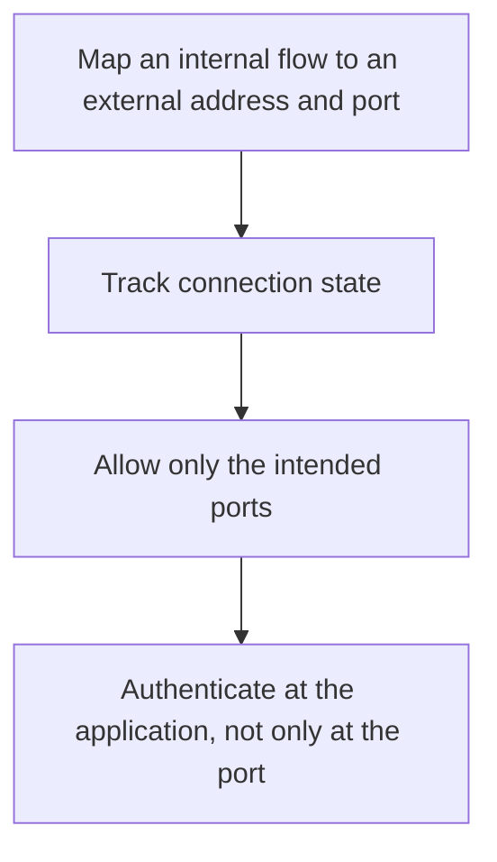

# D04-T020 — NAT, firewalls and ports

Topic ID: `D04-T020`
Domain: Computer Networks
Subdomain: NAT, firewalls and ports
Importance: advanced
Complexity: advanced
Dependencies: `D04-T019`, `D04-T001`, `D01-T001`, `D01-T002`, `D03-T001`, `D03-T002`
Execution status of the code in section F: unexecuted

## A. Topic Overview

NAT rewrites addresses so many hosts can share one public address, or so a private service can be reached through a gateway. It breaks end-to-end addressing and complicates protocols that embed IP addresses in payloads. A firewall filters flows by address, port, and state. Ports distinguish sockets on one host. Opening a port is not the same as authenticating the caller.

In production this shows up as follows: A security group opens 443 to the internet and people call the service 'exposed' even though the app still checks tokens. Idle NAT entries drop a WebSocket that did not heartbeat.

Interviewers use NAT, firewalls and ports to see whether you can state the failure mode, not only the definition. The failure to name is: a stateful rule that allows a return path you did not intend, or a NAT timeout that drops an idle database connection

Prerequisites: `D04-T019`, `D04-T001`, `D01-T001`, `D01-T002`, `D03-T001`, `D03-T002`. Later notes should link here instead of repeating the mechanism.

## B. First-Principles Explanation

NAT rewrites addresses so many hosts can share one public address, or so a private service can be reached through a gateway. It breaks end-to-end addressing and complicates protocols that embed IP addresses in payloads. A firewall filters flows by address, port, and state. Ports distinguish sockets on one host. Opening a port is not the same as authenticating the caller.

The useful picture is: NAT is a front desk that rewrites the return address on every letter. A firewall is the door policy. The port is the apartment number, not the resident's ID.

What has to be true:

1. Map an internal flow to an external address and port
2. Track connection state
3. Allow only the intended ports
4. Authenticate at the application, not only at the port

It works when those steps preserve one invariant. It fails when a stateful rule that allows a return path you did not intend, or a NAT timeout that drops an idle database connection. The alternative is: you treat an open port as an authorization decision

## C. Internal Working and Architecture

Components involved: the caller, the state NAT, firewalls and ports mutates or reads, and the observer that reports NAT table size, firewall drop count, and idle timeouts versus application keepalive.

Execution:

1. Map an internal flow to an external address and port
2. Track connection state
3. Allow only the intended ports
4. Authenticate at the application, not only at the port

Data moves only along that path. A retry re-enters at step 1, so the operation must say what a duplicate does. Memory and locks stay inside this mechanism. Callers see the result or a typed error, not a half-updated invariant.

State to remember: choose this when you are explaining reachability or a dropped idle flow. Do not choose it when you treat an open port as an authorization decision.

## D. Diagrams and Visual Models



Read the diagram from top to bottom. Each box is one step of NAT, firewalls and ports. The failure mode (a stateful rule that allows a return path you did not intend, or a NAT timeout that drops an idle database connection) is what you look for when a later box never happens or happens twice.

## E. Examples and Analogies

Analogy: NAT is a front desk that rewrites the return address on every letter. A firewall is the door policy. The port is the apartment number, not the resident's ID.

Production example: A security group opens 443 to the internet and people call the service 'exposed' even though the app still checks tokens. Idle NAT entries drop a WebSocket that did not heartbeat.

A small counterexample is enough in an interview. Show the input, apply the steps, and show the broken outcome if someone uses the mechanism outside its rule: a stateful rule that allows a return path you did not intend, or a NAT timeout that drops an idle database connection.

## F. Code Examples

The snippet is labeled unexecuted. It illustrates the shape of the idea. It is not a benchmark and it embeds no secret.

```python
def allowed(port, allow):
    return port in allow
```

After the snippet, check NAT table size, firewall drop count, and idle timeouts versus application keepalive. If that signal moves the wrong way, the snippet is the wrong tool for the workload.

## G. Practical Backend Application

Use NAT, firewalls and ports in a service when you are explaining reachability or a dropped idle flow.

A typical place is the production case already stated: A security group opens 443 to the internet and people call the service 'exposed' even though the app still checks tokens. Idle NAT entries drop a WebSocket that did not heartbeat.

Operationally you alert on NAT table size, firewall drop count, and idle timeouts versus application keepalive. You do not alert only on process uptime. The dashboard should show the failure mode, a success rate, and the saturation signal (queue depth, lock wait, or latency) that predicts it.

## H. Advantages, Limitations and Trade-offs

| Choice | Benefit | Cost | Choose when | Avoid when |
| --- | --- | --- | --- | --- |
| Apply NAT, firewalls and ports | you are explaining reachability or a dropped idle flow | Extra moving parts and a new failure mode | The failure you are preventing is already real | you treat an open port as an authorization decision |
| Simpler alternative | Less code and fewer dependencies | a stateful rule that allows a return path you did not intend, or a NAT timeout that drops an idle database connection | The workload does not hit the limit | The invariant must hold under concurrency or failure |

NAT, firewalls and ports is a trade. State the benefit and the cost in the same sentence when you propose it in a design review.

## I. Common Mistakes and Misconceptions

- Embedding private IPs inside application payloads.
- Disabling stateful tracking without a plan.
- Using a long-lived connection without a keepalive inside a NAT.
- Treating a diagram of NAT, firewalls and ports as proof that the invariant holds in production.
- Copying a default configuration without naming NAT table size, firewall drop count, and idle timeouts versus application keepalive.

## J. Debugging and Troubleshooting

Symptom: a stateful rule that allows a return path you did not intend, or a NAT timeout that drops an idle database connection

First check: NAT table size, firewall drop count, and idle timeouts versus application keepalive.

Then compare one healthy instance against one unhealthy instance. Confirm whether retries are duplicating work. Confirm whether a timeout is shorter than the work. Fix the invariant, then watch the same metric for a full peak, not only for the next minute.

Useful questions: did the step order in section C actually happen, or did a caller skip a step? Did a deploy change the data shape that NAT, firewalls and ports assumes?

## K. Interview Preparation

### Beginner

#### Q1. What problem does NAT, firewalls and ports solve?

**Answer:** NAT rewrites addresses so many hosts can share one public address, or so a private service can be reached through a gateway. It breaks end-to-end addressing and complicates protocols that embed IP addresses in payloads. A firewall filters flows by address, port, and state. Ports distinguish sockets on one host. Opening a port is not the same as authenticating the caller. Without it, the usual backend failure is: a stateful rule that allows a return path you did not intend, or a NAT timeout that drops an idle database connection.

#### Q2. Where does NAT, firewalls and ports sit on a request path?

**Answer:** NAT, firewalls and ports is not a library you sprinkle on every call. you are explaining reachability or a dropped idle flow You notice it when NAT table size, firewall drop count, and idle timeouts versus application keepalive. Name the constraint that makes this choice correct. Say what you would measure to confirm it.

#### Q3. Give a concrete example of NAT, firewalls and ports.

**Answer:** A security group opens 443 to the internet and people call the service 'exposed' even though the app still checks tokens. Idle NAT entries drop a WebSocket that did not heartbeat. Walk the input, the state change, and the observable output. Name the constraint that makes this choice correct.

#### Q4. What is a common mix-up around NAT, firewalls and ports?

**Answer:** a stateful rule that allows a return path you did not intend, or a NAT timeout that drops an idle database connection The corrective check is NAT table size, firewall drop count, and idle timeouts versus application keepalive. Name the constraint that makes this choice correct. Say what you would measure to confirm it. Say which alternative you rejected and why.

#### Q5. When would you skip NAT, firewalls and ports?

**Answer:** you treat an open port as an authorization decision Skipping is a decision with a measured cost, not a slogan. Name the constraint that makes this choice correct. Say what you would measure to confirm it. Say which alternative you rejected and why.

### Intermediate

#### Q1. What invariant makes NAT, firewalls and ports correct?

**Answer:** NAT rewrites addresses so many hosts can share one public address, or so a private service can be reached through a gateway. It breaks end-to-end addressing and complicates protocols that embed IP addresses in payloads. A firewall filters flows by address, port, and state. Ports distinguish sockets on one host. Opening a port is not the same as authenticating the caller. State the invariant before you name the tool.

#### Q2. How do you test NAT, firewalls and ports?

**Answer:** Assert the failure mode directly: a stateful rule that allows a return path you did not intend, or a NAT timeout that drops an idle database connection. The assertion should watch NAT table size, firewall drop count, and idle timeouts versus application keepalive. Include a concurrent or retry case if the bug only appears then. Name the constraint that makes this choice correct.

#### Q3. What signal tells you NAT, firewalls and ports is misbehaving in production?

**Answer:** Watch NAT table size, firewall drop count, and idle timeouts versus application keepalive. The user-visible symptom is usually a stateful rule that allows a return path you did not intend, or a NAT timeout that drops an idle database connection. Name the constraint that makes this choice correct. Say what you would measure to confirm it.

#### Q4. How would you introduce NAT, firewalls and ports into a legacy service?

**Answer:** you are explaining reachability or a dropped idle flow Ship it behind a metric so you can compare the old path. Roll back if a stateful rule that allows a return path you did not intend, or a NAT timeout that drops an idle database connection gets worse. Name the constraint that makes this choice correct. Say what you would measure to confirm it.

#### Q5. What do you trade away by choosing NAT, firewalls and ports?

**Answer:** you are explaining reachability or a dropped idle flow you treat an open port as an authorization decision Say the cost in latency, storage, or operational load. Name the constraint that makes this choice correct. Say what you would measure to confirm it. Say which alternative you rejected and why.

### Advanced

#### Q1. What breaks if a dependency of NAT, firewalls and ports is slow or down?

**Answer:** a stateful rule that allows a return path you did not intend, or a NAT timeout that drops an idle database connection Degrade using the rule: you treat an open port as an authorization decision. Timeouts must be shorter than the caller's deadline. Name the constraint that makes this choice correct. Say what you would measure to confirm it.

#### Q2. How does NAT, firewalls and ports behave under retries?

**Answer:** Retries repeat work, so NAT, firewalls and ports must define what a duplicate does. a stateful rule that allows a return path you did not intend, or a NAT timeout that drops an idle database connection Idempotency keys or fences belong next to the write, not in a comment. Name the constraint that makes this choice correct. Say what you would measure to confirm it.

#### Q3. What is the capacity limit of NAT, firewalls and ports?

**Answer:** The limit shows up as NAT table size, firewall drop count, and idle timeouts versus application keepalive. Add capacity only after you know whether the bottleneck is CPU, lock wait, or network. Name the constraint that makes this choice correct. Say what you would measure to confirm it.

#### Q4. How do you evolve NAT, firewalls and ports without a flag day?

**Answer:** you are explaining reachability or a dropped idle flow Version the contract or the on-disk format. Readers should tolerate one old and one new shape during the rollout. Name the constraint that makes this choice correct. Say what you would measure to confirm it.

#### Q5. What security or correctness bug hides inside NAT, firewalls and ports?

**Answer:** a stateful rule that allows a return path you did not intend, or a NAT timeout that drops an idle database connection Check authorization and tenancy at the same boundary as the mechanism. A cache or queue must not widen who can read the data. Name the constraint that makes this choice correct. Say what you would measure to confirm it.

### Scenario

#### Q1. Incident: a stateful rule that allows a return path you did not intend, or a NAT timeout that drops an idle database connection. What do you check first?

**Answer:** Start with NAT table size, firewall drop count, and idle timeouts versus application keepalive. Compare a good host and a bad host before you restart anything. NAT rewrites addresses so many hosts can share one public address, or so a private service can be reached through a gateway. It breaks end-to-end addressing and complicates protocols that embed IP addresses in payloads. A firewall filters flows by address, port, and state. Ports distinguish sockets on one host. Opening a port is not the same as authenticating the caller.

#### Q2. A reviewer wants the clever version. What data settles it?

**Answer:** you are explaining reachability or a dropped idle flow you treat an open port as an authorization decision Bring NAT table size, firewall drop count, and idle timeouts versus application keepalive from a load test or from production, not a slogan. Name the constraint that makes this choice correct. Say what you would measure to confirm it. Say which alternative you rejected and why.

#### Q3. You have one hour to explain NAT, firewalls and ports at a whiteboard.

**Answer:** Draw the happy path in four boxes. Then draw the failure: a stateful rule that allows a return path you did not intend, or a NAT timeout that drops an idle database connection. End with the metric you would page on. Name the constraint that makes this choice correct.

#### Q4. The bug only appears under two concurrent callers.

**Answer:** a stateful rule that allows a return path you did not intend, or a NAT timeout that drops an idle database connection Reproduce with a barrier so both sides enter the critical window. Confirm the fix with NAT table size, firewall drop count, and idle timeouts versus application keepalive. Name the constraint that makes this choice correct. Say what you would measure to confirm it.

#### Q5. Leadership wants this on every service next week.

**Answer:** you treat an open port as an authorization decision you are explaining reachability or a dropped idle flow Roll it out where the failure mode is already hurting users. Name the constraint that makes this choice correct. Say what you would measure to confirm it. Say which alternative you rejected and why.

### Follow-up

#### Q1. What did you assume about the data size or the clock?

**Answer:** NAT rewrites addresses so many hosts can share one public address, or so a private service can be reached through a gateway. It breaks end-to-end addressing and complicates protocols that embed IP addresses in payloads. A firewall filters flows by address, port, and state. Ports distinguish sockets on one host. Opening a port is not the same as authenticating the caller. Clocks are not a total order across machines. State whether the algorithm needs bounded size or a single leader.

#### Q2. What would you measure after the change ships?

**Answer:** Page on NAT table size, firewall drop count, and idle timeouts versus application keepalive. Keep a before/after dashboard for one week. Alert on the failure mode, not only on CPU. Name the constraint that makes this choice correct.

#### Q3. Which neighboring topic did you deliberately not re-teach?

**Answer:** This note owns NAT, firewalls and ports. Related identifiers are in section N. Shared ideas are linked, not copied. Name the constraint that makes this choice correct.

## L. Practical Exercises

Solutions are in `EXERCISES/solutions/D04-T020.md`, not in this section.

1. Whiteboard the four steps of NAT, firewalls and ports and mark where `a stateful rule that allows a return path you did not intend, or a NAT timeout that drops an idle database connection` enters.
2. Read the snippet in section F and write the assertion that would catch that failure. The assertion must mention `NAT table size, firewall drop count, and idle timeouts versus application keepalive`.
3. Argue for or against using NAT, firewalls and ports on a service you know. Use the choose and avoid rows from section H. Do not appeal to popularity.

## M. Revision Notes

- Mechanism: NAT rewrites addresses so many hosts can share one public address, or so a private service can be reached through a gateway.
- Failure: a stateful rule that allows a return path you did not intend, or a NAT timeout that drops an idle database connection
- Metric: NAT table size, firewall drop count, and idle timeouts versus application keepalive
- Choose when: you are explaining reachability or a dropped idle flow
- Avoid when: you treat an open port as an authorization decision

## N. Related Topics

Dependencies to review first: `D04-T019`, `D04-T001`, `D01-T001`, `D01-T002`, `D03-T001`, `D03-T002`.

Shared ideas stay in those notes. This note does not restate them.

## O. Completion Criteria

- You can explain NAT, firewalls and ports without reading this note, including the failure mode.
- You can draw the diagram in section D from memory.
- You can say when not to use it, using the avoid condition in section H.
- You can name the metric you would watch after shipping it.
