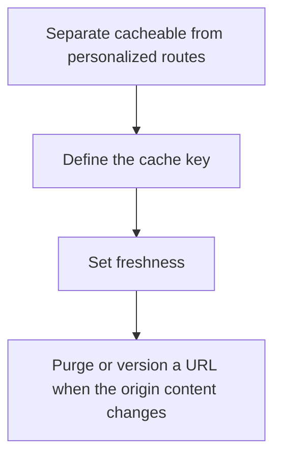

# D04-T021 — CDN and edge networking

Topic ID: `D04-T021`
Domain: Computer Networks
Subdomain: CDN and edge networking
Importance: core
Complexity: intermediate
Dependencies: `D04-T020`, `D04-T001`, `D01-T001`, `D01-T002`, `D03-T001`, `D03-T002`
Execution status of the code in section F: unexecuted

## A. Topic Overview

A CDN caches content at edges close to users and terminates TLS there. It reduces origin load and RTT for cacheable bytes. The origin still owns uncacheable and personalized responses. Cache keys must include every input that changes the body. A purge has to be explicit because TTL is the other way an object leaves.

In production this shows up as follows: Product images are served from the edge. Account pages bypass the cache. A bad cache key on a search page shows one user another user's results.

Interviewers use CDN and edge networking to see whether you can state the failure mode, not only the definition. The failure to name is: caching a response that varies by cookie under a key that ignores the cookie

Prerequisites: `D04-T020`, `D04-T001`, `D01-T001`, `D01-T002`, `D03-T001`, `D03-T002`. Later notes should link here instead of repeating the mechanism.

## B. First-Principles Explanation

A CDN caches content at edges close to users and terminates TLS there. It reduces origin load and RTT for cacheable bytes. The origin still owns uncacheable and personalized responses. Cache keys must include every input that changes the body. A purge has to be explicit because TTL is the other way an object leaves.

The useful picture is: A CDN is a set of branch libraries that keep popular books so you do not travel to the main archive. A personalized letter is never shelved in the branch.

What has to be true:

1. Separate cacheable from personalized routes
2. Define the cache key
3. Set freshness
4. Purge or version a URL when the origin content changes

It works when those steps preserve one invariant. It fails when caching a response that varies by cookie under a key that ignores the cookie. The alternative is: the response is unique per user or must be consistent immediately after a write

## C. Internal Working and Architecture

Components involved: the caller, the state CDN and edge networking mutates or reads, and the observer that reports edge hit ratio and origin request rate after a purge.

Execution:

1. Separate cacheable from personalized routes
2. Define the cache key
3. Set freshness
4. Purge or version a URL when the origin content changes

Data moves only along that path. A retry re-enters at step 1, so the operation must say what a duplicate does. Memory and locks stay inside this mechanism. Callers see the result or a typed error, not a half-updated invariant.

State to remember: choose this when the bytes are public and larger than the header overhead. Do not choose it when the response is unique per user or must be consistent immediately after a write.

## D. Diagrams and Visual Models



Read the diagram from top to bottom. Each box is one step of CDN and edge networking. The failure mode (caching a response that varies by cookie under a key that ignores the cookie) is what you look for when a later box never happens or happens twice.

## E. Examples and Analogies

Analogy: A CDN is a set of branch libraries that keep popular books so you do not travel to the main archive. A personalized letter is never shelved in the branch.

Production example: Product images are served from the edge. Account pages bypass the cache. A bad cache key on a search page shows one user another user's results.

A small counterexample is enough in an interview. Show the input, apply the steps, and show the broken outcome if someone uses the mechanism outside its rule: caching a response that varies by cookie under a key that ignores the cookie.

## F. Code Examples

The snippet is labeled unexecuted. It illustrates the shape of the idea. It is not a benchmark and it embeds no secret.

```python
def cache_key(path, vary):
    return path + '|' + '|'.join(vary)
```

After the snippet, check edge hit ratio and origin request rate after a purge. If that signal moves the wrong way, the snippet is the wrong tool for the workload.

## G. Practical Backend Application

Use CDN and edge networking in a service when the bytes are public and larger than the header overhead.

A typical place is the production case already stated: Product images are served from the edge. Account pages bypass the cache. A bad cache key on a search page shows one user another user's results.

Operationally you alert on edge hit ratio and origin request rate after a purge. You do not alert only on process uptime. The dashboard should show the failure mode, a success rate, and the saturation signal (queue depth, lock wait, or latency) that predicts it.

## H. Advantages, Limitations and Trade-offs

| Choice | Benefit | Cost | Choose when | Avoid when |
| --- | --- | --- | --- | --- |
| Apply CDN and edge networking | the bytes are public and larger than the header overhead | Extra moving parts and a new failure mode | The failure you are preventing is already real | the response is unique per user or must be consistent immediately after a write |
| Simpler alternative | Less code and fewer dependencies | caching a response that varies by cookie under a key that ignores the cookie | The workload does not hit the limit | The invariant must hold under concurrency or failure |

CDN and edge networking is a trade. State the benefit and the cost in the same sentence when you propose it in a design review.

## I. Common Mistakes and Misconceptions

- Purging everything on every deploy.
- Forgetting the query string in the cache key.
- Putting the origin in one region and assuming the edge fixes write latency.
- Treating a diagram of CDN and edge networking as proof that the invariant holds in production.
- Copying a default configuration without naming edge hit ratio and origin request rate after a purge.

## J. Debugging and Troubleshooting

Symptom: caching a response that varies by cookie under a key that ignores the cookie

First check: edge hit ratio and origin request rate after a purge.

Then compare one healthy instance against one unhealthy instance. Confirm whether retries are duplicating work. Confirm whether a timeout is shorter than the work. Fix the invariant, then watch the same metric for a full peak, not only for the next minute.

Useful questions: did the step order in section C actually happen, or did a caller skip a step? Did a deploy change the data shape that CDN and edge networking assumes?

## K. Interview Preparation

### Beginner

#### Q1. What problem does CDN and edge networking solve?

**Answer:** A CDN caches content at edges close to users and terminates TLS there. It reduces origin load and RTT for cacheable bytes. The origin still owns uncacheable and personalized responses. Cache keys must include every input that changes the body. A purge has to be explicit because TTL is the other way an object leaves. Without it, the usual backend failure is: caching a response that varies by cookie under a key that ignores the cookie.

#### Q2. Where does CDN and edge networking sit on a request path?

**Answer:** CDN and edge networking is not a library you sprinkle on every call. the bytes are public and larger than the header overhead You notice it when edge hit ratio and origin request rate after a purge. Name the constraint that makes this choice correct. Say what you would measure to confirm it.

#### Q3. Give a concrete example of CDN and edge networking.

**Answer:** Product images are served from the edge. Account pages bypass the cache. A bad cache key on a search page shows one user another user's results. Walk the input, the state change, and the observable output.

#### Q4. What is a common mix-up around CDN and edge networking?

**Answer:** caching a response that varies by cookie under a key that ignores the cookie The corrective check is edge hit ratio and origin request rate after a purge. Name the constraint that makes this choice correct. Say what you would measure to confirm it. Say which alternative you rejected and why.

#### Q5. When would you skip CDN and edge networking?

**Answer:** the response is unique per user or must be consistent immediately after a write Skipping is a decision with a measured cost, not a slogan. Name the constraint that makes this choice correct. Say what you would measure to confirm it. Say which alternative you rejected and why.

### Intermediate

#### Q1. What invariant makes CDN and edge networking correct?

**Answer:** A CDN caches content at edges close to users and terminates TLS there. It reduces origin load and RTT for cacheable bytes. The origin still owns uncacheable and personalized responses. Cache keys must include every input that changes the body. A purge has to be explicit because TTL is the other way an object leaves. State the invariant before you name the tool.

#### Q2. How do you test CDN and edge networking?

**Answer:** Assert the failure mode directly: caching a response that varies by cookie under a key that ignores the cookie. The assertion should watch edge hit ratio and origin request rate after a purge. Include a concurrent or retry case if the bug only appears then. Name the constraint that makes this choice correct.

#### Q3. What signal tells you CDN and edge networking is misbehaving in production?

**Answer:** Watch edge hit ratio and origin request rate after a purge. The user-visible symptom is usually caching a response that varies by cookie under a key that ignores the cookie. Name the constraint that makes this choice correct. Say what you would measure to confirm it.

#### Q4. How would you introduce CDN and edge networking into a legacy service?

**Answer:** the bytes are public and larger than the header overhead Ship it behind a metric so you can compare the old path. Roll back if caching a response that varies by cookie under a key that ignores the cookie gets worse. Name the constraint that makes this choice correct. Say what you would measure to confirm it.

#### Q5. What do you trade away by choosing CDN and edge networking?

**Answer:** the bytes are public and larger than the header overhead the response is unique per user or must be consistent immediately after a write Say the cost in latency, storage, or operational load. Name the constraint that makes this choice correct. Say what you would measure to confirm it. Say which alternative you rejected and why.

### Advanced

#### Q1. What breaks if a dependency of CDN and edge networking is slow or down?

**Answer:** caching a response that varies by cookie under a key that ignores the cookie Degrade using the rule: the response is unique per user or must be consistent immediately after a write. Timeouts must be shorter than the caller's deadline. Name the constraint that makes this choice correct. Say what you would measure to confirm it.

#### Q2. How does CDN and edge networking behave under retries?

**Answer:** Retries repeat work, so CDN and edge networking must define what a duplicate does. caching a response that varies by cookie under a key that ignores the cookie Idempotency keys or fences belong next to the write, not in a comment. Name the constraint that makes this choice correct. Say what you would measure to confirm it.

#### Q3. What is the capacity limit of CDN and edge networking?

**Answer:** The limit shows up as edge hit ratio and origin request rate after a purge. Add capacity only after you know whether the bottleneck is CPU, lock wait, or network. Name the constraint that makes this choice correct. Say what you would measure to confirm it.

#### Q4. How do you evolve CDN and edge networking without a flag day?

**Answer:** the bytes are public and larger than the header overhead Version the contract or the on-disk format. Readers should tolerate one old and one new shape during the rollout. Name the constraint that makes this choice correct. Say what you would measure to confirm it.

#### Q5. What security or correctness bug hides inside CDN and edge networking?

**Answer:** caching a response that varies by cookie under a key that ignores the cookie Check authorization and tenancy at the same boundary as the mechanism. A cache or queue must not widen who can read the data. Name the constraint that makes this choice correct. Say what you would measure to confirm it.

### Scenario

#### Q1. Incident: caching a response that varies by cookie under a key that ignores the cookie. What do you check first?

**Answer:** Start with edge hit ratio and origin request rate after a purge. Compare a good host and a bad host before you restart anything. A CDN caches content at edges close to users and terminates TLS there. It reduces origin load and RTT for cacheable bytes. The origin still owns uncacheable and personalized responses. Cache keys must include every input that changes the body. A purge has to be explicit because TTL is the other way an object leaves.

#### Q2. A reviewer wants the clever version. What data settles it?

**Answer:** the bytes are public and larger than the header overhead the response is unique per user or must be consistent immediately after a write Bring edge hit ratio and origin request rate after a purge from a load test or from production, not a slogan. Name the constraint that makes this choice correct. Say what you would measure to confirm it. Say which alternative you rejected and why.

#### Q3. You have one hour to explain CDN and edge networking at a whiteboard.

**Answer:** Draw the happy path in four boxes. Then draw the failure: caching a response that varies by cookie under a key that ignores the cookie. End with the metric you would page on. Name the constraint that makes this choice correct.

#### Q4. The bug only appears under two concurrent callers.

**Answer:** caching a response that varies by cookie under a key that ignores the cookie Reproduce with a barrier so both sides enter the critical window. Confirm the fix with edge hit ratio and origin request rate after a purge. Name the constraint that makes this choice correct. Say what you would measure to confirm it.

#### Q5. Leadership wants this on every service next week.

**Answer:** the response is unique per user or must be consistent immediately after a write the bytes are public and larger than the header overhead Roll it out where the failure mode is already hurting users. Name the constraint that makes this choice correct. Say what you would measure to confirm it. Say which alternative you rejected and why.

### Follow-up

#### Q1. What did you assume about the data size or the clock?

**Answer:** A CDN caches content at edges close to users and terminates TLS there. It reduces origin load and RTT for cacheable bytes. The origin still owns uncacheable and personalized responses. Cache keys must include every input that changes the body. A purge has to be explicit because TTL is the other way an object leaves. Clocks are not a total order across machines. State whether the algorithm needs bounded size or a single leader.

#### Q2. What would you measure after the change ships?

**Answer:** Page on edge hit ratio and origin request rate after a purge. Keep a before/after dashboard for one week. Alert on the failure mode, not only on CPU. Name the constraint that makes this choice correct.

#### Q3. Which neighboring topic did you deliberately not re-teach?

**Answer:** This note owns CDN and edge networking. Related identifiers are in section N. Shared ideas are linked, not copied. Name the constraint that makes this choice correct.

## L. Practical Exercises

Solutions are in `EXERCISES/solutions/D04-T021.md`, not in this section.

1. Whiteboard the four steps of CDN and edge networking and mark where `caching a response that varies by cookie under a key that ignores the cookie` enters.
2. Read the snippet in section F and write the assertion that would catch that failure. The assertion must mention `edge hit ratio and origin request rate after a purge`.
3. Argue for or against using CDN and edge networking on a service you know. Use the choose and avoid rows from section H. Do not appeal to popularity.

## M. Revision Notes

- Mechanism: A CDN caches content at edges close to users and terminates TLS there.
- Failure: caching a response that varies by cookie under a key that ignores the cookie
- Metric: edge hit ratio and origin request rate after a purge
- Choose when: the bytes are public and larger than the header overhead
- Avoid when: the response is unique per user or must be consistent immediately after a write

## N. Related Topics

Dependencies to review first: `D04-T020`, `D04-T001`, `D01-T001`, `D01-T002`, `D03-T001`, `D03-T002`.

Shared ideas stay in those notes. This note does not restate them.

## O. Completion Criteria

- You can explain CDN and edge networking without reading this note, including the failure mode.
- You can draw the diagram in section D from memory.
- You can say when not to use it, using the avoid condition in section H.
- You can name the metric you would watch after shipping it.
