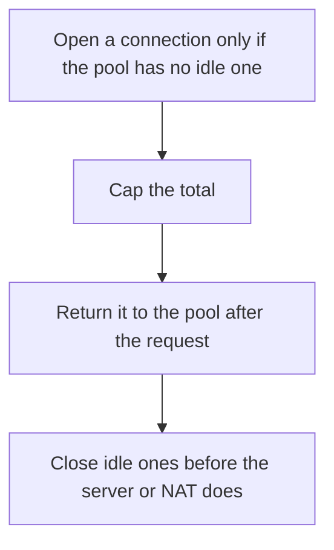

# D04-T022 — Connection pooling and keep-alive

Topic ID: `D04-T022`
Domain: Computer Networks
Subdomain: Connection pooling and keep-alive
Importance: core
Complexity: intermediate
Dependencies: `D04-T021`, `D04-T001`, `D01-T001`, `D01-T002`, `D03-T001`, `D03-T002`
Execution status of the code in section F: unexecuted

## A. Topic Overview

A connection pool reuses open TCP or TLS sessions so each request does not pay a handshake. Keep-alive holds a connection open for another request. The pool has a max size, an idle timeout, and a wait timeout. An unbounded pool is a file-descriptor leak with extra steps. A pool that is smaller than the offered concurrency queues callers.

In production this shows up as follows: A service that opens a new TLS connection per database query spends the CPU on handshakes. A pool of 100 with a wait timeout fails fast when the database is the bottleneck instead of opening 10,000 sockets.

Interviewers use Connection pooling and keep-alive to see whether you can state the failure mode, not only the definition. The failure to name is: a pool that never validates a connection and hands out a socket the server already closed

Prerequisites: `D04-T021`, `D04-T001`, `D01-T001`, `D01-T002`, `D03-T001`, `D03-T002`. Later notes should link here instead of repeating the mechanism.

## B. First-Principles Explanation

A connection pool reuses open TCP or TLS sessions so each request does not pay a handshake. Keep-alive holds a connection open for another request. The pool has a max size, an idle timeout, and a wait timeout. An unbounded pool is a file-descriptor leak with extra steps. A pool that is smaller than the offered concurrency queues callers.

The useful picture is: A pool is a taxi stand with a fixed number of cars. Keep-alive is leaving the meter running between your errands instead of hailing a new cab each time.

What has to be true:

1. Open a connection only if the pool has no idle one
2. Cap the total
3. Return it to the pool after the request
4. Close idle ones before the server or NAT does

It works when those steps preserve one invariant. It fails when a pool that never validates a connection and hands out a socket the server already closed. The alternative is: the peer is different every call, so there is nothing to reuse

## C. Internal Working and Architecture

Components involved: the caller, the state Connection pooling and keep-alive mutates or reads, and the observer that reports pool wait time, handshake rate, and errors on the first request after idle.

Execution:

1. Open a connection only if the pool has no idle one
2. Cap the total
3. Return it to the pool after the request
4. Close idle ones before the server or NAT does

Data moves only along that path. A retry re-enters at step 1, so the operation must say what a duplicate does. Memory and locks stay inside this mechanism. Callers see the result or a typed error, not a half-updated invariant.

State to remember: choose this when the remote handshake is expensive relative to the request. Do not choose it when the peer is different every call, so there is nothing to reuse.

## D. Diagrams and Visual Models



Read the diagram from top to bottom. Each box is one step of Connection pooling and keep-alive. The failure mode (a pool that never validates a connection and hands out a socket the server already closed) is what you look for when a later box never happens or happens twice.

## E. Examples and Analogies

Analogy: A pool is a taxi stand with a fixed number of cars. Keep-alive is leaving the meter running between your errands instead of hailing a new cab each time.

Production example: A service that opens a new TLS connection per database query spends the CPU on handshakes. A pool of 100 with a wait timeout fails fast when the database is the bottleneck instead of opening 10,000 sockets.

A small counterexample is enough in an interview. Show the input, apply the steps, and show the broken outcome if someone uses the mechanism outside its rule: a pool that never validates a connection and hands out a socket the server already closed.

## F. Code Examples

The snippet is labeled unexecuted. It illustrates the shape of the idea. It is not a benchmark and it embeds no secret.

```python
class Pool:
    def __init__(self, max_open):
        self.max_open = max_open
        self.idle = []
        self.open = 0
```

After the snippet, check pool wait time, handshake rate, and errors on the first request after idle. If that signal moves the wrong way, the snippet is the wrong tool for the workload.

## G. Practical Backend Application

Use Connection pooling and keep-alive in a service when the remote handshake is expensive relative to the request.

A typical place is the production case already stated: A service that opens a new TLS connection per database query spends the CPU on handshakes. A pool of 100 with a wait timeout fails fast when the database is the bottleneck instead of opening 10,000 sockets.

Operationally you alert on pool wait time, handshake rate, and errors on the first request after idle. You do not alert only on process uptime. The dashboard should show the failure mode, a success rate, and the saturation signal (queue depth, lock wait, or latency) that predicts it.

## H. Advantages, Limitations and Trade-offs

| Choice | Benefit | Cost | Choose when | Avoid when |
| --- | --- | --- | --- | --- |
| Apply Connection pooling and keep-alive | the remote handshake is expensive relative to the request | Extra moving parts and a new failure mode | The failure you are preventing is already real | the peer is different every call, so there is nothing to reuse |
| Simpler alternative | Less code and fewer dependencies | a pool that never validates a connection and hands out a socket the server already closed | The workload does not hit the limit | The invariant must hold under concurrency or failure |

Connection pooling and keep-alive is a trade. State the benefit and the cost in the same sentence when you propose it in a design review.

## I. Common Mistakes and Misconceptions

- No max size.
- No idle timeout.
- Retrying a request on a broken pooled connection without checking idempotency.
- Treating a diagram of Connection pooling and keep-alive as proof that the invariant holds in production.
- Copying a default configuration without naming pool wait time, handshake rate, and errors on the first request after idle.

## J. Debugging and Troubleshooting

Symptom: a pool that never validates a connection and hands out a socket the server already closed

First check: pool wait time, handshake rate, and errors on the first request after idle.

Then compare one healthy instance against one unhealthy instance. Confirm whether retries are duplicating work. Confirm whether a timeout is shorter than the work. Fix the invariant, then watch the same metric for a full peak, not only for the next minute.

Useful questions: did the step order in section C actually happen, or did a caller skip a step? Did a deploy change the data shape that Connection pooling and keep-alive assumes?

## K. Interview Preparation

### Beginner

#### Q1. What problem does Connection pooling and keep-alive solve?

**Answer:** A connection pool reuses open TCP or TLS sessions so each request does not pay a handshake. Keep-alive holds a connection open for another request. The pool has a max size, an idle timeout, and a wait timeout. An unbounded pool is a file-descriptor leak with extra steps. A pool that is smaller than the offered concurrency queues callers. Without it, the usual backend failure is: a pool that never validates a connection and hands out a socket the server already closed.

#### Q2. Where does Connection pooling and keep-alive sit on a request path?

**Answer:** Connection pooling and keep-alive is not a library you sprinkle on every call. the remote handshake is expensive relative to the request You notice it when pool wait time, handshake rate, and errors on the first request after idle. Name the constraint that makes this choice correct. Say what you would measure to confirm it.

#### Q3. Give a concrete example of Connection pooling and keep-alive.

**Answer:** A service that opens a new TLS connection per database query spends the CPU on handshakes. A pool of 100 with a wait timeout fails fast when the database is the bottleneck instead of opening 10,000 sockets. Walk the input, the state change, and the observable output. Name the constraint that makes this choice correct.

#### Q4. What is a common mix-up around Connection pooling and keep-alive?

**Answer:** a pool that never validates a connection and hands out a socket the server already closed The corrective check is pool wait time, handshake rate, and errors on the first request after idle. Name the constraint that makes this choice correct. Say what you would measure to confirm it. Say which alternative you rejected and why.

#### Q5. When would you skip Connection pooling and keep-alive?

**Answer:** the peer is different every call, so there is nothing to reuse Skipping is a decision with a measured cost, not a slogan. Name the constraint that makes this choice correct. Say what you would measure to confirm it. Say which alternative you rejected and why.

### Intermediate

#### Q1. What invariant makes Connection pooling and keep-alive correct?

**Answer:** A connection pool reuses open TCP or TLS sessions so each request does not pay a handshake. Keep-alive holds a connection open for another request. The pool has a max size, an idle timeout, and a wait timeout. An unbounded pool is a file-descriptor leak with extra steps. A pool that is smaller than the offered concurrency queues callers. State the invariant before you name the tool.

#### Q2. How do you test Connection pooling and keep-alive?

**Answer:** Assert the failure mode directly: a pool that never validates a connection and hands out a socket the server already closed. The assertion should watch pool wait time, handshake rate, and errors on the first request after idle. Include a concurrent or retry case if the bug only appears then. Name the constraint that makes this choice correct.

#### Q3. What signal tells you Connection pooling and keep-alive is misbehaving in production?

**Answer:** Watch pool wait time, handshake rate, and errors on the first request after idle. The user-visible symptom is usually a pool that never validates a connection and hands out a socket the server already closed. Name the constraint that makes this choice correct. Say what you would measure to confirm it.

#### Q4. How would you introduce Connection pooling and keep-alive into a legacy service?

**Answer:** the remote handshake is expensive relative to the request Ship it behind a metric so you can compare the old path. Roll back if a pool that never validates a connection and hands out a socket the server already closed gets worse. Name the constraint that makes this choice correct. Say what you would measure to confirm it.

#### Q5. What do you trade away by choosing Connection pooling and keep-alive?

**Answer:** the remote handshake is expensive relative to the request the peer is different every call, so there is nothing to reuse Say the cost in latency, storage, or operational load. Name the constraint that makes this choice correct. Say what you would measure to confirm it. Say which alternative you rejected and why.

### Advanced

#### Q1. What breaks if a dependency of Connection pooling and keep-alive is slow or down?

**Answer:** a pool that never validates a connection and hands out a socket the server already closed Degrade using the rule: the peer is different every call, so there is nothing to reuse. Timeouts must be shorter than the caller's deadline. Name the constraint that makes this choice correct. Say what you would measure to confirm it.

#### Q2. How does Connection pooling and keep-alive behave under retries?

**Answer:** Retries repeat work, so Connection pooling and keep-alive must define what a duplicate does. a pool that never validates a connection and hands out a socket the server already closed Idempotency keys or fences belong next to the write, not in a comment. Name the constraint that makes this choice correct. Say what you would measure to confirm it.

#### Q3. What is the capacity limit of Connection pooling and keep-alive?

**Answer:** The limit shows up as pool wait time, handshake rate, and errors on the first request after idle. Add capacity only after you know whether the bottleneck is CPU, lock wait, or network. Name the constraint that makes this choice correct. Say what you would measure to confirm it.

#### Q4. How do you evolve Connection pooling and keep-alive without a flag day?

**Answer:** the remote handshake is expensive relative to the request Version the contract or the on-disk format. Readers should tolerate one old and one new shape during the rollout. Name the constraint that makes this choice correct. Say what you would measure to confirm it.

#### Q5. What security or correctness bug hides inside Connection pooling and keep-alive?

**Answer:** a pool that never validates a connection and hands out a socket the server already closed Check authorization and tenancy at the same boundary as the mechanism. A cache or queue must not widen who can read the data. Name the constraint that makes this choice correct. Say what you would measure to confirm it.

### Scenario

#### Q1. Incident: a pool that never validates a connection and hands out a socket the server already closed. What do you check first?

**Answer:** Start with pool wait time, handshake rate, and errors on the first request after idle. Compare a good host and a bad host before you restart anything. A connection pool reuses open TCP or TLS sessions so each request does not pay a handshake. Keep-alive holds a connection open for another request. The pool has a max size, an idle timeout, and a wait timeout. An unbounded pool is a file-descriptor leak with extra steps. A pool that is smaller than the offered concurrency queues callers.

#### Q2. A reviewer wants the clever version. What data settles it?

**Answer:** the remote handshake is expensive relative to the request the peer is different every call, so there is nothing to reuse Bring pool wait time, handshake rate, and errors on the first request after idle from a load test or from production, not a slogan. Name the constraint that makes this choice correct. Say what you would measure to confirm it. Say which alternative you rejected and why.

#### Q3. You have one hour to explain Connection pooling and keep-alive at a whiteboard.

**Answer:** Draw the happy path in four boxes. Then draw the failure: a pool that never validates a connection and hands out a socket the server already closed. End with the metric you would page on. Name the constraint that makes this choice correct.

#### Q4. The bug only appears under two concurrent callers.

**Answer:** a pool that never validates a connection and hands out a socket the server already closed Reproduce with a barrier so both sides enter the critical window. Confirm the fix with pool wait time, handshake rate, and errors on the first request after idle. Name the constraint that makes this choice correct. Say what you would measure to confirm it.

#### Q5. Leadership wants this on every service next week.

**Answer:** the peer is different every call, so there is nothing to reuse the remote handshake is expensive relative to the request Roll it out where the failure mode is already hurting users. Name the constraint that makes this choice correct. Say what you would measure to confirm it. Say which alternative you rejected and why.

### Follow-up

#### Q1. What did you assume about the data size or the clock?

**Answer:** A connection pool reuses open TCP or TLS sessions so each request does not pay a handshake. Keep-alive holds a connection open for another request. The pool has a max size, an idle timeout, and a wait timeout. An unbounded pool is a file-descriptor leak with extra steps. A pool that is smaller than the offered concurrency queues callers. Clocks are not a total order across machines. State whether the algorithm needs bounded size or a single leader.

#### Q2. What would you measure after the change ships?

**Answer:** Page on pool wait time, handshake rate, and errors on the first request after idle. Keep a before/after dashboard for one week. Alert on the failure mode, not only on CPU. Name the constraint that makes this choice correct.

#### Q3. Which neighboring topic did you deliberately not re-teach?

**Answer:** This note owns Connection pooling and keep-alive. Related identifiers are in section N. Shared ideas are linked, not copied. Name the constraint that makes this choice correct.

## L. Practical Exercises

Solutions are in `EXERCISES/solutions/D04-T022.md`, not in this section.

1. Whiteboard the four steps of Connection pooling and keep-alive and mark where `a pool that never validates a connection and hands out a socket the server already closed` enters.
2. Read the snippet in section F and write the assertion that would catch that failure. The assertion must mention `pool wait time, handshake rate, and errors on the first request after idle`.
3. Argue for or against using Connection pooling and keep-alive on a service you know. Use the choose and avoid rows from section H. Do not appeal to popularity.

## M. Revision Notes

- Mechanism: A connection pool reuses open TCP or TLS sessions so each request does not pay a handshake.
- Failure: a pool that never validates a connection and hands out a socket the server already closed
- Metric: pool wait time, handshake rate, and errors on the first request after idle
- Choose when: the remote handshake is expensive relative to the request
- Avoid when: the peer is different every call, so there is nothing to reuse

## N. Related Topics

Dependencies to review first: `D04-T021`, `D04-T001`, `D01-T001`, `D01-T002`, `D03-T001`, `D03-T002`.

Shared ideas stay in those notes. This note does not restate them.

## O. Completion Criteria

- You can explain Connection pooling and keep-alive without reading this note, including the failure mode.
- You can draw the diagram in section D from memory.
- You can say when not to use it, using the avoid condition in section H.
- You can name the metric you would watch after shipping it.
