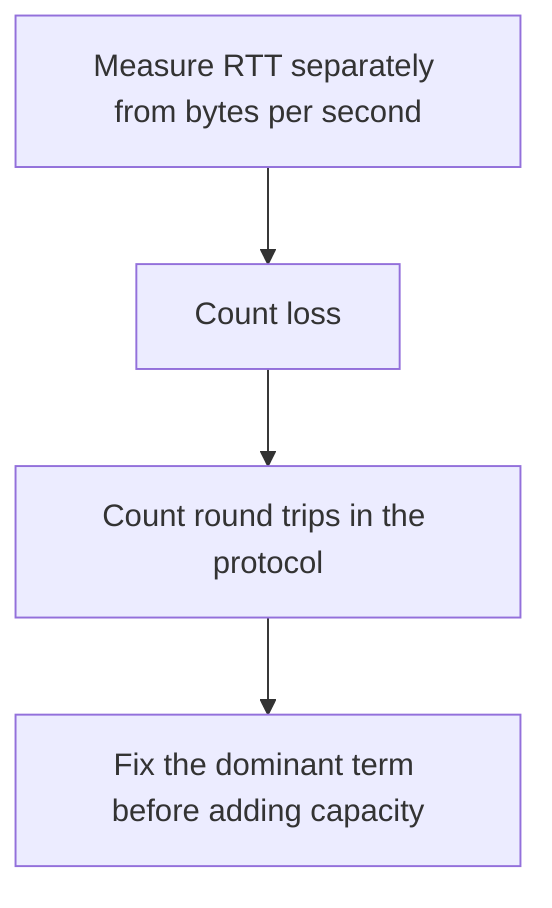

# D04-T023 — Latency, bandwidth, throughput and packet loss

Topic ID: `D04-T023`
Domain: Computer Networks
Subdomain: Latency, bandwidth, throughput and packet loss
Importance: core
Complexity: intermediate
Dependencies: `D04-T022`, `D04-T001`, `D01-T001`, `D01-T002`, `D03-T001`, `D03-T002`
Execution status of the code in section F: unexecuted

## A. Topic Overview

Latency is how long one unit of work takes. Bandwidth is the capacity of the pipe. Throughput is how much useful work completes per unit time. Packet loss forces retransmission and can cut throughput far below the bandwidth. A high-bandwidth path can still have terrible latency. Adding bandwidth does not fix a chatty protocol's round trips.

In production this shows up as follows: A cross-region database call with a 80 ms RTT and twenty queries spends 1.6 seconds in light-speed delay before bandwidth matters. Batching queries beats a bigger NIC.

Interviewers use Latency, bandwidth, throughput and packet loss to see whether you can state the failure mode, not only the definition. The failure to name is: a protocol that needs fifty round trips looking 'slow' on a high-bandwidth, high-latency link

Prerequisites: `D04-T022`, `D04-T001`, `D01-T001`, `D01-T002`, `D03-T001`, `D03-T002`. Later notes should link here instead of repeating the mechanism.

## B. First-Principles Explanation

Latency is how long one unit of work takes. Bandwidth is the capacity of the pipe. Throughput is how much useful work completes per unit time. Packet loss forces retransmission and can cut throughput far below the bandwidth. A high-bandwidth path can still have terrible latency. Adding bandwidth does not fix a chatty protocol's round trips.

The useful picture is: Bandwidth is how many lanes the highway has. Latency is how long the trip takes. Packet loss is lanes closing and forcing you to drive the stretch again.

What has to be true:

1. Measure RTT separately from bytes per second
2. Count loss
3. Count round trips in the protocol
4. Fix the dominant term before adding capacity

It works when those steps preserve one invariant. It fails when a protocol that needs fifty round trips looking 'slow' on a high-bandwidth, high-latency link. The alternative is: you buy bandwidth for a latency problem

## C. Internal Working and Architecture

Components involved: the caller, the state Latency, bandwidth, throughput and packet loss mutates or reads, and the observer that reports RTT, loss percent, and useful throughput versus link bandwidth.

Execution:

1. Measure RTT separately from bytes per second
2. Count loss
3. Count round trips in the protocol
4. Fix the dominant term before adding capacity

Data moves only along that path. A retry re-enters at step 1, so the operation must say what a duplicate does. Memory and locks stay inside this mechanism. Callers see the result or a typed error, not a half-updated invariant.

State to remember: choose this when you are explaining a performance number. Do not choose it when you buy bandwidth for a latency problem.

## D. Diagrams and Visual Models



Read the diagram from top to bottom. Each box is one step of Latency, bandwidth, throughput and packet loss. The failure mode (a protocol that needs fifty round trips looking 'slow' on a high-bandwidth, high-latency link) is what you look for when a later box never happens or happens twice.

## E. Examples and Analogies

Analogy: Bandwidth is how many lanes the highway has. Latency is how long the trip takes. Packet loss is lanes closing and forcing you to drive the stretch again.

Production example: A cross-region database call with a 80 ms RTT and twenty queries spends 1.6 seconds in light-speed delay before bandwidth matters. Batching queries beats a bigger NIC.

A small counterexample is enough in an interview. Show the input, apply the steps, and show the broken outcome if someone uses the mechanism outside its rule: a protocol that needs fifty round trips looking 'slow' on a high-bandwidth, high-latency link.

## F. Code Examples

The snippet is labeled unexecuted. It illustrates the shape of the idea. It is not a benchmark and it embeds no secret.

```python
def transfer_time(bytes_, bandwidth, rtt, trips):
    return trips * rtt + bytes_ / bandwidth
```

After the snippet, check RTT, loss percent, and useful throughput versus link bandwidth. If that signal moves the wrong way, the snippet is the wrong tool for the workload.

## G. Practical Backend Application

Use Latency, bandwidth, throughput and packet loss in a service when you are explaining a performance number.

A typical place is the production case already stated: A cross-region database call with a 80 ms RTT and twenty queries spends 1.6 seconds in light-speed delay before bandwidth matters. Batching queries beats a bigger NIC.

Operationally you alert on RTT, loss percent, and useful throughput versus link bandwidth. You do not alert only on process uptime. The dashboard should show the failure mode, a success rate, and the saturation signal (queue depth, lock wait, or latency) that predicts it.

## H. Advantages, Limitations and Trade-offs

| Choice | Benefit | Cost | Choose when | Avoid when |
| --- | --- | --- | --- | --- |
| Apply Latency, bandwidth, throughput and packet loss | you are explaining a performance number | Extra moving parts and a new failure mode | The failure you are preventing is already real | you buy bandwidth for a latency problem |
| Simpler alternative | Less code and fewer dependencies | a protocol that needs fifty round trips looking 'slow' on a high-bandwidth, high-latency link | The workload does not hit the limit | The invariant must hold under concurrency or failure |

Latency, bandwidth, throughput and packet loss is a trade. State the benefit and the cost in the same sentence when you propose it in a design review.

## I. Common Mistakes and Misconceptions

- Using throughput and bandwidth as synonyms.
- Ignoring loss.
- Averaging latency and hiding the tail.
- Treating a diagram of Latency, bandwidth, throughput and packet loss as proof that the invariant holds in production.
- Copying a default configuration without naming RTT, loss percent, and useful throughput versus link bandwidth.

## J. Debugging and Troubleshooting

Symptom: a protocol that needs fifty round trips looking 'slow' on a high-bandwidth, high-latency link

First check: RTT, loss percent, and useful throughput versus link bandwidth.

Then compare one healthy instance against one unhealthy instance. Confirm whether retries are duplicating work. Confirm whether a timeout is shorter than the work. Fix the invariant, then watch the same metric for a full peak, not only for the next minute.

Useful questions: did the step order in section C actually happen, or did a caller skip a step? Did a deploy change the data shape that Latency, bandwidth, throughput and packet loss assumes?

## K. Interview Preparation

### Beginner

#### Q1. What problem does Latency, bandwidth, throughput and packet loss solve?

**Answer:** Latency is how long one unit of work takes. Bandwidth is the capacity of the pipe. Throughput is how much useful work completes per unit time. Packet loss forces retransmission and can cut throughput far below the bandwidth. A high-bandwidth path can still have terrible latency. Adding bandwidth does not fix a chatty protocol's round trips. Without it, the usual backend failure is: a protocol that needs fifty round trips looking 'slow' on a high-bandwidth, high-latency link.

#### Q2. Where does Latency, bandwidth, throughput and packet loss sit on a request path?

**Answer:** Latency, bandwidth, throughput and packet loss is not a library you sprinkle on every call. you are explaining a performance number You notice it when RTT, loss percent, and useful throughput versus link bandwidth. Name the constraint that makes this choice correct. Say what you would measure to confirm it.

#### Q3. Give a concrete example of Latency, bandwidth, throughput and packet loss.

**Answer:** A cross-region database call with a 80 ms RTT and twenty queries spends 1.6 seconds in light-speed delay before bandwidth matters. Batching queries beats a bigger NIC. Walk the input, the state change, and the observable output. Name the constraint that makes this choice correct.

#### Q4. What is a common mix-up around Latency, bandwidth, throughput and packet loss?

**Answer:** a protocol that needs fifty round trips looking 'slow' on a high-bandwidth, high-latency link The corrective check is RTT, loss percent, and useful throughput versus link bandwidth. Name the constraint that makes this choice correct. Say what you would measure to confirm it. Say which alternative you rejected and why.

#### Q5. When would you skip Latency, bandwidth, throughput and packet loss?

**Answer:** you buy bandwidth for a latency problem Skipping is a decision with a measured cost, not a slogan. Name the constraint that makes this choice correct. Say what you would measure to confirm it. Say which alternative you rejected and why.

### Intermediate

#### Q1. What invariant makes Latency, bandwidth, throughput and packet loss correct?

**Answer:** Latency is how long one unit of work takes. Bandwidth is the capacity of the pipe. Throughput is how much useful work completes per unit time. Packet loss forces retransmission and can cut throughput far below the bandwidth. A high-bandwidth path can still have terrible latency. Adding bandwidth does not fix a chatty protocol's round trips. State the invariant before you name the tool.

#### Q2. How do you test Latency, bandwidth, throughput and packet loss?

**Answer:** Assert the failure mode directly: a protocol that needs fifty round trips looking 'slow' on a high-bandwidth, high-latency link. The assertion should watch RTT, loss percent, and useful throughput versus link bandwidth. Include a concurrent or retry case if the bug only appears then. Name the constraint that makes this choice correct.

#### Q3. What signal tells you Latency, bandwidth, throughput and packet loss is misbehaving in production?

**Answer:** Watch RTT, loss percent, and useful throughput versus link bandwidth. The user-visible symptom is usually a protocol that needs fifty round trips looking 'slow' on a high-bandwidth, high-latency link. Name the constraint that makes this choice correct. Say what you would measure to confirm it.

#### Q4. How would you introduce Latency, bandwidth, throughput and packet loss into a legacy service?

**Answer:** you are explaining a performance number Ship it behind a metric so you can compare the old path. Roll back if a protocol that needs fifty round trips looking 'slow' on a high-bandwidth, high-latency link gets worse. Name the constraint that makes this choice correct. Say what you would measure to confirm it.

#### Q5. What do you trade away by choosing Latency, bandwidth, throughput and packet loss?

**Answer:** you are explaining a performance number you buy bandwidth for a latency problem Say the cost in latency, storage, or operational load. Name the constraint that makes this choice correct. Say what you would measure to confirm it. Say which alternative you rejected and why.

### Advanced

#### Q1. What breaks if a dependency of Latency, bandwidth, throughput and packet loss is slow or down?

**Answer:** a protocol that needs fifty round trips looking 'slow' on a high-bandwidth, high-latency link Degrade using the rule: you buy bandwidth for a latency problem. Timeouts must be shorter than the caller's deadline. Name the constraint that makes this choice correct. Say what you would measure to confirm it.

#### Q2. How does Latency, bandwidth, throughput and packet loss behave under retries?

**Answer:** Retries repeat work, so Latency, bandwidth, throughput and packet loss must define what a duplicate does. a protocol that needs fifty round trips looking 'slow' on a high-bandwidth, high-latency link Idempotency keys or fences belong next to the write, not in a comment. Name the constraint that makes this choice correct. Say what you would measure to confirm it.

#### Q3. What is the capacity limit of Latency, bandwidth, throughput and packet loss?

**Answer:** The limit shows up as RTT, loss percent, and useful throughput versus link bandwidth. Add capacity only after you know whether the bottleneck is CPU, lock wait, or network. Name the constraint that makes this choice correct. Say what you would measure to confirm it.

#### Q4. How do you evolve Latency, bandwidth, throughput and packet loss without a flag day?

**Answer:** you are explaining a performance number Version the contract or the on-disk format. Readers should tolerate one old and one new shape during the rollout. Name the constraint that makes this choice correct. Say what you would measure to confirm it.

#### Q5. What security or correctness bug hides inside Latency, bandwidth, throughput and packet loss?

**Answer:** a protocol that needs fifty round trips looking 'slow' on a high-bandwidth, high-latency link Check authorization and tenancy at the same boundary as the mechanism. A cache or queue must not widen who can read the data. Name the constraint that makes this choice correct. Say what you would measure to confirm it.

### Scenario

#### Q1. Incident: a protocol that needs fifty round trips looking 'slow' on a high-bandwidth, high-latency link. What do you check first?

**Answer:** Start with RTT, loss percent, and useful throughput versus link bandwidth. Compare a good host and a bad host before you restart anything. Latency is how long one unit of work takes. Bandwidth is the capacity of the pipe. Throughput is how much useful work completes per unit time. Packet loss forces retransmission and can cut throughput far below the bandwidth. A high-bandwidth path can still have terrible latency. Adding bandwidth does not fix a chatty protocol's round trips.

#### Q2. A reviewer wants the clever version. What data settles it?

**Answer:** you are explaining a performance number you buy bandwidth for a latency problem Bring RTT, loss percent, and useful throughput versus link bandwidth from a load test or from production, not a slogan. Name the constraint that makes this choice correct. Say what you would measure to confirm it. Say which alternative you rejected and why.

#### Q3. You have one hour to explain Latency, bandwidth, throughput and packet loss at a whiteboard.

**Answer:** Draw the happy path in four boxes. Then draw the failure: a protocol that needs fifty round trips looking 'slow' on a high-bandwidth, high-latency link. End with the metric you would page on. Name the constraint that makes this choice correct.

#### Q4. The bug only appears under two concurrent callers.

**Answer:** a protocol that needs fifty round trips looking 'slow' on a high-bandwidth, high-latency link Reproduce with a barrier so both sides enter the critical window. Confirm the fix with RTT, loss percent, and useful throughput versus link bandwidth. Name the constraint that makes this choice correct. Say what you would measure to confirm it.

#### Q5. Leadership wants this on every service next week.

**Answer:** you buy bandwidth for a latency problem you are explaining a performance number Roll it out where the failure mode is already hurting users. Name the constraint that makes this choice correct. Say what you would measure to confirm it. Say which alternative you rejected and why.

### Follow-up

#### Q1. What did you assume about the data size or the clock?

**Answer:** Latency is how long one unit of work takes. Bandwidth is the capacity of the pipe. Throughput is how much useful work completes per unit time. Packet loss forces retransmission and can cut throughput far below the bandwidth. A high-bandwidth path can still have terrible latency. Adding bandwidth does not fix a chatty protocol's round trips. Clocks are not a total order across machines. State whether the algorithm needs bounded size or a single leader.

#### Q2. What would you measure after the change ships?

**Answer:** Page on RTT, loss percent, and useful throughput versus link bandwidth. Keep a before/after dashboard for one week. Alert on the failure mode, not only on CPU. Name the constraint that makes this choice correct.

#### Q3. Which neighboring topic did you deliberately not re-teach?

**Answer:** This note owns Latency, bandwidth, throughput and packet loss. Related identifiers are in section N. Shared ideas are linked, not copied. Name the constraint that makes this choice correct.

## L. Practical Exercises

Solutions are in `EXERCISES/solutions/D04-T023.md`, not in this section.

1. Whiteboard the four steps of Latency, bandwidth, throughput and packet loss and mark where `a protocol that needs fifty round trips looking 'slow' on a high-bandwidth, high-latency link` enters.
2. Read the snippet in section F and write the assertion that would catch that failure. The assertion must mention `RTT, loss percent, and useful throughput versus link bandwidth`.
3. Argue for or against using Latency, bandwidth, throughput and packet loss on a service you know. Use the choose and avoid rows from section H. Do not appeal to popularity.

## M. Revision Notes

- Mechanism: Latency is how long one unit of work takes.
- Failure: a protocol that needs fifty round trips looking 'slow' on a high-bandwidth, high-latency link
- Metric: RTT, loss percent, and useful throughput versus link bandwidth
- Choose when: you are explaining a performance number
- Avoid when: you buy bandwidth for a latency problem

## N. Related Topics

Dependencies to review first: `D04-T022`, `D04-T001`, `D01-T001`, `D01-T002`, `D03-T001`, `D03-T002`.

Shared ideas stay in those notes. This note does not restate them.

## O. Completion Criteria

- You can explain Latency, bandwidth, throughput and packet loss without reading this note, including the failure mode.
- You can draw the diagram in section D from memory.
- You can say when not to use it, using the avoid condition in section H.
- You can name the metric you would watch after shipping it.
