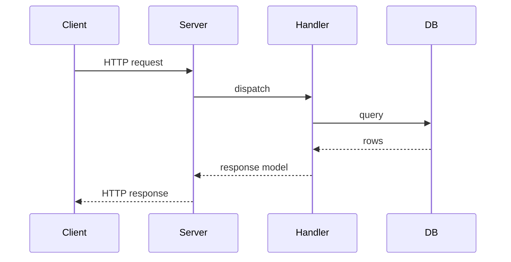

# D05-T002 — Request-response lifecycle

Topic ID: `D05-T002`
Domain: Backend Development Fundamentals
Subdomain: Request-response lifecycle
Importance: core
Complexity: intermediate
Dependencies: `D05-T001`, `D01-T001`, `D01-T002`, `D04-T001`, `D04-T002`

## A. Topic Overview

The request-response lifecycle is the end-to-end path of one HTTP call: connection accept, TLS, parsing, middleware, routing, handler work, serialization, and response flush. Every backend interview eventually asks you to narrate this path with timeouts and failure points.

## B. First-Principles Explanation

HTTP is stateless at the protocol layer; the server maps each request to a handler function or controller method. The OS accepts TCP, the framework reads bytes into an object model, business logic runs, and the framework writes status, headers, and body back. Keep-alive reuses connections; HTTP/2 multiplexes streams on one connection.

## C. Internal Working and Architecture

Thread-per-request servers assign a worker thread for the duration of the call. Event-loop servers (Node, asyncio) await I/O and must not block the loop on CPU or blocking JDBC. Servlet containers use thread pools; exhaustion manifests as 503 with queueing.

Deadlines should propagate: outer LB timeout > gateway > service handler > downstream client timeout.

## D. Diagrams and Visual Models



## E. Examples and Analogies

Like ordering at a counter: you place an order (request), the kitchen works (handler), you get a receipt (response). If the kitchen is slow, the counter may stop taking orders (503) or cancel your order (504).

## F. Code Examples

```python
import time
from typing import Callable

def with_timing(next_fn: Callable) -> Callable:
    def handler(request):
        start = time.perf_counter()
        response = next_fn(request)
        elapsed_ms = (time.perf_counter() - start) * 1000
        response.headers["Server-Timing"] = f"app;dur={elapsed_ms:.1f}"
        return response
    return handler
```

## G. Practical Backend Application

Add access logs at the edge with method, path, status, duration, and request id. Trace from ingress through outbound calls. Align client timeouts with server deadlines to avoid duplicate POSTs.

## H. Advantages, Limitations and Trade-offs

| Model | Pros | Cons |
| --- | --- | --- |
| Sync handler | Simple | Blocks threads on I/O |
| Async handler | Scales I/O | Blocking code starves loop |
| Streaming response | Memory efficient | Harder error handling mid-stream |

## I. Common Mistakes and Misconceptions

- Assuming 200 means business success.
- No timeout on outbound calls inside handlers.
- Reading entire upload into memory before size check.

## J. Debugging and Troubleshooting

Use `Server-Timing`, distributed traces, and LB access logs. Compare TTFB vs total time to see backend vs network delay.

## K. Interview Preparation

### Beginner

#### Q1. List the main phases of an HTTP request in a Java/Spring or Node service.

**Answer:** TCP/TLS accept, HTTP parse, middleware chain, route match, controller/handler, service and persistence, response serialization, flush to client. Each phase can fail independently with different status codes. Naming this sequence shows you understand where to attach auth, metrics, and timeouts.

#### Q2. Where does routing happen relative to middleware?

**Answer:** Middleware wraps the handler; routing selects which handler runs. Global middleware runs for all paths; route-specific middleware runs after match. Order determines whether anonymous health checks bypass auth.

#### Q3. What is the difference between connection close and response complete?

**Answer:** The response may be fully sent while the client still reads the body. Keep-alive returns the connection to the pool for another request. Premature client disconnect can abort server work unless you handle cancellation tokens.

#### Q4. Why do we set timeouts at multiple layers?

**Answer:** Each hop has its own clock: client, LB, gateway, service, database. If inner timeouts exceed outer, users see 504 while work continues, wasting resources and causing duplicate side effects. Inner deadlines should be shorter than outer.

#### Q5. How does HTTP/2 change the lifecycle?

**Answer:** One connection carries many streams; head-of-line blocking at TCP level is reduced. Handlers still execute per stream; connection-level settings apply to all streams. Graceful shutdown must drain all active streams.

### Intermediate

#### Q1. How do you propagate a request deadline to downstream HTTP calls?

**Answer:** Store deadline in request context; subtract elapsed time before each outbound call; pass `Timeout` header or use client libraries with per-call budgets. Cancel work when deadline exceeded. Log when child calls are skipped due to budget exhaustion.

#### Q2. Thread pool exhaustion symptoms?

**Answer:** Rising queue depth, slow accepts, 503 from reverse proxy, CPU not saturated. Fix by scaling replicas, reducing blocking calls, or switching to async I/O for wait-heavy workloads.

#### Q3. How does body parsing fit the lifecycle?

**Answer:** Parsers run after headers; size limits must run before reading unbounded bodies. JSON parsing errors become 400, not 500, if mapped correctly.

#### Q4. Server-Timing and tracing hooks?

**Answer:** Emit timing headers for browser devtools; OpenTelemetry spans around handler and DB calls. Start span at edge middleware.

#### Q5. Idempotency and retries in the lifecycle?

**Answer:** Retries may hit the same handler twice; safe methods and idempotency keys protect writes. Return 409 on duplicate key when appropriate.

### Advanced

#### Q1. Zero-downtime deploy interaction?

**Answer:** Old and new processes serve concurrently; readiness removes draining pods; in-flight requests complete within grace period. Handlers should honor cancellation when connections drop.

#### Q2. Security at lifecycle edges?

**Answer:** TLS termination point affects client cert visibility. Validate Host header to prevent cache poisoning. Limit request smuggling with strict parsing.

#### Q3. Streaming and chunked encoding?

**Answer:** Errors mid-stream cannot change status code; use trailers or separate error events in SSE/WebSocket patterns.

#### Q4. Incident: p99 latency up, errors flat?

**Answer:** Look for GC pauses, pool wait, lock contention, or slow dependency—not always error rate. Trace exemplars at p99.

#### Q5. ADR for switching to async stack?

**Answer:** Document blocking call audit, thread pool removal, and developer rules for JDBC in async contexts.

### Scenarios

#### Q1. Deploy spike, DB flat?

**Answer:** Check middleware order, new serializer, or feature flag default. Roll back if needed.

#### Q2. Mobile slow network?

**Answer:** Align timeouts; support range requests; compress JSON; paginate lists.

#### Q3. Audit?

**Answer:** Log who invoked mutating endpoints with request id and subject.

#### Q4. Traffic doubles?

**Answer:** Scale out; tune pools; shed optional middleware work under load.

#### Q5. Fat controller?

**Answer:** Move orchestration to service; keep HTTP mapping in controller.

### Follow-ups

#### Q1. API design?

**Answer:** Status codes and error bodies are part of the contract at the end of the lifecycle.

#### Q2. Databases?

**Answer:** Transactions should fit inside handler deadline; long work goes async.

#### Q3. Distributed systems?

**Answer:** One user request fans out; trace context must propagate on each hop.

## L. Practical Exercises

See `EXERCISES/D05-T002.md` and `EXERCISES/solutions/D05-T002.md`.

## M. Revision Notes

- Narrate path from socket to SQL and back.
- Timeouts nest inside-out.
- Middleware order matters.

## N. Related Topics

`D05-T003` middleware, `D04-*` HTTP/TCP, `D05-T023` correlation ids.

## O. Completion Criteria

- Draw sequence diagram with failure arrows.
- Explain 502 vs 504 vs 503.
- Set timeouts for chained HTTP calls.
