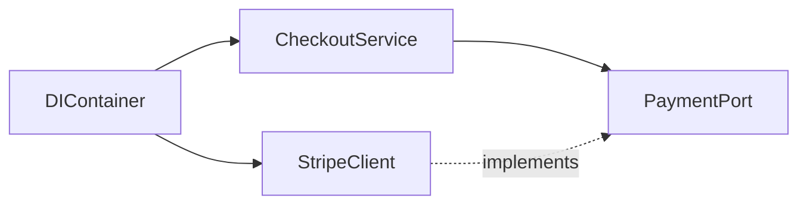

# D05-T005 — Dependency injection

Topic ID: `D05-T005`
Domain: Backend Development Fundamentals
Subdomain: Dependency injection
Importance: core
Complexity: intermediate
Dependencies: `D05-T004`, `D05-T001`, `D01-T001`, `D01-T002`, `D04-T001`, `D04-T002`
Execution status of the code in section F: illustrative (not executed in CI for this topic)

## A. Topic Overview

Dependency injection (DI) is how you supply collaborators to a class from the outside instead of constructing them with `new` inside the method body. The service depends on an interface (`PaymentPort`, `OrderRepository`); the composition root wires a concrete implementation at startup.

It exists because hard-coded construction couples business logic to infrastructure, makes unit tests painful, and hides required dependencies until runtime. Frameworks (Spring, ASP.NET Core, NestJS) provide containers; in Go you often wire manually in `main`.

Interviewers ask DI to see if you understand test doubles, composition roots, and why service locators are a code smell.

## B. First-Principles Explanation

An object needs a database, a clock, or an HTTP client to do its job. It can create those itself (tight coupling) or receive them via constructor parameters (injection). The **composition root** is the single place that knows which concrete types satisfy which interfaces.

Constructor injection is preferred: dependencies are explicit, immutable, and required for instantiation. Setter injection allows partially initialized objects; method injection suits rare strategy parameters.

DI containers resolve graphs: if `OrderService` needs `OrderRepository` and `Metrics`, the container constructs the tree once per scope (request or singleton).

## C. Internal Working and Architecture

At application startup, the container registers bindings (`OrderRepository` -> `PostgresOrderRepository`). When a request hits `OrderController`, the framework resolves `OrderService` with scoped dependencies. Request-scoped `DbConnection` is disposed after the response.

Testing replaces bindings with fakes: in-memory repository, fixed clock, stub payment client. No database or network is required for pure domain tests.

Anti-patterns: injecting the container itself (service locator), injecting ten unrelated dependencies (split the class), and binding concrete types everywhere so interfaces provide no seam.

## D. Diagrams and Visual Models



## E. Examples and Analogies

DI is like hiring staff for a kitchen: the chef (service) needs a supplier (repository). You do not make the chef fly to the farm mid-recipe; supplies are delivered to the station (constructor). Swap suppliers for a dinner service (test) without rewriting recipes.

## F. Code Examples

Illustrative snippet: constructor injection

```python
class Notifier:
    def send(self, user_id: int, message: str) -> None:
        raise NotImplementedError

class EmailNotifier(Notifier):
    def send(self, user_id: int, message: str) -> None:
        print("email", user_id, message)

class WelcomeService:
    def __init__(self, notifier: Notifier):
        self._notifier = notifier

    def onboard(self, user_id: int) -> None:
        self._notifier.send(user_id, "welcome")
```

## G. Practical Backend Application

Use DI for every external system: databases, caches, message brokers, feature flag clients, and clocks. Keep domain services free of framework imports where possible. Register real implementations in production and fakes in tests via the same interface.

## H. Advantages, Limitations and Trade-offs

| Choice | Benefit | Cost |
| --- | --- | --- |
| Constructor injection | Explicit deps | Long parameter lists if abused |
| DI framework | Auto-wiring | Magic, startup failures |
| Manual wiring in `main` | Clear graph | Boilerplate in large apps |

## I. Common Mistakes and Misconceptions

- Using `new` inside services for "just this once" until the whole codebase is untestable.
- Injecting concrete `PostgresRepo` instead of `OrderRepository` interface.
- Service locator hidden behind static `getInstance()`.

## J. Debugging and Troubleshooting

Startup failures (`UnsatisfiedDependency`) mean a missing binding or circular dependency. Break cycles by introducing an interface or event. Integration tests should use a test composition module.

## K. Interview Preparation

### Beginner

#### Q1. What is dependency injection?

**Answer:** It is supplying an object's collaborators from the outside rather than constructing them inside the class. The class depends on abstractions (interfaces) and receives concrete implementations at runtime. This makes dependencies visible in the constructor signature and easy to replace in tests. Interviewers expect you to contrast it with calling `new` inside business methods.

#### Q2. Why is DI useful in backend services?

**Answer:** Services integrate databases, queues, and third-party APIs. Hard-coding those clients prevents isolated unit tests and forces every test to stand up real infrastructure. Injection lets you pass fakes that record calls or return canned data. It also lets operations swap implementations (mock payment in staging) without changing domain code.

#### Q3. What is a composition root?

**Answer:** It is the single module (often `main` or a `@Configuration` class) that wires interfaces to implementations. Domain layers should not know which database driver is used. Centralizing construction avoids scattered `new` calls and makes the dependency graph reviewable. In microservices, each service has its own composition root.

#### Q4. Constructor versus setter injection?

**Answer:** Constructor injection makes required dependencies mandatory and fields `final`/immutable. Setter injection allows reconfiguration after construction and can leave objects half-built. Most backend style guides prefer constructors for required deps and optional config via explicit methods. Frameworks often autowire constructors by default.

#### Q5. What is a DI container?

**Answer:** A registry that knows how to build object graphs: given `OrderController`, it resolves `OrderService`, then `OrderRepository`, then `DataSource`. Containers manage lifetimes (singleton, per-request). They reduce boilerplate but can hide dependencies until you fail at startup. Understanding lifetimes prevents sharing mutable request state in singletons.

### Intermediate

#### Q1. How does DI interact with the request lifecycle?

**Answer:** Web frameworks create a scope per HTTP request. Repositories and unit-of-work bind to that scope so connections are not shared across threads. Singletons must be thread-safe and must not hold request-specific state. Mis-scoped beans cause data leaks between tenants or users.

#### Q2. How do you test with DI?

**Answer:** Register test doubles in a test module or pass fakes directly when constructing the service under test. Use interface segregation so fakes only implement methods the test needs. Contract tests still verify real adapters against sandboxes. Avoid `@SpringBootTest` for every unit test; slice tests are faster.

#### Q3. What is the service locator anti-pattern?

**Answer:** Code calls `Container.get(Repo.class)` inside methods, hiding dependencies. Readers cannot see requirements from the constructor. Refactoring becomes risky because usages are dynamic. Prefer explicit injection; locators are legacy patterns in some frameworks.

#### Q4. How does DI help prepare a monolith for extraction?

**Answer:** Clear interfaces around bounded contexts become remote clients later. If `BillingService` already depends on `InventoryPort`, you can replace the local implementation with HTTP without rewriting rules. DI boundaries mirror team boundaries.

#### Q5. Circular dependencies—how do you fix them?

**Answer:** Two services depending on each other indicate a modeling problem. Extract shared logic to a third component, use events, or depend on interfaces with lazy proxies as a last resort. Spring allows `@Lazy` but fixing the model is better.

### Advanced

#### Q1. DI in zero-downtime deploys?

**Answer:** New binaries must wire the same interfaces; config selects endpoints. Feature flags injected as services allow behavior toggles without redeploying. Health checks should verify critical bindings (can connect to DB) at readiness time.

#### Q2. Security implications?

**Answer:** Do not inject raw user input into class selection (dynamic plugin loading) without validation. Ensure authorization services are always injected, not optionally null. Secrets belong in factory-created clients, not in injectable strings logged by mistake.

#### Q3. DI and idempotency?

**Answer:** Inject a deduplication store or id generator service so handlers stay pure. Clock and randomness should be injected interfaces for deterministic tests of retry logic.

#### Q4. Debugging production with DI?

**Answer:** Log which implementation is active (provider name) at info level during startup. Miswired staging credentials are a common incident. Compare startup logs between good and bad pods.

#### Q5. ADR for adopting a new container?

**Answer:** Document why switching frameworks, migration steps for modules, and how test harnesses change. Note impact on startup time and developer experience.

### Scenarios

#### Q1. Post-deploy NPE in `PaymentService`?

**Answer:** Likely missing binding for new dependency added to constructor. Roll back or hotfix registration. Add startup test that boots the full context in CI.

#### Q2. Slow networks?

**Answer:** Inject timeout-aware HTTP clients with configured deadlines per environment. Do not create new clients per request without pooling.

#### Q3. Audit trail?

**Answer:** Inject an `AuditLogger` port implemented with append-only storage. Controllers should not write audit SQL directly.

#### Q4. Traffic surge?

**Answer:** Ensure singleton clients use connection pools; scoped repos do not open unbounded connections. Tune pool sizes via injected config objects.

#### Q5. Controller vs service?

**Answer:** Inject services into controllers only; repositories into services. Controllers should not receive repositories directly if rules belong in the service layer.

### Follow-ups

#### Q1. API design?

**Answer:** Public DTOs are separate from injected domain types; mappers sit at the edge.

#### Q2. Databases?

**Answer:** Inject `DataSource` or `SessionFactory`; transactions on application services.

#### Q3. Distributed systems?

**Answer:** Replace local interface implementations with RPC clients using the same port abstraction.

## L. Practical Exercises

Solutions: `EXERCISES/solutions/D05-T005.md`.

### Exercise 1 — implementation

Replace `new Database()` inside a service with constructor injection and a fake for tests.

### Exercise 2 — debugging

Startup fails with unsatisfied dependency after adding a new client—how do you localize the missing binding?

### Exercise 3 — trade-off

Service locator versus constructor injection for a legacy codebase.

## M. Revision Notes

- Depend on interfaces; wire in composition root.
- Match bean scope to request lifecycle.
- Fakes enable fast unit tests.

## N. Related Topics

`D05-T004` layering, `D05-T006` configuration, testing topics.

## O. Completion Criteria

- Sketch a DI graph for checkout.
- Write a unit test with a fake repository.
- Explain service locator drawbacks.
