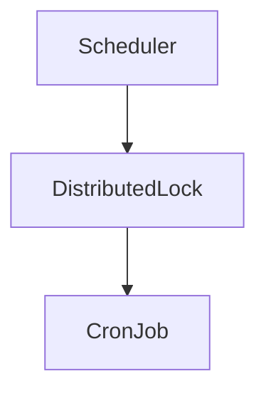

# D05-T017 — Scheduled jobs and cron

Topic ID: `D05-T017`
Domain: Backend Development Fundamentals
Subdomain: Scheduled jobs and cron
Importance: core
Complexity: intermediate
Dependencies: `D05-T016`, `D05-T001`, `D01-T001`, `D01-T002`, `D04-T001`, `D04-T002`
Execution status of the code in section F: illustrative (not executed as part of this generator run)

## A. Topic Overview

Scheduled jobs and cron is how backend engineers structure reliable behavior around runs recurring tasks on a schedule with single-leader execution and observability. Clients, operators, and other services all depend on predictable boundaries here.

The concept exists because production APIs run under partial failure, concurrent deploys, and heterogeneous clients. Without explicit design for scheduled jobs and cron, teams ship handlers that mix transport, business rules, and infrastructure calls.

In production this shows up in incident postmortems, on-call pages, and interview system-design questions. Strong candidates name layers, failure modes, and observability hooks instead of only framework trivia.

Prerequisites: `D05-T016`, `D05-T001`, `D01-T001`, `D01-T002`, `D04-T001`, `D04-T002`. Later API and database topics assume you can place this concern in the request path and in service boundaries.

## B. First-Principles Explanation

A backend process is a state machine driven by inbound events (HTTP requests, queue messages, cron ticks). Each event should be parsed, authorized, executed against domain rules, and translated into an outbound effect (response, enqueue, email).

Scheduled jobs and cron answers where that work lives and what invariants hold. The alternative is a single "god handler" that becomes untestable and unsafe under change.

What happens internally for a typical HTTP call:

1. The runtime accepts a connection and parses the request line and headers.
2. Middleware establishes security context, deadlines, and logging fields.
3. The router selects a handler based on method and path.
4. The controller maps DTOs, the service enforces rules, the repository talks to storage.
5. Errors map to stable responses; success serializes to the wire format.

Why it works: separation of concerns lets you change persistence without changing clients and lets you test rules without a network. Limitations: too many layers add indirection; too few layers hide security and consistency bugs until production.

Terms: **DTO** is a transport shape. **Domain model** encodes business truth. **Middleware** wraps handlers. **Dependency injection** supplies implementations of interfaces.

## C. Internal Working and Architecture

Components:

- Ingress: load balancer, TLS termination, optional API gateway.
- Framework pipeline: router, middleware stack, exception handlers.
- Application core: services orchestrating repositories and external clients.
- Egress: serializers, cache, message publishers, email/SMS providers.
- Platform: config, secrets, health endpoints, metrics, and graceful lifecycle.

Execution threads or async tasks handle concurrent requests. Each request should carry its own context object (identity, correlation id, deadline). Shared mutable singletons without careful design cause races and test flakiness.

Data flow: bytes on the wire become typed input, domain operations mutate or read state, and typed output becomes bytes again. Side effects (email, jobs) should be explicit and usually asynchronous for latency-sensitive paths.

State: handlers should be stateless between requests; state lives in databases, caches, and queues. Background workers maintain consumer offsets and job status tables.

Memory and I/O: parsing large bodies streams to disk or object storage; connection pools bound open sockets to the database; thread pools bound concurrent blocking calls.

## D. Diagrams and Visual Models



Read the diagram as the happy path. Failure branches should short-circuit to mapped errors, logs with correlation identifiers, and metrics increments on the failing dependency.

## E. Examples and Analogies

Analogy: Scheduled jobs and cron is like airport security and boarding passes. Security (auth) checks identity; the gate agent (controller) scans the pass; baggage loading (repository) happens out of sight; delays are announced consistently (error mapping).

Backend example: a checkout endpoint validates the cart, reserves inventory in a transaction, enqueues a payment capture job, and returns 202 with a poll URL. Each step belongs to a different layer with explicit failure handling.

Do not put SQL in controllers. Do not leak database ids into authorization without checking ownership. Do not log secrets or full payment payloads.

## F. Code Examples

Illustrative snippet: cron with UTC and jitter

```python
CRON_NIGHTLY = "0 2 * * *"  # 02:00 UTC

def should_run(instance_id: str, leader: str) -> bool:
    return instance_id == leader
```

How to run: adapt the snippet into your service test harness; these samples are intentionally small. Expected behavior follows docstrings and comments in the snippet.

Important lines: boundary validation happens before domain calls; errors are raised as domain or value errors and mapped centrally; side effects are represented explicitly (jobs, providers).

Edge cases: missing headers, duplicate job delivery, pool timeout under load, and deploy SIGTERM while requests are active.

## G. Practical Backend Application

On call you will see this topic when latency grows, errors cluster on one route, or a deploy causes readiness flaps. Instrument request duration, dependency errors, and saturation (pool wait, thread queue).

Concurrent requests isolate per-request context; global caches need TTLs and stampede protection. Error handling should distinguish client mistakes from server misconfiguration.

Security: fail closed on auth, validate all untrusted input, and sanitize output encodings for HTML contexts. Observability: structured logs with correlation ids, RED metrics per route, and traces across outbound HTTP and SQL.

Scaling: horizontal replicas require sticky sessions only when you mistakenly store session state in memory; prefer external session stores or stateless JWT with short TTL and refresh flows.

## H. Advantages, Limitations and Trade-offs

| Choice | Benefit | Cost | Choose when | Avoid when |
| --- | --- | --- | --- | --- |
| Strict layering | Testable, clear ownership | More classes and mapping | Teams > 3, long-lived APIs | Throwaway prototypes |
| Fat controllers | Fast initial coding | Hidden rules, poor tests | Spikes only | Regulated or payment domains |
| Sync external calls | Simple mental model | Tail latency spikes | Low fan-out | Many chained dependencies |
| Async jobs | Responsive APIs | Complexity, duplicates | Email, reports, webhooks | Must read-your-writes instantly |
| Fail closed | Safer under attack | Harder DX | Public internet | Internal admin with mTLS |

Under load, the first bottleneck is often pool or thread exhaustion, not CPU on business logic.

Failure modes: retry storms, duplicate processing, partial transaction commit, and cascading timeouts when degradation is not designed.

## I. Common Mistakes and Misconceptions

- Skipping authorization because authentication succeeded.
- Using offset pagination on high-churn feeds and calling it "random bugs".
- Storing secrets in environment variables baked into images instead of a secret manager.
- Treating health checks as optional; Kubernetes will route traffic to broken pods.
- Ignoring graceful shutdown and wondering why deploys cause 502s.
- Logging entire request bodies containing passwords or tokens.

Weak interview answers quote framework marketing. Strong answers walk through a request and point to concrete failure and testing strategies.

## J. Debugging and Troubleshooting

Symptoms: elevated 5xx on one route, rising pool wait time, cron did not run, clients see stale data, traces break across services.

Diagnosis:

1. Find a failing trace id or request id in access logs.
2. Check deploy and config change timeline against metric shifts.
3. Reproduce locally with integration tests and recorded fixtures.
4. Classify: client error, dependency outage, resource saturation, or logic bug.

Mitigation: rollback, scale, disable non-critical features, extend timeouts only as a temporary measure while fixing root cause.

Metrics: golden signals per service (latency, traffic, errors, saturation) plus business KPIs (successful checkouts, sent notifications).

## K. Interview Preparation

### Beginner

#### Q1. What is Scheduled jobs and cron in one sentence a junior engineer would understand?

**Answer:** Scheduled jobs and cron is the backend idea that runs recurring tasks on a schedule with single-leader execution and observability. It exists because HTTP services are stateless processes that must coordinate with clients, databases, and other services under failure and load. You see it in every production API: the framework hook, the config flag, or the middleware that makes behavior consistent across handlers. Interviewers use it to check whether you can name responsibilities and boundaries, not only buzzwords from a tutorial. In interviews, tie the idea to a concrete production symptom such as latency, a 500 error, or a deploy rollback, not only to framework vocabulary. In interviews, tie the idea to a concrete production symptom such as latency, a 500 error, or a deploy rollback, not only to framework vocabulary. In interviews, tie the idea to a concrete production symptom such as latency, a 500 error, or a deploy rollback, not only to framework vocabulary.

#### Q2. Where does Scheduled jobs and cron sit in a typical three-tier web application?

**Answer:** The client talks to an edge load balancer, then to your application process, then to data stores and third parties. Scheduled jobs and cron usually lives in the application tier: routing, middleware, domain services, or infrastructure glue around handlers. It is not the database schema itself, though it influences how you query and how you expose results to clients. A clear answer names ingress, handler, service, repository, and egress without collapsing those layers into one class. In interviews, tie the idea to a concrete production symptom such as latency, a 500 error, or a deploy rollback, not only to framework vocabulary. In interviews, tie the idea to a concrete production symptom such as latency, a 500 error, or a deploy rollback, not only to framework vocabulary. In interviews, tie the idea to a concrete production symptom such as latency, a 500 error, or a deploy rollback, not only to framework vocabulary.

#### Q3. What is the difference between configuration and code for Scheduled jobs and cron?

**Answer:** Code encodes invariant rules and structure; configuration selects behavior per environment without recompiling. For Scheduled jobs and cron, misconfiguration often causes outages that code review would never catch, such as wrong URLs, disabled checks, or pool sizes set to zero. Twelve-factor style apps read config from the environment at startup and fail fast if required values are missing. Interviewers want you to say that secrets are configuration too, but they must not live in git or in client-visible responses. In interviews, tie the idea to a concrete production symptom such as latency, a 500 error, or a deploy rollback, not only to framework vocabulary. In interviews, tie the idea to a concrete production symptom such as latency, a 500 error, or a deploy rollback, not only to framework vocabulary. In interviews, tie the idea to a concrete production symptom such as latency, a 500 error, or a deploy rollback, not only to framework vocabulary.

#### Q4. What HTTP status codes commonly appear when Scheduled jobs and cron is misimplemented?

**Answer:** 400 series mean the client sent something the server refuses to process: validation, auth, or unsupported versions. 500 series mean the server failed while handling an otherwise well-formed request: uncaught exceptions, dependency timeouts, or broken pools. 502 and 503 often mean the instance is draining, overloaded, or failing readiness while the process is still alive. When discussing Scheduled jobs and cron, map each failure mode to a status and a stable error body so clients and SREs can act. In interviews, tie the idea to a concrete production symptom such as latency, a 500 error, or a deploy rollback, not only to framework vocabulary. In interviews, tie the idea to a concrete production symptom such as latency, a 500 error, or a deploy rollback, not only to framework vocabulary. In interviews, tie the idea to a concrete production symptom such as latency, a 500 error, or a deploy rollback, not only to framework vocabulary.

#### Q5. Why is observability part of Scheduled jobs and cron rather than an afterthought?

**Answer:** Logs, metrics, and traces explain what the service did for a single request and how the fleet behaves under load. Without correlation across layers, debugging Scheduled jobs and cron issues becomes guesswork across grep and dashboards. Structured logs with request identifiers let you connect a user report to a specific handler span and downstream query. Production readiness means you can answer how often a path fails, how slow it is, and whether a deploy caused a regression. In interviews, tie the idea to a concrete production symptom such as latency, a 500 error, or a deploy rollback, not only to framework vocabulary. In interviews, tie the idea to a concrete production symptom such as latency, a 500 error, or a deploy rollback, not only to framework vocabulary. In interviews, tie the idea to a concrete production symptom such as latency, a 500 error, or a deploy rollback, not only to framework vocabulary.

### Intermediate

#### Q1. How does Scheduled jobs and cron interact with middleware and the request lifecycle?

**Answer:** Middleware runs as a nested chain around the handler: authentication, logging, panic recovery, and timeouts execute before and after business logic. Scheduled jobs and cron often registers as middleware, a filter, or an aspect that sees the request before the controller method runs. Order matters: a body-size limit must run before parsers allocate unbounded memory; auth must run before authorization checks on resources. Interviewers expect you to sketch inbound parsing, handler execution, outbound serialization, and where errors short-circuit the chain. In interviews, tie the idea to a concrete production symptom such as latency, a 500 error, or a deploy rollback, not only to framework vocabulary. In interviews, tie the idea to a concrete production symptom such as latency, a 500 error, or a deploy rollback, not only to framework vocabulary. In interviews, tie the idea to a concrete production symptom such as latency, a 500 error, or a deploy rollback, not only to framework vocabulary.

#### Q2. How would you test Scheduled jobs and cron without hitting production dependencies?

**Answer:** Unit tests substitute fakes for interfaces: in-memory repositories, stub HTTP clients, and clock interfaces for time-based logic. Contract tests verify serializers and error mapping against golden JSON fixtures so refactors do not silently change API behavior. Integration tests spin up real databases or brokers in containers for pool behavior, migrations, and transaction boundaries. For Scheduled jobs and cron, also test failure injection: dependency timeout, partial outage, and invalid config at startup. In interviews, tie the idea to a concrete production symptom such as latency, a 500 error, or a deploy rollback, not only to framework vocabulary. In interviews, tie the idea to a concrete production symptom such as latency, a 500 error, or a deploy rollback, not only to framework vocabulary. In interviews, tie the idea to a concrete production symptom such as latency, a 500 error, or a deploy rollback, not only to framework vocabulary.

#### Q3. What trade-offs appear when you enable stricter behavior around Scheduled jobs and cron?

**Answer:** Stricter validation and auth reduce security incidents and data corruption but increase client integration work and support tickets. Failing closed on misconfiguration prevents subtle partial outages but can block deploys until secrets and flags are correct. More logging improves debuggability but raises cost and risks leaking sensitive fields unless you redact deliberately. The right default for Scheduled jobs and cron is usually strict at the boundary and explicit in the domain model, with feature flags only for reversible product behavior. In interviews, tie the idea to a concrete production symptom such as latency, a 500 error, or a deploy rollback, not only to framework vocabulary. In interviews, tie the idea to a concrete production symptom such as latency, a 500 error, or a deploy rollback, not only to framework vocabulary. In interviews, tie the idea to a concrete production symptom such as latency, a 500 error, or a deploy rollback, not only to framework vocabulary.

#### Q4. How does Scheduled jobs and cron affect scalability and tail latency?

**Answer:** Shared connection pools and synchronous calls to slow dependencies turn per-request work into queueing behind exhausted threads. Caching and pagination reduce database load but introduce staleness and consistency questions you must document. Background work moves latency out of the user path but requires idempotency, retries, and dead-letter handling. When scaling Scheduled jobs and cron, measure p95 and p99, not averages, because tail latency drives timeouts and retries that amplify load. In interviews, tie the idea to a concrete production symptom such as latency, a 500 error, or a deploy rollback, not only to framework vocabulary. In interviews, tie the idea to a concrete production symptom such as latency, a 500 error, or a deploy rollback, not only to framework vocabulary. In interviews, tie the idea to a concrete production symptom such as latency, a 500 error, or a deploy rollback, not only to framework vocabulary.

#### Q5. How do you keep Scheduled jobs and cron consistent across multiple services in a system?

**Answer:** Shared libraries for error shapes and logging fields help, but versioning those libraries is itself a deployment problem. Platform standards (OpenAPI, JSON log schema, trace propagation headers) beat ad hoc copy-paste from service to service. Governance uses linters, CI checks, and service templates so new repos start with the same middleware and health endpoints. For Scheduled jobs and cron, document the golden path in an internal guide and enforce it with code review checklists and automated conformance tests. In interviews, tie the idea to a concrete production symptom such as latency, a 500 error, or a deploy rollback, not only to framework vocabulary. In interviews, tie the idea to a concrete production symptom such as latency, a 500 error, or a deploy rollback, not only to framework vocabulary. In interviews, tie the idea to a concrete production symptom such as latency, a 500 error, or a deploy rollback, not only to framework vocabulary.

### Advanced

#### Q1. How would you design Scheduled jobs and cron for zero-downtime deploys on Kubernetes?

**Answer:** Rollouts use readiness probes so new pods only receive traffic when dependencies and migrations are satisfied. Graceful shutdown stops accepting new connections, waits for in-flight requests up to a bounded deadline, then closes pools. Feature flags and API versioning let you ship code before exposing behavior, reducing the blast radius of incompatible changes. Scheduled jobs and cron must cooperate with SIGTERM handling: workers finish or cancel work predictably instead of killing mid-transaction. In interviews, tie the idea to a concrete production symptom such as latency, a 500 error, or a deploy rollback, not only to framework vocabulary. In interviews, tie the idea to a concrete production symptom such as latency, a 500 error, or a deploy rollback, not only to framework vocabulary. In interviews, tie the idea to a concrete production symptom such as latency, a 500 error, or a deploy rollback, not only to framework vocabulary.

#### Q2. What failure modes of Scheduled jobs and cron become security issues?

**Answer:** Trusting client input without validation leads to injection, SSRF, and authorization bypass when object references are guessable. Verbose errors and stack traces in responses leak implementation details attackers use to craft exploits. Missing auth on admin endpoints and debug routes are recurring penetration-test findings tied to routing mistakes. Security review for Scheduled jobs and cron asks who can trigger the path, what data crosses trust boundaries, and what is logged. In interviews, tie the idea to a concrete production symptom such as latency, a 500 error, or a deploy rollback, not only to framework vocabulary. In interviews, tie the idea to a concrete production symptom such as latency, a 500 error, or a deploy rollback, not only to framework vocabulary. In interviews, tie the idea to a concrete production symptom such as latency, a 500 error, or a deploy rollback, not only to framework vocabulary.

#### Q3. How does Scheduled jobs and cron relate to idempotency and exactly-once illusions?

**Answer:** Networks retry: clients, gateways, and message brokers may deliver the same logical operation more than once. Idempotent handlers and deduplication keys make retries safe; non-idempotent side effects require outbox or saga patterns. Exactly-once end-to-end is not achievable; you design for at-least-once delivery with idempotent consumers. When Scheduled jobs and cron touches writes, state the idempotency contract in the API and enforce it in the service layer, not only in documentation. In interviews, tie the idea to a concrete production symptom such as latency, a 500 error, or a deploy rollback, not only to framework vocabulary. In interviews, tie the idea to a concrete production symptom such as latency, a 500 error, or a deploy rollback, not only to framework vocabulary. In interviews, tie the idea to a concrete production symptom such as latency, a 500 error, or a deploy rollback, not only to framework vocabulary.

#### Q4. How would you debug a production incident where Scheduled jobs and cron is the suspected root cause?

**Answer:** Start from a single trace or request id and walk forward through logs across services with the same correlation identifier. Compare canary versus baseline metrics around the deploy window: error rate, latency, pool wait time, and queue depth. Reproduce with integration tests using recorded traffic, redacted, to see whether config or code changed behavior. Mitigate by rollback, traffic shift, tightening limits, or disabling a feature flag while you fix forward with a patch. In interviews, tie the idea to a concrete production symptom such as latency, a 500 error, or a deploy rollback, not only to framework vocabulary. In interviews, tie the idea to a concrete production symptom such as latency, a 500 error, or a deploy rollback, not only to framework vocabulary. In interviews, tie the idea to a concrete production symptom such as latency, a 500 error, or a deploy rollback, not only to framework vocabulary.

#### Q5. What would you put in an architecture decision record for changing Scheduled jobs and cron?

**Answer:** Context describes the pain: incidents, toil, or scaling limits that motivate the change. Decision states the chosen approach, alternatives rejected, and consequences for clients, operators, and other teams. Rollout plan covers migration steps, monitoring, and rollback triggers with explicit owners and dates. For Scheduled jobs and cron, include compatibility guarantees, config keys, and how on-call will detect misconfiguration after merge. In interviews, tie the idea to a concrete production symptom such as latency, a 500 error, or a deploy rollback, not only to framework vocabulary. In interviews, tie the idea to a concrete production symptom such as latency, a 500 error, or a deploy rollback, not only to framework vocabulary. In interviews, tie the idea to a concrete production symptom such as latency, a 500 error, or a deploy rollback, not only to framework vocabulary.

### Scenarios

#### Q1. After a deploy, error rate spikes on one endpoint related to Scheduled jobs and cron. Database metrics are flat. What do you do first?

**Answer:** Confirm the spike is real in the SLI dashboard and isolate which version, region, and pod class introduced it. Pull exemplar traces and logs for failing requests and compare payload shapes with the previous release. Check recent config and secret rotations even if code did not change, because platforms often deploy config independently. If user impact is high, roll back or scale out while you diff middleware order, feature flags, and dependency timeouts. In interviews, tie the idea to a concrete production symptom such as latency, a 500 error, or a deploy rollback, not only to framework vocabulary. In interviews, tie the idea to a concrete production symptom such as latency, a 500 error, or a deploy rollback, not only to framework vocabulary. In interviews, tie the idea to a concrete production symptom such as latency, a 500 error, or a deploy rollback, not only to framework vocabulary.

#### Q2. A mobile client reports intermittent failures only on slow networks. How could Scheduled jobs and cron contribute?

**Answer:** Short server-side timeouts may abort work the client is still retrying, producing duplicate operations or confusing 504 responses. Missing idempotency on POST combined with client retries can create duplicate rows that look like flaky reads. Large payloads without compression or pagination waste bandwidth and fail on high-latency links before the server sees them. Fix by aligning client timeouts with server deadlines, returning retry hints, and making Scheduled jobs and cron behavior explicit in API docs. In interviews, tie the idea to a concrete production symptom such as latency, a 500 error, or a deploy rollback, not only to framework vocabulary. In interviews, tie the idea to a concrete production symptom such as latency, a 500 error, or a deploy rollback, not only to framework vocabulary. In interviews, tie the idea to a concrete production symptom such as latency, a 500 error, or a deploy rollback, not only to framework vocabulary.

#### Q3. Finance asks for an audit trail of who changed sensitive settings tied to Scheduled jobs and cron. What do you build?

**Answer:** Append-only audit logs with actor identity, timestamp, before and after values, and a tamper-evident store or SIEM integration. Separate admin APIs with stronger auth and rate limits from public routes; never reuse session cookies across surfaces. Configuration changes go through pull requests for static config and through approved workflows for runtime toggles. Retention and access to audit data are themselves compliance requirements; design queries auditors can run without production shell access. In interviews, tie the idea to a concrete production symptom such as latency, a 500 error, or a deploy rollback, not only to framework vocabulary. In interviews, tie the idea to a concrete production symptom such as latency, a 500 error, or a deploy rollback, not only to framework vocabulary. In interviews, tie the idea to a concrete production symptom such as latency, a 500 error, or a deploy rollback, not only to framework vocabulary.

#### Q4. Traffic doubles overnight after a marketing event. Which Scheduled jobs and cron knobs do you turn?

**Answer:** Scale replicas horizontally and verify autoscaling signals use readiness, not only CPU, so bad pods do not amplify errors. Tune pool sizes and thread pools using Little's law intuition: concurrency equals throughput times latency. Enable caching, pagination defaults, and circuit breaking on non-critical dependencies to shed load gracefully. Communicate degraded modes to product if you must disable expensive features to protect checkout and auth paths. In interviews, tie the idea to a concrete production symptom such as latency, a 500 error, or a deploy rollback, not only to framework vocabulary. In interviews, tie the idea to a concrete production symptom such as latency, a 500 error, or a deploy rollback, not only to framework vocabulary. In interviews, tie the idea to a concrete production symptom such as latency, a 500 error, or a deploy rollback, not only to framework vocabulary.

#### Q5. Two teams disagree on whether logic belongs in controllers or services for Scheduled jobs and cron. How do you decide?

**Answer:** Controllers adapt HTTP to domain calls: status codes, headers, and DTO mapping stay thin. Services own business rules, transactions, and orchestration across repositories and external clients. Repositories isolate persistence queries and should not know about HTTP headers or JSON field naming. For Scheduled jobs and cron, draw a sequence diagram of one happy path and one failure path; whichever layer must change for a new rule owns that rule. In interviews, tie the idea to a concrete production symptom such as latency, a 500 error, or a deploy rollback, not only to framework vocabulary. In interviews, tie the idea to a concrete production symptom such as latency, a 500 error, or a deploy rollback, not only to framework vocabulary. In interviews, tie the idea to a concrete production symptom such as latency, a 500 error, or a deploy rollback, not only to framework vocabulary.

### Follow-ups

#### Q1. How does Scheduled jobs and cron connect to API design domain topics?

**Answer:** Public contracts live in OpenAPI and protobuf definitions that outlive any single service implementation. Consistent error models and pagination parameters are cross-cutting API concerns even when implemented in middleware. Versioning and deprecation policies prevent clients from breaking when you evolve {t}-related behavior. See domain six notes for REST constraints, idempotency keys, and rate limiting that complement this topic. In interviews, tie the idea to a concrete production symptom such as latency, a 500 error, or a deploy rollback, not only to framework vocabulary. In interviews, tie the idea to a concrete production symptom such as latency, a 500 error, or a deploy rollback, not only to framework vocabulary. In interviews, tie the idea to a concrete production symptom such as latency, a 500 error, or a deploy rollback, not only to framework vocabulary.

#### Q2. How does Scheduled jobs and cron connect to databases and transactions?

**Answer:** Connection pools bound concurrent queries; mis-sized pools cause wait timeouts that look like application bugs. Transaction boundaries belong in the service layer so controllers do not commit partial work across multiple repositories. Read replicas and caching change consistency guarantees you must explain in API behavior. See database domain notes for isolation levels, indexes that make pagination efficient, and migration safety. In interviews, tie the idea to a concrete production symptom such as latency, a 500 error, or a deploy rollback, not only to framework vocabulary. In interviews, tie the idea to a concrete production symptom such as latency, a 500 error, or a deploy rollback, not only to framework vocabulary. In interviews, tie the idea to a concrete production symptom such as latency, a 500 error, or a deploy rollback, not only to framework vocabulary.

#### Q3. How does Scheduled jobs and cron connect to distributed systems concerns?

**Answer:** Clock skew, partial failures, and split brain make naive assumptions about synchronous calls unsafe at scale. Sagas, outbox, and event-driven designs move work across services with explicit compensation steps. Observability with trace propagation is mandatory when a user request fans out to dozens of internal calls. Mature Scheduled jobs and cron design assumes failure is normal and makes behavior predictable for operators and clients. In interviews, tie the idea to a concrete production symptom such as latency, a 500 error, or a deploy rollback, not only to framework vocabulary. In interviews, tie the idea to a concrete production symptom such as latency, a 500 error, or a deploy rollback, not only to framework vocabulary. In interviews, tie the idea to a concrete production symptom such as latency, a 500 error, or a deploy rollback, not only to framework vocabulary.

## L. Practical Exercises

Solutions are in `EXERCISES/solutions/D05-T017.md`. Try these before opening that file.

### Exercise 1 — implementation

Prevent duplicate nightly billing when three pods are running.

### Exercise 2 — debugging

Document daylight-saving pitfalls if someone uses local time cron.

### Exercise 3 — trade-off

Design alerting when a cron job has not succeeded in 25 hours.

## M. Revision Notes

- Name the layers: controller, service, repository, and where middleware sits.
- Validate at the boundary; keep domain rules free of HTTP details.
- Prefer cursor pagination for live lists; offset for admin exports with care.
- Use health/readiness and graceful shutdown as part of deploy safety.
- Propagate correlation ids across logs and outbound calls.
- Background work needs idempotency and retries with dead-letter queues.

Flashcards:

- What is readiness versus liveness?
- Why constructor injection over `new` in services?
- What does SIGTERM imply for in-flight HTTP?

## N. Related Topics

Understand this after: `D05-T016`, `D05-T001`, `D01-T001`, `D01-T002`, `D04-T001`, `D04-T002`.

This topic supports API design (`D06-*`), databases (`D07-*`), and observability stacks.

Often confused with: framework magic versus explicit architecture rules.

Interviewers combine this with networking (`D04-*`) and authentication patterns in security domains.

## O. Completion Criteria

- Explain Scheduled jobs and cron using a request lifecycle diagram without reading this note.
- Implement or describe validation, error mapping, and pagination for a list endpoint.
- Describe how you would deploy the service with health checks and graceful shutdown.
- Debug a missing correlation id across two services using log queries.
- Choose sync versus async processing for a user-facing workflow and defend the choice.
