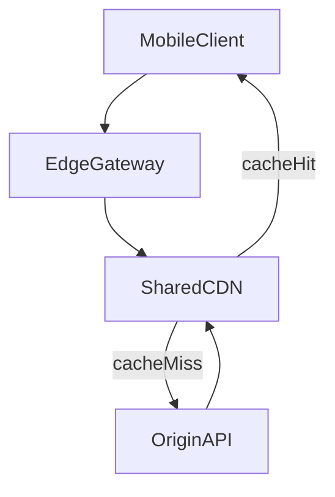

# D06-T001 — REST architectural constraints

Topic ID: `D06-T001`
Domain: API Design and REST
Subdomain: REST architectural constraints
Importance: core
Complexity: intermediate
Dependencies: `D04-T001`, `D04-T002`, `D05-T001`, `D05-T002`
Execution status of the code in section F: illustrative (not executed in CI for this topic)

## A. Topic Overview

REST is an architectural style for networked hypermedia systems, not a framework download. Fielding's constraints—client-server separation, statelessness, cacheability, a uniform interface, layered systems, and optional code on demand—describe how to keep large HTTP systems evolvable.

The constraints exist because the web scaled when intermediaries could treat messages generically. Hidden conversational state on one machine breaks load balancing, caching, and safe retries.

In production you inherit these ideas whenever mobile clients, CDNs, and API gateways sit in front of your service. Interviewers use REST to test whether you know why statelessness and cache headers matter, not whether you can spell "representational."

Prerequisites: HTTP and request lifecycle (`D05-T001`, `D05-T002`, `D04-T001`, `D04-T002`). This topic anchors `D06-T002` through `D06-T021`.

## B. First-Principles Explanation

Clients and servers evolve independently when the interface is resources plus representations rather than shared code. Each request should carry enough context to be understood alone: credentials, tenant, pagination cursors, and conditional validators like `If-Match`.

Statelessness does not forbid databases; it forbids opaque in-memory session maps that only one pod understands. Cacheability means responses declare whether a shared cache may store them. The uniform interface combines URI identification, manipulation through representations, self-descriptive messages (`Content-Type`), and optional hypermedia links.

Layered systems allow TLS terminators, gateways, and CDNs without changing semantics if methods, status codes, and cache directives stay coherent. Code on demand is rare in JSON APIs but common on the public web via scripts.

## C. Internal Working and Architecture

A read request crosses DNS, TLS, optional gateway auth, routing, authorization against the resource, serialization, and cache header attachment. Writes add validation, transactional persistence, and conflict handling.

For `GET /products/sku-9`, the gateway validates a JWT, the service loads catalog data, sets `ETag`, and may mark the response `Cache-Control: public, max-age=300`. No server field remembers "this client already saw page 2"; the client sends `?page=2` or a cursor.

Failure modes: sticky sessions causing uneven load, `private` data cached at the edge, and RPC-style URLs that gateways cannot reason about.

## D. Diagrams and Visual Models



Intermediaries only help when responses are stateless and correctly labeled for caching.

## E. Examples and Analogies

Postal analogy: the URI is the address, the method is the operation class on the mailbox, the body is the letter contents. You do not scribble imperative verbs on the envelope instead of using the agreed service.

Model checkout as resources: `cart`, `checkout_session`, `payment_intent`, each with an id the client stores. Avoid a server-only workflow engine with no resumable ids.

Do not claim REST while using server RAM sessions without client-visible ids. Do not disable caching on static catalog reads without measuring cost.

## F. Code Examples

File: `EXERCISES/examples/d06_t001_context.py` (illustrative)

```python
from dataclasses import dataclass


@dataclass(frozen=True)
class RequestContext:
    tenant_id: str
    subject: str
    request_id: str


def get_invoice(ctx: RequestContext, invoice_id: str) -> dict:
    if not ctx.subject:
        raise ValueError("unauthenticated")
    inv = repository_get(ctx.tenant_id, invoice_id)
    if inv.owner != ctx.subject:
        raise PermissionError("forbidden")
    return {"id": invoice_id, "total_cents": inv.total_cents, "status": inv.status}


def repository_get(tenant_id: str, invoice_id: str):
    return type("Inv", (), {"owner": "user-7", "total_cents": 500, "status": "OPEN"})()
```

Run: `python EXERCISES/examples/d06_t001_context.py` after adding a trivial `__main__` print. Pattern: context per request, not global session.

## G. Practical Backend Application

Gateways enforce auth and quotas on every call because requests are self-contained. Catalog services emit cache headers; account services use `private` or `no-store`. Deployments roll without draining sessions when tokens or session resources replace RAM maps.

Observability: propagate `request_id` from edge to database logs. Security: re-validate scopes per request. Scaling: horizontal pods plus shared cache beats affinity.

## H. Advantages, Limitations and Trade-offs

| Choice | Benefit | Cost | Choose when | Avoid when |
| --- | --- | --- | --- | --- |
| Stateless handlers | Elastic scale | Larger tokens | Mobile, multi-region | Cannot change legacy sessions |
| HTTP caching | Lower p95 reads | Staleness risk | Catalog | Balances, entitlements |
| Resource URLs | Clear support logs | Awkward commands | CRUD domains | Dense RPC workflows |
| Gateways | Central policy | Extra hop | Many services | Single monolith |

## I. Common Mistakes and Misconceptions

- Calling JSON CRUD "REST" while ignoring cache and state rules.
- Sticky sessions as a permanent design.
- Resources equal database rows with no authorization model.
- Using `POST` for safe reads without documenting exceptions.

## J. Debugging and Troubleshooting

Symptoms: mass logout on deploy, CDN stale content, uneven pod CPU. Check session storage, `Cache-Control`, and stickiness rules. Mitigate with externalized session tokens and per-resource cache policies. Metric: cache hit ratio and 401 spikes after releases.

## K. Interview Preparation

### Beginner

#### Q1. What is REST?

**Answer:** REST is an architectural style for distributed systems that uses constraints to keep APIs evolvable on the web. It centers on resources identified by URIs and manipulated through representations such as JSON. Intermediaries like caches and gateways can participate because messages are self-contained and methods have predictable semantics. Interviewers want constraints and outcomes, not a buzzword.

#### Q2. What does stateless mean?

**Answer:** Each HTTP request must carry enough context for the server to process it without relying on hidden conversation state on a specific host. The server may read databases, but it should not require an earlier request only stored in one pod's RAM. Clients hold resumable ids for long workflows. This property enables load balancing and safer retries on idempotent reads.

#### Q3. What is a resource?

**Answer:** A resource is an abstraction exposed at a URI, such as an order or a collection of orders. Clients interact with representations of that resource, not necessarily with internal tables. Collections and singletons are both resources. Good APIs document lifecycle and authorization per resource.

#### Q4. Why is cacheability a constraint?

**Answer:** The web scales partly because responses can declare whether they are safe to store and reuse. Without explicit cache rules, every read hammers the origin. Misapplied caching on personalized data leaks data across users. Correct cache headers are both a performance and privacy requirement.

#### Q5. What is the uniform interface?

**Answer:** Clients use a small set of HTTP methods with standard status semantics on named resources. Representations are self-describing via media types. Optional hypermedia links can drive next steps. Uniformity lets infrastructure apply policy without domain-specific knowledge.

### Intermediate

#### Q1. How is statelessness different from having no server data?

**Answer:** Servers persist data in databases and object stores; statelessness targets protocol conversation state between requests. A `session` resource with a client-held id is fine; an opaque server map without an id is not. Tokens and cookies are acceptable if validated each time. The distinction explains logout bugs after deploys.

#### Q2. When does layering help?

**Answer:** Gateways consolidate TLS, authentication, rate limits, and routing across microservices. Each layer can enforce REST constraints consistently for external clients. The cost is latency and misconfigured header forwarding. Layering fails when inner services depend on client IP or stripped auth headers.

#### Q3. Is every JSON HTTP API RESTful?

**Answer:** Many APIs use HTTP without cacheability, consistent resources, or hypermedia. That may be pragmatic, but the label sets expectations. Strong candidates name which constraints they meet. Accuracy matters in architecture reviews and interviews.

#### Q4. How do constraints help mobile clients?

**Answer:** Mobile networks retry; idempotent GETs and explicit resource ids reduce duplicate effects. Cacheable catalog responses save battery. Uniform URLs simplify logging across app versions. Multi-step flows should be resumable after process death.

#### Q5. What is code on demand?

**Answer:** Servers may deliver executable code the client runs, as with JavaScript on the web. Backend JSON services rarely use this constraint. It completes the REST constraint list for interviews. Plugin systems are the closest enterprise analog.

### Advanced

#### Q1. How do you model checkout RESTfully?

**Answer:** Represent cart, checkout session, and payment intent as resources with ids and links. Transitions are fields or sub-resources, not hidden variables. Clients poll or subscribe to payment status using stable URIs. This preserves statelessness while supporting long flows.

#### Q2. What breaks with sticky sessions?

**Answer:** Traffic sticks to hot pods while others idle. Deployments drop sessions on terminated pods. Caches cannot serve generically. Sticky affinity is a bridge, not the scalability end state.

#### Q3. What is the Richardson Maturity Model?

**Answer:** It levels adoption from HTTP as transport to resources, HTTP verbs, and hypermedia. It is a teaching ladder, not a scorecard. Many teams stop at level two successfully. Hypermedia helps public discoverability more than internal microservices.

#### Q4. When would you violate a constraint?

**Answer:** Internal low-latency RPC or legacy session apps may trade evolvability for speed. Document the violation and isolate it behind a gateway presenting a uniform external API. Never mark user-specific responses cacheable on shared edges. Reviews should record the trade-off explicitly.

#### Q5. How do constraints affect versioning?

**Answer:** Clients depend on stable URIs and representation shapes. Breaking changes need explicit version paths or media types. Caches must key separately per version. Stateless requests can carry version selectors without server affinity.

### Scenarios

#### Q1. Users logout on every deploy. What failed?

**Answer:** Session state likely lived in pod memory or non-replicated stores. Rolling replacements dropped sessions though the database stayed healthy. Move to signed tokens or a replicated session store with client-visible ids. Remove stickiness once state is externalized.

#### Q2. CDN shows stale sale prices. What do you check?

**Answer:** Compare `Cache-Control`, `ETag`, and `Age` between edge and origin. Marketing HTML may cache longer than price APIs should. Purges fail if origins still emit large `max-age`. Personalized pricing requires `private` or `no-store`.

#### Q3. You have `POST /doRefund`. How do you evolve?

**Answer:** Introduce `POST /orders/{id}/refunds` creating a refund resource with idempotency support. Gateway-rewrite the legacy path during migration. Document status polling on the new resource. Remove RPC when metrics show adoption.

#### Q4. Support needs the pod name to debug. Why is that bad?

**Answer:** It signals hidden affinity or session state tied to hosts. Stateless designs plus `request_id` make any replica's logs sufficient. Stickiness hides correlation problems until churn occurs. Architecture should not require pod names for user issues.

#### Q5. Legal asks about EU data in CDN caches.

**Answer:** Cacheability requires explicit marking of storable data. User-specific bodies must not sit on shared edges without review. Use regional caches or `no-store` for personal data. Document residency implications in the DPIA.

### Follow-ups

#### Q1. How does this connect to HTTP methods?

**Answer:** Methods express safe and idempotent interaction classes on resources. They are part of the uniform interface constraint. See `D06-T003` for precise idempotency rules. Gateways use methods to enforce caching and retries.

#### Q2. How does this connect to caching?

**Answer:** Cacheability is realized with `Cache-Control` and validators like `ETag`. See `D06-T014` for patterns. Misconfigured caching hurts performance and privacy. Validators also support optimistic concurrency in `D06-T013`.

#### Q3. How does REST compare to gRPC?

**Answer:** gRPC favors typed contracts and binary framing over generic hypermedia. REST fits public HTTP ecosystems and browsers. Many systems expose REST externally and gRPC internally. See `D06-T020` for a structured comparison.

## L. Practical Exercises

Solutions are in `EXERCISES/solutions/D06-T001.md`. Try these before opening that file.

### Exercise 1 — design

Audit a sample HTTP JSON API against the six REST constraints. For each gap, name one production symptom and one mitigation.

### Exercise 2 — debugging

Given logout-on-deploy, diagram where session state lives and propose a stateless replacement listing which headers or fields carry context.

### Exercise 3 — trade-off

Product wants `POST /execute` for all actions. Propose resource-oriented alternatives for refunds and subscriptions, and when you would keep RPC internal only.

## M. Revision Notes

- REST = constraints for evolvable web-scale systems.
- Stateless = no hidden per-host conversation state.
- Resources have URIs; representations travel in messages.
- Cache headers are mandatory thinking, not optional tuning.
- Gateways benefit from uniform methods and statuses.

## N. Related Topics

Before: HTTP basics (`D05-T001`, `D05-T002`). Next: `D06-T002` URLs, `D06-T003` methods, `D06-T014` caching, `D06-T020` comparisons.

## O. Completion Criteria

- Name REST constraints and explain statelessness with an example.
- Draw client, gateway, cache, and origin.
- Spot hidden session state in a deploy bug.
- Choose cache policy for catalog vs account data.
- Explain why JSON alone is not REST.
