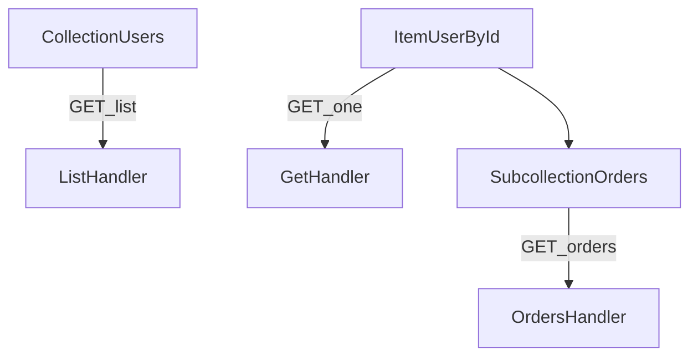

# D06-T002 — Resource-oriented URL design

Topic ID: `D06-T002`
Domain: API Design and REST
Subdomain: Resource-oriented URL design
Importance: core
Complexity: intermediate
Dependencies: `D06-T001`, `D04-T001`, `D04-T002`, `D05-T001`, `D05-T002`
Execution status of the code in section F: illustrative (not executed in CI for this topic)

## A. Topic Overview

Resource-oriented URLs name things (nouns) and collections, not imperative actions (verbs). Paths express hierarchy and stable identity; HTTP methods express what you do to a representation.

The pattern exists so clients, logs, caches, and authorization policies can reason about requests without reading bodies. A `GET /users/9/orders` line in access logs is self-explanatory; `POST /runReport` is not.

Production APIs mix nested resources (`/accounts/{id}/transactions`), singleton sub-resources (`/users/me`), and search collections with query parameters. Interviewers watch whether you avoid RPC verbs in paths while still modeling real workflows.

Prerequisites: REST constraints (`D06-T001`). Leads into HTTP methods (`D06-T003`) and parameter placement (`D06-T007`).

## B. First-Principles Explanation

A URI identifies a resource. Collections use plural nouns (`/invoices`). Items use stable ids (`/invoices/{invoice_id}`). Relationships can be nested when the child cannot exist without a clear parent scope, or linked by id when cross-tenant references matter.

Actions that are not simple attribute updates become sub-resources: `POST /payments` under an order, or a `transitions` collection for state changes. Filters, sorts, and optional fields belong in query strings, not extra path segments.

URLs should be opaque to clients except for documented templates; do not encode business rules only in path shape. Versioning may prefix paths (`/v1/...`) or use headers (`D06-T010`).

## C. Internal Working and Architecture

Routers map templates to handlers. Gateway rules often authorize `account_id` from the path before the body is parsed. CDN cache keys frequently include full paths and query strings for GET.

Execution: client calls `PATCH /projects/proj-1/tasks/task-9` with JSON body; router extracts ids; service loads task scoped to project; mismatch returns `404` not `403` when hiding existence is required.

## D. Diagrams and Visual Models



Paths form a tree; methods attach at each node.

## E. Examples and Analogies

Library analogy: `/books` is the shelf, `/books/isbn-123` is one volume, `/books/isbn-123/reviews` are notes about that volume. You do not name a URL `/borrowBook`.

Prefer `/search/products?q=...` or documented filter query params over `/getProductsBySku`. Use `/actions` sub-resources sparingly and document idempotency.

## F. Code Examples

```python
# Flask-style route table (illustrative)
ROUTES = {
    "GET /v1/customers": "list_customers",
    "POST /v1/customers": "create_customer",
    "GET /v1/customers/{customer_id}": "get_customer",
    "GET /v1/customers/{customer_id}/invoices": "list_invoices",
}
```

Stable ids in paths; business filters in query (`?status=open&sort=-created_at`).

## G. Practical Backend Application

Consistent URLs simplify WAF rules, rate limits per resource, and OpenAPI generation. Nested paths enforce parent scope early. Avoid leaking internal primary keys if external ids are UUIDs.

## H. Advantages, Limitations and Trade-offs

| Pattern | Benefit | Cost |
| --- | --- | --- |
| Plural collections | Convention | Irregular plurals |
| Deep nesting | Clear ownership | Long URLs, coupling |
| Flat ids + links | Flexible graphs | More client logic |
| Verb paths | Fast to ship | Breaks caches/gateways |

## I. Common Mistakes and Misconceptions

- `/getUser`, `/deleteOrder` RPC paths.
- Putting filters in path: `/users/active` instead of `?status=active`.
- Changing ids in URLs without versioning plan.
- Exposing sequential integer ids when guessing is a risk.

## J. Debugging and Troubleshooting

Symptoms: 404 spikes after rename, double slashes, wrong tenant data. Check route tables, trailing slash policy, and URL encoding of ids with special characters.

## K. Interview Preparation

### Beginner

#### Q1. Should URLs contain verbs?

**Answer:** Public resource URLs should name nouns and collections, while HTTP methods carry the action semantics. Verbs in paths like `/createOrder` break uniform interfaces and confuse caches. Sub-resources can name domain nouns such as `refunds` or `cancellations`. RPC-style paths are sometimes acceptable internally if isolated.

#### Q2. Plural or singular collections?

**Answer:** Industry convention uses plural nouns for collections such as `/users`. Singular is acceptable if consistent across the API. Pick one style per API surface and document it in OpenAPI. Mixed styles confuse SDK generators and client developers.

#### Q3. What belongs in the path versus query?

**Answer:** Path segments identify resources and required hierarchy such as account id. Query parameters express optional filters, sorting, pagination, and sparse field sets. Required identifiers for authorization usually belong in the path or headers, not buried only in the body. This separation keeps logs and caches meaningful.

#### Q4. What is a stable identifier in URLs?

**Answer:** A stable id does not change when non-identity attributes change, such as username or email. UUIDs and opaque tokens reduce enumeration risk compared with sequential integers. Document whether ids are globally unique or scoped under a parent path. Never recycle ids to refer to different entities.

#### Q5. Why nest resources?

**Answer:** Nesting expresses containment and scoping, such as orders under a customer. It helps authorization checks use parent ids from the path early. Deep nesting can imply false lifecycles when resources are shared across parents. Prefer links by id when many-to-many graphs dominate.

### Intermediate

#### Q1. `/users/me` versus `/users/{id}`?

**Answer:** `me` is a singleton alias resolved from the access token, avoiding clients storing their own id. It simplifies mobile apps while keeping collection patterns. Servers must not cache `me` responses on shared CDNs. Document equivalence to the canonical user resource.

#### Q2. When is `/search` acceptable?

**Answer:** Search is a collection-like endpoint with query parameters driving results. Treat it as read-only with GET and cache cautiously. Complex search may use POST with a body when queries exceed URL length limits, documented as an exception. Still avoid verb names like `/findUsers`.

#### Q3. How do URLs interact with pagination?

**Answer:** List endpoints live on collection paths with `limit` and cursor query params (`D06-T009`). Paths should not encode page numbers as `/users/page/2` unless legacy requires it. Cursors belong in query or `Link` headers. Stable sort keys prevent duplicates across pages.

#### Q4. File uploads and URLs?

**Answer:** Metadata resources might be `/attachments/{id}` while bytes upload via `POST` to the collection or a signed URL flow. Do not put filenames with spaces unencoded in paths. Large payloads may bypass app servers; the resource URL still names the attachment entity.

#### Q5. Trailing slashes?

**Answer:** Pick one canonical form and redirect or reject the other consistently. Mixed policies cause double requests and broken caches. Framework defaults differ; document your gateway behavior. Clients should follow redirects only when safe for the method.

### Advanced

#### Q1. Model many-to-many in paths?

**Answer:** Prefer `/courses/{id}/enrollments` linking students rather than deep `/schools/{s}/classes/{c}/students/{st}`. Hypermedia or separate link resources reduce path depth. GraphQL or batch endpoints may fit read-heavy UIs. REST URLs should not mirror every join table.

#### Q2. Custom actions without verb URLs?

**Answer:** Use sub-resources: `POST /instances/{id}/reboot` names a reboot request entity, or `POST /jobs` with a typed payload. Return `202` with a job id for async work. Document idempotency for the creation endpoint. This preserves logs that show `reboots` resources.

#### Q3. URL design for multi-tenant SaaS?

**Answer:** Options include `/tenants/{tid}/...` path prefix, subdomain tenancy, or header `X-Tenant-Id`. Paths in URLs help WAF and logs; headers require gateway normalization. Never trust tenant id from the body alone. Align with authorization claims.

#### Q4. Encoding and internationalized paths?

**Answer:** Percent-encode non-ASCII in paths; prefer ASCII slugs in public APIs. Slugs may change; back them with immutable ids in paths or exclusively in ids. Document normalization rules for case sensitivity. Collisions break caches if case folding differs.

#### Q5. Compatibility when renaming resources?

**Answer:** Add new paths, keep old paths as aliases during deprecation (`D06-T019`). Emit `Sunset` and `Link` headers on legacy routes. Monitor traffic share before removal. Version bumps (`D06-T010`) pair with URL changes.

### Scenarios

#### Q1. Clients call `/user/1` but spec says `/users/1`.

**Answer:** Standardize on plural collections and add gateway redirects temporarily. Log deprecated path usage metrics. Communicate sunset dates in developer docs. Breaking changes require version negotiation.

#### Q2. Support cannot find logs for an order.

**Answer:** Inconsistent paths such as `/order` versus `/orders` split traffic across routes. Normalize routes and structured access logs with route template names. Include `order_id` path param in structured fields. OpenAPI route ids help correlate.

#### Q3. SEO team wants pretty slugs in API paths.

**Answer:** Separate public marketing slugs from API ids: `/products/{product_id}` stable, optional `?slug=` lookup endpoint. Slug changes should not break integrations. Caches key on id paths. Document slug resolution rules.

#### Q4. Mobile app hard-coded `/v1/items` but backend moved to `/v2/items`.

**Answer:** Maintain `/v1` alias or gateway rewrite until adoption metrics drop. Pair with deprecation headers. Never silently change id semantics between versions. Contract tests on both paths during transition.

#### Q5. Security scan flags enumerable `/users/123`.

**Answer:** Sequential ids enable scraping; use opaque ids and rate limits (`D06-T012`). Authorization must deny cross-user access regardless of id guessability. Paths do not replace authz checks. Return `404` vs `403` per policy.

### Follow-ups

#### Q1. Link to HTTP methods?

**Answer:** Methods attach to these URLs with idempotency rules in `D06-T003`. Wrong method on a path should yield `405` with `Allow`. URL design enables correct caching per method.

#### Q2. Link to parameters?

**Answer:** `D06-T007` details path versus query versus header placement. URLs are only part of the request target. Headers carry auth and conditional requests.

#### Q3. Link to OpenAPI?

**Answer:** `D06-T016` documents path templates and parameters for clients. Generated SDKs embed your URL choices. Drift between code and spec breaks clients.

## L. Practical Exercises

Solutions: `EXERCISES/solutions/D06-T002.md`.

### Exercise 1 — design

Design URLs for customers, subscriptions, and pause/resume lifecycle without verb paths. Include list, get, and transition creates.

### Exercise 2 — debugging

404s only for `/invoices/` with trailing slash. Identify slash policy fix and cache impact.

### Exercise 3 — trade-off

Choose nested `/accounts/{a}/users/{u}` versus flat `/users/{u}` with `account_id` query for a B2B product.

## M. Revision Notes

- Nouns in paths; methods carry actions.
- Plural collections; stable opaque ids.
- Filters in query; required scope in path or auth.
- Sub-resources for non-CRUD transitions.
- Deprecate renamed paths with metrics.

## N. Related Topics

`D06-T001`, `D06-T003`, `D06-T007`, `D06-T010`, `D06-T016`.

## O. Completion Criteria

- Refactor verb URLs to resources.
- Place filters correctly.
- Design nested versus flat URLs with auth rationale.
- Plan deprecation for a path rename.
