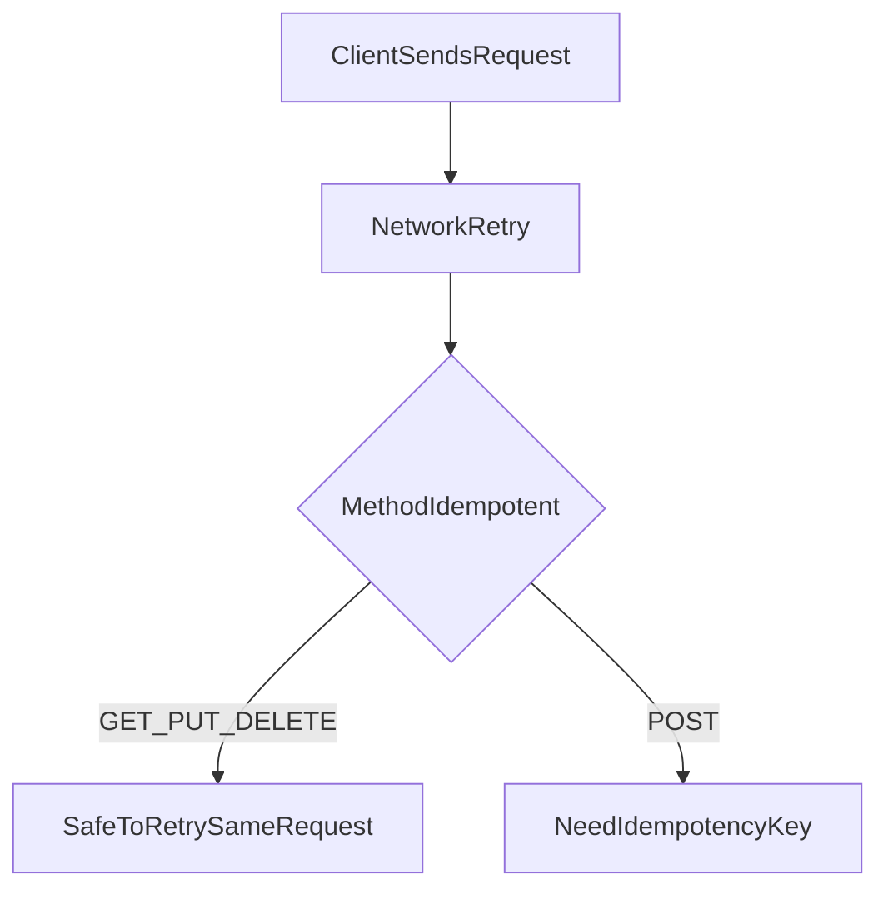

# D06-T003 — HTTP methods and idempotency

Topic ID: `D06-T003`
Domain: API Design and REST
Subdomain: HTTP methods and idempotency
Importance: core
Complexity: intermediate
Dependencies: `D06-T002`, `D06-T001`, `D04-T001`, `D04-T002`, `D05-T001`, `D05-T002`
Execution status of the code in section F: illustrative (not executed in CI for this topic)

## A. Topic Overview

HTTP methods classify how an interaction affects server state and whether repeating the same request is safe. **Safe** methods should not change server state (`GET`, `HEAD`, `OPTIONS`). **Idempotent** methods can be applied multiple times with the same intended effect on the server (`GET`, `PUT`, `DELETE`, `HEAD`, `OPTIONS`); `POST` is not idempotent by default, and `PATCH` is not guaranteed idempotent unless you design it so.

Idempotency matters because networks retry: mobile radios, gateway timeouts, and client libraries may replay requests. If a duplicate `POST /payments` creates two charges, the API failed the contract even if HTTP succeeded once.

Interviewers expect you to separate method idempotency from **application idempotency** (idempotency keys on `POST`, `D06-T011`) and to map methods to status codes (`D06-T004`).

## B. First-Principles Explanation

`GET` retrieves a representation. `HEAD` is `GET` without a body. `POST` submits data to be processed, often creating a subordinate resource; repeats may create multiple resources. `PUT` replaces a resource at a URI; repeating should leave the resource in the same final state. `DELETE` removes a resource; repeating should still result in absence (often `204` or `404`). `PATCH` applies partial updates; whether repeats are harmless depends on patch semantics (JSON Merge Patch versus JSON Patch).

Idempotency is about the **effect**, not the response byte-for-byte. A second `DELETE` may return `404` while remaining idempotent in effect. A second `PUT` with the same body should yield the same stored resource.

`POST` plus `Idempotency-Key` header implements deduplication at the application layer because HTTP does not make `POST` idempotent.

## C. Internal Working and Architecture

Load balancers and clients may retry non-idempotent requests unless you forbid it. Idempotent methods can be retried more aggressively; still avoid unbounded retries on `500`.

Handler design: `PUT /widgets/w1` reads body, writes version, returns `200` or `201` on first create. `POST /widgets` creates new ids each time unless a key store dedupes.

PATCH handlers should document whether operations are additive counters (non-idempotent) or setting a field to a value (idempotent).

## D. Diagrams and Visual Models



## E. Examples and Analogies

Light switch versus vending machine: `PUT` sets lamp to ON (flipping the request again stays ON). `POST` inserts another coin each time unless the machine recognizes duplicate tokens.

Use `PUT` for upserts with client-chosen ids when appropriate. Use `POST` for collection creates with server ids plus idempotency keys for payments.

## F. Code Examples

```python
def put_profile(user_id: str, body: dict) -> int:
    """Idempotent replace: same body -> same stored profile."""
    stored = repo.replace_profile(user_id, body)
    return 200 if stored.existed else 201


def post_payment(idem_key: str | None, body: dict) -> int:
    if idem_key and cache_hit(idem_key):
        return replay_cached_response(idem_key)
    result = charge(body)
    if idem_key:
        cache_store(idem_key, result)
    return 201
```

## G. Practical Backend Application

Document which endpoints are safe to retry. Return `409` on conflicting `PUT` versions when using `If-Match` (`D06-T013`). Gateways should not convert `POST` to `GET` for caching.

## H. Advantages, Limitations and Trade-offs

| Method | Idempotent | Safe | Typical use |
| --- | --- | --- | --- |
| GET | Yes | Yes | Read |
| PUT | Yes | No | Replace/upsert |
| POST | No | No | Create, commands |
| PATCH | Maybe | No | Partial update |
| DELETE | Yes | No | Remove |

## I. Common Mistakes and Misconceptions

- Assuming `POST` is idempotent because "we only insert once" without a key store.
- Using `GET` to delete or charge.
- `PATCH` incrementing a counter and calling it idempotent.
- Retrying `POST` on `500` without deduplication.

## J. Debugging and Troubleshooting

Duplicate rows, double charges, twin emails. Correlate retries by `Idempotency-Key`, `request_id`, and timestamps. Fix with keys, unique constraints, or outbox patterns.

## K. Interview Preparation

### Beginner

#### Q1. What does idempotent mean in HTTP?

**Answer:** Repeating the same request should not change server state beyond the first successful application. For example, two identical `DELETE` calls should both result in the resource being gone. The response code may differ on the second call, such as `404` instead of `204`. Idempotency is about effect, not identical response bodies.

#### Q2. Which methods are idempotent?

**Answer:** `GET`, `HEAD`, `OPTIONS`, `PUT`, and `DELETE` are idempotent in the HTTP semantics. `POST` is not idempotent by default because each call may create a new resource. `PATCH` is only idempotent if your patch operations are designed that way. Interviewers want the list and the nuance on `PATCH`.

#### Q3. What is a safe method?

**Answer:** Safe methods should not alter server resources; they are read-only at the protocol level. `GET` and `HEAD` are safe. Safe does not mean "no side effects at all" because logging or rate-limit counters may update. Still, you must not use safe methods for state-changing business operations.

#### Q4. Why not use GET for deletes?

**Answer:** Caches, prefetchers, and crawlers may issue `GET` without user intent. A delete must use `DELETE` or a documented `POST` to a sub-resource. Using `GET` breaks safety and creates security vulnerabilities. Logs and WAF rules also treat `GET` as low risk incorrectly.

#### Q5. POST versus PUT for create?

**Answer:** `POST` to a collection lets the server assign ids and is not idempotent. `PUT` to a known URI can upsert idempotently when the client controls the URI. Choose based on who owns the identifier and retry requirements. Payments usually need `POST` plus an idempotency key.

### Intermediate

#### Q1. Is DELETE idempotent if the second call returns 404?

**Answer:** Yes, the resource remains absent after the first successful delete. The status code may change while the effect is stable. Clients should treat `404` on delete as success in many APIs. Document your policy to avoid client confusion.

#### Q2. When is PATCH idempotent?

**Answer:** Setting a field to an absolute value, such as `"status": "paused"`, is idempotent. Operations like "increment by 1" are not. JSON Patch `add` to an array may duplicate entries on retry. Design patches with replace semantics or use etags for concurrency.

#### Q3. How do retries interact with PUT?

**Answer:** Retries of the same `PUT` body should converge to the same resource state. Conflicts appear when another writer changes the resource between attempts; use `If-Match` with `412` responses. Without validators, last writer wins may be acceptable for some profiles. Document concurrency expectations.

#### Q4. What is the difference between method idempotency and Idempotency-Key?

**Answer:** Method idempotency is defined by HTTP for verbs like `PUT`. Application idempotency keys deduplicate `POST` requests with server-side replay caches. Keys must be unique per logical operation per client scope. See `D06-T011` for storage TTL and body hash rules.

#### Q5. Should gateways retry POST?

**Answer:** Generally no, unless the upstream documents idempotency support. Retrying non-idempotent methods causes duplicate side effects. Idempotent methods may be retried on connection resets with care. Prefer client-side retry with keys for `POST`.

### Advanced

#### Q1. Design idempotent account funding.

**Answer:** Use `POST /transfers` with `Idempotency-Key` and a unique constraint on `(tenant, key)`. Store response snapshot for replay within TTL. Combine with ledger double-entry ids. Never rely on "we check balance once" without transaction isolation.

#### Q2. PUT create versus POST create trade-offs?

**Answer:** Client-generated UUIDs enable idempotent `PUT` creates at known URIs. Server-generated ids reduce collision and enumeration risk. Hybrid: `POST` returns id, subsequent updates use `PUT` or `PATCH` with etags. Pick per security and retry story.

#### Q3. How do method semantics affect caching?

**Answer:** Only safe methods are cacheable by default in intermediaries. `POST` responses are not cached unless explicitly allowed with careful rules. Mislabeled methods break CDN behavior. Align method choice with cache headers in `D06-T014`.

#### Q4. Batch endpoints and idempotency?

**Answer:** Batch `POST` is one HTTP request but many operations; define per-item keys or transactional batch ids. Partial success responses need clear per-item statuses. Retries must not duplicate succeeded items. Document whether batches are all-or-nothing.

#### Q5. Webhooks and method choice?

**Answer:** Outbound webhooks are usually `POST` to customer URLs; customers must dedupe by event id (`D06-T018`). Inbound callbacks should also use keys or signed event ids. Do not use `GET` callbacks with side effects.

### Scenarios

#### Q1. Double charge after timeout.

**Answer:** Client retried `POST /payments` without an idempotency key while the first request succeeded slowly. Add `Idempotency-Key`, persist outcomes, return the same response on replay. Monitor duplicate key hits. Align gateway timeout with processing time.

#### Q2. Crawler hit `/logout` linked as GET.

**Answer:** Logout must not be a safe method. Change to `POST /sessions/logout` and require auth. Audit links in HTML emails. Return `405` for wrong methods on sensitive routes.

#### Q3. PATCH inventory counts drift.

**Answer:** Patch used `{ "op": "increment", "value": 1 }` which doubles on retry. Switch to absolute quantity with version checks or use a dedicated adjustment resource created via idempotent `POST`. Reconcile with warehouse events.

#### Q4. PUT returns 201 then 200 on retry.

**Answer:** This is acceptable idempotent behavior showing create then update. Clients should not treat status flip as error if body matches. Document in OpenAPI. Tests should assert stable final state.

#### Q5. Load balancer replays idempotent GET on 502.

**Answer:** Generally fine for reads if responses are cache-neutral or validated with `ETag`. Dangerous if `GET` incorrectly mutates state. Fix handler side effects and add metrics on duplicate read processing.

### Follow-ups

#### Q1. Link to status codes?

**Answer:** `D06-T004` maps outcomes: `201` create, `204` delete, `409` conflict, `412` precondition failed. Method choice constrains which statuses are meaningful.

#### Q2. Link to idempotency keys?

**Answer:** `D06-T011` specifies header format, storage, and mismatch rules when the same key arrives with a different body.

#### Q3. Link to conditional requests?

**Answer:** `D06-T013` uses `If-Match` to make updates safe under concurrency, complementing idempotent `PUT`.

## L. Practical Exercises

Solutions: `EXERCISES/solutions/D06-T003.md`.

### Exercise 1 — design

Specify methods for CRUD on `/widgets/{id}` and idempotent pause/resume without verb URLs.

### Exercise 2 — debugging

Explain duplicate charges from `POST` retries and design `Idempotency-Key` storage.

### Exercise 3 — trade-off

Choose `PUT` upsert with client UUID versus `POST` with server id for user signup.

## M. Revision Notes

- Safe: no state change via method semantics.
- Idempotent: repeat without extra effect (`POST` excluded).
- `PATCH` idempotency is design-dependent.
- Retries demand keys on `POST`.
- Never mutate via `GET`.

## N. Related Topics

`D06-T004`, `D06-T011`, `D06-T013`, `D06-T018`.

## O. Completion Criteria

- Classify methods by safe/idempotent.
- Design payment `POST` with deduplication.
- Explain `DELETE` returning `404` on retry.
- Fix non-idempotent `PATCH` patterns.
