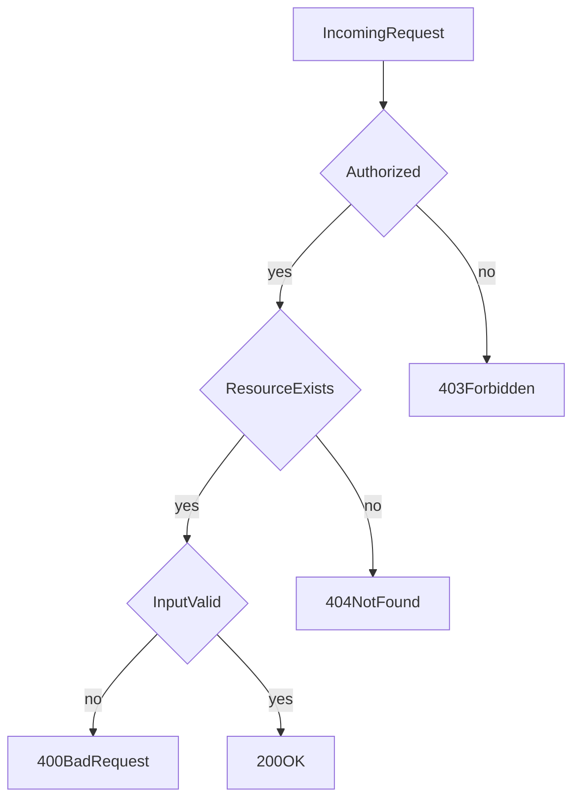

# D06-T004 — HTTP status codes

Topic ID: `D06-T004`
Domain: API Design and REST
Subdomain: HTTP status codes
Importance: core
Complexity: intermediate
Dependencies: `D06-T003`, `D06-T001`, `D04-T001`, `D04-T002`, `D05-T001`, `D05-T002`
Execution status of the code in section F: illustrative (not executed in CI for this topic)

## A. Topic Overview

HTTP status codes tell clients whether a request succeeded, how to interpret the body, and whether to retry. They are part of the uniform interface: machines and humans should agree that `404` means "not found for this URI" and `429` means "back off."

Codes group into classes: `2xx` success, `3xx` redirection, `4xx` client fault, `5xx` server fault. Precision reduces client bugs: charging flows should not treat `202` like `200` without polling, and caches must not store `500` as success.

Interviewers probe mapping domain errors to codes without leaking internals, and pairing codes with headers like `Retry-After`, `Location`, and `ETag`.

## B. First-Principles Explanation

The status line is the first machine-readable outcome. Bodies carry details (`D06-T008` problem format). `204 No Content` signals success without a representation. `304 Not Modified` tells caches to use a stored representation (`D06-T014`). `412 Precondition Failed` supports optimistic concurrency (`D06-T013`).

Use `201 Created` with `Location` when a resource is born. `202 Accepted` when work is queued. `409 Conflict` for version clashes or state machines rejecting a transition. `422 Unprocessable Content` (or `400` with discipline) for semantic validation failures.

Do not use `200` with `{ "error": true }` for failures; clients and middleware will mis-handle outcomes.

## C. Internal Working and Architecture

Frameworks map exceptions to statuses via handlers. Gateways may translate upstream `502/503/504`. Observability pipelines alert on `5xx` rates and `4xx` spikes by route.

Retry policy: idempotent methods may retry `502/503/504` with backoff; `429` honors `Retry-After`; `400` and `404` generally should not retry blindly.

## D. Diagrams and Visual Models



## E. Examples and Analogies

Traffic lights: `2xx` go, `4xx` driver error, `5xx` road broken. `3xx` detour signs with `Location`.

Payment required: the registry defines `402 Payment Required`, but many products use `403` with a problem `type` such as `payment_required` for consistency with existing clients. Pick one approach per API and document it in OpenAPI.

## F. Code Examples

```python
def map_domain_error(err: Exception) -> tuple[int, str]:
    if isinstance(err, NotFound):
        return 404, "not_found"
    if isinstance(err, ValidationFailed):
        return 400, "validation_error"
    if isinstance(err, VersionConflict):
        return 409, "version_conflict"
    if isinstance(err, RateLimited):
        return 429, "rate_limited"
    return 500, "internal_error"
```

## G. Practical Backend Application

Consistent codes power API monitors and client SDKs. Document which `4xx` are expected business cases versus bugs. Separate `401` (unauthenticated) from `403` (forbidden).

## H. Advantages, Limitations and Trade-offs

| Code | Use | Avoid |
| --- | --- | --- |
| 200 | OK with body | Errors in body |
| 201 | Created | Updates |
| 204 | Delete/update no body | When client needs body |
| 304 | Cache revalidation | Missing validators |
| 409 | Conflict | Generic validation |
| 429 | Rate limit | Hiding auth failures |
| 503 | Overload | Masking bugs |

## I. Common Mistakes and Misconceptions

- Always `500` for any exception.
- `404` for auth hiding existence inconsistently.
- `200` for async completion.
- Ignoring `405` with `Allow` header.

## J. Debugging and Troubleshooting

Dashboards split `4xx` by route. Trace `5xx` to stack traces; correlate with deploys. Clients logging only bodies miss status-driven retry logic.

## K. Interview Preparation

### Beginner

#### Q1. What does 2xx mean?

**Answer:** The request was received, understood, and accepted for the intended method. `200` returns a body; `201` signals creation; `204` signals success without content. Clients can treat `2xx` as success at the HTTP layer. Domain failures must not hide inside `200` JSON.

#### Q2. 401 versus 403?

**Answer:** `401 Unauthorized` means authentication failed or is missing; clients may retry with credentials. `403 Forbidden` means the caller is authenticated but not allowed for this resource. Mixing them breaks SDK refresh flows. Pick consistently and document for public APIs.

#### Q3. When use 404?

**Answer:** Use `404` when the target URI does not map to a resource the caller may know about. Some APIs return `404` instead of `403` to avoid leaking existence. That is a product security choice and must be consistent. Do not use `404` for validation errors on malformed ids that never existed.

#### Q4. What is 500?

**Answer:** `500 Internal Server Error` indicates the server failed unexpectedly. Clients may retry with backoff for idempotent operations. Repeated `500` needs engineering attention, not client tweaks. Never return stack traces in production bodies.

#### Q5. What is 429?

**Answer:** `429 Too Many Requests` signals rate limiting or quota exhaustion. Include `Retry-After` when possible (`D06-T012`). Clients should back off rather than hammering. Distinguish quota from auth failures.

### Intermediate

#### Q1. 201 versus 202?

**Answer:** `201 Created` means the resource now exists at `Location`. `202 Accepted` means processing started but is not finished; clients poll a status resource or wait for webhooks. Using `200` for async work confuses SDK generators. Document lifecycle clearly.

#### Q2. 400 versus 422?

**Answer:** Both indicate client-provided input problems. `400` is generic bad syntax or semantics; `422` emphasizes well-formed syntax but business rule failures. Pick one style per API and stay consistent in OpenAPI. Problem details belong in a structured body (`D06-T008`).

#### Q3. When 409?

**Answer:** Use `409 Conflict` for state conflicts such as version mismatch, duplicate unique keys, or illegal state transitions. Pair with `If-Match` failures mapped to `412` when preconditions fail. Helps clients prompt refresh merges.

#### Q4. 502/503/504 for clients?

**Answer:** `502 Bad Gateway` and `504 Gateway Timeout` often indicate proxy/upstream issues. `503 Service Unavailable` may signal maintenance or overload with `Retry-After`. Clients retry idempotent calls with jitter. Non-idempotent `POST` needs keys before retry.

#### Q5. 304 role?

**Answer:** `304 Not Modified` tells clients to use cached representations when validators match (`If-None-Match`, `If-Modified-Since`). It must not include a new body. Saves bandwidth on large JSON lists. See `D06-T014`.

### Advanced

#### Q1. Map validation to 400 with field errors?

**Answer:** Return `400` with a stable machine-readable list of `{field, code, message}` entries. Keep messages safe for end users. Log detailed causes server-side. Align with OpenAPI schemas (`D06-T005`).

#### Q2. Idempotent DELETE and status codes?

**Answer:** First delete may return `204`; second may return `404`. Both are compatible with idempotent effect. Document client handling. Some APIs always return `204` for idempotent deletes.

#### Q3. Conditional GET failures?

**Answer:** `412 Precondition Failed` applies to unsafe methods when `If-Match` fails. `428 Precondition Required` can force clients to send validators on sensitive updates. Prevents lost updates under concurrency (`D06-T013`).

#### Q4. Rate limit versus auth?

**Answer:** Use `429` for throttling authenticated users. Do not return `401` to confuse token refresh logic. Include rate limit headers where supported. Gateways often emit `429` before origin.

#### Q5. Problem details standard?

**Answer:** RFC 9457 Problem Details (`application/problem+json`) gives `type`, `title`, `status`, `detail`, and `instance`. It complements status codes without replacing them. Clients should branch on `status` first.

### Scenarios

#### Q1. Mobile retries POST on 503 and doubles orders.

**Answer:** `503` retries are unsafe for `POST` without idempotency keys. Issue `409` or replay cached `201` when keys match (`D06-T011`). Tune gateway timeouts. Educate client SDK retry policy.

#### Q2. CDN caches 500 responses.

**Answer:** Misconfigured `Cache-Control` on errors causes poisoned caches. Mark errors `no-store`. Fix origin exceptions. Purge edge after deploy.

#### Q3. Users see 403 but token is valid.

**Answer:** Likely missing scope for the resource, not authentication. Check `403` body codes versus `401` from gateway clock skew. Log authorization decision inputs redacted.

#### Q4. 404 vs 403 debate for other users' invoices.

**Answer:** Choose policy: always `404` to hide existence or `403` when authenticated. Mixed responses leak information. Document for support teams.

#### Q5. Long poll returns 200 forever.

**Answer:** Prefer `202` + status resource or Server-Sent Events/WebSockets for long work. Holding `200` connections exhausts pools. Return `504` at gateway with resumable tokens.

### Follow-ups

#### Q1. Link to methods?

**Answer:** `405 Method Not Allowed` includes `Allow` header listing valid methods (`D06-T003`).

#### Q2. Link to errors body?

**Answer:** `D06-T008` structures `4xx` payloads consistently.

#### Q3. Link to caching?

**Answer:** `3xx` and `304` interact with caches (`D06-T014`).

## L. Practical Exercises

Solutions: `EXERCISES/solutions/D06-T004.md`.

### Exercise 1 — mapping

Map ten domain failures (not found, validation, conflict, rate limit, maintenance) to statuses and problem `type` URIs.

### Exercise 2 — debugging

Clients infinite-retry `400` on bad input. Fix SDK policy and server distinguishability.

### Exercise 3 — trade-off

Choose `404` vs `403` for cross-tenant access and write support guidance.

## M. Revision Notes

- Status first; body explains.
- No errors in `200`.
- `401` auth, `403` authz.
- `201` vs `202` for sync vs async.
- `429` + `Retry-After`.

## N. Related Topics

`D06-T003`, `D06-T008`, `D06-T012`, `D06-T013`, `D06-T014`.

## O. Completion Criteria

- Map domain errors to precise codes.
- Explain retry rules per class.
- Design async create with `202`.
- Use problem+json consistently.
