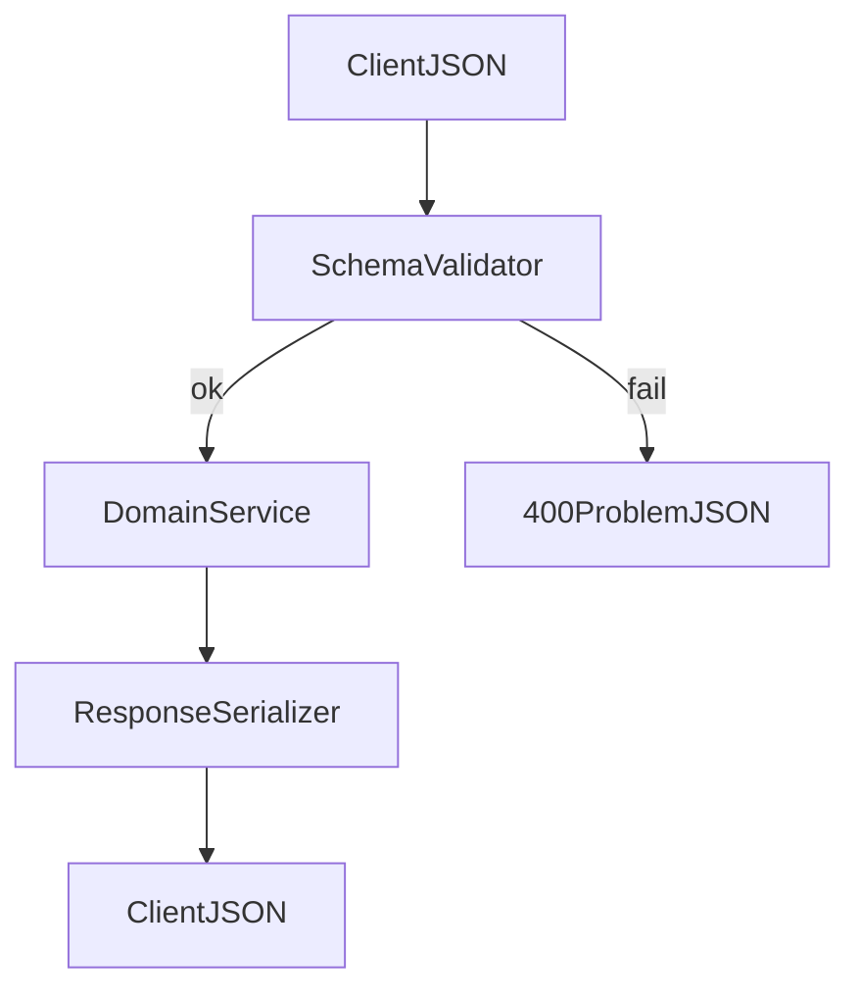

# D06-T005 — Request and response schemas

Topic ID: `D06-T005`
Domain: API Design and REST
Subdomain: Request and response schemas
Importance: core
Complexity: intermediate
Dependencies: `D06-T004`, `D06-T001`, `D04-T001`, `D04-T002`, `D05-T001`, `D05-T002`
Execution status of the code in section F: illustrative (not executed in CI for this topic)

## A. Topic Overview

Request and response schemas define the allowed shape of JSON (or other media) independent of any single service language. They are the cross-team contract: field types, required properties, enums, formats, and evolution rules.

Schemas exist because HTTP bodies are untyped on the wire. Without a published contract, mobile, web, and third-party integrators infer behavior from examples and break on the first additive change.

Production APIs pair schemas with validation at the edge, code generation, and contract tests (`D06-T006`). Interviewers ask how you represent money, timestamps, and identifiers without JavaScript number pitfalls.

## B. First-Principles Explanation

A schema names properties, types, nullability, and constraints (min, max, pattern). Requests are validated before domain logic; responses are validated before release to prevent accidental field drops. `Content-Type` and optional `Accept` select representations.

Version fields inside bodies are weaker than URL or media-type versioning unless paired with strict routing. Prefer explicit optional fields over ambiguous null versus missing unless documented.

## C. Internal Working and Architecture

OpenAPI or JSON Schema documents feed validators and SDKs. Framework middleware rejects malformed bodies with `400` and structured errors (`D06-T008`). Serializers map domain objects to DTOs to avoid leaking internal entities.

## D. Diagrams and Visual Models



## E. Examples and Analogies

Form instructions: schema is the blank with required boxes. Examples help humans but machines need rules.

Use ISO-8601 UTC strings for instants; integer minor units for money; string ids for large integers.

## F. Code Examples

```python
SCHEMA = {
    "type": "object",
    "required": ["amount_cents", "currency"],
    "properties": {
        "amount_cents": {"type": "integer", "minimum": 1},
        "currency": {"type": "string", "pattern": "^[A-Z]{3}$"},
    },
    "additionalProperties": False,
}
```

## G. Practical Backend Application

Publish schemas in repo CI; diff on PR. Redact secrets from response schemas. Document read-only fields ignored on input.

## H. Advantages, Limitations and Trade-offs

| Approach | Benefit | Cost |
| --- | --- | --- |
| JSON Schema | Rich validation | Verbosity |
| OpenAPI | Ecosystem | Drift from code |
| Protobuf | Strong types | Not browser-native |

## I. Common Mistakes and Misconceptions

- Examples without schemas.
- `number` for money and snowflake ids.
- Breaking clients by renaming without version bump.

## J. Debugging and Troubleshooting

Validation spikes after client release: compare payload to schema diff. Use correlation ids in error instances.

## K. Interview Preparation

### Beginner

#### Q1. Why define response schemas?

**Answer:** Clients need predictable fields to parse safely across versions. Servers need guards against accidentally omitting required data in deploys. Schemas enable generated SDKs and contract tests. Without them, integrations rely on folklore examples.

#### Q2. required versus optional fields?

**Answer:** Required fields must be present on requests; optional may be omitted. For responses, document which fields appear always versus conditionally. Changing required sets is a breaking change. Use optional new fields for additive evolution.

#### Q3. How represent timestamps?

**Answer:** Use RFC 3339 strings in UTC with `Z` or offset, or epoch seconds with clear units documented. Never mix local time without offset. Clients parse consistently when format is fixed.

#### Q4. How represent money in JSON?

**Answer:** Integer minor units plus ISO currency code avoids float rounding. Document scale per currency if needed. Display formatting is separate from wire format.

#### Q5. What is additionalProperties false?

**Answer:** It rejects unknown input keys, catching typos early. It can break forward-compatible clients sending extra metadata unless documented. Public APIs often allow unknown fields on responses but forbid on requests.

### Intermediate

#### Q1. Request DTO versus domain model?

**Answer:** DTOs match the public contract; domain models reflect business invariants. Mapping between them prevents leaking internal columns. Validation belongs at the boundary on DTOs.

#### Q2. Nullable versus optional?

**Answer:** Optional means the key may be absent; nullable means the key may be present with null. JSON Schema distinguishes them explicitly. Mixing semantics confuses PATCH merge behavior.

#### Q3. Enumerations evolution?

**Answer:** Add new enum values as backward compatible if clients ignore unknowns. Removing values breaks clients. Use open strings with documented constants when extensibility matters.

#### Q4. Pagination fields in list schema?

**Answer:** Document `items`, `next_cursor`, `has_more` consistently (`D06-T009`). Avoid overloading list schema per resource without shared components in OpenAPI.

#### Q5. Error response schema?

**Answer:** Align with problem+json (`D06-T008`). Stable `code` strings beat changing prose messages. Include `field` paths for validation arrays.

### Advanced

#### Q1. oneOf polymorphism?

**Answer:** Use discriminators for event types or payment methods. Document discriminator property and mapping. Clients switch on discriminator reliably.

#### Q2. Schema CI gates?

**Answer:** Breaking change detectors on OpenAPI diff fail PRs. Contract tests replay golden fixtures. Pair with consumer-driven tests for critical partners.

#### Q3. Write-only versus read-only fields?

**Answer:** Passwords are write-only in docs; computed fields read-only. Servers ignore read-only on input. Prevents clients depending on writable derived fields.

#### Q4. Large payloads?

**Answer:** Streaming and chunking may bypass single JSON schema validation; document limits. Use attachment resources for blobs.

#### Q5. Internationalized strings?

**Answer:** UTF-8 JSON; define max lengths for storage. Locale-specific content may need language tags in field names or nested maps.

### Scenarios

#### Q1. Client breaks after server adds field.

**Answer:** Adding response fields should be safe; check client strict parsers. If client used `additionalProperties: false`, fix client or namespace extensions.

#### Q2. Validation passes but business fails.

**Answer:** Schema covers syntax; domain rules return `409` or `422`. Keep layers separate in docs.

#### Q3. Float totals in schema.

**Answer:** Migrate schema to integer cents; version API (`D06-T010`). Communicate deprecation timeline.

#### Q4. OpenAPI diverges from production.

**Answer:** Generate from code or verify in CI with traffic replay samples. Treat drift as incident risk.

#### Q5. Partner sends unknown currency code.

**Answer:** Pattern validation rejects early with field error. Expand enum only after treasury approves.

### Follow-ups

#### Q1. Schema evolution?

**Answer:** See `D06-T006` for additive versus breaking rules.

#### Q2. OpenAPI tooling?

**Answer:** See `D06-T016` for publication and codegen.

#### Q3. Validation errors?

**Answer:** See `D06-T008` for consistent problem responses.

## L. Practical Exercises

Solutions: `EXERCISES/solutions/D06-T005.md`.

### Exercise 1 — schema

Define OpenAPI components for `Money` and `Timestamps` reused across resources.

### Exercise 2 — debugging

Find why strict client rejects benign server additive field.

### Exercise 3 — trade-off

`additionalProperties: false` on requests: security vs compatibility.

## M. Revision Notes

- Schemas are cross-language contracts.
- Money as integer cents; ids as strings when large.
- DTOs at boundary; domain inside.
- Additive response fields; careful required changes.

## N. Related Topics

`D06-T006`, `D06-T008`, `D06-T016`, `D01-T001` types at boundary.

## O. Completion Criteria

- Author reusable schema components.
- Separate syntactic and domain validation.
- Plan safe enum and required-field changes.
