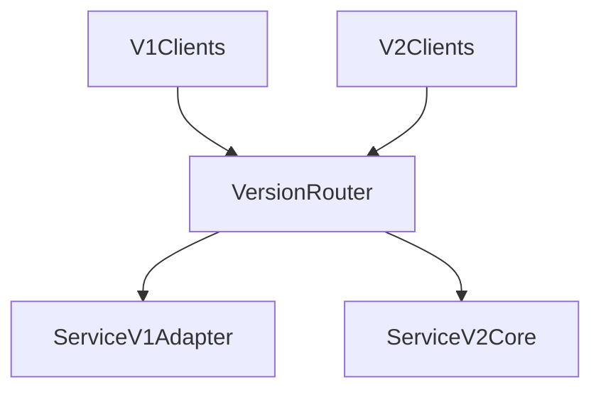

# D06-T006 — API contracts and schema evolution

Topic ID: `D06-T006`
Domain: API Design and REST
Subdomain: API contracts and schema evolution
Importance: core
Complexity: intermediate
Dependencies: `D06-T005`, `D06-T001`, `D04-T001`, `D04-T002`, `D05-T001`, `D05-T002`
Execution status of the code in section F: illustrative (not executed in CI for this topic)

## A. Topic Overview

An API contract is the promise about URLs, methods, schemas, error shapes, and compatibility rules over time. Schema evolution is how you change that contract without surprising clients: additive changes first, breaking changes only with version bumps or explicit deprecation.

Contracts matter because deployed mobile apps cannot be recalled. Server teams ship daily; clients linger for years. Interviewers test whether you know safe versus breaking changes and how to detect drift.

Pairs with `D06-T010` versioning and `D06-T021` backward compatibility.

## B. First-Principles Explanation

Backward compatible changes include new optional request fields, new response fields, new endpoints, and new enum values clients tolerate. Breaking changes remove fields, change types, tighten validation, or alter semantics of existing fields. Use expand-contract for databases: add column, dual-write, migrate readers, remove old.

Consumer-driven contract tests let clients publish expectations. Server publishes OpenAPI as source of truth with CI diff gates.

## C. Internal Working and Architecture

Release trains tag API changelog. Feature flags gate new behavior behind same version when semantics stay compatible. Breaking migrations bump `/v2` or `Accept` media type version.

## D. Diagrams and Visual Models



## E. Examples and Analogies

API contracts are like building codes: add a new optional window (field) without tearing walls (breaking clients). Breaking changes are wall removals requiring a new permit (major version).

## F. Code Examples

```python
ALLOWED_ADDITIVE = {"add_optional_response_field", "add_endpoint"}
BREAKING = {"remove_field", "change_type", "tighten_validation"}
```

## G. Practical Backend Application

Run OpenAPI diff in CI; maintain changelog; dual-publish fields during rename migrations. Pair with `Deprecation` headers (`D06-T019`).

## H. Advantages, Limitations and Trade-offs

Strict contracts slow teams but reduce partner outages. Loose contracts speed shipping but increase silent drift. Automated diff balances both.

## I. Common Mistakes and Misconceptions

Silent renames, tightening validation without version bump, and removing null fields clients distinguish from missing.

## J. Debugging and Troubleshooting

Partner breakage after release: compare schema diff to traffic samples. Spike in `400`: likely tightened validation. Use field usage metrics before removal.

## K. Interview Preparation

### Beginner

#### Q1. What is a breaking API change?

**Answer:** Any change that causes a correctly written old client to fail or misinterpret data. Removing a response field breaks strict parsers. Changing a string id to a number breaks JavaScript assumptions. Tightening validation rejects previously accepted payloads.

#### Q2. What is a safe additive change?

**Answer:** Adding a new optional request field ignored by old servers if they strip unknowns. Adding new response fields clients ignore. Adding new endpoints leaves old paths untouched. New enum values are safe only if clients handle unknown values.

#### Q3. Why publish changelogs?

**Answer:** Integrators plan upgrades when they see scheduled breaking changes. Support references versioned notes. Reduces emergency hotfixes on partner deadlines.

#### Q4. What is expand-contract?

**Answer:** Database migration pattern: add new schema, write both, backfill, switch reads, drop old. Applied to APIs when renaming fields via dual fields temporarily.

#### Q5. Who owns the contract?

**Answer:** The API provider publishes; clients consume. Shared governance for major partners. Codegen and CI enforce provider side.

### Intermediate

#### Q1. Rename a field safely?

**Answer:** Ship new field alongside old, dual-write, migrate clients, deprecate old with metrics, remove after sunset. Never silent rename.

#### Q2. Tighten validation?

**Answer:** Often breaking. Gate behind new version or new query flag `strict=true` default false until cutover.

#### Q3. Contract tests in CI?

**Answer:** Replay golden fixtures; diff OpenAPI; Pact tests for consumers. Fail builds on accidental breaks.

#### Q4. Optional vs required promotion?

**Answer:** Making optional field required is breaking. Collect metrics on omission rate first.

#### Q5. Semantic versioning for APIs?

**Answer:** URL major version or explicit media type major. Minor for additive. Document policy.

### Advanced

#### Q1. Dual-stack operation cost?

**Answer:** Two adapters, double maintenance. Automate from single domain model with view mappers. Set sunset dates.

#### Q2. Event schema evolution?

**Answer:** Version event types; upcast in consumers; never mutate past events.

#### Q3. GraphQL deprecation?

**Answer:** `@deprecated` with telemetry; removal after usage zero.

#### Q4. Feature flags vs version?

**Answer:** Flags for gradual rollout within compatible schema; versions for incompatible.

#### Q5. Legal retention vs deletion fields?

**Answer:** Removing PII may be breaking for auditors; use tombstone fields.

### Scenarios

#### Q1. Partner still sends legacy field.

**Answer:** Keep accepting until sunset; log usage; communicate deadline.

#### Q2. Mobile crash on new enum.

**Answer:** Clients must tolerate unknown; fix client; server documents open enum policy.

#### Q3. Accidental OpenAPI break merged.

**Answer:** Roll forward fix or revert; run diff gate next time.

#### Q4. Database NOT NULL breaks API.

**Answer:** Align rollout: default values, backfill, then enforce.

#### Q5. Internal services skip contract tests.

**Answer:** They break at scale; enforce same CI as public API.

### Follow-ups

#### Q1. Versioning strategies?

**Answer:** URL prefixes, media types, and headers each expose major versions (`D06-T010`). Pick one canonical mechanism per public API. Version routers must keep schemas and routes aligned. Caches need keys per major version.

#### Q2. Deprecation?

**Answer:** Communicate sunsetting with `Deprecation` and `Sunset` headers plus docs (`D06-T019`). Measure traffic on legacy paths before removal. Enterprise partners need written notice periods. After sunset, `410 Gone` is appropriate.

#### Q3. Compatibility checklist?

**Answer:** Checklists label additive versus breaking edits before merge (`D06-T021`). Clients should ignore unknown response fields. Error code stability matters as much as JSON shapes. Automate checks where possible.

## L. Practical Exercises

Solutions: `EXERCISES/solutions/D06-T006.md`.

1. Classify ten proposed schema edits as safe or breaking.
2. Plan rename of `customerId` to `customer_id` without downtime.
3. Design CI OpenAPI diff gate rules.

## M. Revision Notes

- Additive by default; breaking needs version.
- Dual-field migrations; metrics on legacy usage.
- Contract tests in CI.

## N. Related Topics

`D06-T005`, `D06-T010`, `D06-T019`, `D06-T021`.

## O. Completion Criteria

- Label changes safe/breaking.
- Design expand-contract migration.
- Explain dual-stack routing.
