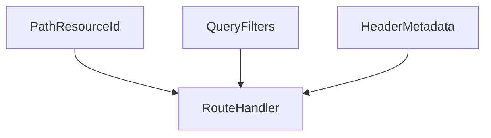

# D06-T007 — Path vs query vs header parameters

Topic ID: `D06-T007`
Domain: API Design and REST
Subdomain: Path vs query vs header parameters
Importance: core
Complexity: intermediate
Dependencies: `D06-T006`, `D06-T001`, `D04-T001`, `D04-T002`, `D05-T001`, `D05-T002`
Execution status of the code in section F: illustrative (not executed in CI for this topic)

## A. Topic Overview

Path parameters identify the resource. Query parameters refine reads: filters, sorts, pagination, sparse fieldsets. Headers carry metadata: auth, content type, conditional requests, idempotency keys, tracing, and negotiated versions.

Placement affects caching, logging, and security. Gateways often log paths and status; bodies may be redacted. Putting secrets in query strings leaks via logs and Referer headers.

## B. First-Principles Explanation

Required resource identity belongs in the path when it is hierarchical (`/accounts/{id}`). Optional modifiers belong in query (`?status=open`). Cross-cutting concerns belong in headers (`Authorization`, `If-Match`, `Idempotency-Key`).

Repeatable query keys and encoding rules must be documented. Array parameters: choose `?tag=a&tag=b` or `?tag=a,b` consistently.

## C. Internal Working and Architecture

Routers bind path templates first; query parsing follows; header middleware runs authentication and optional validation before body parsing. Gateways may normalize or strip headers unless allowlisted.

## D. Diagrams and Visual Models



## E. Examples and Analogies

Path is the street address; query is delivery instructions; headers are postage metadata such as return receipt and insurance.

## F. Code Examples

```http
GET /v1/orders/ord_9?status=open&limit=20
Authorization: Bearer …
If-None-Match: "etag-abc"
```

## G. Practical Backend Application

`Accept-Language` for localization. `Prefer: return=minimal` for partial responses. Validate path params early for auth scope. Never pass secrets in query strings logged at the edge.

## H. Advantages, Limitations and Trade-offs

Clear placement improves cache keys, WAF rules, and supportability. Misplaced auth or filters leak data or break caches.

## I. Common Mistakes and Misconceptions

API keys in query strings, unbounded query arrays, and versioning only in undocumented headers.

## J. Debugging and Troubleshooting

Compare access logs with redacted query params; verify gateway header allowlists when auth works locally but fails in prod.

## K. Interview Preparation

### Beginner

#### Q1. When use path parameters?

**Answer:** When the value identifies a specific resource or parent scope in the hierarchy. Paths are required for routing templates and often for authorization checks. They appear in access logs frequently. Keep values opaque ids rather than mutable labels when possible.

#### Q2. When use query parameters?

**Answer:** For optional filters, sorting, pagination cursors, and sparse field selection on collections. Query strings differentiate cache keys for GET requests. Complex objects may require POST search exceptions documented clearly.

#### Q3. When use headers?

**Answer:** For metadata not part of the resource identity: authentication, content negotiation, validators, idempotency keys, and tracing. Headers can be stripped or added by proxies; document required forwarding. Never put passwords in query strings.

#### Q4. Are headers case-sensitive?

**Answer:** Header names are case-insensitive per HTTP semantics. Treat them case-insensitively when parsing. Values may be case-sensitive depending on scheme.

#### Q5. Can pagination be in the path?

**Answer:** Prefer query cursors on collection paths. Path-encoded pages complicate caching and are harder to evolve. Legacy systems may use path pages; document as exception.

### Intermediate

#### Q1. Idempotency-Key placement?

**Answer:** Header `Idempotency-Key` on mutating requests (`D06-T011`). Not in body alone because intermediaries may replay without parsing JSON.

#### Q2. API version in header vs path?

**Answer:** `Accept: application/vnd.company.v2+json` or `/v2/` prefix (`D06-T010`). Headers enable cleaner URLs; paths are easier to grep in logs.

#### Q3. Sensitive filters in query?

**Answer:** Avoid PII in queries logged at edge. Use POST search or hashed tokens. Apply retention policies on logs.

#### Q4. Content-Type role?

**Answer:** Declares request body format; server returns `415` if unsupported. Pair with charset for text.

#### Q5. If-Match location?

**Answer:** Header on `PUT`/`PATCH`/`DELETE` for concurrency (`D06-T013`).

### Advanced

#### Q1. Gateway header normalization?

**Answer:** Lowercase canonical names internally; forward `Authorization` and tracing headers explicitly.

#### Q2. Duplicate query keys?

**Answer:** Define precedence: first wins vs last wins vs reject duplicates with `400`.

#### Q3. Matrix parameters?

**Answer:** Rare in modern JSON APIs; stick to query conventions unless legacy clients need them.

#### Q4. Field masks via query?

**Answer:** `fields=id,name` reduces payload; document available fields and stability.

#### Q5. Header size limits?

**Answer:** Proxies impose limits; keep JWTs reasonable; use token references if needed.

### Scenarios

#### Q1. API key in query leaked in logs.

**Answer:** Move to header or `Authorization`; rotate keys; scrub logs.

#### Q2. Cache serves wrong language.

**Answer:** `Vary: Accept-Language` or separate paths; include language in cache key.

#### Q3. Tracing lost at gateway.

**Answer:** Forward `traceparent`; inject if missing.

#### Q4. Two clients encode arrays differently.

**Answer:** Publish encoding rules; reject ambiguous duplicates.

#### Q5. Version header stripped.

**Answer:** Configure gateway allowlist; fallback default version with metrics.

### Follow-ups

#### Q1. URL design?

**Answer:** `D06-T002`.

#### Q2. Pagination query params?

**Answer:** `D06-T009`.

#### Q3. Versioning?

**Answer:** `D06-T010`.

## L. Practical Exercises

Solutions: `EXERCISES/solutions/D06-T007.md`.

1. Place parameters for list orders with filters, sort, and page cursor.
2. Fix API key in query security issue.
3. Choose version header versus path for public API.

## M. Revision Notes

- Path = identity; query = modifiers; headers = metadata.
- No secrets in query.
- Document array encoding.

## N. Related Topics

`D06-T002`, `D06-T009`, `D06-T010`, `D06-T011`, `D06-T013`.

## O. Completion Criteria

- Assign parameters to path/query/header correctly.
- Document caching effects of query choice.
- Secure credential placement.
