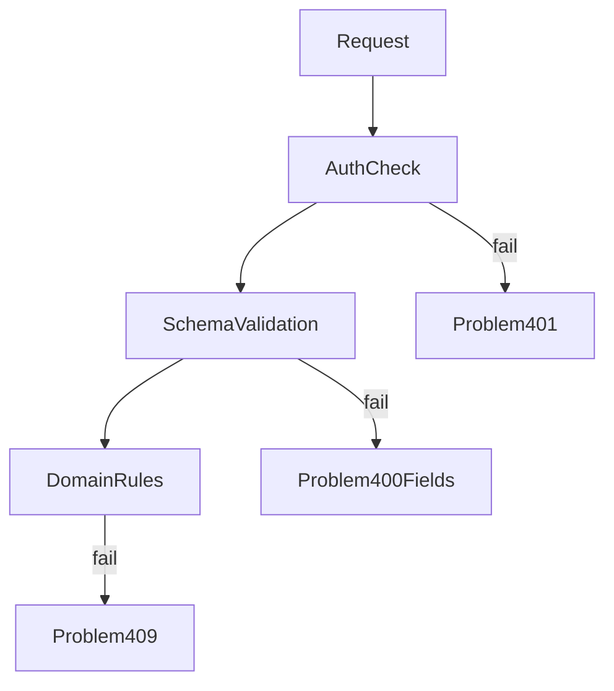

# D06-T008 — Validation and consistent error responses

Topic ID: `D06-T008`
Domain: API Design and REST
Subdomain: Validation and consistent error responses
Importance: core
Complexity: intermediate
Dependencies: `D06-T007`, `D06-T001`, `D04-T001`, `D04-T002`, `D05-T001`, `D05-T002`
Execution status of the code in section F: illustrative (not executed in CI for this topic)

## A. Topic Overview

Validation ensures requests match syntactic and semantic rules before side effects. Consistent error responses let clients branch on stable machine codes instead of parsing English prose.

Use HTTP `4xx` with RFC 9457 Problem Details (`application/problem+json`): `type`, `title`, `status`, `detail`, `instance`, plus extension arrays for field errors.

## B. First-Principles Explanation

Validation layers separate transport parsing, schema checks, and domain invariants. Errors must be machine-stable and human-readable without leaking internals.

## C. Internal Working and Architecture

Middleware validates JSON schema, then handlers enforce business rules. Exception mappers emit problem+json with consistent `type` URIs.

## D. Diagrams and Visual Models



## E. Examples and Analogies

Form errors list every invalid field at once instead of hiding behind a generic “something went wrong.”

## F. Code Examples

```json
{"type":"https://api.example/problems/validation","status":400,"errors":[{"field":"/email","code":"invalid_format"}]}
```

## G. Practical Backend Application

Validate early at gateway and service. Separate auth (`401/403`), not found (`404`), validation (`400/422`), conflict (`409`). Log internal causes; return safe messages. Include `instance` URI or request id.

## H. Advantages, Limitations and Trade-offs

Consistent errors speed client development; over-sharing aids attackers—balance detail.

## I. Common Mistakes and Misconceptions

English-only messages without codes, SQL in 500 bodies, mixed shapes across services.

## J. Debugging and Troubleshooting

Count validation errors by field; spike indicates client bug or undocumented tightening.

## K. Interview Preparation

### Beginner

#### Q1. Why consistent errors?

**Answer:** SDKs map codes to UI flows. Support searches logs by `type` URI. Random messages break automation. Consistency is part of the public contract.

#### Q2. What is problem+json?

**Answer:** A standard JSON envelope for errors with stable `type` identifiers. It complements HTTP status rather than replacing it. Extensions carry field-level issues.

#### Q3. 400 when?

**Answer:** Malformed JSON, wrong types, missing required fields, or out-of-range values. Distinguish from unauthorized access.

#### Q4. Field error shape?

**Answer:** Array of `{field, code, message}` with JSON pointer paths. Codes stable across locales; messages may translate.

#### Q5. Log versus response detail?

**Answer:** Responses stay safe; logs carry stack traces and internal ids redacted appropriately.

### Intermediate

#### Q1. Validation at gateway vs service?

**Answer:** Gateway handles size limits, auth, coarse schema; service enforces domain invariants needing database context.

#### Q2. instance field?

**Answer:** Identifies this specific occurrence, often a request id URL. Helps support correlate without exposing secrets.

#### Q3. Internationalization?

**Answer:** Localize `detail` via `Accept-Language` if product requires; keep `code` stable.

#### Q4. Multiple errors per request?

**Answer:** Return all field errors at once when cheap; avoid whack-a-mole client retries. Clients fix forms in one round trip instead of serial guesses. Servers should cap extremely large validation lists to protect performance. Document any maximum error count in the API guide.

#### Q5. Security of error messages?

**Answer:** Do not confirm account existence via different validation messages unless intentional policy.

### Advanced

#### Q1. Error catalogs?

**Answer:** Publish registry of `type` URIs documenting remediation.

#### Q2. Rate limit errors?

**Answer:** `429` problem type with `Retry-After` (`D06-T012`).

#### Q3. Partial batch failures?

**Answer:** `207` multi-status or per-item problems in body; document pattern.

#### Q4. Webhook delivery errors?

**Answer:** Distinguish customer endpoint failures from payload validation (`D06-T018`).

#### Q5. Testing errors?

**Answer:** Contract tests assert status, type, and field paths for golden bad inputs.

### Scenarios

#### Q1. Clients parse English messages.

**Answer:** Migrate to `code`; deprecate message reliance.

#### Q2. Leaky SQL errors as 500.

**Answer:** Map to generic internal problem; log SQL separately.

#### Q3. Different services different shapes.

**Answer:** Adopt shared library middleware at gateway.

#### Q4. Validation passes; race causes conflict.

**Answer:** Return `409` with conflict code, not validation array.

#### Q5. Huge error payloads.

**Answer:** Cap field error count; summarize overflow count. Attackers should not be able to force megabyte error bodies via deep nested objects. Return a stable `errors_truncated` flag when capping. Log full detail server-side for operators only.

### Follow-ups

#### Q1. Status codes?

**Answer:** `D06-T004`.

#### Q2. Schemas?

**Answer:** `D06-T005`.

#### Q3. Compatibility?

**Answer:** Changing error codes is breaking (`D06-T021`).

## L. Practical Exercises

Solutions: `EXERCISES/solutions/D06-T008.md`.

1. Design problem+json for validation with five field errors.
2. Stop SQL leakage in 500 responses.
3. Standardize errors across three microservices via gateway.

## M. Revision Notes

- problem+json + stable codes.
- Field arrays with pointers.
- Safe external detail.

## N. Related Topics

`D06-T004`, `D06-T005`, `D06-T012`.

## O. Completion Criteria

- Implement shared error middleware.
- Map validation vs conflict.
- Publish error type catalog.
