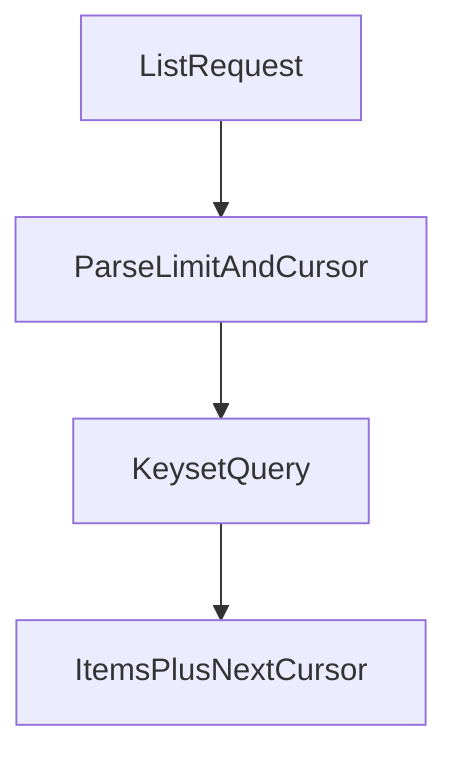

# D06-T009 — Pagination, filtering and sorting

Topic ID: `D06-T009`
Domain: API Design and REST
Subdomain: Pagination, filtering and sorting
Importance: core
Complexity: intermediate
Dependencies: `D06-T008`, `D06-T001`, `D04-T001`, `D04-T002`, `D05-T001`, `D05-T002`
Execution status of the code in section F: illustrative (not executed in CI for this topic)

## A. Topic Overview

List endpoints return slices of large collections. Pagination avoids huge payloads and timeouts. Filtering and sorting let clients query subsets without bespoke RPC endpoints.

**Offset/limit** pagination is simple but unstable when rows insert during paging (duplicates/skips). **Cursor** pagination keys off an opaque token tied to a stable sort key (usually `(created_at, id)`). Document max `limit`, default sort, and whether filters combine with AND semantics.

## B. First-Principles Explanation

Offset computes `SKIP (page-1)*limit` which degrades on deep pages in SQL. Cursor encodes position in sorted order; `next_cursor` in response links forward. Keyset pagination uses `WHERE (created_at, id) > (?, ?) ORDER BY created_at, id LIMIT n`.

Filters belong in query (`?status=open&customer_id=`). Sort uses allowlisted fields (`?sort=-created_at`) to prevent SQL injection via sort parameters.

## C. Internal Working and Architecture

Handlers parse allowlisted query params, build keyset SQL or search queries, and serialize envelope responses with opaque cursors.

## D. Diagrams and Visual Models



## E. Examples and Analogies

Reading a long book with a bookmark (cursor) instead of tearing pages out (offset skips) when new pages are inserted.

## F. Code Examples

```json
{"items":[{"id":"ord_1"}],"next_cursor":"eyJjcmVhdGVkX2F0IjoiLi4uIn0","has_more":true}
```

## G. Practical Backend Application

Return envelope: `{ "items": [], "next_cursor": null, "has_more": false }`. HTTP `Link` header with `rel="next"` is acceptable. Index database columns used in filters and sort. Rate-limit expensive list scans (`D06-T012`).

## H. Advantages, Limitations and Trade-offs

Cursors stabilize feeds; offset is simpler for admin jump-to-page at small scale.

## I. Common Mistakes and Misconceptions

Unstable sorts, unsigned cursors, and unbounded `limit`.

## J. Debugging and Troubleshooting

Duplicate rows across pages: switch to keyset. Slow lists: missing indexes on filter/sort columns.

## K. Interview Preparation

### Beginner

#### Q1. Why paginate?

**Answer:** Large collections exhaust memory, time, and client UI. Pagination bounds response size and database work. It improves reliability under load. APIs should default to sensible limits.

#### Q2. limit parameter?

**Answer:** Clients request page size capped by server max (often 100). Server enforces upper bound to protect DB. Defaults prevent accidental full table scans.

#### Q3. What is a cursor?

**Answer:** An opaque token representing position in a stable sorted stream. Clients pass `cursor=` on the next call. Opaque prevents clients from forging unsafe positions.

#### Q4. Why stable sort?

**Answer:** Without tie-breaker id, equal timestamps reorder between pages. Always sort by primary key as secondary key.

#### Q5. Filtering purpose?

**Answer:** Narrows collection server-side using indexed fields. Document allowed operators and combinations.

### Intermediate

#### Q1. Offset vs cursor trade-offs?

**Answer:** Offset is easy for jump-to-page UIs but slow and inconsistent under writes. Cursor is stable and fast for feeds. Hybrid: offset only for admin tools with warnings.

#### Q2. Encoding cursors?

**Answer:** Base64url JSON of sort keys or signed blobs to prevent tampering. Rotate signing keys carefully.

#### Q3. Reverse pagination?

**Answer:** Provide `prev_cursor` or bidirectional cursors if product needs scroll up.

#### Q4. Total count?

**Answer:** `COUNT(*)` is expensive; make optional `include_total=true` or separate estimate endpoint.

#### Q5. Sort injection defense?

**Answer:** Allowlist fields; map to columns internally; reject unknown sort keys with `400`.

### Advanced

#### Q1. Multi-field filters?

**Answer:** Define grammar; reject ambiguous OR without parentheses. Document timezone for date filters.

#### Q2. Consistency with replicas?

**Answer:** Cursor may skip/repeat rows if reading from async replica; use primary for strict reads or tolerate lag in docs.

#### Q3. Elasticsearch vs SQL pagination?

**Answer:** Search after pattern in ES; scroll APIs for batch not user paging.

#### Q4. GraphQL pagination?

**Answer:** Relay cursors differ but same principles (`D06-T020`).

#### Q5. Export all rows?

**Answer:** Separate async export job, not giant `limit=999999`.

### Scenarios

#### Q1. Users see duplicate rows across pages.

**Answer:** Switch from offset to keyset; fix sort tie-breaker.

#### Q2. Deep page timeouts.

**Answer:** Disallow large offsets; cursor only.

#### Q3. Client forges cursor.

**Answer:** Sign cursors or validate decoded keys within tenant scope.

#### Q4. Filter on unindexed column.

**Answer:** Add index or reject filter.

#### Q5. Sort by PII field disallowed.

**Answer:** Remove from allowlist; return `400`.

### Follow-ups

#### Q1. Parameters?

**Answer:** `D06-T007`.

#### Q2. Caching lists?

**Answer:** `D06-T014` cautiously; personalized lists `private`.

#### Q3. Rate limits?

**Answer:** `D06-T012` on heavy queries.

## L. Practical Exercises

Solutions: `EXERCISES/solutions/D06-T009.md`.

1. Design cursor pagination for `orders` sorted by `created_at`.
2. Fix duplicate rows from offset paging under concurrent inserts.
3. Publish allowlisted filters and sorts with OpenAPI parameters.

## M. Revision Notes

- Prefer cursor/keyset for large feeds.
- Stable sort with tie-breaker id.
- Allowlist sort fields; cap limit.

## N. Related Topics

`D06-T007`, `D06-T012`, `D06-T014`, `D06-T020`.

## O. Completion Criteria

- Implement keyset pagination API.
- Explain offset instability.
- Defend against sort injection.
