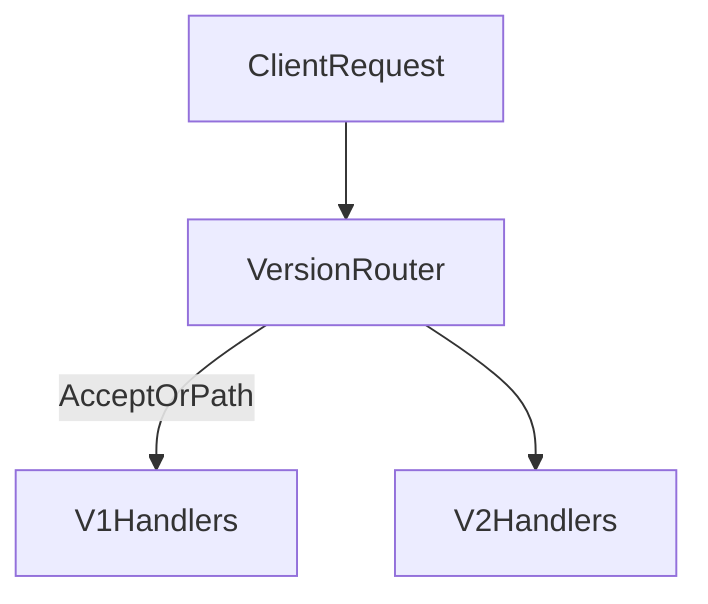

# D06-T010 — Versioning strategies

Topic ID: `D06-T010`
Domain: API Design and REST
Subdomain: Versioning strategies
Importance: core
Complexity: intermediate
Dependencies: `D06-T009`, `D06-T001`, `D04-T001`, `D04-T002`, `D05-T001`, `D05-T002`
Execution status of the code in section F: illustrative (not executed in CI for this topic)

## A. Topic Overview

API versioning lets you ship breaking changes without silently breaking old clients. Common strategies: URL prefix (`/v1/`), custom media type in `Accept` (`application/vnd.example.v2+json`), or header (`API-Version: 2`).

Pick one primary mechanism per public API and document defaults when version is omitted. Version identity should affect routing, schemas, and deprecation headers together (`D06-T019`).

## B. First-Principles Explanation

Versioning isolates incompatible contracts while allowing additive evolution within a major line.

## C. Internal Working and Architecture

Major versions bump on breaking changes; minor additive changes stay within major when following compatibility rules (`D06-T021`). Gateways route `/v1` and `/v2` to adapters. Sunset old versions with metrics on traffic share.

## D. Diagrams and Visual Models



## E. Examples and Analogies

Major versions are new editions of a textbook; minor releases add footnotes without rewriting chapters.

## F. Code Examples

```http
GET /v2/invoices/inv_1
Accept: application/vnd.example.v2+json
```

## G. Practical Backend Application

Document default version; emit deprecation headers on old majors; monitor traffic share.

## H. Advantages, Limitations and Trade-offs

URL versions are obvious; media-type versions keep URLs clean but are harder to grep.

## I. Common Mistakes and Misconceptions

Silent breaking changes within `/v1`, conflicting version signals, and unversioned error shape changes.

## J. Debugging and Troubleshooting

Clients hitting wrong major: check gateway routing and SDK defaults.

## K. Interview Preparation

### Beginner

#### Q1. Why version APIs?

**Answer:** Deployed clients cannot update instantly when servers change. Versioning isolates breaking contract changes. It sets expectations for support and deprecation. Without versions, you freeze evolution or break integrators.

#### Q2. URL versioning?

**Answer:** Paths like `/v1/users` are visible in logs and easy to route. They clutter URLs slightly. Many public APIs use this pattern successfully.

#### Q3. Header versioning?

**Answer:** Keeps URLs stable while negotiating representation version. Requires clients to set headers consistently. Gateways must forward version headers.

#### Q4. Media type versioning?

**Answer:** `Accept` header selects vendor media type with major version embedded. Aligns with content negotiation. Tools must understand custom media types.

#### Q5. What is default version?

**Answer:** Behavior when client sends no version selector. Often latest stable or oldest supported; document clearly.

### Intermediate

#### Q1. Breaking vs non-breaking within v1?

**Answer:** Additive changes stay in v1 per compatibility checklist. Breaking changes require v2 or explicit flag with sunset.

#### Q2. Versioning OpenAPI?

**Answer:** Separate documents or single doc with tags; publish per major version (`D06-T016`).

#### Q3. Internal vs external versioning?

**Answer:** Internal services may iterate faster; edge gateway presents stable external version.

#### Q4. Combine URL and header?

**Answer:** Avoid conflicting signals; pick canonical source of truth.

#### Q5. Database migrations across versions?

**Answer:** Shared storage with adapters mapping views; expand-contract (`D06-T006`).

### Advanced

#### Q1. GraphQL versioning?

**Answer:** Avoid breaking schema; deprecate fields (`D06-T020`).

#### Q2. Long tail of v1 traffic?

**Answer:** Charge or limit; communicate shutdown; proxy translate if feasible.

#### Q3. Version in SDKs?

**Answer:** Pin default major; expose configuration.

#### Q4. Global gateways?

**Answer:** Path-based routing at edge; blue/green per version.

#### Q5. Legal contracts on versions?

**Answer:** Enterprise SLAs may pin major for years.

### Scenarios

#### Q1. Mobile on v1 years later.

**Answer:** Maintain v1 security patches; block new features; sunset plan.

#### Q2. Accidental v2 breaking field.

**Answer:** Hotfix adapter; extend v1 parity.

#### Q3. CDN caches wrong version.

**Answer:** Include version in cache key path or `Vary`.

#### Q4. Partners ignore deprecation headers.

**Answer:** Enforce quotas; direct outreach; hard cutoff date.

#### Q5. Monolith extracts microservice.

**Answer:** Gateway keeps `/v1` facade stable.

### Follow-ups

#### Q1. Deprecation?

**Answer:** `D06-T019`.

#### Q2. Compatibility rules?

**Answer:** `D06-T021`.

#### Q3. Evolution?

**Answer:** `D06-T006`.

## L. Practical Exercises

Solutions: `EXERCISES/solutions/D06-T010.md`.

1. Choose versioning scheme for public payments API.
2. Plan v1 to v2 migration with dual routing.
3. Define cache keys when versioning via Accept header.

## M. Revision Notes

- One canonical version mechanism.
- Major for breaking; additive in place when safe.
- Deprecate with metrics.

## N. Related Topics

`D06-T006`, `D06-T019`, `D06-T021`, `D06-T016`.

## O. Completion Criteria

- Compare URL vs media-type versioning.
- Design gateway routing for two majors.
- Tie versioning to deprecation policy.
