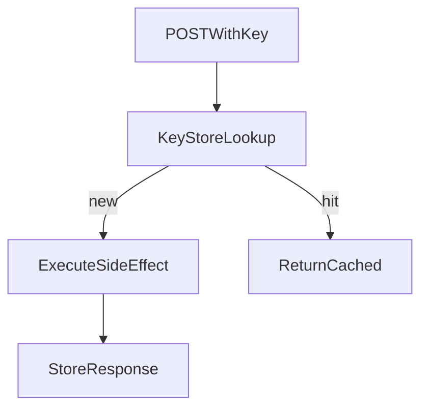

# D06-T011 — Idempotency keys

Topic ID: `D06-T011`
Domain: API Design and REST
Subdomain: Idempotency keys
Importance: core
Complexity: intermediate
Dependencies: `D06-T010`, `D06-T001`, `D04-T001`, `D04-T002`, `D05-T001`, `D05-T002`
Execution status of the code in section F: illustrative (not executed in CI for this topic)

## A. Topic Overview

`Idempotency-Key` (header) lets clients safely retry `POST` and other non-idempotent operations. The server stores the first successful result keyed by `(tenant, key)` and replays the same status, headers, and body on duplicates.

Keys must be unique per logical operation from a given client credential scope. Reusing a key with a different request body should return `409 Conflict`. TTL (often 24 hours) bounds storage.

Complements HTTP method idempotency (`D06-T003`).

## B. First-Principles Explanation

Application idempotency deduplicates logical operations when HTTP methods are not idempotent.

## C. Internal Working and Architecture

Accept UUID v4 keys from clients. Persist before side effects (outbox) or use unique constraint on `(idempotency_key)` in payments table. Hash body to detect mismatches. Return cached response on in-flight duplicate with `202` optional lock pattern.

## D. Diagrams and Visual Models



## E. Examples and Analogies

A bank teller recognizes duplicate deposit slips by slip number instead of cashing twice.

## F. Code Examples

```http
POST /v1/payments
Idempotency-Key: 7e9c5c2a-… 
```

## G. Practical Backend Application

Require keys on payment endpoints; document TTL; metric replay hits.

## H. Advantages, Limitations and Trade-offs

Keys enable safe retries; storage and locking add complexity.

## I. Common Mistakes and Misconceptions

Reusing keys across different bodies, caching failures, and stripping headers at gateways.

## J. Debugging and Troubleshooting

Double charges: verify store scope and body hash checks.

## K. Interview Preparation

### Beginner

#### Q1. Why idempotency keys?

**Answer:** Networks and clients retry `POST` on timeouts. Without keys, retries create duplicate payments or orders. Keys make logical operations safe to repeat. This is application-level idempotency beyond HTTP verbs.

#### Q2. Where is the key sent?

**Answer:** HTTP header `Idempotency-Key` on mutating requests. Headers survive gateway retries better than only body fields. Document required length and charset.

#### Q3. What is replayed?

**Answer:** Same HTTP status, headers (filtered), and body as first completion. Clients must treat replay as success of original intent.

#### Q4. TTL purpose?

**Answer:** Storage cannot grow forever; after TTL a reused key may execute again. Choose TTL longer than client retry window.

#### Q5. Who generates keys?

**Answer:** Clients generate unique keys per operation attempt family. Servers may reject missing keys on critical endpoints.

### Intermediate

#### Q1. Same key different body?

**Answer:** Return `409` indicating key reuse mismatch. Prevents accidental cross-request deduplication.

#### Q2. In-flight concurrent duplicates?

**Answer:** Second request waits or receives `409`/`202` until first completes; use row lock or lease.

#### Q3. Keys and multi-tenant?

**Answer:** Scope store by `tenant_id` and auth subject to prevent cross-tenant collision.

#### Q4. Partial failure?

**Answer:** Only cache responses after commit; rolling back must not cache success.

#### Q5. Stripe-like behavior?

**Answer:** Industry pattern for payments APIs; emulate documented semantics for integrator trust.

### Advanced

#### Q1. Database unique constraint?

**Answer:** `UNIQUE(idempotency_key)` plus status column ensures one row per payment.

#### Q2. Distributed idempotency?

**Answer:** Redis SETNX with TTL or Dynamo conditional writes; still require durable outcome store.

#### Q3. GraphQL mutations?

**Answer:** Same header on HTTP POST carrying GraphQL (`D06-T020`).

#### Q4. Webhook idempotency?

**Answer:** Event id dedupe on consumer (`D06-T018`).

#### Q5. Testing?

**Answer:** Send parallel duplicate keys; assert single side effect.

### Scenarios

#### Q1. Double charge fixed by keys.

**Answer:** Backfill key requirement; replay tests in staging.

#### Q2. Key reused monthly.

**Answer:** Client bug; reject or treat as new after TTL with monitoring.

#### Q3. Gateway strips header.

**Answer:** Allowlist `Idempotency-Key` forwarding.

#### Q4. 500 after success cached?

**Answer:** Client retries get cached 201; monitor cache hit metric.

#### Q5. Body changed slightly on retry.

**Answer:** Hash mismatch `409`; client generates new key for new intent.

### Follow-ups

#### Q1. HTTP methods?

**Answer:** `D06-T003`.

#### Q2. Status codes?

**Answer:** `D06-T004` for `409`.

#### Q3. Headers placement?

**Answer:** `D06-T007`.

## L. Practical Exercises

Solutions: `EXERCISES/solutions/D06-T011.md`.

1. Design Redis + Postgres idempotency store for payments.
2. Handle concurrent duplicate keys safely.
3. Document client retry policy with keys.

## M. Revision Notes

- Header on POST mutations.
- Replay identical response; mismatch -> 409.
- TTL and tenant scope.

## N. Related Topics

`D06-T003`, `D06-T004`, `D06-T007`, `D06-T018`.

## O. Completion Criteria

- Implement key store with body hash.
- Explain TTL and replay rules.
- Test parallel duplicates.
